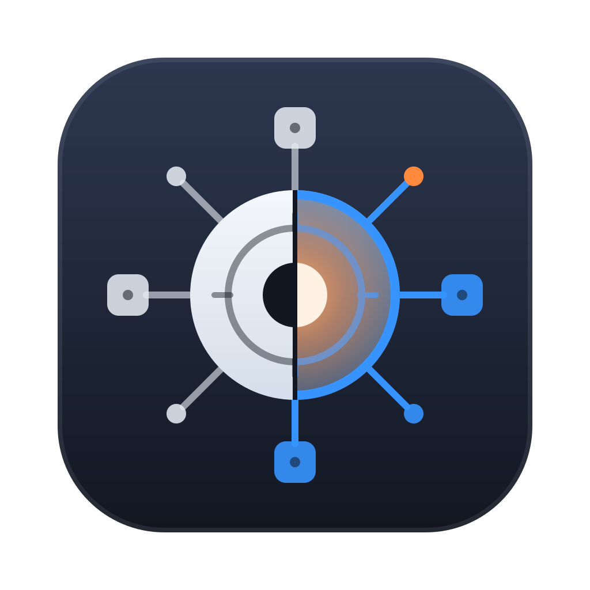
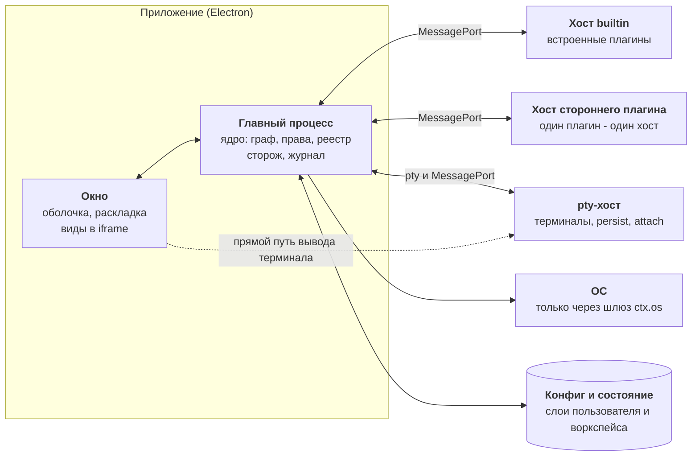

<p align="center">
  
</p>

<h1 align="center">Cyborg Harness</h1>

<p align="center">
  <b>Микроядро для настольных приложений на плагинах</b>
  <br />
  Загрузка и изоляция плагинов, контракты вместо общих сервисов, терминалы как ресурс ядра, виды во фреймах, права словами.
  <br />
  Ядро ничего не знает о вашей предметной области.
  <br />
  <br />
  <a href="https://github.com/dex-it/cyborg-harness/actions/workflows/ci.yml"></a>
  
  
  
  
  <br />
  <br />
  <a href="#зачем">Зачем</a>
  ·
  <a href="#возможности">Возможности</a>
  ·
  <a href="#быстрый-старт">Быстрый старт</a>
  ·
  <a href="#плагин-за-пять-минут">Плагин</a>
  ·
  <a href="docs/guide/start/index.md">Документация</a>
  ·
  <a href="#разработка">Разработка</a>
</p>

## Зачем

Приложение, которое растёт функциями, рано или поздно превращается в один большой главный процесс: агент, сессии, файлы, проекты, трекеры лежат рядом и знают друг о друге. Добавить функцию значит править всё; сбой одной функции роняет окно.

Harness переворачивает это. В ядре нет ни агента, ни файлов, ни проектов, ни трекеров: только то, что нужно любому набору плагинов.

- **Плагины как равные**: агент, сессии, дерево файлов, просмотрщик, git и трекеры - плагины на одних и тех же правилах. Поставка приложения - это список встроенных плагинов.
- **Контракты вместо общих сервисов**: плагин объявляет в манифесте, что он даёт и что ему нужно от других. Ядро строит граф до запуска кода и сразу видит циклы, пропавших поставщиков и несовместимые версии.
- **Сбой изолирован**: плагины работают в отдельных процессах-хостах под сторожем. Зависший или упавший плагин получает страйк, а после трёх подряд выключается, окно и терминалы продолжают работать.
- **Права словами**: плагин видит файловую систему, процессы, сеть и окружение только через ядро и только в объявленных областях. Человек видит права обычными словами, а не флагами.

> [!NOTE]
> Harness не фреймворк интерфейса и не менеджер пакетов. Он решает одну задачу: безопасно собрать приложение из независимо развивающихся частей и не дать одной части сломать остальные.

## Возможности

Подробности по каждой возможности - на [сайте документации](docs/guide/features/index.md).

| | |
|---|---|
| [**Плагины и жизненный цикл**](docs/guide/features/plugins.md) | Манифест разбирается до запуска кода. Ленивая активация по команде, сочетанию, показу вида или потребителю; выгрузка с зависимыми; безопасный режим, в котором ни один плагин не стартует; удаление плагина вместе с его данными, секретами и правами. |
| [**Контракты**](docs/guide/features/contracts.md) | `provides`, `requires`, `optional`, `consumes` с кратностью one и many. Версии контрактов по мажору, `@deprecated` в журнале, отмена запросов между плагинами, подписки без шины событий. |
| [**Хосты и сторож**](docs/guide/features/hosts.md) | Хосты на `utilityProcess` с группировкой по настройке. Сторож находит виновника зависания: хост сам сообщает, чей код выполнялся. Падение хоста не трогает окно, соседние хосты и терминалы. |
| [**Терминалы**](docs/guide/features/terminals.md) | pty - ресурс ядра в отдельном процессе-хосте. Переживает перезапуск плагина, хоста и окна (`persist`, `attach`); вывод идёт к виду мимо хоста плагина; пределы ввода и вывода, льготное время для осиротевших процессов. |
| [**Виды во фреймах**](docs/guide/features/views.md) | Каждый вид - `<iframe>` с origin `cyborg-plugin://<группа>/` и строгой CSP. Мост узнаёт плагин по origin, а не по словам вида. Набор элементов `cy-*` в теме приложения, диалоги, тема, память вида. |
| [**Раскладка и меню**](docs/guide/features/layout.md) | Плагин объявляет вид с областью и порядком, документы с типом, вклады в меню. Каркас окна рисуется по манифестам до кода плагинов; замок закрывает окно экраном плагина. |
| [**Сочетания клавиш**](docs/guide/features/keys.md) | Единый реестр: статические и условные сочетания, меню и акселераторы без конфликтов, переназначение пользователем. Перехват работает и тогда, когда фокус внутри фрейма вида. |
| [**Права и `ctx.os`**](docs/guide/features/permissions.md) | `fs`, `process`, `pty`, `net`, `env`, `notify`, `clipboard`, `shell`, `dialog`, `serve`, секреты. Области, маски, закреплённые аргументы программ, квоты, окно согласия теми же словами, что список прав в «Плагинах». |
| [**Конфиг и состояние**](docs/guide/features/config-state.md) | `config` и `state` по разделам со схемами и `migrate`; слои пользователя и воркспейса; ссылки `$secret` вместо секретов в файлах; повреждённый файл не затирается. |
| [**Воркспейсы**](docs/guide/features/workspaces.md) | Воркспейс - главная сессия: файл, замок, «Недавние», свой набор плагинов и настроек. Несколько воркспейсов открываются отдельными окнами. |
| [**Окно и система**](docs/guide/features/window-system.md) | Уведомления с кликом и закрытием, заголовок окна, события фокуса, питания и блокировки экрана. |
| [**Версии и совместимость**](docs/guide/features/versions.md) | API плагина зафиксирован как 1.0 и защищён снимком под тестом; плагин объявляет `engines.cyborg`; ядро называет причину отказа одним словом: версия. |

## Быстрый старт

Нужны:

- macOS или Linux (на Windows не проверялось);
- Node.js 24 и npm;
- Electron 45 в приложении, которое подключает ядро.

Подключите пакеты в приложение:

```bash
npm install @cyborg-harness/core @cyborg-harness/electron @cyborg-harness/contracts
```

> [!NOTE]
> Пакеты `@cyborg-harness/*` и команда `cyborg-plugin` публикуются задачами [P-01](https://github.com/dex-it/cyborg-harness/issues/29), [P-02](https://github.com/dex-it/cyborg-harness/issues/34), [P-05](https://github.com/dex-it/cyborg-harness/issues/39), [P-09](https://github.com/dex-it/cyborg-harness/issues/9). Пакеты scope `@cyborg` на npmjs.com к проекту не относятся. До выпуска работайте из репозитория (`npm ci`, `npm start`).

Пакет `@cyborg-harness/core` - ядро без зависимостей и без Electron, `@cyborg-harness/electron` - готовые хосты, адаптер ОС, схема `cyborg-plugin://`, мост видов и оболочка вида, `@cyborg-harness/contracts` - типы контрактов и API плагина.

Чтобы посмотреть ядро вживую, не подключая его к своему приложению, запустите стенд из этого репозитория:

```bash
git clone https://github.com/dex-it/cyborg-harness.git
cd cyborg-harness
npm ci
npm start
```

Откроется окно playground: сессия агента слева, справа вкладки плагинов, видов, документов, сообщений, журнала и клавиш. Там можно выключить плагин, уронить или повесить его хост и посмотреть, как сторож называет виновника.

## Плагин за пять минут

```bash
cp -R templates/plugin my-plugin
cd my-plugin
npm test
```

В клоне после `npm ci`; шаблон и порядок переименования - [Первый плагин](docs/guide/start/first-plugin.md).

Плагин - каталог с манифестом и точкой входа. Манифест:

```json
{
  "id": "greeter",
  "version": "1.0.0",
  "engines": { "cyborg": "^1" },
  "provides": { "my.greeting": "1.0" },
  "commands": { "greeter.hello": {} },
  "keybindings": [{ "key": "CmdOrCtrl+Shift+G", "command": "greeter.hello" }],
  "ui": { "views": { "main": "./ui/ui.js" } }
}
```

Главная часть:

```ts
import type { PluginModule } from '@cyborg-harness/contracts';

declare module '@cyborg-harness/contracts' {
  interface Contracts {
    'my.greeting': { 1: { greet(name: string): Promise<string> } };
  }
}

const greeter: PluginModule = {
  activate(ctx) {
    ctx.commands.register('greeter.hello', () => ctx.log('привет'));
    ctx.contracts.provide('my.greeting', '1.0', { greet: async (name: string) => `привет, ${name}` });
    return undefined;
  },
};

export default greeter;
```

Дальше `cyborg-plugin check` проверит манифест, импорты и права, `cyborg-plugin build` соберёт главную часть и вид вместе с зависимостями, `cyborg-plugin pack` упакует плагин для поставки. Подробно - в [руководстве автору плагина](docs/guide/authors/index.md).

## Сочетания окна

| Действие | Linux | macOS |
|---|---|---|
| Следующая и предыдущая область окна | `F6`, `Shift+F6` | `F6`, `Shift+F6` |
| Закрыть окно замком (плагин `pin-lock`) | `Ctrl+Shift+L` | `Cmd+Shift+L` |
| Остальные | назначают плагины и пользователь | |

Любое сочетание плагина можно переназначить в разделе `plugins.keybindings`. Полный список - в [справке](docs/guide/reference/hotkeys.md).

## Как это устроено



Ядро живёт в главном процессе и не импортирует Electron. Плагины работают в хостах (`utilityProcess`), каждый вид - в своём `<iframe>`. Что бы плагин ни делал с системой, он делает это через шлюз `ctx.os`, который сверяет вызов с правами из манифеста. Подробно - жизнь плагина, границы доверия, данные на диске и решения - на странице [«Архитектура»](docs/guide/concepts/architecture.md).

## Границы

- **Не знает предметной области**: в ядре нет агента, файлов, проектов, трекеров и шины событий. Их приносят плагины и объявляют свои контракты.
- **Не изолирует код встроенных плагинов от самого себя**: плагины одного хоста живут в одном процессе и могут помешать друг другу; граница доверия - процесс хоста. Сторонний плагин всегда получает свой хост.
- **Не запускает код стороннего плагина без согласия**: установка из внешнего источника и процесс на плагин с `--permission` - второй этап изоляции, он включается, когда появится плагин от автора вне команды.
- **Не хранит секреты в открытом виде**: значения лежат в хранилище ОС (`safeStorage`), в файлах - только ссылки `$secret`.
- **Не кладёт предметные данные в свои файлы**: разделы `config` и `state` принадлежат плагинам, ядро лишь проверяет их по схеме.

## Статус

Ранняя версия: ядро и стенд запускаются из исходников, подписанных сборок нет. Проверено на macOS (Apple Silicon) и Linux; каждый PR проходит CI на обеих системах. Эта страница описывает ядро в том виде, в каком его завершает [эпик микроядра](https://github.com/dex-it/cyborg-harness/issues/15); что уже сделано, а что в работе, показывает [дорожная карта](docs/guide/development/roadmap.md). Windows и второй этап изоляции пока не поддерживаются.

## Документация

Страницы документации лежат в [`docs/guide/`](docs/guide/start/index.md): установка, возможности, устройство, руководство автору плагина, справка, разработка. Из них же собирается сайт (`site/`); публичный адрес появится, когда станут доступны GitHub Pages (репозиторий приватный). Требования и решения проекта лежат в [`docs/`](docs/README.md): стратегия, BRD и SRS, сценарии, SAD, ADR, замеры, дорожная карта.

## Разработка

```bash
npm run build         # сборка стенда в playground/dist/
npm run typecheck     # проверка типов (TypeScript 7)
npm run lint          # ESLint, ноль предупреждений
npm test              # тесты ядра и стенда (node --test)
npm run smoke         # дымовой тест окна: плагины, виды, клавиши, терминал (нужен дисплей)
npm run spike:hosts   # замер хостов: память, цена вызова, пороги сторожа
npm run spike         # замер фреймов: память и процессы на свой и общий origin
npm start             # сборка и запуск стенда
```

Код: `core/` - ядро, `contracts/` - пакет контрактов, `playground/` - стенд и базовые плагины, `docs/` - проектные документы и страницы сайта (`docs/guide/`), `site/` - сборка сайта (Astro и Starlight).

Каждый PR и пуш в `master` проверяет GitHub Actions на macOS и Linux ([`ci.yml`](.github/workflows/ci.yml)): установка, сборка, типы, линтер, тесты и `smoke`. Сайт собирается и публикуется отдельным workflow ([`docs-site.yml`](.github/workflows/docs-site.yml)).

План работ - [эпик «Микроядро»](https://github.com/dex-it/cyborg-harness/issues/15) и [дорожная карта](docs/05-plans/roadmap.md); правила для задач и меток - на странице [«Разработка»](docs/guide/development/index.md).
