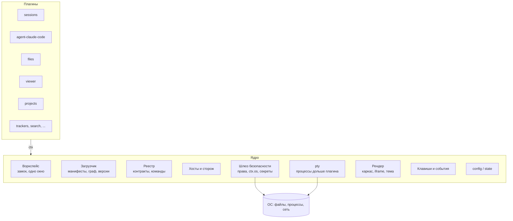
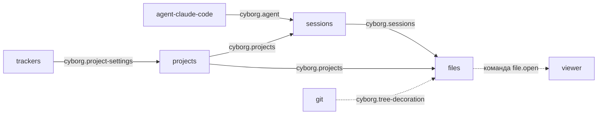
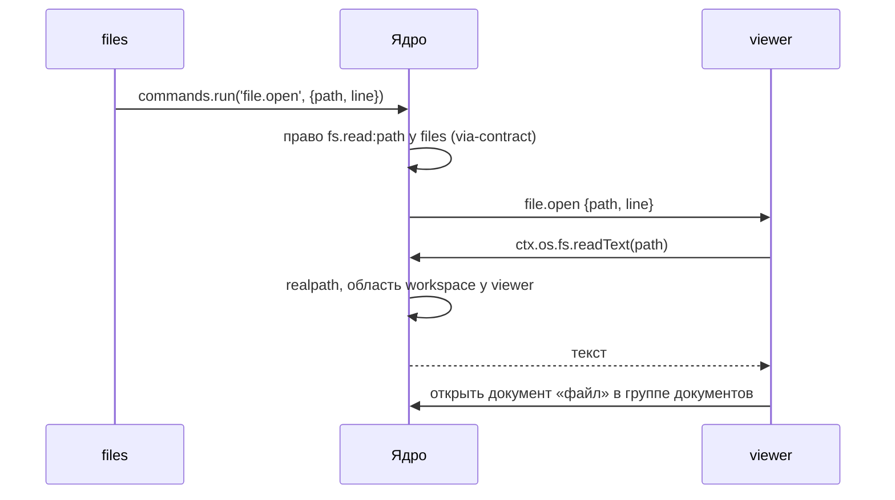

# SAD: ядро и плагины

> Архитектура Cyborg Harness: договорённости владельца и составителя с 2026-11-02, сверенные с кодом репозитория. Пометка «Сделано» у цели называет код и тест; что осталось - [дорожная карта](../../05-plans/roadmap.md). Первая редакция пакета ([SAD от 2026-11-02](https://github.com/dex-it/cyborg-harness/blob/23922d0c65b3fdf7d6e670330ffb36569ffd5913/docs/03-architecture/design/sad.md), ADR-CH-0001..0008) расходится с этим документом в [разделе 7](#7-расхождения-с-первой-редакцией-пакета); действует этот документ. Решения проверены замерами в Electron, разбором аналогов и сверкой с кодом ([ресёрч-2](../../research/sad2-validation.md)); что изменилось по итогам - [раздел 10](#10-правки-по-итогам-проверки).

## 1. Общая архитектура

Cyborg - это **ядро** и набор **равных плагинов**. Ядро не знает предметной области: в нём нет агентов, сессий, файлов, проектов и трекеров. Всё это плагины. Ядро открывает воркспейс, загружает плагины, связывает их, изолирует их сбои, следит за правами и даёт им экран, клавиши и хранение.



**Процессы.**

| Процесс | Что в нём |
|---|---|
| Главный (Electron main) | ядро: воркспейс, загрузчик, реестр, сторож, шлюз, `config` и `state`; запускает хосты плагинов и pty-хост |
| pty-хост (`utilityProcess` ядра) | процессы pty (`node-pty`) и кольцевые буферы их вывода; код плагинов не исполняет ([3.6](#36-ресурсы-дольше-плагина-pty)) |
| Хосты плагинов (`utilityProcess`, один или несколько) | главные части плагинов по группам ([3.5](#35-изоляция-сбоев-хосты-и-сторож)); плагин видит только `ctx`; во втором этапе сторонний плагин - в своём процессе с `--permission` и `Compartment` вторым слоем |
| Рендерер | каркас окна от ядра; UI каждого плагина - в своём `<iframe>` с origin его группы рендера `cyborg-plugin://<группа>/` ([3.8](#38-изоляция-рендера)) |

Код плагина ходит к ОС только через ядро. В первом этапе это дисциплина, которую проверяют тесты, во втором - граница процесса на плагин ([раздел 6](#6-этапы)).

## 2. Что есть ядро

Ядро - хост плагинов: оно открывает воркспейс, загружает, связывает и изолирует плагины, контролирует их доступ к ОС и даёт им экран, клавиши и хранение.

**Компактность - ограничение на всё ядро.** Задача попадает в ядро, только если выполнены оба условия:

1. она нужна всем плагинам или окну без плагинов;
2. плагин не может решить её сам, не нарушив гарантию, которую ядро даёт остальным.

Проекты - плагин: они нужны не всем, и `projects` справляется сам. pty - в ядре: процесс должен пережить перезапуск своего плагина, а этого плагин себе не гарантирует. «Недавние» - в ядре: воркспейс выбирается до загрузки любого плагина. Шина событий - нигде: связь идёт через API владельца.

**Накладные расходы - с бюджетом.** Время старта, память на хост и на `<iframe>`, задержка вызова через шлюз и вывода терминала задаются числами; против чего мерить и сами числа - открытый вопрос 9.

**В ядре нет:** агента и его запуска, сессий и их восстановления, дерева файлов, просмотрщика, проектов, трекеров, уведомлений о сессиях, источников секретов, общей шины событий, реестра сервисов по произвольным ключам, `inject`, waterfall и guard.

**Центральных плагинов нет.** Ядро не выделяет ни один плагин, в коде ядра нет имён плагинов. Окно без плагинов - нормальное состояние: в нём доступно управление плагинами. Поставка Cyborg - это список встроенных плагинов и больше ничего.

## 3. Цели ядра

| | Цель | Что гарантирует |
|---|---|---|
| [3.1](#31-воркспейс-как-главная-сессия) | Воркспейс как главная сессия | один экземпляр - один воркспейс - одно окно и одно согласованное состояние |
| [3.2](#32-загрузка-плагинов) | Загрузка плагинов | сломанный граф виден до запуска кода; окно без плагинов работает |
| [3.3](#33-версии-и-миграции) | Версии и миграции | обновление Cyborg или плагина не ломает остальных и не теряет данные |
| [3.4](#34-связь-между-плагинами) | Связь между плагинами | плагины знают друг друга только через контракт |
| [3.5](#35-изоляция-сбоев-хосты-и-сторож) | Изоляция сбоев | зависание или падение плагина не трогает другие хосты, окно и агентов |
| [3.6](#36-ресурсы-дольше-плагина-pty) | Ресурсы дольше плагина | перезапуск хоста или окна не убивает процессы агентов |
| [3.7](#37-безопасность-данных-и-контроль-плагинов) | Безопасность данных и контроль плагинов | плагин делает только объявленное; секреты не попадают в `config`, `state` и журнал |
| [3.8](#38-изоляция-рендера) | Изоляция рендера | плагин рисует только у себя; каркас появляется до кода плагинов |
| [3.9](#39-системные-клавиши-и-события) | Системные клавиши и события | системное сочетание срабатывает одинаково из любого `<iframe>`; конфликт виден при загрузке |
| [3.10](#310-главный-конфиг-и-состояние) | Главный конфиг и состояние | плагин видит только свой раздел; ошибка в разделе ломает только его владельца |

### 3.1. Воркспейс как главная сессия

Воркспейс - главная сессия приложения: файл `config` воркспейса, его `state` и одно окно.

- Открытие: `--workspace <файл>` или «Недавние»; ядро берёт замок `<файл>.lock`.
- **Один экземпляр - один воркспейс - одно окно.** Второй запуск приложения, с тем же воркспейсом или другим, переводит фокус на открытое окно и завершается; другой воркспейс открывается из окна («Недавние», «Открыть…») сменой воркспейса.
- Закрытие окна или смена воркспейса: плагины выключаются через `Disposable`, живые pty завершаются после подтверждения пользователя ([3.6](#36-ресурсы-дольше-плагина-pty)), замок снимается.
- Перезагрузка окна - не закрытие: воркспейс, хосты и pty остаются.
- «Недавние» и окно без воркспейса - забота ядра: выбрать воркспейс нужно до загрузки любого плагина.

**Сделано в ядре.** `core/src/workspace.ts`, тесты - `core/test/workspace.test.ts`: замок `<файл>.lock` с pid и забор замка умершего процесса; `state` по ключу от `realpath` файла; перенос старого `{projects, lastProjectId}` с копией `.v1.bak`; слои config `user` и `workspace`, `plugins.enabled` воркспейса перекрывает пользовательский, группы хостов сливаются; правка файла извне доходит до `ctx.config.onChange`, битый файл не стирает разделы и не перезаписывается. Playground: флаг `--workspace=<файл>`, второй запуск того же воркспейса отдаёт фокус первому окну (`requestSingleInstanceLock`), отказ замка - в окне плагинов.

«Недавние» - `core/src/recent.ts`: список в каталоге приложения, последний открытый первым, без повторов по `realpath`, до 10; файл, которого больше нет, не показывается; битый список не мешает открыть окно. В список попадает только воркспейс, который открылся. Playground: без флага открывается последний из «Недавних»; в шапке окна - текущий воркспейс, «Недавние» кнопками и «Открыть…» (системный диалог). Смена воркспейса - перезапуск приложения с `--workspace`: выход выключает плагины и снимает замок, а при живых pty плагинов окно сначала спрашивает человека. `--no-workspace` - окно без воркспейса: ядро не запускается, в окне только выбор воркспейса. Дымовой тест проверяет «Недавние» после открытия и окно без воркспейса с пропавшим файлом в списке.

Смена `plugins.enabled` в файле без перезапуска - `kernel.setEnabled`, тест - `playground/src/main/plugins.test.ts`: разница со списком из файла, а не с выключенными в окне; убранный выключается вместе с теми, кто требует его через `requires`, вернувшийся включается. Плагин, которого не было в графе при запуске, ждёт перезапуска с записью «включатся после перезапуска» в окне: граф, связи контрактов и зеркала хостов на ходу не перестраиваются. Выключение владельца замка из-под замка - отказ с записью, как из окна.

Ещё нет: включение без перезапуска плагина, которого не было в графе при запуске.

### 3.2. Загрузка плагинов

1. Прочитать `plugins.enabled` (файл пользователя, перекрытый файлом воркспейса). Больше ядру для старта ничего не нужно.
2. Прочитать манифесты, проверить совместимость версий ([3.3](#33-версии-и-миграции)).
3. Разрешить граф контрактов **до запуска кода**: недостающий `requires`, два поставщика при кратности `one`, цикл - плагин не загружается, причина пишется в журнал.
4. Нарисовать каркас окна по манифестам ([3.8](#38-изоляция-рендера)).
5. Разложить плагины по хостам ([3.5](#35-изоляция-сбоев-хосты-и-сторож)) и активировать в порядке графа; активация может быть ленивой - по первому показу вида или первой команде.

- Журнал плагинов: отказы загрузки, ошибки активации, отказы прав, перезапуски хостов; виден в «Плагины Cyborg».
- Безопасный режим выключает все плагины без исключений.
- Выгрузка и загрузка плагина - без перезапуска окна. Выгрузка снимает плагин и тех, кто требует его через `requires`, в обратном порядке активации; потребители через `optional` остаются и получают `onChange`. Хост, где не осталось плагинов, гасится, поэтому загрузка поднимает код в новом процессе. Сторож выгруженный человеком плагин не поднимает. Процессы агентов выгрузку переживают ([3.6](#36-ресурсы-дольше-плагина-pty)).

**Ленивая активация - сделано в ядре.** `"activation": "lazy"` в манифесте: при старте плагин получает состояние «ждёт» (`waiting` в журнале). Будят его первая команда (`run` активирует владельца до вызова; команду плагина, активация которого уже идёт, например после `enable`, `run` тоже ждёт), сочетание (оно перехватывается и у спящего владельца), показ вида (`kernel.wake`, playground зовёт его при первой загрузке файла вида) и активация потребителя: поставщика из `requires` и `optional` ядро поднимает до потребителя, поставщиков `consumes` - без ожидания, иначе встречная пара `consumes` ждала бы сама себя. Выключенный человеком ленивый плагин команда не будит. Тест - `core/test/events.test.ts`, в playground - плагин `later`.

### 3.3. Версии и миграции

**Плагин и API ядра.**

```jsonc
// манифест плагина
"id": "trackers",
"version": "2.3.0",
"engines": { "cyborg": "^1" }   // версия API плагинов: ctx и элементы ядра
```

- Несовместимый `engines.cyborg` - плагин не загружается, причина в журнале.
- Незнакомое поле манифеста - отказ с именем поля, кроме `$schema` для редактора; если при этом `engines.cyborg` не принимает версию API, причина одна - версия API.
- API плагинов версионируется семантически; элемент ядра не удаляется и не меняет атрибуты в пределах мажорной версии.

**Контракты.**

- **Семантические версии.** Минорное изменение: новый необязательный член, новое необязательное поле, новое значение в объединении событий - потребитель обязан пропускать незнакомое. Мажорное: удаление или переименование, новое обязательное поле аргумента, смена смысла.
- **Владение.** Пространство имён `cyborg.*` закреплено за репозиторием Cyborg и пакетом `@cyborg-harness/contracts`. Сторонние контракты называются по автору (`acme.*`) и публикуются своими пакетами объявлений.
- **Переход между мажорными версиями.** Поставщик может давать две версии сразу (`"provides": { "cyborg.sessions": ["1.4", "2.0"] }`); каждый потребитель получает ту, что просил.
- **Устаревание.** Член с пометкой `@deprecated` живёт минимум до следующей мажорной версии; ядро пишет в журнал, кто его вызывает.

**Разделы `config` и `state`.** Плагин обновился и сменил формат, пользователь поправил файл руками и ошибся - ни то, ни другое не должно ронять плагин или окно.

```jsonc
// манифест плагина
"config": { "schema": "./config.schema.json", "version": 3 },
"state":  { "schema": "./state.schema.json",  "version": 1 }
```

- Ядро проверяет раздел по схеме до активации и при изменении файла воркспейса извне (файл отслеживается).
- Версия раздела ниже версии плагина - ядро до активации вызывает `migrate(fromVersion, data)` плагина и сохраняет результат.
- Версия раздела выше (плагин откатили) - плагин не активируется, раздел не трогается, причина в журнале.
- Раздел не прошёл схему - отказ только этому плагину с записью в журнале; остальные работают.

**Сделано в ядре.** Версии и `migrate` - `core/src/config.ts`, тесты - `core/test/config.test.ts` и `core/test/loader.test.ts`. Схема - `core/src/json-schema.ts`, подмножество JSON Schema без зависимостей: `type`, `properties`, `required`, `additionalProperties`, `items`, `enum`, `const`, границы чисел, длины строк и списков, `pattern`, `uniqueItems`; аннотации (`title`, `description`, `default`) пропускаются, а остальные ключи (`$ref`, `oneOf` и другие) - ошибка схемы: автор не должен считать проверенным то, что ядро не проверяет. Путь схемы в манифесте - `./<файл>.json` внутри каталога плагина; файл читает приложение (`readSchemaFile` в `playground/src/main/plugins.ts`) после `realpath`, ссылка наружу - отказ, иначе хост плагина получил бы чужой JSON. Схема проверяет слитое значение раздела вместе с `validate` плагина; нет файла или схема не разбирается - отказ разделу до запуска кода. Правка файла извне не по схеме оставляет значение прежним, отказ - в журнале.

### 3.4. Связь между плагинами

Ядро ведёт реестр контрактов (`provides` / `requires` / `optional` / `consumes`) и реестр команд и передаёт вызовы: между плагинами, между UI и главной частью одного плагина, между хостами. Для плагина вызов выглядит одинаково, в одном хосте поставщик или в другом. Как плагины этим пользуются - [раздел 4](#4-взаимодействие-плагинов).

### 3.5. Изоляция сбоев: хосты и сторож

Главные части плагинов работают не в главном процессе, а в хостах (`utilityProcess`). Плагины одного хоста делят процесс и цикл событий: зависание одного останавливает соседей, падение хоста роняет все его плагины. Поэтому группировкой по хостам управляет пользователь.

```jsonc
"plugins": {
  "enabled": ["sessions", "agent-claude-code", "files", "viewer", "projects", "trackers", "search"],
  "hosts": {
    "builtin":  ["sessions", "agent-claude-code", "files", "viewer", "projects"],
    "trackers": ["trackers", "search"]
  }
}
```

- `plugins.hosts` - часть `config` с теми же уровнями: пользователь и воркспейс.
- **Сторонний плагин всегда один в своём хосте.** Граница доверия ядра - процесс хоста: ядро проверяет, что сообщение пришло из хоста, где живёт названный в нём плагин, а внутри хоста плагины неразличимы. Плагин в общем хосте может писать от имени соседа - в его раздел `config` и `state`, в его команды и контракты. До изоляции этапа 2 ([6.2](#62-этап-2-изоляция-доступа-по-поводу)) так закрыто только между процессами.
  - **Сторонний** - не из поставки Cyborg. Признак поставки - каталог установки, а не манифест: автор пишет в манифест что угодно.
  - Сторонний плагин без группы получает хост со своим id. Группа из него одного действует как переименование хоста. Если пользователь назвал его в группе с другими, ядро всё равно даёт ему отдельный хост и пишет в журнал `host-isolated` с именем группы; «Плагины Cyborg» показывают это предупреждением.
  - Цена - процесс на каждый сторонний плагин. Снять её для доверенного автора можно только вместе с изоляцией этапа 2, а не настройкой.
- Плагины из поставки по умолчанию идут в хост `builtin`; не названный ни в одной группе идёт по умолчанию. Манифест может попросить отдельный хост (`"host": "own"`); пользователь вправе переопределить, но «Плагины Cyborg» показывают предупреждение.
- **Внутри хоста** исключение при активации или в вызове ловит хост: отказывает только этот плагин, с записью в журнале.
- **Сторож.** Ядро регулярно проверяет, отвечает ли хост; нет ответа дольше порога - хост перезапускается. Виновник - при зависании плагин, чей код хост выполнял (хост называет плагин ядру до входа в его код: вызов, событие, таймер, продолжение после ответа ядра), при падении - плагин, чей код завершил процесс (`process.exit`, необработанное исключение); хост виновника не назвал, например процесс убит сигналом, - плагин первого вызова, принятого после последнего отвеченного пинга. Отметка ставится на входах хоста и в его глобальных таймерах: код, запущенный мимо них, и зависание кода самого хоста после плагина записываются на плагин, вошедший последним. После нескольких зависаний подряд плагин выключается с записью в журнале. Падение хоста идёт тем же путём. Пинг раз в 1 с, порог 5 с, выключение после трёх зависаний подряд: порог равен самой долгой синхронной работе, которую плагин вправе сделать без `await`, а обход 230 тыс. записей занимает 2 с ([замер](../../04-verification/spike-hosts.md)).
- Перезапуск хоста не трогает другие хосты, окно и pty ([3.6](#36-ресурсы-дольше-плагина-pty)). Плагины хоста активируются заново; потребители из других хостов узнают о пропаже и возврате поставщика из `ctx.contracts.onChange`.
- **Что видит пользователь.** Пока хост перезапускается, виды его плагинов остаются на месте под плашкой ядра «Перезапуск» и не принимают ввод. Плагин выключен или не поднялся - ядро снимает его виды и ставит на их место заглушку: имя, причина из журнала, «Включить снова» и «Журнал». Плагин без видов при выключении даёт одно уведомление ядра с перечнем плагинов, которые брали его контракты.
- Цена - память на каждый процесс хоста: первый ~56 МБ PSS, каждый следующий ~34 МБ; плагины в одном хосте почти не добавляют ([замер](../../04-verification/spike-hosts.md), Linux). На macOS [ресёрч-2](../../research/sad2-validation.md#21-хост-плагинов-в-utilityprocess) намерил около 15 МБ физического следа и 70-100 мс старта на хост: другая ОС и другая мера (`footprint`, а не PSS).
- У сторожа нет прецедента: в изученных системах зависший локальный хост не перезапускают (VS Code перезапускает только pty-хост и удалённый хост). Поэтому пороги выше заданы замером, а не ориентиром.

### 3.6. Ресурсы дольше плагина: pty

Ресурс ОС, который должен пережить своего владельца, держит ядро. Сегодня это pty: плагин решает, что запустить, ядро запускает процесс и держит его у себя. Ядро не знает, что это агент: для него это pty с программой из права плагина.

**Держит pty не главный процесс, а отдельный `utilityProcess` ядра - pty-хост** (не плагин и не общий хост плагинов). Зависание или падение нативного `node-pty` не должно замораживать окно; в VS Code терминал живёт в отдельном процессе по той же причине. `node-pty` в `utilityProcess` загружается (проверено). Сторож ([3.5](#35-изоляция-сбоев-хосты-и-сторож)) следит и за pty-хостом; при его перезапуске процессы pty теряются, и плагины получают это как завершение.

```ts
// главная часть sessions; запуск описал поставщик cyborg.agent, право pty - у sessions
const spec = await agent.launch({ sessionId, cwd });   // program, args, cwd, env
const pty = await ctx.os.pty.spawn({
  ...spec,
  cols, rows,
  persist: true,                       // пережить перезапуск хоста и окна
});
pty.onData(chunk => { /* разбор для статуса сессии */ });
pty.write(input); pty.resize(cols, rows); pty.kill();

// после перезапуска хоста
for (const info of await ctx.os.pty.list()) {      // только pty этого плагина
  const h = await ctx.os.pty.attach(info.id);      // тот же PtyHandle
  // h.backlog - хвост вывода, накопленный, пока плагина не было
}
```

| | Ядро | Плагин |
|---|---|---|
| что запускать: программа, аргументы, env, cwd | проверяет по праву `pty` | решает |
| процесс (`node-pty` в pty-хосте ядра) | держит | - |
| буфер вывода, пока владельца нет | ведёт | читает при `attach` |
| когда завершать | спрашивает пользователя, если плагин выключают | `kill()` |

- Перезапуск хоста или окна - pty живы, владелец возвращается через `attach`.
- Плагин выключают - ядро спрашивает, завершать ли его процессы. Плагин удалён, воркспейс закрыт или приложение завершается - процессы завершаются.
- Короткие процессы `ctx.os.process` при падении хоста завершаются: их результат больше некому принять. Перезапуск переживает только pty с `persist`.
- Буфер кольцевой, размер на pty - настройка ядра. Хвост сырой и может начинаться посреди escape-последовательности; после `attach` ядро отправляет `resize`, и TUI (`claude`) по `SIGWINCH` перерисовывает экран сам. VS Code и предложение для Zed идут дальше: восстанавливают экран снимком состояния терминала (headless-xterm с сериализацией) вместе с размерами; что выбрать, решит спайк с настоящим `claude` (открытый вопрос 14).
- Осиротевший pty (плагин не вернулся после перезапуска хоста) завершается по истечении льготного времени, как в VS Code; значение - настройка ядра.

**Горячий путь мимо хоста.** Экран терминала живёт в `<iframe>` плагина `sessions`, а у UI-части `ctx.os` нет. Главная часть выдаёт своему UI билет на просмотр:

```ts
// главная часть sessions
const ticket = await pty.share();              // одноразовый, только для своего UI
// UI-часть
const view = await ctx.terminal.open(ticket);  // data / write / resize, мимо хоста
```

Вывод идёт из pty-хоста прямо в `<iframe>` по `MessagePort`, ввод - обратно: хост плагина может зависнуть, а терминал работает. Порт создаёт главный процесс и раздаёт концы, в потоке он не участвует; замер: поток около 1,9 ГБ/с, круг 45 мкс ([ресёрч-2, 3.3](../../research/sad2-validation.md#33-мост-окно---хост-и-задержки)). UI-часть не получает права на pty, ей доступен только процесс, который показала собственная главная часть.

**Сделано в ядре.** Таблица pty - `core/src/pty.ts`, проверка права - общая с `process` в `core/src/os-gateway.ts`, тесты - `core/test/pty.test.ts`. Псевдотерминал ядру даёт приложение (`PtyBackend` по форме `node-pty`), playground - `node-pty` в главном процессе. Есть `spawn` / `list` / `attach`, `write` / `resize` / `kill` с сигналами `SIGTERM`, `SIGKILL`, `SIGINT`, `SIGHUP`; чужой pty для плагина не существует (`NotFound`). Падение хоста: pty с `persist` ждут возврата плагина, прочие завершаются; плагин, которого сторож не поднимет, теряет и `persist`. Выключение плагина спрашивает человека, если у него и уходящих с ним по `requires` есть живые pty: `kernel.disablePreview(id)` называет эти плагины и процессы, `disable(id, { keepPty: true })` оставляет процессы ждать `attach` вернувшегося плагина (как `persist` после падения хоста), без `keepPty` они завершаются; журнал пишет `keptPty`. Окно playground задаёт вопрос модальным `<dialog>` с фокусом на «Оставить работать»; выход из приложения (`kernel.unload`) завершает и оставленные. После `attach` ядро делает шаг размера в сторону и обратно: тот же размер `SIGWINCH` не даёт. Хвост (256 К символов по умолчанию) ядро держит и при живом владельце: после перезапуска им восстанавливается экран программы, которая не перерисует себя сама. Вывод до подписки `onData` хост копит. Горячий путь: `PtyHandle.share()` выдаёт билет (UUID, одноразовый, 30 с), вид предъявляет его через `ctx.terminal.open`; плагин вида приложение берёт из origin фрейма, чужой, просроченный или повторный билет - `NotFound`, и билет гасится при первом предъявлении. Вывод ядро шлёт зрителям из таблицы pty, ввод и размер принимает только от открывшего фрейма (`playground/src/main/view-terminals.ts`), так что зависший или упавший хост терминал не останавливает; дымовой тест останавливает хост `echo` через `SIGSTOP` и печатает в его вид. Дымовой тест выключает `echo` с оставлением, включает снова - вид подхватывает тот же `sh` с прежним выводом, - и выключает с завершением. Ещё нет: pty-хост отдельным процессом - playground держит `node-pty` и таблицу pty в главном процессе, и вывод к зрителям идёт через него, а не по `MessagePort`; льготное время осиротевшего pty; `pty` на Windows не проверялся.

### 3.7. Безопасность данных и контроль плагинов

Доступ к ОС разбит на пространства имён. Нет права в манифесте - нет объекта в `ctx.os`: ни чтения, ни записи.

| Пространство | Что даёт | Право в манифесте |
|---|---|---|
| `fs.read` / `fs.write` / `fs.watch` | файлы | области путей |
| `process` | запуск программ | список программ, опционально первые аргументы |
| `pty` | терминал | список программ; агент стартует через оболочку пользователя (`$SHELL -lc 'exec claude …'`, чтобы получить его `PATH`), поэтому в списке оболочка |
| `net` | HTTP | список хостов |
| `shell` | открыть путь или URL в системе | области путей, схемы URL |
| `clipboard` | буфер обмена | `read` / `write` |
| `notify` | системные уведомления | да / нет |
| `env` | переменные окружения | список имён |
| `secrets` | своё хранилище секретов | не нужно, только свои ключи |
| `secrets.ref` | секреты из внешнего источника по ссылке ([секреты](#секреты)) | маски ссылок: `vault://kv/data/jira*` |
| `dialog` | выбор файла | не нужно, выбор пользователя сам становится правом |
| `ui.lock` | закрыть окно замком ([3.8](#38-изоляция-рендера)) | да / нет; в окне согласия - «может закрыть окно Cyborg», наравне с `process` |

**Области путей:** `workspace` (репозитории проектов и cwd живых сессий; задают плагины с правом `security.roots`), `plugin-data`, `plugin-temp` (всегда свои), явные пути и маски, `granted` (выбор в `dialog`).

**Правила шлюза:**

- вызывающего ядро определяет по каналу, а не со слов плагина;
- путь проверяется после `realpath`, на открытом дескрипторе; вне области - всегда `PermissionDenied`, никогда `NotFound`;
- защищённые пути закрыты всегда: данные приложения, файл воркспейса и замок, запись в `.git/` (кроме явной области `workspace.git`);
- права через чужой контракт не передаются: член контракта объявляет нужное право (`guard` в `provides` поставщика), и шлюз проверяет его у **вызывающего** (`reason: 'via-contract'`);
- каждый отказ пишется в журнал плагинов.

**Честная граница:** `process` и `pty` дают программе все права пользователя ОС. Списки аргументов и запрет опасных флагов - смягчение, а не защита; окно подтверждения показывает такое право как «полный доступ через программу».

**Два класса плагинов.** Честная граница касается немногих: базовым модулям (`sessions`, агенты, `files`, git, поиск) нужны процессы и файлы, и их права широки. Интеграции по HTTP API (Jira, GitHub, GitLab, Confluence, Vault) режутся до сети к своему хосту и своего токена - для них изоляция даёт полную гарантию:

```jsonc
// плагин jira: ни файлов, ни процессов, ни буфера обмена
"permissions": {
  "net": ["config:baseUrl"]   // хост из своего раздела config
}
// токен - в своём хранилище ctx.secrets или ссылкой $secret
```

- Хост из `config:<поле>` ядро берёт из раздела плагина. Окно согласия показывает «ходит на хост из настройки baseUrl: jira.company.com»; смена значения на новый хост требует подтверждения пользователя.
- Трекеры сегодняшнего Cyborg работают через CLI (`gh`, `glab`, `jira`) и токенов в приложении не хранят; пока так, плагину нужно право `process` на эти программы, и он относится к широкому классу. В узкий класс он попадает вместе с переходом на HTTP API.
- Отсюда правило для интеграций: HTTP API, а не CLI. Обёртка над `gh` или `glab` требует `process` и попадает под честную границу; тот же плагин на API остаётся в узком классе.

**Что даёт каждый этап.** В первом этапе хост - обычный процесс Node: шлюз делает права видимыми и ловит ошибки, но плагин, который захочет, достанет `require('node:fs')`. Гарантию «ничего сверх объявленного» для стороннего кода даёт второй этап ([6.2](#62-этап-2-изоляция-доступа-по-поводу)): процесс на плагин с `--permission` и `Compartment` вторым слоем. Одного `Compartment` для этого недостаточно ([ресёрч-2, 2.3 и 4.2](../../research/sad2-validation.md)): общая виртуальная машина пробивается.

**Сделано в ядре.** Шлюз - `core/src/os-gateway.ts`, разбор прав - `core/src/permissions.ts`, тесты - `core/test/os.test.ts`. Есть `fs.read`/`fs.write` с областями `workspace`, `plugin-data`, `plugin-temp` и абсолютными путями, `process` с префиксом аргументов, `net` со списком хостов и `config:<поле>` без переадресации, `env`, `notify`, `clipboard`, `secrets` и `secrets.ref`, `security.roots`; отказ - `PermissionDenied` и запись `denied` в журнале; права словами - в строке плагина окна «Плагины Cyborg». Адаптер Electron (`safeStorage`, `Notification`, `clipboard`) - `playground/src/main/os-env.ts`.

Границы шлюза, закреплённые тестами после ревью безопасности:

- хост `config:<поле>` берётся из config, принятого при активации или после правки файла извне; в само поле плагин пишет только значение, которое уже задал человек в одном из слоёв (иначе `PermissionDenied` и `denied` с методом `config.set`): своя запись не расширяет сеть ни после падения хоста, ни после перезапуска приложения;
- `security.setRoots` принимает только существующий каталог, не корень ФС, не домашний каталог и не предка каталогов приложения;
- `process.run` получает базовое окружение (PATH, HOME, локаль, TERM и системные переменные Windows), а остальные переменные - только по именам из `env` правила; `cwd` проверяется как чтение;
- каталоги других плагинов и каталог данных приложения закрыты при любом праве, кроме корней проектов, которые задаёт само приложение;
- `fs.remove` не удаляет корень области и каталог с `.git` внутри;
- хост без порта в `net` пускает только на порт схемы по умолчанию;
- временный каталог по умолчанию свой на каждый запуск, а не общий в `/tmp`.

Пределы ресурсов главного процесса, закреплённые тестами `core/test/os-lifetime.test.ts`:

- `process.run` запускает программу лидером своей группы процессов (POSIX): `timeoutMs` шлёт `SIGTERM`, а выключение, выгрузка и падение хоста плагина - `SIGKILL` всей группе, так что сборки и серверы, запущенные программой, не остаются сиротами; pty адаптер Electron гасит так же (`groupKilled`);
- `net.fetch` ждёт ответ вместе с телом не дольше `timeoutMs` (по умолчанию 30 с, дальше - `Timeout`), тело больше 16 МиБ обрывается отказом `Remote`, а выгрузка плагина обрывает его запросы;
- метод чужого контракта ждёт ответа поставщика не дольше `callTimeout` ядра (по умолчанию 10 минут), дальше вызывающему - `Timeout`;
- наблюдение `fs.watch`, закрытое ядром (ошибка ОС, путь ушёл из прав), приходит плагину в `onClose` с причиной.

Известное ограничение: между проверкой пути после `realpath` и самой операцией процесс того же пользователя может подменить компонент пути ссылкой. Закрывается на втором этапе операциями относительно открытого дескриптора каталога (`openat` с `O_NOFOLLOW`).

**Длинные и меняющиеся файлы - сделано.** `fs.readSlice(path, offset, maxBytes)` читает кусок от 4 байт до 1 МиБ и не рвёт символ UTF-8: `bytes` в ответе - на сколько сдвинуть `offset`. `fs.watch(path, listener)` следит за файлом или каталогом по праву чтения; события ядро склеивает за 50 мс и шлёт хосту имена изменённых, id наблюдения даёт хост, чтобы событие, пришедшее раньше ответа, нашло слушателя; не больше 64 наблюдений на плагин - место занимается до первого `await`, так что параллельные вызовы лимит не обходят; право сверяется на каждой пачке событий, и сузившиеся корни воркспейса закрывают наблюдение; выгрузка плагина закрывает все. `paths.home` - домашний каталог, тот же, что `~` в правах; приложение может подменить его средой шлюза, поэтому тест не читает настоящий `~/.claude`.

**Маски, `granted`, `shell` - сделано**, тест - `core/test/os.test.ts`. Маска пути: `*` - один сегмент, `**` - любая глубина и только целым сегментом; первый сегмент без `*`, `.` и `..` нельзя, так что маска не начинается с корня ФС. Каталог, попавший под маску, - корень своей области: `fs.remove` его не удалит. `workspace.git` - только в `fs.write`: запись в `.git` корней воркспейса, остальным правам `.git` закрыт по-прежнему. `ctx.os.dialog.open({ title, directory, multiple })` есть у каждого плагина: выбранные человеком пути (после `realpath`) становятся областью `granted` этого плагина, а право `fs.read: ["granted"]` или `fs.write: ["granted"]` даёт к ним доступ; выбор одного плагина не право другого. Под замком окна диалог чужого плагина - `Unavailable`, чтобы системное окно не встало поверх экрана замка (`core/test/window.test.ts`). `shell: ["granted", "https:"]` даёт `ctx.os.shell.openPath` по путям областей из списка и `openExternal` по названным схемам; `file:`, `javascript:`, `data:`, `vbscript:` манифест не примет, а `openPath` отказывает исполняемому файлу - по расширению (`.sh`, `.exe`, `.app`, `.desktop` и подобные) и по биту `x`; там, где плагин сам пишет, - всему, кроме документа (ниже). Адаптер Electron - `shell.openPath`, `shell.openExternal`, `dialog.showOpenDialog` в `playground/src/main/os-env.ts`.

**`via-contract` - сделано**, тест - `core/test/via-contract.test.ts`. Поставщик объявляет в `provides`, какие аргументы его членов - пути или ссылки, с которыми он работает по чужой просьбе:

```jsonc
"provides": { "cyborg.files": { "version": "1.0", "guard": {
  "read": { "fs.read": 0 },          // аргумент 0 - путь под fs.read вызывающего
  "open": { "fs.read": "0.path" }    // поле path аргумента 0
} } }
```

Права в `guard` - `fs.read`, `fs.write`, `shell`, `secrets.ref`. Ядро сверяет аргумент с правом **вызывающего** до передачи вызова поставщику, отказ - `PermissionDenied` и `denied` с `reason: 'via-contract'` у вызывающего; аргумент не строкой - `Invalid`, а не пропуск. Поставщик потом выполняет вызов по своим правам, так что действует пересечение: право вызывающего поставщика не расширяет. Одна проверка на оба пути вызова - из главной части (`invoke`) и из вида (`Kernel.callAs`). Почему в манифесте поставщика, а не в типе контракта: пакет `@cyborg-harness/contracts` - только типы, и ядро знает о контракте лишь из манифестов; `guard` защищает самого поставщика от роли посредника, поэтому объявить его - его забота. Член без `guard` ядро не проверяет.

**`granted` после перезапуска - сделано**, тест - `core/test/os.test.ts` («granted: выбор в dialog…»). Выбор человека ядро хранит в своём разделе `$granted` state воркспейса (`{ byPlugin: { <плагин>: [пути] } }`) и читает при старте: выбор - про файлы этого воркспейса, и в другом воркспейсе он плагину не нужен. Запись в файле правят руками, поэтому при чтении ядро берёт только абсолютные пути без NUL, остальное отбрасывает. Сбой записи не отменяет выбор: `dialog.open` отдаёт выбранное, и до конца запуска оно действует. Выбор привязан к id плагина, как его данные и секреты: выключение его не снимает, а удаление плагина стирает вместе с секретами - иначе новый плагин с тем же id унаследовал бы чужие пути. Удаления в ядре пока нет; до него запись о выборе правят руками.

**Право `serve` - сделано**, тест - `core/test/serve.test.ts`. `ctx.os.serve.http(handler)` - сервер HTTP на `127.0.0.1` с портом от ОС; сервер держит главный процесс, запрос уходит в хост плагина и возвращается ответом. Ядро отвечает само, не зовя плагин: чужой `Host` - 421 (подмена DNS), `Origin` - 403 (страница в браузере), тело больше 1 МиБ - 413, нет ответа за 30 с - 504, падение или чужая форма ответа - 502; длину тела считает сервер, заголовок с переводом строки отброшен. До 4 серверов на плагин, выгрузка и падение хоста их закрывают. Кто звонит, ядро не знает: вызывающего проверяет плагин, например токеном. Первый потребитель - сервер MCP плагина `sessions` ([5](#5-пример-базовая-часть)).

Отложено: внешний источник секретов `cyborg.secret-source`; источник - плагин (ссылка `{ "$secret": "ключ" }` из config уже разрешается из хранилища ядра через `ctx.secrets.resolve`).

**Цепочка `fs.write` + `shell.openPath` - решено**, тест - `core/test/os.test.ts` («shell.openPath: где плагин сам пишет…»). Запрещённый список расширений не бывает полным: плагин с `fs.write` и `shell` на одну область записал бы файл с расширением вне списка и открыл бы его программой ОС - запуск в обход права `process`. Поэтому правило зависит от того, может ли файл быть записан самим плагином. Там, где область `shell` пересекается с областями его записи (`fs.write` и всегда свои `plugin-data`, `plugin-temp`), `openPath` открывает только файл из разрешённого списка типов документов: текст и разметка (`.txt`, `.md`, `.log`, `.csv`, `.json`), `.pdf`, офисные документы (`.docx`, `.odt` и подобные, но не форматы для макросов `.docm`, `.xlsm`), картинки, звук и видео. В областях только для чтения действует прежнее правило - запрещённый список и бит `x`: такой файл положил человек или его программа, и плагин запуск не подготовил. HTML и SVG в разрешённый список не входят: браузер выполнил бы их скрипт и сходил бы в сеть в обход права `net`. Файл кода в области записи (`.ts`, `.go`) программой ОС так не открыть - его показывает редактор приложения (`viewer`, [5](#5-пример-базовая-часть)), у которого права записи нет. Отвергнуто: запретить `openPath` в областях записи целиком - плагин не открыл бы и свой отчёт; один разрешённый список везде - человек не открыл бы через плагин свой файл редкого типа, хотя плагин его не писал. Список придётся вести, но ошибка в нём - лишь отказ открыть документ, а не запуск. Остаток риска: программа ОС может выбрать обработчик по содержимому, а не по расширению; бит `x` при этом всё равно проверяется. Плагину с правом `process` или `pty` правило ничего не запрещает сверх того, что он может и так (честная граница выше). Через контракт правило то же: поставщик с правом `shell` открывает путь вызывающего, и если путь лежит в области записи вызывающего, открывается только документ - иначе вызывающий записал бы файл и попросил открыть его поставщика, который туда не пишет; тест - `core/test/via-contract.test.ts` («via-contract: файл из области записи вызывающего…»).

**Область `any` права `shell` - сделано**, тест - `core/test/os.test.ts` («shell any: документ или каталог вне корней…»). Cyborg открывает в системе ссылку из вывода сессии, а она указывает куда угодно, не только в корни воркспейса. Путь через `granted` не годится: человек кликнул по ссылке, а не выбрал файл в диалоге. Область `any` - только в `shell`: любой существующий документ из разрешённого списка или каталог; программы, скрипты и файлы других типов она не открывает - такой файл мог положить кто угодно, не только человек (другой плагин, загрузка браузера, распакованный архив). Файл редкого типа открывается, если он лежит в названной области `shell`, где действует правило областей только для чтения. Читать и писать там она не даёт, в `fs.read` и `fs.write` манифест её не примет. Защищённые пути, данные приложения и каталоги других плагинов закрыты и для неё. Цепочку `fs.write` + `shell.openPath` она не открывает: области записи плагина входят в `any`, и там по правилу выше открывается только документ. Словами право звучит как «открывает в системе: любой документ или каталог - кроме программ и скриптов; где сам пишет - только документы». Корень области - корень диска текущего каталога: другие диски Windows в неё не входят; нужна ли Windows в первой версии - [открытый вопрос](#8-открытые-вопросы).

#### Секреты

Секреты держатся на двух ролях, и смешивать их нельзя.

1. **Хранилище ядра** (`ctx.os.secrets`, `safeStorage`) - корень доверия. Работает без плагинов; ключи хранятся как `<pluginId>/<key>`, и каждый плагин видит только свои. Без шифрования ОС (Linux без keyring) вызов получает `Unavailable`, а не запись открытым текстом. При удалении плагина его секреты стираются.
2. **Источник секретов** (Vault, 1Password, `pass`) - предметная область, то есть плагин, поставщик контракта `cyborg.secret-source`. Свой собственный токен источник хранит в хранилище ядра.

**Почему источник не подменяет хранилище ядра.** Если ядро отправит все `secrets.get` в плагин, тот увидит секреты всех плагинов, разделение по владельцам перестанет быть заботой ядра, а выключение плагина лишит секретов всех остальных, включая токен самого источника.

**Ссылки.** В `config` лежит не значение, а ссылка:

```jsonc
"trackers": { "byProject": { "p1": {
  "jira": { "enabled": true, "token": { "$secret": "vault://kv/data/jira#token" } }
} } }
```

Ссылка без схемы (`{ "$secret": "jira-token" }`) указывает на хранилище ядра вызывающего плагина, поэтому без источника всё работает как сегодня.

**Контракт.** `cyborg.secret-source`, кратность `many`, но поставщик выбирается по схеме ссылки: два поставщика одной схемы - отказ при загрузке, как при `one`.

```jsonc
// поставщик: vault
"provides": { "cyborg.secret-source": { "version": "1.0", "schemes": ["vault"] } },
"permissions": { "net": ["vault.company.local"] }

// потребитель: trackers
"consumes": { "cyborg.secret-source": "^1" },
"permissions": { "secrets.ref": ["vault://kv/data/jira*", "vault://kv/data/gitlab*"] }
```

```ts
export interface SecretValue { value: string; expiresAt?: number }   // аренда источника

export interface SecretSource {
  /** @requires secrets.ref:ref */
  resolve(ref: string): Promise<SecretValue>;
  /** Пути без значений - для выбора ссылки в форме. */
  /** @requires secrets.ref:prefix */
  list?(prefix: string): Promise<string[]>;
}

// в ctx потребителя
ctx.secrets.resolve(ref: string | { $secret: string }): Promise<SecretValue>;
```

**Как ядро разрешает ссылку.**

1. Проверяет ссылку по праву `secrets.ref` **вызывающего** - тот же механизм `via-contract`, что для `fs.read`. Источник не знает, кто спросил, и не решает, кому что можно.
2. Ссылку без схемы разрешает из своего хранилища, по ключам вызывающего; иначе выбирает поставщика по схеме.
3. Передаёт вызов и возвращает значение. Нет поставщика схемы или он выключен - `Unavailable`; ссылка вне права - `PermissionDenied`.

**Правила.**

- Значение секрета никогда не пишется в `config`, `state` и журнал; ядро не логирует ни результат `resolve`, ни аргументы с ним.
- Ядро значения не кэширует, чтобы аренды и отзыв в источнике работали. Кэш до `expiresAt` - решение потребителя, в его памяти.
- Значение не проходит через третьи плагины: ни через `projects`, ни через форму настроек. Форма хранит только выбор «локально» или «ссылка» и саму ссылку; путь для ссылки помогает выбрать `list()`.
- Окно подтверждения прав показывает у потребителя «читает секреты `vault://kv/data/jira*`», у источника - «отдаёт секреты другим плагинам по их правам».

### 3.8. Изоляция рендера

Ядро знает только **роды областей**: боковая колонка с заголовком, основная область с группой документов, панель инструментов основной области, всплывающий слой, слой замка (`overlay`, только для плагина с правом `ui.lock`). Плагин объявляет в манифесте виды и типы документов: род области и `order`. **Ещё нет:** манифест знает только `ui.views` (имя вида и модуль) и `ui.overlay`, рода области и `order` у вида нет, и область вида выбирает окно playground.

Расстановка = манифесты + изменения пользователя. Изменения пользователя - это `state`; закрепить расстановку для команды можно явным сохранением в `config` воркспейса. **Предустановленного лаяута нет**: всё известно из данных до запуска кода плагинов, поэтому каркас рисуется сразу.

Ещё в рендере: токены темы и шрифта, слой диалогов, фокус и системное меню; клавиши - [3.9](#39-системные-клавиши-и-события).

**Средства UI для плагинов.** Общего фреймворка нет: плагин пишет свой UI на чём угодно внутри своего `<iframe>`. Ядро даёт два средства, и оба работают без фреймворка и из любого:

- **токены темы** - CSS-переменные цветов, шрифтов, отступов и радиусов; ядро передаёт их в каждый `<iframe>` и обновляет при смене темы;
- **элементы ядра** - веб-компоненты (Custom Elements) кнопки, поля, списка, дерева, вкладок, пустого состояния и индикатора загрузки, на токенах темы. Их определяет оболочка вида до `mount`, со своего origin плагина, так что CSP `'self'` их пропускает, а имя `cy-*` плагину не занять.

Почему не фреймворк: его версия стала бы частью API плагинов, и мажорное обновление сломало бы все сторонние плагины разом; каждый `<iframe>` всё равно грузит свою копию, так что общий фреймворк не экономит бандл. Набор элементов ядра версионируется вместе с API плагинов ([3.3](#33-версии-и-миграции)): элемент не удаляется и не меняет атрибуты в пределах мажорной версии.

**Чужой UI в свой не встраивается - в v1 «задача, а не виджет».** Плагин не монтирует вид другого плагина. Нужен чужой UI - плагин вызывает команду или член контракта владельца; владелец сам показывает свой документ или диалог и возвращает данные:

```ts
// редактор кнопок просит JSON у просмотрщика вместо встраивания Monaco
const text = await viewer.editJson({ title: 'Кнопки', value, schema });  // undefined - пользователь отменил
```

Плагин, которому нужен редактор, не встраивает Monaco к себе, а вызывает контракт просмотрщика. Встраиваемые виды ядро не поддерживает, пока не появится случай, который так не решается (например, составной экран из карточек разных плагинов).

**UI плагина: свой `<iframe>` с первого плагина.** Каждый вид и тип документа плагина живёт в своём `<iframe>` с CSP. Свой документ даёт плагину свой DOM, CSS и `window`. Origin задаёт **группа рендера**: кадры одной группы делят origin `cyborg-plugin://<группа>/` и процесс рендера, у каждой группы - свой процесс. Свой процесс стоит +13 МБ PSS на вид ([спайк](../../04-verification/spike-iframe-ui.md)), поэтому вид на процесс для каждого плагина дорог, а один общий origin на всё стирает границу между несвязанными частями.

```jsonc
// манифест плагина - рекомендация автора
"ui": { "group": "terminal", "views": { "terminal": "./ui.js" } }
// config пользователя или воркспейса - решение владельца
"plugins": { "uiGroups": { "terminal": ["sessions", "agent-claude-code"], "workspace": ["files", "viewer"] } }
```

- Группы устроены как хосты ([3.5](#35-изоляция-сбоев-хосты-и-сторож)): автор плагина рекомендует группу в манифесте, владелец переопределяет её в `plugins.uiGroups` на уровнях пользователя и воркспейса. Встроенные плагины сгруппированы по смыслу: терминал с агентом, дерево с просмотрщиком, панели трекеров.
- Плагин без группы получает группу со своим id - свой origin и свой процесс. Сторонний плагин по умолчанию всегда один; в общую группу его ставит только владелец, и «Плагины Cyborg» предупреждают, что плагин увидит DOM соседей.
- Внутри группы физической изоляции DOM нет: правило «не трогать чужой DOM» проверяется статически вместе с остальной дисциплиной первого этапа ([6.1](#61-этап-1-ядро-без-изоляции-доступа)). Главный процесс узнаёт вид по origin кадра, так что плагины одной группы для моста неразличимы - как плагины одного хоста ([3.5](#35-изоляция-сбоев-хосты-и-сторож)); граница доверия - группа. Вариант `sandbox` без `allow-same-origin` даёт изоляцию DOM по цене общего origin, но лишает кадр хранилищ origin и не проверен с Monaco (открытый вопрос 11).

CSP вида: скрипты и прочее - только `'self'`, стили - `'self'` и инлайн: xterm и Monaco вставляют `<style>`, а скрипту вида инлайн-стиль не даёт ничего сверх CSSOM, которым он и так владеет. Код вида - браузерный бандл без Node: npm-пакеты в нём разрешены, встроенные модули Node и `electron` - нет (проверка импортов плагинов). Monaco и xterm работают в нём как на обычной странице. Это не дорогая часть изоляции: её даёт браузер, а дорогая - изоляция доступа главных частей - остаётся вторым этапом ([6.2](#62-этап-2-изоляция-доступа-по-поводу)).

```ts
// ui.js плагина; манифест: "ui": { "views": { "tree": "./ui.js" } }
export function mount(root: HTMLElement, ctx: UiContext): Disposable;
```

- `UiContext` - урезанный `ctx`: команды, контракты, клавиши, слой диалогов, тема, свой `state`. `ctx.os` в UI нет: доступ к ОС есть только у главной части.
- Скрытая область не отмонтируется: DOM сохраняется, плагин получает `ctx.onVisibilityChange`. `dispose` - только при выключении плагина или закрытии документа; так терминал не теряет прокрутку и выделение.
- Что ядро достраивает на границе фрейма: перехват системных сочетаний до страницы ([3.9](#39-системные-клавиши-и-события)), порядок фокуса между областями, передачу токенов темы, мост к главному процессу. Меню и диалоги выходят за прямоугольник фрейма только через слой ядра; перетаскивание между видами - тоже: HTML5-перетаскивание Chromium во фрейм другого процесса не пускает, путь и источник несёт ядро ([спайк](../../04-verification/spike-iframe-ui.md#перетаскивание-через-ядро)).
- Мост - preload в подфреймах ([спайк](../../04-verification/spike-iframe-ui.md)): главный процесс узнаёт плагин (с группами рендера - группу) по origin фрейма-отправителя, а не по словам вида, и вывод идёт во фрейм мимо документа окна. Preload выдаёт мост по origin документа: вид - свой, окно - свой, чужая страница внутри вида - ничего; каналы окна принимают только главный фрейм.
- Мост без preload в подкадрах (`MessageChannelMain`, порт через страницу оболочки, [ресёрч-2, 3.3](../../research/sad2-validation.md#33-мост-окно---хост-и-задержки)) тоже работает, но не взят: порт, переданный через документ окна, не говорит главному процессу, чей это кадр, а preload с проверкой origin отправителя говорит.
- **CSP по умолчанию:** `default-src 'none'; script-src 'self'; style-src 'self' 'unsafe-inline'; connect-src 'self'; img-src 'self' data:`. Проверено: встроенный скрипт не выполняется, запросы в интернет и на другие origin блокируются, `parent.document` и мост оболочки недоступны. Сеть UI плагину не нужна: всё, что выходит наружу, идёт через главную часть и шлюз `ctx.os.net`; иначе страница плагина обходит права.
- **Ещё нет:** групп рендера - origin кадра в playground по id плагина; CSP вида в playground - `default-src 'self'` (`VIEW_CSP` в `playground/src/main/view-files.ts`), а не `'none'` с явными источниками.

**Сделано в ядре.** Разбор `ui.views` манифеста - `core/src/manifest.ts` (имя вида `[a-z][a-z0-9-]*`, вход - только относительный `./…/*.js` внутри каталога плагина); `UiContext` поверх моста и `mount` - `core/src/ui-shell.ts`, тесты - `core/test/ui-shell.test.ts`. Есть `commands.run`, `contracts.get` (вызов идёт от имени плагина вида, проверка `requires`/`optional` та же, что у главной части; ответ - только данные, подписки остаются у главной части), `theme` с токенами `--cy-*` до `mount` и `onChange`, `visible` и `onVisibilityChange`, лента журнала и перетаскивание через ядро. Оболочку вида (`/.cyborg/shell.js`) отдаёт ядро, модуль плагина грузится как ES-модуль. Playground: токены светлой и тёмной темы - `playground/src/main/theme.ts` по `nativeTheme`, сворачивание вида скрывает фрейм без размонтирования, плашка «Перезапуск…» с `inert` на время перезапуска хоста и заглушка с причиной, «Включить снова» и «Журнал» на месте снятого вида; дымовой тест проходит всё это в окне. `ctx.terminal.open(ticket)` - в [3.6](#36-ресурсы-дольше-плагина-pty). Память вида `ctx.state`: `value` готово до `mount`, `set(value)` пишет JSON до 64 КБ, `undefined` - забыть; ядро хранит её в своём разделе `$views` state воркспейса под ключом `<плагин>/<вид>` (имя `$` манифест плагину не даст), вид не из манифеста - `Invalid`, записи идут по очереди. Не `localStorage`: у origin плагина он один на все воркспейсы. Дымовой тест перезагружает вид `alice` и видит счётчик приветов прежним. Слой диалогов `ctx.dialogs.show(spec)` - `core/src/window-layer.ts`, тесты - `core/test/window.test.ts`: `ask` (заголовок, текст, кнопки) и `menu` (пункты и точка `at` в координатах фрейма вида); ответ - `id` пункта, Escape и клик мимо меню - `undefined`. Описание от вида ядро разбирает и ограничивает (до 12 пунктов, подписи до 80 символов) и отдаёт окну копию; на экране один диалог, остальные ждут по порядку, у плагина в очереди не больше 8; выгрузка плагина закрывает его диалоги с `undefined`, а ответ с пунктом не из диалога ядро отклоняет. Окно рисует диалог модальным `<dialog>` поверх всех фреймов (`playground/src/renderer/window-layer.ts`). `ctx.keys.of(command)` - сочетание своей команды, как его ловит ядро после переназначений; таблица берётся при подключении вида, переназначение без перезапуска ей пока не нужно. Порядок фокуса между областями: команды окна `cyborg.window.focus-next` (`F6`) и `cyborg.window.focus-prev` (`Shift+F6`) принадлежат ядру ([3.9](#39-системные-клавиши-и-события)), исполняет их окно - по кругу через панели каркаса и видимые фреймы видов, мимо скрытых и `inert`, при открытом диалоге ядра не двигает. Фокус, пришедший во фрейм снаружи, оболочка вида (`keepFocus` в `core/src/ui-shell.ts`) кладёт на `[autofocus]` или первый фокусируемый элемент, а не на `body`; дальше документ сам помнит свой элемент. Playground - `playground/src/renderer/focus.ts`; дымовой тест проходит `F6` по панелям, `Shift+F6` по кругу на последний вид и проверяет, что фокус внутри вида лёг на элемент. Элементы ядра - `core/elements/elements.ts` (DOM) и `core/src/elements-model.ts` (развёртка дерева, ход клавишами, проверка пунктов; тесты - `core/test/elements.test.ts`), данные свойств и событий - `contracts/elements.ts`, теги и атрибуты - [README контрактов](../../../contracts/README.md#элементы-ядра). Набор - `cy-button`, `cy-field`, `cy-list`, `cy-tree`, `cy-tabs`, `cy-empty`, `cy-spinner`. Оболочка вида определяет их до `mount`, а не плагин отдельным скриптом: так `cy-*` нельзя занять своим классом и версия набора одна с API. Стили идут через `adoptedStyleSheets`: сконструированные таблицы не зависят от `style-src` окна, и элементы работают и в окне со строгим CSP без инлайн-стилей. Вид `sessions` в playground построен на них; дымовой тест собирает список, дерево и вкладки во фрейме вида и проходит клавиши, события, `disabled` и отказ на неверных пунктах.

**Блокировка окна.** Механизм - в ядре, политика и проверка - в плагине ([5.4](#54-пример-узкого-плагина-блокировка-по-пину)). Плагин не может закрыть чужие `<iframe>`, не нарушив изоляцию рендера, а замок, который снимает кто-то другой, ничего не стоит.

```ts
// манифест: "permissions": { "ui.lock": true }, "ui": { "overlay": "./lock.js" }
const lock = await ctx.os.ui.lock({ hideNotifications: true });
// ... пользователь подтвердил себя
await lock.release();
```

Пока окно заблокировано:

- чужие `<iframe>` скрыты (`visibility: hidden`), а не только перекрыты, и `inert`: ни мышь, ни фокус до них не доходят; виден только `overlay` владельца замка;
- системные сочетания отключены, кроме сочетаний владельца замка ([3.9](#39-системные-клавиши-и-события));
- слой диалогов ставит чужие диалоги в очередь; с `hideNotifications` системные уведомления идут без текста: «Cyborg: новое событие»;
- управление плагинами недоступно: выключить плагин замка из-под замка нельзя;
- главные части работают: агенты выполняются, pty живы. Замок закрывает экран, а не работу.

Правила замка:

- Снять замок может только тот, кто его поставил. Два замка от двух плагинов - окно открывается, когда сняты оба.
- Состояние «заблокировано» держит ядро. Хост владельца упал - окно остаётся закрытым; сторож перезапускает хост, плагин активируется и снова показывает свой `overlay`.
- Манифест с `"lock": { "onStart": true }` активирует плагин сразу, а не лениво: ядро рисует каркас с закрытыми областями, пока плагин не снимет замок или не поставит свой.

**Сделано в ядре.** Замок - в том же `core/src/window-layer.ts`, вызов - `ctx.os.ui.lock` (есть только с правом `ui.lock`; без права RPC `ui.lock` - `PermissionDenied` и запись `denied`). Манифест: `ui.overlay` и право `ui.lock` требуют друг друга, `lock.onStart` - только с правом; экран замка отдаётся как вид `overlay`, поэтому имя `overlay` в `ui.views` занято. Под замком сочетания ловятся только у владельцев, чужие доходят до окна как незанятые; чужой диалог, стоявший на экране, возвращается в начало очереди; `disable` владельца и плагина, от которого владелец зависит, - `Invalid`; с `hideNotifications` текст уведомлений `ctx.os.notify` и уведомлений ядра о выключенных плагинах заменён на «Cyborg: новое событие». `lock.onStart` закрывает окно до активации, безопасный режим его не ставит: это выход, если плагин замка не открывает окно. Playground: `body[data-locked]` прячет `main` и делает его `inert`, экран замка - фрейм `?view=overlay` поверх окна, без экрана - текст «ждём возвращения»; демо-плагин `playground/plugins/pin-lock` закрывает окно по `CmdOrCtrl+Shift+L` и открывает по PIN `0000`. Дымовой тест проходит `ask`, `menu`, сочетание из `ctx.keys.of`, замок, чужое сочетание под замком, неверный и верный PIN.

**Вкладки после перезапуска.** Расстановка видов, ширины, открытые документы и их порядок - `state` ядра. Документ восстанавливается, если его тип объявлен в манифесте как `restorable`: `"documents": { "session": { "restorable": true } }`. Данные документа владелец отдаёт сам, когда они меняются (`ctx.documents.save`), а не по опросу ядра при выходе: после падения окна или хоста опрашивать некого, а записанное раньше уже лежит в `state`. После перезапуска владелец получает свои документы из `ctx.documents.list()` и поднимает их. Поставщика нет - вкладка показывается как недоступная, а не пропадает. Что лежит в данных документа и как его поднять, решает владелец типа: для терминала сессии это `sessions` ([5.3](#53-восстановление-сессий)).

**Сделано в ядре.** Таблица документов - `core/src/documents.ts`, в `state` воркспейса секцией `$documents`. API - `ctx.documents`: `open(type, { title, data? })` отдаёт id, `save(id, { title?, data? })` меняет названное поле (`data: undefined` - забыть данные), `close(id)`, `list()` - только свои документы, чужой id - `NotFound`; `onClose` - человек закрыл вкладку в окне (`kernel.closeDocument`). Тип не из `manifest.documents` - `NotDeclared`; `title` - до 200 символов, данные - JSON до 64 КБ, документов у плагина - до 200. На диск уходят документы `restorable`-типов; при загрузке отсеиваются типы, которые владелец убрал или лишил `restorable`, а строки плагина, которого нет среди манифестов, остаются недоступной вкладкой. `kernel.documents` - строки окна в порядке открытия с признаком `available` (владелец активен или ждёт ленивой активации). Playground: панель «Документы» с «Закрыть», `sessions` открывает документ `session` на каждую сессию с агентом в данных, после перезапуска показывает «Сессии прошлого запуска» (`cy-list`) и поднимает выбранную командой `sessions.restore` в ту же вкладку; закрытие вкладки завершает её pty. Перезапуск проверяет тест ядра и `playground/test/agents.test.ts`, окно - дымовой тест.

### 3.9. Системные клавиши и события

**Клавиши.** Сочетания объявляются в манифесте и привязываются к командам:

```jsonc
"keybindings": [
  { "key": "CmdOrCtrl+Shift+F", "command": "search.open" },
  { "key": "CmdOrCtrl+T", "command": "sessions.new" }
]
```

- Ядро перехватывает объявленные сочетания до страницы, в главном процессе (`before-input-event` окна). Поэтому они срабатывают одинаково из каркаса и из любого `<iframe>`, включая терминал. На Linux настоящим вводом X11 подтверждено: `before-input-event` гасит сочетание и при фокусе во фрейме ([спайк](../../04-verification/spike-iframe-ui.md)); синтетические нажатия ресёрча-2 до него не доходили. macOS не проверена (открытый вопрос 11). Остальные клавиши идут в область с фокусом как обычно.
- Список системных сочетаний держится коротким: терминалу нужны почти все клавиши (`Ctrl+C`, `Ctrl+R`).
- Конфликт - два плагина на одно сочетание - виден при загрузке, в журнале и в «Плагины Cyborg». Сочетание достаётся встроенному плагину, между равными - первому по id; пользователь переназначает его в `config`, и его привязки перекрывают манифесты. Победитель выгружен - сочетание не переходит к проигравшему, а идёт в окно: что делает нажатие, не зависит от того, кто сейчас работает.
- **Сочетания, которые задаёт пользователь** (в сегодняшнем Cyborg - горячие клавиши кнопок-команд, F1-F4 по умолчанию), в манифест не попадают и срабатывают по условию: не при автоповторе, не в поле ввода (кроме поля терминала), не при открытом диалоге, только для видимой сессии. Для них нужна динамическая регистрация `ctx.keys.register({ key, command, when })` с общей проверкой конфликтов, включая акселераторы меню: сегодня хоткей кнопки, совпавший с акселератором меню, не срабатывает, и это закрывается, когда меню и кнопки идут через один реестр. **Ещё нет.**
- Плагин не вешает глобальных обработчиков: в своём `<iframe>` он видит только клавиши, пришедшие в его фокус.
- Пока окно под замком, работают только сочетания владельца замка ([3.8](#38-изоляция-рендера)).
- Команды окна - у ядра: `cyborg.window.focus-next` (`F6`) и `cyborg.window.focus-prev` (`Shift+F6`) идут в таблицу сочетаний до плагинов, плагин на то же сочетание проигрывает с записью `key-conflict`, а id `cyborg` и `cyborg.window` манифест не даст. Человек переназначает их той же записью `plugins.keybindings`.

Переназначение - `plugins.keybindings` в файле пользователя или воркспейса: `[{ "key": "CmdOrCtrl+K", "command": "search.open" }]`, `"command": null` отдаёт сочетание окну. Запись воркспейса идёт после записи пользователя и побеждает её. Неразобранное сочетание или команда, которой нет ни у одного плагина, - запись `key-ignored` в журнале. Вытесненные привязки манифестов остаются в `shadowed` без записи о конфликте: его разрешил человек. Сделано в ядре, тест - `core/test/lifecycle.test.ts`.

**События окна и системы** - подписки с `Disposable`:

| Событие | API |
|---|---|
| фокус окна | `ctx.window.onFocusChange` |
| видимость своей области | `ctx.onVisibilityChange` (UI-часть) |
| смена темы | `ctx.theme.onChange` |
| сон и пробуждение | `ctx.system.onSuspend` / `ctx.system.onResume` |
| простой пользователя N секунд | `ctx.system.onIdle(seconds, cb)` |
| блокировка экрана ОС | `ctx.system.onScreenLock` |
| завершение приложения | `ctx.system.onBeforeQuit` - с бюджетом времени, после него хост завершается |
| изменение своего раздела `config` | `ctx.config.onChange` |

**Сделано в ядре**: фокус окна, сон и пробуждение, блокировка экрана, простой и завершение. Приложение сообщает факт ядру (`kernel.emit`), ядро рассылает его хостам один раз, хост раздаёт слушателям своих плагинов. Простой ядро узнаёт само через `idleSeconds()` приложения и опрашивает ОС, только пока есть подписчики `onIdle`; слушатель срабатывает один раз на простой и снова после активности. `kernel.beforeQuit(budget)` ждёт `onBeforeQuit` всех хостов не дольше бюджета, зависший слушатель не считается сбоем плагина. Playground: `focus`/`blur` окна, `powerMonitor` и бюджет 3 с перед `unload`. Тест - `core/test/events.test.ts`. `ctx.onVisibilityChange` и `ctx.theme.onChange` UI-части - в [3.8](#38-изоляция-рендера) (`core/src/ui-shell.ts`).

### 3.10. Главный конфиг и состояние

| | Config | State |
|---|---|---|
| Что | намеренные настройки | память машины: активный проект, ширины, раскрытые узлы, расстановка |
| Где | файл воркспейса + файл пользователя | каталог приложения, ключ по воркспейсу |
| API | `ctx.config` - только свой раздел | `ctx.state` - только свой раздел |

Значения секретов не лежат ни там, ни там; в `config` допустима только ссылка на секрет ([секреты](#секреты)).

```jsonc
{
  "cyborg": 2,
  "plugins": { "enabled": ["sessions", "agent-claude-code", "files", "viewer", "projects", "trackers"] },
  "settings": {
    "projects": { "items": [{ "id": "p1", "name": "Cyborg", "description": "", "repos": ["/home/me/Work/Cyborg"] }] },
    "trackers": { "byProject": { "p1": { "github": true, "gitlab": false, "jira": { "enabled": false, "projects": [] } } } }
  }
}
```

Старый формат `{projects, lastProjectId}` (`src/main/workspaces.ts`, `src/main/projects.ts`) `config` переводит один раз: `id`, `name`, `description`, `repos` - в `settings.projects`; `trackers` и `jira` - в `settings.trackers.byProject`; `lastProjectId` - в state. Это единственное место, где ядро знает чужие поля, и оно удаляется через пару версий.

- Файл воркспейса отслеживается: правка извне проверяется по схеме и доходит до владельца раздела через `ctx.config.onChange`.
- Схемы и миграции разделов - [3.3](#33-версии-и-миграции).
- Третье место хранения - хранилище секретов ядра, только для значений секретов ([секреты](#секреты)).

## 4. Взаимодействие плагинов

1. **Через контракты, а не друг через друга.** Поставщик не знает потребителей, потребитель не знает поставщика; обе стороны знают только контракт. Контракт - имя, версия и типы; типы лежат в пакете объявлений `@cyborg-harness/contracts` без логики.
2. **Кратность объявляет потребитель.** `one` - ровно один поставщик, при двух ядро отказывает при загрузке и выбор за пользователем. `many` - все поставщики собираются списком.
3. **Ещё два вида связи без зависимости:** команда по имени («пусть сделает кто-нибудь») и тип данных при перетаскивании и в буфере (`application/x-cyborg-path`).
4. **Общей шины событий нет.** Событие - часть контракта того, кто владеет предметом: `sessions.onChange`, `projects.onChange`.
5. **API контракта асинхронный и только с данными.** Обратный вызов - только подписка с `Disposable`. Поэтому тот же API работает через RPC между хостом плагинов и окном. Функция-колбэк остаётся в хосте потребителя: через границу идёт её номер, вызовы поставщика возвращаются сообщениями через ядро, `dispose()` снимает подписку у поставщика. Если поставщик не вернул `Disposable`, колбэк живёт только до ответа.
6. **Подписки привязаны к вызывающему:** ядро снимает их при выгрузке или падении любой из сторон и отбрасывает вызов колбэка от хоста, который подписку не обслуживает.
7. **Раздел `config` - не канал связи:** плагин видит только свой раздел.
8. **Версии контрактов семантические:** правила - [3.3](#33-версии-и-миграции).

```jsonc
// манифест потребителя
"requires": { "cyborg.sessions": "^1" },
"optional": { "cyborg.projects": "^1" },
"consumes": { "cyborg.tree-decoration": "^1" }   // consumes - кратность many
// манифест поставщика
"provides": { "cyborg.tree-decoration": "1.0" }
```

```ts
const decorations = ctx.contracts.all('cyborg.tree-decoration', 1);   // Remote<TreeDecoration>[]
ctx.subscriptions.add(ctx.contracts.onChange('cyborg.tree-decoration', refresh));
const sessions = ctx.contracts.get('cyborg.sessions', 1);              // Remote<SessionsApi> | undefined
if (sessions) ctx.subscriptions.add(await sessions.onChange(e => { /* ... */ }));
```

9. **Тип контракта выводится из имени и мажорной версии,** а не задаётся вызывающим. `@cyborg-harness/contracts` ведёт карту `Contracts`: имя -> мажорная версия -> тип; сторонний пакет дополняет её через `declare module`. Мажорная версия в `get` и `all` обязательна: компилятор проверяет, что она есть в карте, ядро - что она лежит в диапазоне манифеста потребителя, иначе `NotDeclared`. `provide` сверяет реализацию с типом мажорной версии, указанной в строке версии. Потребитель получает `Remote<T>`: каждый метод асинхронный. Правила и полный пример - `contracts/README.md`.
10. **Аргументы команды описывает манифест исполнителя,** ядро сверяет их до обработчика, откуда бы ни пришла команда. Обработчик получает `unknown[]`: схема - проверка в рантайме, а не тип для компилятора.

```jsonc
// манифест: список имён - команды без аргументов, объект - со схемой
"commands": {
  "tabs.open": { "args": ["string"] },
  "acme.log":  { "args": ["string", "number?"] },     // ? - только в хвосте
  "acme.trace": { "args": ["string"], "rest": "any" } // rest - без необязательных
}
// виды: string, number (конечное), boolean, array, strings, record, any (не undefined)
```

11. **Кто объявляет контракт.** Контракт вклада объявляет владелец сущности или вида; вкладчик зависит от владельца, а не наоборот. Общий ресурс предметной области, нужный нескольким плагинам, получает плагин-владелец с контрактом, а не место в ядре. Так уже устроены `cyborg.tree-decoration` (его объявляет `files`, владелец дерева, а `git` поставляет отметки) и `cyborg.session-prompt` (его объявляет и опрашивает `sessions`, а фрагменты дают поставщики). Три следствия:
    - **общий ресурс** (git, трекеры) - свой плагин с контрактом: `git` даёт `cyborg.git`, `trackers` - один плагин с видами «Задачи», «MR/PR», «Статус»;
    - **данные одного плагина в виде другого** - владелец вида объявляет вклад (`many`), вкладчики отдают данные, рисует владелец: полосу кнопок под терминалом объявляет `sessions`, кнопки отдаёт `command-buttons`, шаблоны старта (`mr.review`, `task.start`) - `trackers`;
    - **состояние у чужой сущности** - владелец сущности даёт метки с ключом по плагину, только в памяти: `trackers` пишет задачу и MR в метки сессии `cyborg.sessions`, `command-buttons` читает их для `{task}` и `{pr}`; на диск метки не попадают.

    Цикла `command-buttons` - `trackers` при этом нет: оба зависят от `sessions`, а не друг от друга. Меню - вид ядра, `contributes.menus` - вклад в него по тому же правилу.

## 5. Пример: базовая часть

Базовая часть - агент, сессии, дерево файлов, просмотрщик и проекты. Это пять обычных плагинов; ни один не знает о другом по имени.



| Плагин | Даёт | Потребляет | Права |
|---|---|---|---|
| `sessions` | `cyborg.sessions`: реестр сессий, документ-терминал, события, `create` / `send` / `paste` / `reveal`, приём броска пути; команда `sessions.new` | `cyborg.agent` (many), `cyborg.projects` (optional) | `pty` по списку агентов, `security.roots` (cwd живых сессий) |
| `agent-claude-code` | `cyborg.agent`: запуск `claude` с хуками, адаптер событий `Stop` / `Notification`, `resume`; вид «Сессии» (история) | - | `process`: `$SHELL -lc 'claude --version'`, `fs.read: ["~/.claude/projects"]`; pty запускает `sessions` по описанию `launch` |
| `files` | вид «Файлы»; бросок пути как MIME | `cyborg.sessions`, `cyborg.projects` (optional), `cyborg.tree-decoration` (many); команда `file.open` | `fs.read`, `fs.watch`: `workspace` |
| `viewer` | документ «файл» (Monaco), исполнитель `file.open`, `cyborg.editor` | - | `fs.read: workspace`, `shell.openPath: workspace` |
| `projects` | `cyborg.projects`, диалог проекта, команды `projects.new` / `projects.edit` | `cyborg.project-settings` (many) | `security.roots` |

**`cyborg.agent` - сделано.** Контракт - `contracts/agent.ts`: `facts` (найдена ли программа, версия, `capabilities`: `resume`, `history`, `events`), `launch` (готовый вход `ctx.os.pty.spawn`), `watch` (события `cwd`, `session` - id сессии самого агента для `resume`, `activity`, `prompt`, `turnEnd`, `waiting`), `ended` (уборка и причина выхода по коду: 127 - `notFound`), `history`. Поставщик процессов не создаёт ([ADR-CH-0004](../adr/ADR-CH-0004-agent-provider-contract.md)), pty запускает потребитель по своему праву. Программа правила `process` и `pty` может быть `$SHELL` - оболочка входа человека: ядро подставляет её путь, а правило обязано закрепить флаг и скрипт; так `agent-claude-code` запускает `$SHELL -lc 'exec claude --settings "$CYBORG_SETTINGS" "$@"'`, как сегодняшний Cyborg, и `claude` находится по PATH из профиля. В playground: `agent-claude-code` (хуки `SessionStart`, `UserPromptSubmit`, `PostToolUse`, `Stop`, `Notification` пишут JSON в файл сессии в `plugin-data`, `watch` следит за каталогом сессий через `fs.watch` и дочитывает файл через `fs.readSlice` с конца; `history` - интерактивные сессии каталога и его worktree из `~/.claude/projects`, заголовок с краёв журнала, как в сегодняшнем Cyborg), второй поставщик `agent-shell` (агент без следов: только запуск и вывод) и потребитель `sessions` с видом - кнопка на поставщика и терминал сессии по билету. Общий набор тестов поставщика и паритет аргументов и хуков - `playground/test/agents.test.ts`; дымовой тест открывает сессию `agent-shell` в окне. Восстановление сессий - [5.3](#53-восстановление-сессий). **«Ждёт», фрагменты промпта, confused deputy - сделано.** «Ждёт» после `Stop` объявляет `agent-claude-code` (`waitAfterStop`), как сегодняшний Cyborg: только если ход закончен без фоновой работы и сессия молчит 30 с - чужой Stop-хук может продолжить ход; любое следующее событие и `dispose` снимают таймер. Фрагменты промпта - контракт `cyborg.session-prompt` (кратность many): `sessions` собирает фрагменты всех поставщиков по порядку id и передаёт в `launch({ promptFragments })`; изоляцию даёт плагин `session-isolation`. ADR-CH-0004 (п. 6) называл для этого waterfall-событие `session.prompt`; шины событий в ядре нет, а контракт many даёт тот же сбор без нового механизма. Confused deputy закрыт в ядре: `pty.spawn({ describedBy })` сверяет описание и с `pty` потребителя, и с новым правом `launch` поставщика - права пересекаются, сторонний поставщик не получает права потребителя; `launch` члена в `ctx.os` не даёт. Дымовой тест с `CYBORG_SMOKE_CLAUDE=1` запускает живой `claude` по праву `launch` и доходит до вопроса о доверии к каталогу; стрелки из пустого поля вида уходят в сессию.

**Вопрос о доверии - разобрано.** Выход claude с кодом 1 после Enter - не сбой: в диалоге доверия по умолчанию выбрано «No, exit». Дымовой тест доводит выбор стрелкой до «Yes» и Enter не нажимает - иначе временный каталог попал бы в доверенные `~/.claude.json`; живой `SessionStart` проверяет набор тестов с подставным `claude`. Стрелка повторяется, пока выбор не сдвинулся: Ink выводит диалог раньше, чем принимает клавиши.

**Кнопки следующих шагов через MCP - сделано**, тест - `playground/test/agents.test.ts` («sessions + next-actions…»). Инструменты агенту - контракт `cyborg.agent-tool` (кратность many): поставщик перечисляет `{ name, description, inputSchema }` и отвечает на `call(name, input, { sessionId })` текстом и, по желанию, кнопками `actions`. Протокол MCP держит потребитель `sessions`, а не ядро: по праву `serve` он поднимает сервер HTTP на `127.0.0.1` с первой сессией, у которой есть поставщики инструментов, и отвечает JSON-RPC по Streamable HTTP (`initialize`, `ping`, `tools/list`, `tools/call`; ответ JSON без потока SSE, GET - 405). Токен выдаётся на сессию и называет её; `launch({ tools: { url, token } })` передаёт его поставщику агента, а `agent-claude-code` передаёт его переменной `CYBORG_MCP_TOKEN` и `--mcp-config=<файл>`, где заголовок ссылается на `${CYBORG_MCP_TOKEN}`, - окружение процесса читает только владелец, а argv и файл с правами по umask увидели бы другие пользователи машины; `ended` файл убирает, выход сессии гасит токен. Разрешение `mcp__cyborg` стоит в `--settings` плагина: инструменты дали плагины, которые человек включил, и вопрос на каждый вызов был бы лишним. Кнопки `sessions` чистит (до 6, подпись до 40 знаков, без управляющих символов), снимает новым `prompt` и отдаёт виду долгим опросом `sessions.actions(билет, версия)` - толкать в свой вид плагин не может; нажатие отправляет реплику в терминал с Enter (`submit`) или кладёт её в поле ввода. Инструмент `suggest_actions` и фрагмент промпта, который велит его звать, даёт плагин `next-actions` - замена HTML-комментария `cyborg-buttons`, который сегодняшний Cyborg выкусывает из вывода. Совместимость с живым claude проверена вручную: `claude -p --mcp-config=…` раскрывает `${CYBORG_MCP_TOKEN}` в заголовке, проходит `initialize`, `tools/list` и `tools/call`, кнопка доходит до `sessions`.

Корни дерева - репозитории активного проекта и cwd активной сессии. Без `projects` дерево показывает только cwd сессий. Терминал сессии и файл - документы разных типов в одной группе: вкладки группы заменяют нынешнюю полосу сессий, а её кнопки («Статус», «Задачи», «MR/PR», «Новая сессия») переходят на панель инструментов основной области.

### 5.1. Как это работает: файл из дерева в просмотрщик



### 5.2. Описание контракта на примере `cyborg.projects`

Так описывается любой контракт базы: кто поставщик и кратность, типы, что в контракт сознательно не входит, жизненный цикл.

**Поставщик** `projects`, кратность `one`. **Потребители** - `files`, `sessions` (optional), `trackers`.

```ts
export interface Project {
  id: string;
  name: string;
  description: string;
  /** Абсолютные пути, порядок задаёт пользователь. */
  repos: string[];
}

export type ProjectsEvent =
  | { type: 'added'; project: Project }
  | { type: 'updated'; project: Project; changed: Array<'name' | 'description' | 'repos'> }
  | { type: 'removed'; id: string }
  | { type: 'activated'; id: string | null };

export interface ProjectsApi {
  list(): Promise<Project[]>;
  get(id: string): Promise<Project | null>;
  /** Активный проект окна; хранится в ctx.state. */
  active(): Promise<string | null>;
  activate(id: string): Promise<void>;
  /** Проект, которому принадлежит путь: самый длинный совпавший корень. */
  ownerOf(path: string): Promise<string | null>;
  onChange(listener: (e: ProjectsEvent) => void): Disposable;
}
```

- **Изменения - не в контракте.** Записи меняет только владелец через свой диалог; остальные вызывают команды `projects.new` и `projects.edit {id}` и узнают результат из событий.
- **Корни для ядра - не в контракте.** `projects` передаёт их ядру `ctx.security.setRoots(paths)` по праву `security.roots`; ядро объединяет их с cwd сессий в область `workspace`.
- **Удаление.** Запись вычёркивается, затем идёт `removed`; каждый потребитель сам чистит свои ключи. Ключ-сирота выключенного плагина безвреден и вычищается сверкой с `list()` при активации.

**Настройки проекта у других плагинов** - контракт `cyborg.project-settings` (many). Поставщик (например, `trackers`) отдаёт секцию формы данными: `fields()`, `load(draft)`, `validate(draft, values)`, `save(projectId, values)`. Диалог рисует `projects`, значения хранит поставщик в своём разделе (`settings.trackers.byProject[id]`). Чужой UI в чужой диалог не монтируется; значений секретов в форме нет - токен вводится в окне поставщика по его команде, а форма хранит только ссылку `$secret` ([секреты](#секреты)).

### 5.3. Восстановление сессий

Это поведение `sessions`, а не ядра. Ядро даёт три опоры: живые pty ([3.6](#36-ресурсы-дольше-плагина-pty)), `state` ([3.10](#310-главный-конфиг-и-состояние)) и восстановление вкладок через `ctx.documents` ([3.8](#38-изоляция-рендера)). `sessions` решает, что и когда поднять, агент знает, как продолжить свою сессию.

| | Перезапуск хоста или окна | Перезапуск приложения |
|---|---|---|
| Процессы агентов | живы: pty принадлежит ядру | завершены |
| Сессии | `sessions` подключается к живым pty | `sessions` поднимает их заново через `resume` агента |
| Лаяут и документы | из state | из state |

**Сессии после перезапуска приложения.** `sessions` ведёт в своём state список открытых сессий: `{agent, resumeId, cwd, projectId, title, order}`. При старте вкладки восстанавливаются сразу, а процесс агента запускается через `resume` поставщика `cyborg.agent` при первом показе вкладки - старт с десятью сессиями не поднимает десять `claude`. Настройка `sessions.restore`: `lazy` (по умолчанию), `eager`, `off`.

**Сделано в playground.** `sessions` держит сессию документом `session` ([3.8](#38-изоляция-рендера)) с данными `{agent, resumeId}`: `resumeId` приходит событием `session` поставщика (у `agent-claude-code` - `session_id` хука `SessionStart`), `sessions.restore` запускает агента с `launch({ resumeId })`, если у него `capabilities.resume`, иначе - новую сессию в той же вкладке. Подъём ручной: человек выбирает сессию в «Сессиях прошлого запуска». Ещё нет: настройка `sessions.restore` (`lazy`, `eager`, `off`), `cwd`, `projectId` и порядок в данных - проектов в playground нет.

**Файл событий хуков.** Сейчас его имя включает pid процесса Cyborg (`src/main/sessions.ts:121`); для подключения после перезапуска оно строится от устойчивого id сессии, а файл лежит в `plugin-data` плагина агента. Сегодня id сессии - счётчик в памяти, обнуляемый при каждом старте (`sessions.ts`); устойчивый идентификатор вводится первым шагом.

### 5.4. Пример узкого плагина: блокировка по пину

Плагин `pin-lock` показывает, как ложится на ядро плагин, которому нужно влиять на чужой UI: механизм замка даёт ядро ([3.8](#38-изоляция-рендера)), а сам плагин решает, когда закрывать окно и как пользователю себя подтвердить. Пин, отпечаток или пароль ОС - разные плагины на одном механизме.

```jsonc
// манифест pin-lock: ни файлов, ни сети, ни процессов
"permissions": { "ui.lock": true },     // секреты - своё хранилище, права не нужно
"ui": { "overlay": "./lock.js" },
"lock": { "onStart": true },
"config": { "schema": "./config.schema.json", "version": 1 }
```

```ts
export function activate(ctx: PluginContext) {
  const cfg = ctx.config.get<LockConfig>();     // { idleSeconds, onScreenLock, onResume, hotkey }
  const lockNow = () => ctx.os.ui.lock({ hideNotifications: true });
  ctx.subscriptions.add(
    ctx.system.onIdle(cfg.idleSeconds, lockNow),
    ctx.system.onScreenLock(lockNow),
    ctx.system.onResume(lockNow),
    ctx.commands.register('pin-lock.lock', lockNow),   // сочетание - в keybindings манифеста
  );
}
```

- Пин хранится хешем с солью (scrypt) в `ctx.os.secrets` плагина; самого пина нигде нет.
- После нескольких неверных попыток задержка между попытками растёт.
- Пока пин не задан, плагин окно не закрывает, а `overlay` при первом показе предлагает его задать.
- Права - `ui.lock` и своё хранилище секретов: узкий класс плагинов ([3.7](#37-безопасность-данных-и-контроль-плагинов)), второй этап изолирует его целиком.

**Честная граница.** Замок защищает экран от того, кто подошёл к столу, а не данные. Перезапуск приложения в безопасном режиме выключает все плагины, а с ними и замок; файлы, `state` и сессии Claude Code в `~/.claude` доступны любому, кто вошёл в ОС под этим пользователем. Защита данных - шифрование диска и блокировка ОС.

## 6. Этапы

Разделы 1-5 описывают целевую картину. Строится она в два этапа: первый даёт все цели ядра, кроме гарантии доступа; второй - гарантию доступа, когда для неё появится повод.

Изоляция бывает трёх видов, и стоят они по-разному:

| Вид | Чем даётся | Этап |
|---|---|---|
| сбоев | хосты и сторож ([3.5](#35-изоляция-сбоев-хосты-и-сторож)) | первый |
| рендера | `<iframe>` на плагин ([3.8](#38-изоляция-рендера)) | первый |
| доступа | процесс на плагин с `--permission`, `Compartment` вторым слоем, окна согласия | второй |

Ценность прав двоякая. **Прозрачность:** по манифесту видно, что плагин просит, - это работает и без песочницы, поэтому список прав виден с первого этапа. **Гарантия:** плагин не может ничего сверх объявленного - это даёт только изоляция второго этапа; в одном процессе злонамеренный код обходит шлюз. Для базовых модулей с `process` и `pty` гарантия ограничена честной границей: известно, какую программу плагин запускает и с какими флагами, но не что сделает сама программа. Для интеграций по HTTP API она полная: сеть к своему хосту и свой токен ([3.7](#37-безопасность-данных-и-контроль-плагинов), «Два класса плагинов»). Именно интеграции чаще всего и пишут сторонние авторы.

### 6.1. Этап 1: ядро без изоляции доступа

**Что входит** - все цели раздела 3:

- один экземпляр - один воркспейс - одно окно ([3.1](#31-воркспейс-как-главная-сессия));
- загрузка, журнал, безопасный режим ([3.2](#32-загрузка-плагинов));
- версии и миграции, перенос формата `{projects, lastProjectId}` ([3.3](#33-версии-и-миграции));
- реестр контрактов и команд ([3.4](#34-связь-между-плагинами)); реестр сервисов по ключам, шина и `inject` не нужны;
- хост `builtin` и группы хостов со сторожем; плагин не из поставки, если попал в каталог плагинов пользователя, - один в своём хосте ([3.5](#35-изоляция-сбоев-хосты-и-сторож));
- pty-хост ядра ([3.6](#36-ресурсы-дольше-плагина-pty));
- `ctx.os` с проверкой прав по манифесту; хранилище секретов ядра и ссылки `$secret`, источник секретов от плагина - когда появится первый; «Плагины Cyborg» показывают объявленные права человеческим языком, теми же строками, что потом войдут в окно согласия ([3.7](#37-безопасность-данных-и-контроль-плагинов));
- `<iframe>` с `mount`, токены темы и элементы ядра ([3.8](#38-изоляция-рендера));
- системные клавиши и события ([3.9](#39-системные-клавиши-и-события));
- `config` и `state` по разделам ([3.10](#310-главный-конфиг-и-состояние));
- контракт `cyborg.agent` и плагин `agent-claude-code`.

**Чего нет:** `Compartment`, окон согласия, установки плагинов. Загружаются только плагины из поставки; плагин команды попадает в поставку сборкой.

**Дисциплина, которая сохраняет путь ко второму этапу.** Обязательна с первого плагина и проверяется тестами, а не ревью:

- члены контрактов асинхронные, аргументы и результаты - данные, которые переживают `structuredClone`; проверка - на каждом вызове и не только в разработке: вызов идёт каналом ядра и между плагинами одного хоста, а канал клонирует сообщение и отвечает `NotCloneable` (`core/src/rpc.ts`, `core/src/transports.ts`);
- плагин импортирует только `@cyborg-harness/contracts` и свои модули: ни чужого плагина, ни `node:*`, ни `electron` (статическая проверка импортов в `test/`);
- доступ к ОС только через `ctx.os`; вызов без права в манифесте - `PermissionDenied`, как во втором этапе; хост без `Compartment` не мешает плагину обойти шлюз, поэтому импорты проверяются статически;
- UI плагина общается со своей главной частью и с ядром только через `ctx`; DOM соседей из других групп рендера отделён границей `<iframe>`, внутри группы чужой DOM не трогают - это проверяется статически ([3.8](#38-изоляция-рендера)).

**Состояние.** Замеры хостов и фреймов сделаны до каркаса (открытые вопросы 7 и 11); цели раздела 3 сделаны, кроме названного в их пометках «Ещё нет» и «Отложено». Остаток этапа - [дорожная карта](../../05-plans/roadmap.md#2-остаток-этапа-1).

### 6.2. Этап 2: изоляция доступа по поводу

**Повод** - любое из:

- плагин от автора вне команды, который нужно дать установить пользователю;
- каталог плагинов.

**Что входит:** процесс на плагин (Electron как Node) с `--permission`: `utilityProcess` этот флаг принимает, но не применяет (проверено, [ресёрч-2, 2.2](../../research/sad2-validation.md#22-права-node-флаг-принимается-но-не-действует)); `Compartment` в этих процессах вторым слоем (спайк `ses` сделан: работает, ограничения в [ресёрче-2, 2.3](../../research/sad2-validation.md#23-hardened-js-ses-230-в-electron-45)); окна согласия; установка и подпись (открытый вопрос 8). Цена процесса на плагин: около 12 МБ и обмен через главный процесс (поток к `<iframe>` идёт не напрямую, около 50 мкс сверху). Сеть и окружение флагом не закрываются, их держит шлюз.

Если дисциплина первого этапа соблюдена, переход меняет среду выполнения хоста, а не код плагинов.

## 7. Расхождения с первой редакцией пакета

| Тема | Пакет | Здесь |
|---|---|---|
| Граница ядра | рантайм сессий, воркспейс, уведомления, шина (SAD первой редакции, §5) | десять целей раздела 3 и критерий компактности; сессий, уведомлений и шины в ядре нет |
| Связи | реестр сервисов, `inject`, waterfall, guard (SAD первой редакции, §6.3, §7; ADR-CH-0005) | контракты в манифесте, проверка до запуска, кратность, без каскада |
| Агент | точка расширения «провайдер агента», `registerAgent` (ADR-CH-0004) | обычный плагин, поставщик `cyborg.agent` |
| Лаяут | слоты в оболочке, разрез `app.ts` последним (ADR-CH-0007) | роды областей в ядре, `kind` и `order` в манифестах |
| Изоляция | L0-L1 в одном процессе, L2 для сторонних (ADR-CH-0003) | сбоев и рендера - с первого этапа для всех; доступа - процесс на плагин во втором; путь к ОС у любого плагина только через `ctx.os` |
| Проекты и трекеры | воркспейс в ядре, трекеры на шесть плагинов (SAD первой редакции, §9.2) | плагин `projects`; настройки трекеров через `cyborg.project-settings` |
| pty | процесс сессий в ядре | pty-хост ядра отдельным процессом; прямой путь в `<iframe>` ([3.6](#36-ресурсы-дольше-плагина-pty)) |

## 8. Открытые вопросы

Спорные моменты с позициями сторон и предложениями - [sad2-disputed-points.md](sad2-disputed-points.md).

1. Просмотр файла в v1: одно превью на месте терминала, как сейчас, или вкладка в группе документов. Предложение - превью, как в Cyborg сейчас.
2. Диапазоны `order` для встроенных плагинов.
3. Поля секций `project-settings`: в контракте (`fields()`) или в манифесте, чтобы диалог открывался без активации поставщика.
4. Связь сессии с проектом: `sessions.create({cwd, projectId?})` с `ownerOf` как запасным путём.
5. Списки опасных флагов для `git`, `gh`, `glab`, `claude`: кто ведёт и как сверяет с новыми версиями.
6. Аннотация права на членах контракта: генерировать из типов `@cyborg-harness/contracts` или описывать в манифесте поставщика.
7. Замеры и спайки среды выполнения. ~~До первого этапа: память на хост, цена RPC, пороги сторожа~~ - сделано, [итоги](../../04-verification/spike-hosts.md) (Linux): хост ~34 МБ PSS сверх первого, вызов p50 0,07-0,3 мс из главного процесса и 0,13-0,78 мс между хостами, внутри хоста - столько же, поток 4 МиБ ~130 МиБ/с; зависание обнаруживается за порог плюс интервал, перезапуск - 70 мс; пороги 1000/5000/3. До второго - сделано ([ресёрч-2, 2.2-2.3](../../research/sad2-validation.md)): `ses` с `lockdown()` в `utilityProcess` работает; `utilityProcess` флаг `--permission` принимает и не применяет, процесс Electron как Node применяет, но сеть и окружение не закрывает (перепроверено 2026-11-05 на Linux, Electron 45.0.0). **Осталось:** совместимость `ses` с реальными зависимостями плагинов (zod и marked не проходят сканер исходника).
8. Установка сторонних плагинов: источник (каталог, файл, git), подпись или хотя бы хеш, повторное согласие, когда новая версия расширяет права.
9. Бюджеты горячих путей: вывод терминала, события хуков, обход дерева, ввод в поиске - допустимая задержка шлюза и RPC в миллисекундах, чем замеряется. Цена RPC известна ([замер хостов](../../04-verification/spike-hosts.md)): p99 до 1,5 мс на вызов до 64 КиБ; задержка шлюза `ctx.os` ещё не мерилась. Против чего мерить - тоже открыто: базовая линия Cyborg (его замер `scripts/measure.mjs` живёт в репозитории Cyborg, здесь его нет) или числа самого харнеса.
10. Набор тестов контракта: общий для всех поставщиков (`cyborg.agent`, `cyborg.secret-source`, `cyborg.project-settings`), чтобы сторонний поставщик проверял себя тем же, что и встроенный.
11. ~~Спайк UI до первого этапа~~ - сделан, [итоги](../../04-verification/spike-iframe-ui.md) (Linux; macOS не мерили). Свой origin - свой процесс рендера, +13 МБ PSS на фрейм, десять - +132 МБ против +51 МБ на общем origin; граница фрейма не добавляет задержки (p50 0,12 мс, ~210 МБ/с), `postMessage` через окно - в 3-4 раза дороже; `before-input-event` гасит сочетание при фокусе во фрейме; HTML5-перетаскивание между видами разных процессов Chromium блокирует - его ведёт ядро через `startDrag`, приёмник получает путь и плагин-источник. Решено: мост - preload в подфреймах; origin - по группе рендера ([3.8](#38-изоляция-рендера)). Закрытая CSP проверена [ресёрчем-2](../../research/sad2-validation.md). **Осталось:** клавиши настоящей клавиатурой на macOS; бросок файла ОС в кадр (`webUtils.getPathForFile` синхронный и нужен в кадре с целью броска); Monaco (воркеры) на кастомной схеме; Monaco и xterm под `sandbox`; поведение `role: copy/paste` меню Edit во вложенном кадре.
12. Windows: в области этапа 1 или нет. pty на Windows не проверялся, замеры хостов и фреймов - только Linux.
13. Второй настоящий агент для проверки контракта `cyborg.agent` ([D-11](../../01-product/02-extension-contracts/decision-log.md)): сейчас контракт проверяют `agent-claude-code` и `agent-shell`, агент без следов.
14. Что держит экран терминала после перезапуска хоста: кольцевой буфер сырого вывода или снимок состояния терминала (headless-xterm), как в VS Code. Решает спайк с настоящим `claude`.
15. Вклады плагинов в меню (`contributes.menus`), сочетания с условиями (`ctx.keys.register`), отмена запросов (идентификатор запроса и сообщение об отмене в протоколе вызова): форма API.
16. ~~Владелец git~~ - решено: плагин `git` с контрактом `cyborg.git` (`root`, `branch`, `status`, `headContent`, `branches`, `switch`, `remotes`, `files`) и правом `process` на `git` по правилу 11 [раздела 4](#4-взаимодействие-плагинов); потребители - `files`, `viewer`, `search`, `trackers`, `command-buttons`.

## 9. Риски

| Риск | Чем грозит | Что делаем |
|---|---|---|
| `Compartment` принимают за границу против злого кода | общая виртуальная машина пробивается (Figma ушла с такой песочницы после нескольких побегов), сторонний плагин выходит наружу | граница - процесс на плагин с `--permission`, `Compartment` вторым слоем; `ses` в нашей среде работает, но сканер отвергает часть бандлов (zod, marked), см. [ресёрч-2, 2.3](../../research/sad2-validation.md#23-hardened-js-ses-230-в-electron-45) |
| `utilityProcess` не применяет `--permission` | рассчитывали на второй слой, а его нет | процесс Electron как Node для плагинов второго этапа ([6.2](#62-этап-2-изоляция-доступа-по-поводу)); сеть и окружение закрывает только шлюз |
| Цена RPC через шлюз на горячих путях | терминал и дерево заметно медленнее, чем сегодня | бюджеты из открытого вопроса 9 и замер; поток вывода pty идёт из pty-хоста в рендерер напрямую, не через хост плагина |
| Память на `<iframe>` плагина | кадр с собственным origin - отдельный процесс рендера: +13 МБ PSS на вид ([спайк](../../04-verification/spike-iframe-ui.md), Linux), около 17 МБ против 3 МБ на macOS ([ресёрч-2](../../research/sad2-validation.md#31-процессы-и-память)) | группы рендера по смыслу ([3.8](#38-изоляция-рендера)): процесс на группу, а не на вид |
| Внутри группы рендера нет изоляции DOM | плагин группы читает DOM и мост соседей | в группу ставятся только встроенные плагины одной команды; правило «не трогать чужой DOM» проверяется статически; сторонний плагин в общую группу - только переопределением владельца с предупреждением |
| `node-pty` в главном процессе зависает или падает | замороженное окно, потеря всех сессий | pty-хост отдельным процессом со сторожем ([3.6](#36-ресурсы-дольше-плагина-pty)) |
| Сторож не имеет прецедента | перезапуск зависшего локального хоста в VS Code не делается | испытан в ядре: зависание обнаруживается за порог плюс интервал, перезапуск - 70 мс ([спайк хостов](../../04-verification/spike-hosts.md)) |
| UI плагина получает сеть через CSP | страница обходит права `net` шлюза | CSP по умолчанию с `connect-src 'self'` ([3.8](#38-изоляция-рендера)); проверено |
| Клавиши с фокусом внутри `<iframe>` не перехватываются в главном процессе | системные сочетания молчат в терминале | на Linux настоящим вводом X11 подтверждено: `before-input-event` гасит сочетание при фокусе во фрейме ([спайк](../../04-verification/spike-iframe-ui.md)); macOS - вопрос 11 |
| Память на процесс хоста | группировка «каждый сторонний в свой хост» дорога при десятке плагинов | замер (открытый вопрос 7); группировку меняет пользователь ([3.5](#35-изоляция-сбоев-хосты-и-сторож)) |
| Право `process` или `pty` даёт все права пользователя | плагин с этим правом обходит песочницу целиком | честная граница в окне согласия, списки опасных флагов, право выдаётся на конкретную программу ([3.7](#37-безопасность-данных-и-контроль-плагинов)) |
| Плагин-источник секретов скомпрометирован | утечка всех секретов его схемы | источник видит только запросы по своей схеме; две одинаковые схемы - отказ; значения не кэшируются и не пишутся ([секреты](#секреты)) |
| Восстановление сессий зависит от `resume` агента | после смены формата у Claude Code сессии не поднимаются | `resume` - член контракта `cyborg.agent`, сбой показывает вкладку с причиной, а не теряет её |
| Ломающие изменения контрактов и элементов ядра | сторонние плагины перестают работать после обновления Cyborg | семантические версии, две мажорные версии одновременно, `@deprecated` с журналом ([3.3](#33-версии-и-миграции)) |
| «Задача, а не виджет» не покрывает составные экраны | экран «Статус» из карточек разных плагинов не собрать | встраиваемые виды - отдельное решение, когда появится такой случай ([3.8](#38-изоляция-рендера)) |
| Набор элементов ядра становится API | цена сопровождения и медленные изменения вида | набор минимальный, расширяется по запросу авторов плагинов |
| Файл воркспейса правят извне | потеря правок, противоречивый config | проверка по схеме при изменении файла ([3.10](#310-главный-конфиг-и-состояние)); один экземпляр - один воркспейс - одно окно ([3.1](#31-воркспейс-как-главная-сессия)) |
| Изоляцию откладываем, а плагины первого этапа пишутся в обход дисциплины | второй этап требует переписать плагины, а не транспорт | правила дисциплины проверяются тестами, а не ревью ([6.1](#61-этап-1-ядро-без-изоляции-доступа)) |
| Блокировку по пину принимают за защиту данных | пользователь оставляет машину без блокировки ОС | честная граница в описании плагина и в окне согласия ([5.4](#54-пример-узкого-плагина-блокировка-по-пину)); безопасный режим и перезапуск снимают замок |
| Плагин с `ui.lock` закрывает окно без причины | работа остановлена, пользователь не может открыть окно | право в окне согласия наравне с `process`; безопасный режим выключает плагин |

## 10. Правки по итогам проверки

Решения проверены [ресёрчем-2](../../research/sad2-validation.md): замеры в Electron 45, разбор аналогов, сверка с кодом. Решения автора от 2026-11-05 по [спорным пунктам](sad2-disputed-points.md). Изменено:

| Раздел | Что | Почему |
|---|---|---|
| 1, 3.6 | pty держит отдельный pty-хост ядра; снимок экрана как вариант; льготное время сироты; скорость моста числом | VS Code ptyHost; `node-pty` загружается в `utilityProcess`; зависание нативного модуля не должно замораживать окно; замер: 1,9 ГБ/с, 45 мкс |
| 3.5 | Цена хоста на macOS; у сторожа нет прецедента | замер: 15 МБ, 70-100 мс; разбор аналогов |
| 3.7 | `pty` через оболочку; трекеры сегодня на CLI; второй этап - процесс на плагин | `utilityProcess` не применяет `--permission`; `Compartment` не граница |
| 3.8 | Origin по группе рендера: автор плагина рекомендует группу, владелец переопределяет; CSP по умолчанию; мост без preload записан как проверенная альтернатива | замер: свой origin - свой процесс рендера; проверка изоляции кадра |
| 3.9 | `before-input-event` во фрейме подтверждён на Linux, macOS - вопрос 11; динамические сочетания с условиями | спайк с вводом X11; хоткеи кнопок сегодняшнего Cyborg условные |
| 4 | Правило 11 «кто объявляет контракт» и его следствия для git, трекеров, полосы кнопок и привязки к сессии | спорные пункты 8-13 |
| 6, 7, 8, 9 | Второй этап - процесс на плагин; строка о pty; вопросы 7 и 11 обновлены, добавлены 12-14; новые риски | выше |
