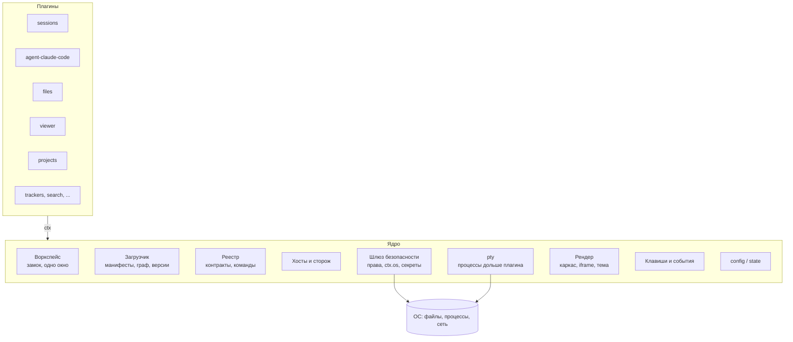
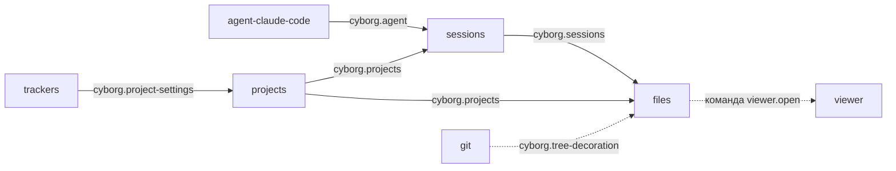
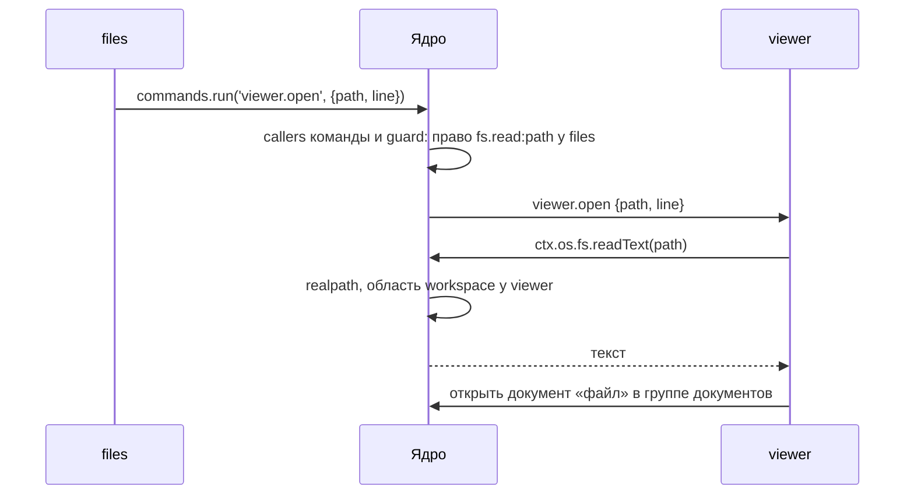

# SAD: ядро и плагины

> Архитектура Cyborg Harness: договорённости владельца и составителя с 2026-11-02, сверенные с кодом репозитория. Пометка «Сделано» у цели называет код и тест; что осталось - [дорожная карта](../../06-plans/roadmap.md). Первая редакция пакета ([SAD от 2026-11-02](https://github.com/dex-it/cyborg-harness/blob/23922d0c65b3fdf7d6e670330ffb36569ffd5913/docs/03-architecture/design/sad.md), ADR-CH-0001..0008) расходится с этим документом в [разделе 7](#7-расхождения-с-первой-редакцией-пакета); действует этот документ. Решения проверены замерами в Electron, разбором аналогов и сверкой с кодом ([ресёрч-2](../../research/sad2-validation.md)); что изменилось по итогам - [раздел 10](#10-правки-по-итогам-проверки).

## 1. Общая архитектура

Cyborg - это **ядро** и набор **равных плагинов**. Ядро не знает предметной области: в нём нет агентов, сессий, файлов, проектов и трекеров. Всё это плагины. Ядро открывает воркспейс, загружает плагины, связывает их, изолирует их сбои, следит за правами и даёт им экран, клавиши и хранение.



**Процессы.**

| Процесс | Что в нём |
|---|---|
| Главный (Electron main) | ядро: воркспейс, загрузчик, реестр, сторож, шлюз, `config` и `state`; запускает хосты плагинов и pty-хост |
| pty-хост (`utilityProcess` ядра) | процессы pty (`node-pty`) и кольцевые буферы их вывода; код плагинов не исполняет ([3.6](#36-ресурсы-дольше-плагина-pty)) |
| Хосты плагинов (`utilityProcess`, один или несколько) | главные части плагинов по группам ([3.5](#35-изоляция-сбоев-хосты-и-сторож)); плагин видит только `ctx`; во втором этапе сторонний плагин - в своём процессе с `--permission` и `Compartment` вторым слоем |
| Рендерер | каркас окна от ядра; UI каждого плагина - в своём `<iframe>` с origin его группы рендера `cyborg-plugin://<группа>/` ([3.8](#38-изоляция-рендера)) |

Код плагина ходит к ОС только через ядро. В первом этапе это дисциплина, которую проверяют тесты, во втором - граница процесса на плагин ([раздел 6](#6-этапы)).

**Поставка ядра.** Ядро ставится пакетом `@cyborg-harness/core` рядом с `@cyborg-harness/contracts` (решение владельца о scope - D-00, строка 3; способ поставки решён в P-02, 2026-11-08). Подмодуль и перенос исходников не взяты: пакет даёт версию ядра, проверку совместимости с контрактами (peer-зависимость `@cyborg-harness/contracts` `>=1.0.0-0 <2.0.0`: мажор 1 и предрелизы 1.0.0 вроде `1.0.0-dev`, которого не принимает `^1.0.0`; предрелизы следующих версий, например `1.1.0-dev`, диапазон не принимает) и ту же границу, что видит потребитель, а не внутреннюю раскладку каталогов.

- Форма. ESM без бандла: `core/dist` содержит JS по файлу на модуль и `.d.ts`; исходники `.ts` в архив не входят, потому что Node не снимает типы у файлов в `node_modules`. Сборка - `npm run build:core` (TypeScript 7, `rewriteRelativeImportExtensions`, объявления дополнительно переписываются с `.ts` на `.js`). Рантайм-зависимостей у пакета нет; контракты подключаются только типами.
- Точки входа и публичный API (T-09, 2026-11-08). Встраивающее приложение вправе импортировать только имена точек входа `exports`; остальное в пакете внутреннее и совместимостью не обещано. `@cyborg-harness/core` - главный процесс (загрузчик и `Kernel`, хосты, воркспейс и «Недавние», `SectionStore`, среда шлюза `ctx.os`, разбор журнала и типы к ним); `/host` - `runHost` для процесса хоста (в Electron его вызывает файл приложения для `utilityProcess`); `/host-entry` - готовый вход хоста для `child_process.fork`; окно без `node:*` - `/keys` (клавиши), `/ui-shell` (оболочка вида), `/window` (снимок слоя окна, строки документов, предпросмотр выключения), `/elements` (элементы `cy-*`, нужен DOM). Основание раскладки - среда выполнения: общий вход потянул бы в браузерный бандл `node:fs` и `node:crypto`. Состав по именам держит `core/test/public-api.test.ts` (перечень по входам, запрет `export *`, имя для каждого типа в публичной сигнатуре, отсутствие `node:*` в JS окна, граница playground), описание - [README ядра](../../../core/README.md). Не вошло в публичное: помощники воркспейса и файлов (`readJson`, `writeJsonAtomic`), `isRecord`, `errorMessage`, `WindowLayer`, `DocumentTable`, `DeniedCollapse`, граф и реестр контрактов как значения. `OsGateway` и `PtyTable` оставлены в главном входе только для замеров и тестов (позиционные конструкторы, приложению не нужны). Расширять перечень можно, сужать после первой публикации нельзя: имя в нём - обещание совместимости.
- Путь входа хоста. `forkHosts` выводит его из `import.meta.url` с расширением модуля (`.ts` из исходников, `.js` из пакета); в cjs-бандле, где `import.meta.url` пуст, приложение задаёт `forkHosts({ entry })`.
- Версия и среда. Пакет `0.1.0`, не `private` (P-10: выпуск по тегу, `publishConfig.access` равен `restricted`, в реестре пакета ещё нет); `engines.node` `>=24` - Node из Electron 45 (в 45.2.2 это 24.22.2) и Node в CI. Playground берёт ядро по имени через workspace, то есть из `core/dist`; `npm run build:packages` (ядро в `core/dist`, тест-кит в `testing/dist` и `cyborg-plugin` в `tools/cyborg-plugin/dist`) идёт перед `build`, `typecheck`, `lint` и `test`.
- Тест-кит автора - отдельный пакет `@cyborg-harness/testing` (P-08, тот же `0.1.0`, `private: true`): `startKernel`, поддельные pty, секреты и память разделов, общий набор тестов `cyborg.agent`. Он строится на `@cyborg-harness/core` как на peer-зависимости (`^0.1.0`, серия версий та же, что у ядра) и контрактах, код ядра не копирует; собирается тем же способом (`npm run build:testing`, `testing/dist`). Состав и границу держит `testing/test/package.test.ts`, установку в пустой проект из архивов - `testing/test/consumer.test.ts`.
- Проверки. `core/test/package.test.ts` - состав и форма пакета и `npm pack --dry-run`; `core/test/consumer.test.ts` - пустой проект вне репозитория ставит архивы пакетов, собирается tsc и запускает сценарий из `core/examples` и пример из README; `core/test/hosts-dist.test.ts` - хосты в дочерних процессах на собранном пакете. Подробности - [README ядра](../../../core/README.md).

**Адаптер Electron.** Всё, что связывает ядро с Electron, лежит в пакете `@cyborg-harness/electron` в этом репозитории (P-03, 2026-11-08; D-00, строка 3 - место адаптера решено по предложению: пакет рядом с ядром; строка 4 - прокладку `window.cyborg` и свою обёртку каналов IPC не вводим: приложение берёт каналы `plugins:*`, `view:*`, `window:*` пакета и само называет мост окна). Playground остаётся примером приложения поверх пакета.

- Что даёт пакет: хосты в `utilityProcess` и точка входа их файла, среда `ctx.os` (секреты под `safeStorage`, `node-pty`, `shell`, `dialog`, `clipboard`, уведомления), служба плагинов для окна (`PluginsService`, `startPlugins`, `discoverPlugins`, снимок `PluginsSnapshot`), схема `cyborg-plugin://` с оболочкой вида, строгой CSP и защитой навигации, каналы IPC окна и видов и мосты preload, перехват клавиш, события фокуса и питания, одиночный экземпляр, выход с ожиданием плагинов, перезапуск при смене воркспейса и безопасного режима, слой окна (диалоги видов и замки), оболочка вида одним скриптом.
- Что делает приложение: имя и папка данных, разбор командной строки и выбор воркспейса, список встроенных плагинов и конфигурация первого запуска, окно и его настройки, раскладка окна (области, вкладки, меню, стили слоя окна), каналы, специфичные для приложения, сборка бандлов. Раскладка окна Cyborg на областях - PL-08, не адаптер.
- Несколько видов. Строка плагина в снимке (`PluginRow.views`) держит все `ui.views` манифеста по порядку, у каждого свой адрес (`cyborg-plugin://<группа>/<плагин>/?view=<имя>`); `PluginRow.view` - адрес первого. Окно показывает фрейм на каждый вид (`data-view`), диалог вида встаёт у фрейма своего вида.
- Граница и проверки. Пакет не импортирует `playground/` и внутренности ядра, только публичные входы T-09; playground берёт адаптер только входами его `exports`. Тесты: `electron/test/boundary.test.ts`, `electron/test/public-api.test.ts` (перечень имён входов, запрет `export *`, вход окна без `node:*`), `electron/test/channels.test.ts` (имена каналов в preload и главном процессе), `electron/test/example.test.ts` (пример из README собирается), `electron/test/package.test.ts` (состав архива), `core/test/public-api.test.ts` (ядро берётся публичными именами). Описание, пример и точки расширения под K-01, K-04, K-05, K-09, K-11, K-13 - [README адаптера](../../../electron/README.md).
- Версия и среда. `0.1.0`, не `private` (P-10, `publishConfig.access` равен `restricted`); `engines.node` `>=24`; peer-зависимости `@cyborg-harness/core`, `@cyborg-harness/contracts`, `electron` `>=45`, `node-pty`. Сборка - `npm run build:electron` (TypeScript 7, оболочка вида - esbuild), она идёт перед `build`, `typecheck`, `lint` и `test`.

**Поставка плагина.** Плагин поставляется каталогом, который собирает `cyborg-plugin build` (пакет `cyborg-plugin`, каталог `tools/cyborg-plugin`; P-06, 2026-11-08). Ядро грузит именно его: ни `.ts`, ни `node_modules` в нём не нужны.

- Состав каталога: `manifest.json`; `index.mjs` - главная часть одним файлом, npm-зависимости внутри, рядом `index.mjs.map` (трассировка стека и журнал ведут к исходникам, а не к бандлу); модули видов и экрана замка `ui/*.js` (ESM, из `ui/*.ts`, с картами) и файлы вида рядом с ними (стили, ресурсы: фрейм грузит ресурсы только со своего origin); файлы схем `config.schema` и `state.schema` по путям из манифеста. `package.json` не нужен: файл главной части `.mjs`.
- Главная часть: `node:*` и `electron` в бандле нет - ни в собственных исходниках, ни в зависимостях. Исходники проверяет `checkPlugin` с `bundled: true` (npm-пакеты допустимы, остальные правила прежние), результат - сборщик по метафайлу (кто именно из `node_modules` подтянул `node:fs`) и затем та же `checkPlugin` без `bundled` на готовом каталоге. Сборка идёт во временный скрытый каталог рядом с `--out`, проверка готового каталога - там же, и только прошедший результат переименовывается на место: отказ на любом шаге (исходники, сборщик, метафайл, проверка результата) оставляет прежний результат нетронутым, `build` завершается кодом 1. Занять `--out` можно, только если его нет, он пуст или в нём метка `.cyborg-plugin-build`, оставленная прежней сборкой; любой другой каталог, даже с `manifest.json` (исходники соседнего плагина, `public/` веб-приложения), - отказ. Метка служебная: в составе результата, отчёте и архиве её нет. Символическая ссылка в `ui/` на файл внутри каталога плагина копируется как обычный файл, остальные ссылки - нарушение. Метафайл видит только литеральные пути: вычисляемый `import()` внутри зависимости находит проверка готового каталога (сборка отказывает), а вычисляемый `require()` CJS-зависимости в бандле становится `__require(x)`, и его не видит ни одна из проверок - это граница этапа 1, как и для собственных исходников.
- Версия: `build` и `check` падают, если `engines.cyborg` не принимает версию API установленного ядра (`--api-version` называет другую). Версия плагина и диапазон API независимы.
- Архив: `cyborg-plugin pack` складывает собранный каталог в воспроизводимый `tar.gz` (корень `<id>/`, время 0, порядок по алфавиту, одни и те же файлы дают те же байты). Формат архива **предварительный**: источник, подпись, хеш и повторное согласие - этап 2 (открытый вопрос 8), владелец их не решил; на этапе 1 нормативна поставка каталогом, архив - способ перенести его одним файлом.
- Стенд. `playground/scripts/build.mjs` собирает плагины стенда тем же инструментом в режиме `main: 'source'`: главная часть остаётся исходниками (стенд проверяет загрузку `.ts` и общий `playground/plugins/contracts.ts`), виды собираются так же, как в поставке. Состав `playground/dist/plugins` не изменился.
- Ограничение этапа 2. Бандл зависимости может не пройти сканер `ses`/`Compartment` (zod и marked не проходят, [ресёрч-2, 2.3](../../research/sad2-validation.md#23-hardened-js-ses-230-в-electron-45)); этап 1 это не ограничивает, решения здесь нет (открытый вопрос 7).
- Проверки: `tools/cyborg-plugin/test` - сборка плагина с npm-зависимостью и его загрузка ядром в `forkHosts` из каталога без `node_modules`, отказы по `node:fs`/`electron` в исходнике и в зависимости, по отсутствующему файлу вида или схемы, по `engines.cyborg`, состав и воспроизводимость архива; `npm run smoke` - собранный каталог включён в стенде, вид открыт.
- Загрузка вне репозитория и из упаковки (T-10, 2026-11-10). Точку входа хост грузит через `import()`, тип модуля и снятие типов решает Node 24: `.ts`, `.js` (в том числе без `type`) и `.mjs` грузятся из каталога пользователя, каталога поставки и из asar без `asarUnpack`; не грузятся `enum` и параметры-свойства конструктора в `.ts`, `.ts` под `node_modules` и ESM-код в области `"type":"commonjs"`. Отказ называет файл и причину в журнале (`core/src/entry-load.ts`), `discoverPlugins` пишет в `problems` «нет точки входа» и «точек входа несколько». Таблицы, запуск asar на macOS и Linux и текст ограничений для автора - [external-plugins.md](../../05-verification/external-plugins.md).

## 2. Что есть ядро

Ядро - хост плагинов: оно открывает воркспейс, загружает, связывает и изолирует плагины, контролирует их доступ к ОС и даёт им экран, клавиши и хранение.

**Компактность - ограничение на всё ядро.** Задача попадает в ядро, только если выполнены оба условия:

1. она нужна всем плагинам или окну без плагинов;
2. плагин не может решить её сам, не нарушив гарантию, которую ядро даёт остальным.

Проекты - плагин: они нужны не всем, и `projects` справляется сам. pty - в ядре: процесс должен пережить перезапуск своего плагина, а этого плагин себе не гарантирует. «Недавние» - в ядре: воркспейс выбирается до загрузки любого плагина. Шина событий - нигде: связь идёт через API владельца.

**Накладные расходы - с бюджетом.** Время старта, память на хост и на `<iframe>`, задержка вызова через шлюз и вывода терминала задаются числами; числа задержек приняты, против чего мерить старт и память - открытый вопрос 9.

**В ядре нет:** агента и его запуска, сессий и их восстановления, дерева файлов, просмотрщика, проектов, трекеров, уведомлений о сессиях, источников секретов, общей шины событий, реестра сервисов по произвольным ключам, `inject`, waterfall и guard.

**Центральных плагинов нет.** Ядро не выделяет ни один плагин, в коде ядра нет имён плагинов. Окно без плагинов - нормальное состояние: в нём доступно управление плагинами. Поставка Cyborg - это список встроенных плагинов и больше ничего.

## 3. Цели ядра

| | Цель | Что гарантирует |
|---|---|---|
| [3.1](#31-воркспейс-как-главная-сессия) | Воркспейс как главная сессия | один экземпляр - один воркспейс - одно окно и одно согласованное состояние |
| [3.2](#32-загрузка-плагинов) | Загрузка плагинов | сломанный граф виден до запуска кода; окно без плагинов работает |
| [3.3](#33-версии-и-миграции) | Версии и миграции | обновление Cyborg или плагина не ломает остальных и не теряет данные |
| [3.4](#34-связь-между-плагинами) | Связь между плагинами | плагины знают друг друга только через контракт |
| [3.5](#35-изоляция-сбоев-хосты-и-сторож) | Изоляция сбоев | зависание или падение плагина не трогает другие хосты, окно и агентов |
| [3.6](#36-ресурсы-дольше-плагина-pty) | Ресурсы дольше плагина | перезапуск хоста или окна не убивает процессы агентов |
| [3.7](#37-безопасность-данных-и-контроль-плагинов) | Безопасность данных и контроль плагинов | плагин делает только объявленное; секреты не попадают в `config`, `state` и журнал |
| [3.8](#38-изоляция-рендера) | Изоляция рендера | плагин рисует только у себя; каркас появляется до кода плагинов |
| [3.9](#39-системные-клавиши-и-события) | Системные клавиши и события | системное сочетание срабатывает одинаково из любого `<iframe>`; конфликт виден при загрузке |
| [3.10](#310-главный-конфиг-и-состояние) | Главный конфиг и состояние | плагин видит только свой раздел; ошибка в разделе ломает только его владельца |

### 3.1. Воркспейс как главная сессия

Воркспейс - главная сессия приложения: файл `config` воркспейса, его `state` и одно окно.

- Открытие: `--workspace=<файл>` или «Недавние»; ядро берёт замок `<файл>.lock`.
- **Один экземпляр - один воркспейс - одно окно; процессов может быть несколько** (решение K-20, D-00 строка 5; принято по поручению владельца 2026-11-09 по «Предложению» строки). Воркспейс держит один процесс; разные воркспейсы открываются разными процессами с общим `userData`. Второй запуск того же воркспейса просит владельца поднять окно (сокет по `workspaceKey`, `claimInstance`; каталог сокетов личный: `XDG_RUNTIME_DIR`, а без него `<userData>/run`, общий `tmpdir` - только если адрес не влезает в предел сокета) и завершается; владелец, который жив, но не ответил в срок, - отдельный исход: сообщение человеку и код выхода 3. Если контроль экземпляров не заработал (каталог адресов чужой или не создаётся), процесс не остаётся без окна: он открывается без адреса, причина видна в диалоге окна, данные по-прежнему держит замок воркспейса, а повторный запуск получит отказ замка. Windows вне v1 (D-00, строка 7): имя канала `\\.\pipe\cyborg-harness-<ключ>` общее для сессий машины, чужой процесс, занявший его первым, получит запрос второго запуска или не даст стать владельцем; для поддержки Windows нужен канал с дескриптором безопасности текущего пользователя ([threat-model, У-50](threat-model.md#56-загрузка-воркспейс-жизненный-цикл)); «Открыть в новом окне» - ещё один процесс, «Открыть…» и «Недавние» - смена воркспейса перезапуском. Общие файлы `userData` (`secrets.json`, `recent.json`, слой пользователя `cyborg.json`) пишутся под замком `<файл>.write.lock`; сессия Chromium у каждого воркспейса своя (`<userData>/workspaces/<ключ>`). Каталоги `plugin-data` и `plugin-temp` общие для процессов: `fs.writeText` атомарен, а цикл «прочитал - изменил - записал» двух процессов плагин исключает сам. Слой пользователя один на `userData`, а согласие этапа 2 привязано к `workspaceKey` ([ADR-CH-0015](../adr/ADR-CH-0015-workspace-trust.md), K-27, #100); флаг `--user-plugins` (K-17, #104) у каждого процесса свой и при «новом окне» наследуется.
- Закрытие окна или смена воркспейса: плагины выключаются через `Disposable`, живые pty завершаются после подтверждения пользователя ([3.6](#36-ресурсы-дольше-плагина-pty)), замок снимается.
- Перезагрузка окна - не закрытие: воркспейс, хосты и pty остаются.
- «Недавние» и окно без воркспейса - забота ядра: выбрать воркспейс нужно до загрузки любого плагина.

**Сделано в ядре.** `core/src/workspace.ts`, тесты - `core/test/workspace.test.ts`: замок `<файл>.lock` с pid и забор замка умершего процесса; `state` по ключу от `realpath` файла; перенос старого формата хуком приложения `migrate` с копией `.v1.bak` (предметный перенос Cyborg - `playground/src/main/legacy-workspace.ts`); слои config `user` и `workspace`, `plugins.enabled` воркспейса перекрывает пользовательский, группы хостов сливаются, а права значения воркспейса не расширяют ([3.7](#37-безопасность-данных-и-контроль-плагинов)); правка файла извне доходит до `ctx.config.onChange`, битый файл не стирает разделы и не перезаписывается, рядом ложится его копия `.corrupt-<время>` ([3.10](#310-главный-конфиг-и-состояние)). Playground: флаг `--workspace=<файл>`, второй запуск того же воркспейса отдаёт фокус первому окну (`workspaceInstance` адаптера поверх `claimInstance` ядра, `core/src/instance.ts`), отказ замка - в окне плагинов.

«Недавние» - `core/src/recent.ts`: список в каталоге приложения, последний открытый первым, без повторов по `realpath`, до 10; файл, которого больше нет, не показывается; битый список не мешает открыть окно. В список попадает только воркспейс, который открылся. Playground: без флага открывается последний из «Недавних»; в шапке окна - текущий воркспейс, «Недавние» кнопками и «Открыть…» (системный диалог). Смена воркспейса - перезапуск приложения с `--workspace`: выход выключает плагины и снимает замок, а при живых pty плагинов окно сначала спрашивает человека. `--no-workspace` - окно без воркспейса: ядро не запускается, в окне только выбор воркспейса. Дымовой тест проверяет «Недавние» после открытия и окно без воркспейса с пропавшим файлом в списке.

Решения по вопросам задачи K-20 ([#61](https://github.com/dex-it/cyborg-harness/issues/61); принято по поручению владельца 2026-11-09, строки D-00 5 и 7 - по «Предложению»):

1. **D-00 строка 5: вариант (Б).** Пилот P9 прошёл в smoke на ubuntu и macOS, паритет FR-1029 сохранён, откат - одна строка в `main.ts`.
2. **`plugin-data` и `plugin-temp` общие для процессов.** Целостность файла даёт шлюз: `fs.writeText` пишет через временный файл и `rename` (читатель соседнего процесса не видит недописанного), потерю обновления при цикле «прочитал - изменил - записал» двух процессов исключает плагин (замка для плагинов в API нет). Для v1 принято (на подтверждение владельцем); записано в описании `ctx.os.paths` и в [данных](../../guide/concepts/data.md).
3. **`claude-hooks.json` и `userData/sessions/*.jsonl` Cyborg** проверены по ai-cyborg (`1f00014`, `src/main/sessions.ts`, `jsonfile.ts`): `claude-hooks.json` пишется при каждом запуске одним и тем же содержимым через временный файл с pid в имени и `rename`, так что два процесса не портят друг друга; файлы событий и `.mcp.json` называются `<pid>-<id>.jsonl`, пересечения между процессами нет, а чужие файлы мёртвых pid убирает `removeOrphanedEvents`. Общий `userData` для инстансов в ai-cyborg принят и в ADR-0014 («Negative: … `claude-hooks.json`, `trackers.json`, кэш входа пишут все инстансы»). Правок в Cyborg не нужно; остаётся сверить это на переезде (P-11). В playground те же файлы лежат в `plugin-data` плагина `agent-claude-code`: `claude-hooks.json` пишется атомарно (`fs.writeText`), а id сессии для файла событий получил случайную часть, чтобы два окна не выбрали одно имя.
4. **Windows вне v1 (D-00, строка 7).** Именованный канал не запускался; оговорка по его имени - в 3.1 и [У-50](threat-model.md#56-загрузка-воркспейс-жизненный-цикл).

Смена `plugins.enabled` в файле без перезапуска - `kernel.setEnabled`, тест - `electron/test/plugins.test.ts`: разница со списком из файла, а не с выключенными в окне; убранный выключается вместе с теми, кто требует его через `requires`, вернувшийся включается. Плагин, которого не было в графе при запуске, ждёт перезапуска с записью «включатся после перезапуска» в окне: граф, связи контрактов и зеркала хостов на ходу не перестраиваются. Выключение владельца замка из-под замка - отказ с записью, как из окна.

Ещё нет: включение без перезапуска плагина, которого не было в графе при запуске.

### 3.2. Загрузка плагинов

1. Прочитать `plugins.enabled` (файл пользователя, перекрытый файлом воркспейса). Больше ядру для старта ничего не нужно.
2. Найти и прочитать манифесты: в каталоге поставки всегда, в каталоге плагинов пользователя - только при запуске с `--user-plugins` ([6.1](#61-этап-1-ядро-без-изоляции-доступа), «Каталог плагинов пользователя»). Проверить совместимость версий ([3.3](#33-версии-и-миграции)).
3. Разрешить граф контрактов **до запуска кода**: недостающий `requires`, два поставщика при кратности `one`, цикл - плагин не загружается, причина пишется в журнал.
4. Нарисовать каркас окна по манифестам ([3.8](#38-изоляция-рендера)).
5. Разложить плагины по хостам ([3.5](#35-изоляция-сбоев-хосты-и-сторож)) и активировать в порядке графа; активация может быть ленивой - по первому показу вида или первой команде.

- Журнал плагинов: отказы загрузки, ошибки активации, отказы прав, перезапуски хостов; виден в «Плагины Cyborg».
- Безопасный режим выключает все плагины без исключений.
- **Точка входа (P-07, принято по поручению владельца 2026-11-10).** Выбрано соглашение, а не поле `main` в манифесте: встроенный плагин поставки грузится по файлу `index.mjs` и только по нему, угадывания по `index.mjs`, `index.js`, `index.ts` в поставке нет. Основание: сборка `cyborg-plugin build` ([формат поставки плагина](#1-общая-архитектура)) всегда пишет главную часть в `index.mjs`, поле `main` ничего бы не добавило, а лишнее поле манифеста - это публичная форма API (`TOP_LEVEL` в `core/src/manifest.ts`), которую потом не убрать; соглашение при необходимости обратимо добавлением `main`. Угадывание остаётся плагинам каталога пользователя (`--user-plugins`) и режиму стенда (`builtinMode: 'stand'`, у playground - запуск без `--delivery`): стенд грузит исходники `index.ts`. Плагин поставки без `index.mjs` ядру передаётся, а его активация получает отказ с причиной в журнале («нет точки входа index.mjs», при чужом `index.js` или `index.ts` рядом причина называет найденное); остальные плагины поднимаются. Тесты - `electron/test/plugins.test.ts` («точка входа поставки…», «старт: встроенный плагин без index.mjs…», «режим стенда…»).
- Выгрузка и загрузка плагина - без перезапуска окна. Выгрузка снимает плагин и тех, кто требует его через `requires`, в обратном порядке активации; потребители через `optional` остаются и получают `onChange`. Хост, где не осталось плагинов, гасится, поэтому загрузка поднимает код в новом процессе. Сторож выгруженный человеком плагин не поднимает. Процессы агентов выгрузку переживают ([3.6](#36-ресурсы-дольше-плагина-pty)).

**Сделано в ядре.** Загрузка - `core/src/loader.ts` (сборка, раскладка модулей - ниже), граф - `core/src/graph.ts`, журнал - `core/src/journal.ts`, причины словами - `core/src/status.ts`. Тесты - `core/test/graph.test.ts` (граф до кода, каскад отказа), `core/test/loader.test.ts` («журнал: невалидный, выключенный, не найденный, отказ графа…», «безопасный режим не запускает хосты», «хуки: граф до кода…»), `core/test/lifecycle.test.ts` (выгрузка и загрузка без перезапуска окна: «disable: требующие выгружаются вместе с поставщиком…»), `core/test/journal.test.ts`, `core/test/status.test.ts`. Окно «Плагины Cyborg» - playground, проверка - `npm run smoke`.

**Раскладка загрузчика (T-08).** `load()` в `core/src/loader.ts` - сборка в пять строк (весь файл - 36): `createContext` собирает общее состояние, `createParts` создаёт части, `activation.start()` запускает плагины, `buildKernel` отдаёт `Kernel`. Общее состояние (журнал и `record`, `active`, `byId`, `registry`, `graph`, `options`, шлюз ОС, слой окна) - один объект `KernelContext` из `kernel-context.ts`, а не замыкание. Каждая часть получает его целиком, держит своё изменяемое состояние у себя и зовёт соседей через `ctx.parts` в момент вызова, поэтому фабрики частей друг друга не импортируют: из `kernel-context.ts` берутся только типы, напрямую - лишь функции без состояния (`assignHosts` и `bump` из `host-pool.ts`, `bindKeys` и `applyUserKeys`, `checkCall` и `mayUse`); кругов нет (проверяет `core/test/module-structure.test.ts`, как и предел в 400 строк на модуль; список частей в тесте ручной, но тест требует, чтобы в нём был каждый модуль, импортирующий `kernel-context.ts`, - такая часть без записи в списке роняет тест; часть без общего контекста, как `manifest-*.ts`, вносится в список руками, иначе предел на неё не распространится). Публичная поверхность не менялась: `load`, `Kernel`, `LoadOptions`, `JournalEntry`, `DisableOptions`, `DisablePreview` по-прежнему экспортируются из `loader.ts`, типы лежат в `kernel-types.ts`.

| Модуль | Состояние и обязанности | Шов задач эпика |
|---|---|---|
| `kernel-types.ts` | Публичные типы: `Kernel`, `LoadOptions`, `JournalEntry`, `DisableOptions`, `DisablePreview`, `Keybinding` | - |
| `kernel-context.ts` | `KernelContext`, `Host`, `Subscription` и интерфейсы частей (`Parts`); только типы | - |
| `context-build.ts` | Разбор манифестов, граф, раскладка по хостам, сочетания, шлюз ОС, слой окна; порядок записей в журнал при старте | - |
| `host-pool.ts` | Карта хостов, запуск, остановка, вызовы в хост, сторож (пинг, `hostDown`, перезапуск), `assignHosts` | - |
| `host-bridge.ts` | Проверка отправителя сообщения хоста (`mine`), разбор сообщений по схеме; сообщения `running`, `exiting`, `rejected`, `log` | - |
| `contract-calls.ts` | Описатели поставщиков, подписки через границу хоста, `invoke`, `callAs` | K-06, K-09 |
| `cancel.ts` | Метка и разбор сигнала отмены в аргументах вызова; чистые функции, не часть | K-09 |
| `call-check.ts` | `mayUse` (кто вправе звать контракт) и `checkCall` (`via-contract`) | K-06 |
| `commands.ts` | Владельцы команд, `run`, регистрация команд из хоста | K-22 |
| `activation.ts` | `waiting`, `waking`, `activating` (соседям - только чтение; снять с ожидания - `forget`), `activate`, `wake`, старт ядра | - |
| `lifecycle.ts` | Очередь `enqueue`, `strikes`, `switchedOff`, `userOff`, `enable`, `disable`, `uninstall`, `setEnabled`, `dropPlugin`, выгрузка | K-10 |
| `sections.ts` | Что хост получает из `config` и `state`, `section.write`, `reloadSections` | - |
| `os-requests.ts` | Запросы `documents` и `os` из хоста, уведомления, замок окна | - |
| `idle-watch.ts` | Слушатели простоя и опрос ОС | - |
| `views-state.ts` | Память видов `$views`, очередь записей, `forget` при удалении плагина | - |
| `keybindings.ts` | `bindKeys`, `applyUserKeys` (статическая таблица), `createKeyRegistry` (динамические сочетания, `ctx.keys.register`, поиск по нажатию с условиями; не путать с `keys.ts` - разбором нажатия) | K-07 (сделано) |
| `kernel-api.ts` | `buildKernel`: тонкий слой над частями, своего состояния нет | - |
| `manifest-provides.ts`, `manifest-ui.ts`, `manifest-fields.ts` | `readProvides` (K-06), `readUi` (K-03) и общие мелочи разбора вынесены из `manifest.ts` | K-06 (provides), K-03 (ui) |
| `manifest-layout.ts`, `layout.ts` | область, `order` и заголовок вида, типы документов (`readDocuments` переехал из `manifest.ts`); снимок `Kernel.layout` без состояния | K-03 (раскладка), K-04 (`ui.group` в `manifest-ui.ts`, готово) |

Порядок старта, который держит сборка: журнал и манифесты, граф и `onGraph`, `assignHosts`, `bindKeys` и `applyUserKeys`, части, замок окна, активация. Часть при создании ничего не вызывает.

**Ленивая активация - сделано в ядре.** `"activation": "lazy"` в манифесте: при старте плагин получает состояние «ждёт» (`waiting` в журнале). Будят его первая команда (`run` активирует владельца до вызова; команду плагина, активация которого уже идёт, например после `enable`, `run` тоже ждёт), сочетание (оно перехватывается и у спящего владельца), показ вида (`kernel.wake`, playground зовёт его при первой загрузке файла вида) и активация потребителя: поставщика из `requires` и `optional` ядро поднимает до потребителя, поставщиков `consumes` - без ожидания, иначе встречная пара `consumes` ждала бы сама себя. Выключенный человеком ленивый плагин команда не будит. Тест - `core/test/events.test.ts`, в playground - плагин `later`.

### 3.3. Версии и миграции

**Плагин и API ядра.**

```jsonc
// манифест плагина
"id": "trackers",
"version": "2.3.0",
"engines": { "cyborg": "^1" }   // версия API плагинов: ctx и элементы ядра
```

- Несовместимый `engines.cyborg` - плагин не загружается, причина в журнале.
- Незнакомое поле манифеста - отказ с именем поля, кроме `$schema` для редактора; если при этом `engines.cyborg` не принимает версию API, причина одна - версия API.
- API плагинов версионируется семантически; элемент ядра не удаляется и не меняет атрибуты в пределах мажорной версии.

**Контракты.**

- **Семантические версии.** Минорное изменение: новый необязательный член, новое необязательное поле, новое значение в объединении событий - потребитель обязан пропускать незнакомое. Мажорное: удаление или переименование, новое обязательное поле аргумента, смена смысла.
- **Владение.** Пространство имён `cyborg.*` закреплено за репозиторием Cyborg и пакетом `@cyborg-harness/contracts`. Сторонние контракты называются по автору (`acme.*`) и публикуются своими пакетами объявлений. Отдавать `cyborg.*` и носить `id` из `cyborg.` может только плагин из поставки: сторонний отвергается при разборе графа (`reserved` в журнале), брать `cyborg.*` ему можно. Признак поставки - каталог установки (`bundled`); ядро тестов без него проверку не делает ([ADR-CH-0002](../adr/ADR-CH-0002-manifest-and-compatibility.md) п. 6).
- **Переход между мажорными версиями.** Поставщик может давать две версии сразу (`"provides": { "cyborg.sessions": ["1.4", "2.0"] }`); каждый потребитель получает ту, что просил.
- **Устаревание.** Член с пометкой `@deprecated` живёт минимум до следующей мажорной версии; ядро пишет в журнал, кто его вызывает. Пометка - в манифесте поставщика, `provides.<контракт>.deprecated: ["член"]`, рядом с `guard` (для всех его мажорных версий); запись `deprecated-call` - вызывающий, поставщик, контракт, член; повторы склеены за окно 5 с, записей не больше 1000.

**Разделы `config` и `state`.** Плагин обновился и сменил формат, пользователь поправил файл руками и ошибся - ни то, ни другое не должно ронять плагин или окно.

```jsonc
// манифест плагина
"config": { "schema": "./config.schema.json", "version": 3 },
"state":  { "schema": "./state.schema.json",  "version": 1 }
```

- Ядро проверяет раздел по схеме до активации и при изменении файла воркспейса извне (файл отслеживается).
- Версия раздела ниже версии плагина - ядро до активации вызывает `migrate(fromVersion, data)` плагина и сохраняет результат.
- Версия раздела выше (плагин откатили) - плагин не активируется, раздел не трогается, причина в журнале.
- Раздел не прошёл схему - отказ только этому плагину с записью в журнале; остальные работают.

**Сделано в ядре.** Версии и `migrate` - `core/src/config.ts`, тесты - `core/test/config.test.ts` и `core/test/loader.test.ts`. Схема - `core/src/json-schema.ts`, подмножество JSON Schema без зависимостей: `type`, `properties`, `required`, `additionalProperties`, `items`, `enum`, `const`, границы чисел, длины строк и списков, `pattern`, `uniqueItems`; аннотации (`title`, `description`, `default`) пропускаются, а остальные ключи (`$ref`, `oneOf` и другие) - ошибка схемы: автор не должен считать проверенным то, что ядро не проверяет. Путь схемы в манифесте - `./<файл>.json` внутри каталога плагина; файл читает приложение (`readSchemaFile` в `electron/src/plugins.ts`) после `realpath`, ссылка наружу - отказ, иначе хост плагина получил бы чужой JSON. Схема проверяет слитое значение раздела вместе с `validate` плагина; нет файла или схема не разбирается - отказ разделу до запуска кода. Правка файла извне не по схеме оставляет значение прежним, отказ - в журнале.

**Журнал вызовов `@deprecated` - сделано.** Разбор пометки - `core/src/manifest-provides.ts` (ошибка называет поле, например `provides.demo.files.deprecated[1]`), запись - `checkCall` в `core/src/call-check.ts`, общая точка `invoke` (главная часть) и `callAs` (вид); пишется, когда проверки вызова пройдены. Склейка повторов и предел числа записей - `core/src/journal.ts`, слова и уровень - `core/src/status.ts`. Тесты - `core/test/via-contract.test.ts` («@deprecated: …»), `core/test/journal.test.ts`, `core/test/status.test.ts`, `core/test/semver-manifest.test.ts` («манифест: deprecated у provides…»). Пометка относится к контракту целиком, не к мажорной версии; существование члена в контракте ядро при разборе не проверяет.

#### Пакет контрактов: поставка и версии

**Канал.** Пакет `@cyborg-harness/contracts` выпускается в реестр npm (`registry.npmjs.org`) под scope `@cyborg-harness`; scope выбран владельцем 2026-11-06 ([D-00, строка 3](https://github.com/dex-it/cyborg-harness/issues/21)), потому что `@cyborg` на npmjs.com занят посторонним. GitHub Packages не годится: он требует, чтобы scope совпадал с именем организации-владельца (`@dex-it`), а имя владелец выбрал другое. Запасной путь, если реестр недоступен, - tarball из `npm pack` в `contracts/`, приложенный к релизу на GitHub: пакет собирается из `contracts/` без ничего, что привязывало бы его к реестру, а установку из tarball проверяет `contracts/test/package.test.ts`. Зависимость по git-тегу не годится: npm ставит git-зависимость из корня репозитория (получится пакет `cyborg-harness`, а не `@cyborg-harness/contracts`), `contracts/dist` в git нет, а `prepack` берёт `typescript7` из корневых `node_modules`, которых у потребителя нет. Пока `publishConfig.access` равен `restricted`: случайный `npm publish` не сделает пакет публичным, а `public` ставит выпуск после решения владельца о видимости и резервирования scope за организацией.

**Выпуск по тегу (P-10, принято по поручению владельца 2026-11-10).** Выпускаются `@cyborg-harness/contracts`, `@cyborg-harness/core`, `@cyborg-harness/electron` workflow `.github/workflows/release.yml` на тег `v<версия>`; `@cyborg-harness/testing` и `cyborg-plugin` остаются `private` (в задачу P-10 не входят). Версии пакетов независимы (README контрактов, «Три версии»), поэтому тег выпускает пакеты, чья версия равна версии тега, остальные пропускает, а тег без совпадений отвергается; порядок публикации - контракты, ядро, адаптер. Перед выпуском `scripts/release.ts` сверяет версию тега с `package.json` и записью `## <версия> - <дата>` в `CHANGELOG.md` пакета, отвергает `private`, версию `-dev` и пакет без `publishConfig.registry`; предварительная версия выходит с меткой `next`. Права: `contents: read` у обоих заданий, токен `NPM_TOKEN` (гранулярный, только запись в пакеты scope) лежит в окружении `npm-publish` и виден одному шагу. Публикацию включает владелец: переменная репозитория `RELEASE_PUBLISH=true`, окружение с обязательными ревьюерами, тег на коммите из `master`; без них workflow собирает архивы и делает `npm publish --dry-run`, публикует проверенные архивы, а не пересборку. Лицензия пакетов не выбрана (поле `license` у ядра, адаптера и тест-кита - `UNLICENSED`, у контрактов поля нет): выбор за владельцем, workflow предупреждает, но не блокирует; до выбора пакеты выходят закрытыми (`restricted`).

**Состав.** В tarball входят `dist/*.d.ts`, `package.json`, `README.md`, `CHANGELOG.md`. `exports` отдаёт только условие `types`: кода выполнения в пакете нет (в tarball только `.d.ts`: `contracts/test/package.test.ts`), импорт значения не должен разрешаться. Исходные `.ts` с расширениями в путях в пакет не входят: потребителю не нужен `allowImportingTsExtensions`, а `lib` без DOM достаточно. Ядро и стенд продолжают брать пакет по `paths`.

**Три версии.** Версия пакета (`version`), мажорная версия контракта (ключ карты `Contracts['cyborg.files'][1]`, минор - у поставщика в `provides`) и версия API плагина (`engines.cyborg`, `PLUGIN_API_VERSION`) - разные вещи. Мажор API плагина равен мажору пакета. Что повышает какую - таблица в [README пакета](../../../contracts/README.md#что-повышает-какую-версию): необязательный член и новый контракт - минор пакета; удаление, переименование, обязательное поле, смена смысла - мажор пакета и API; контракт получает новую мажорную версию отдельным ключом, старый остаётся на срок `@deprecated`.

**Проверка.** `contracts/api-snapshot.txt` хранит собранные декларации без комментариев; `npm run check:contracts` сверяет их с собранными и с версией пакета, а в PR (`--base`) сравнивает снимок со снимком ветки назначения: декларации изменены, версия прежняя - CI красный. До первого выпуска (версия `1.0.0-dev`) декларации меняются без повышения версии, снимок обновляется. Выбор между патчем, минором и мажором для карты `Contracts` остаётся за ревью: компилятор не отличит обязательный член от необязательного.

**Снимок API плагина (T-06).** Поверх снимка пакета `core/test/api-snapshot.test.ts` сверяет исходники с эталоном `core/test/api-snapshot/<версия API>.txt` (`PLUGIN_API_VERSION`): члены типов `contracts/plugin.ts`, `view.ts`, `os.ts`, `elements.ts`, поля манифеста (`PluginManifest`, `TOP_LEVEL`), команды окна (`WINDOW_COMMANDS`), теги и атрибуты `cy-*`. Тест делит изменения на ломающие (удаление, переименование, смена типа, новый обязательный член у типа, который строит плагин) и добавления; после заморозки первые требуют нового мажора, вторые - минора, а каждый следующий эталон одной мажорной версии обязан только дополнять предыдущий. До заморозки (`1.0.0-dev` у пакета) тест красный до `npm run snapshot:api`, но мажор не требует. Состав и процедура - [README пакета контрактов](../../../contracts/README.md#снимок-api-плагина-t-06); решения исполнителя по поручению владельца 2026-11-10 - в описании PR T-06.

### 3.4. Связь между плагинами

Ядро ведёт реестр контрактов (`provides` / `requires` / `optional` / `consumes`) и реестр команд и передаёт вызовы: между плагинами, между UI и главной частью одного плагина, между хостами. Для плагина вызов выглядит одинаково, в одном хосте поставщик или в другом. Как плагины этим пользуются - [раздел 4](#4-взаимодействие-плагинов).

**Сделано в ядре.** Реестр контрактов - `core/src/registry.ts`, реестр команд и проверка `callers` и `guard` команды - `core/src/commands.ts`, передача вызовов между хостами - `core/src/contract-calls.ts` и `core/src/call-check.ts` поверх канала `core/src/rpc.ts`, право вызывающего через контракт (`guard`) - `core/src/via-contract.ts`. Тесты - `core/test/registry.test.ts`, `core/test/rpc.test.ts`, `core/test/subscriptions.test.ts` (подписка через границу хоста), `core/test/via-contract.test.ts` (в том числе вызов из вида), `core/test/trust.test.ts` (контракт зовёт только связанный графом потребитель, аргументы команды сверяются со схемой, вызывающего команды называет канал), `core/test/command-callers.test.ts` (`callers` и `guard` команд), `core/test/loader.test.ts` («команды: запуск из ядра и из другого плагина…»).

### 3.5. Изоляция сбоев: хосты и сторож

Главные части плагинов работают не в главном процессе, а в хостах (`utilityProcess`). Плагины одного хоста делят процесс и цикл событий: зависание одного останавливает соседей, падение хоста роняет все его плагины. Поэтому группировкой по хостам управляет пользователь.

```jsonc
"plugins": {
  "enabled": ["sessions", "agent-claude-code", "files", "viewer", "projects", "trackers", "search"],
  "hosts": {
    "builtin":  ["sessions", "agent-claude-code", "files", "viewer", "projects"],
    "trackers": ["trackers", "search"]
  }
}
```

- `plugins.hosts` - часть `config` с теми же уровнями: пользователь и воркспейс. Группа из плагинов поставки действует из обоих уровней. Сторонний плагин в группе не действует ни с какого уровня; когда этап 2 позволит ему общий хост или общую группу рендера, такую группу ядро будет брать только из слоя пользователя ([ADR-CH-0015](../adr/ADR-CH-0015-workspace-trust.md)).
- **Сторонний плагин всегда один в своём хосте.** Граница доверия ядра - процесс хоста: ядро проверяет, что сообщение пришло из хоста, где живёт названный в нём плагин, а внутри хоста плагины неразличимы. Плагин в общем хосте может писать от имени соседа - в его раздел `config` и `state`, в его команды и контракты. До изоляции этапа 2 ([6.2](#62-этап-2-изоляция-доступа-по-поводу)) так закрыто только между процессами.
  - **Сторонний** - не из поставки Cyborg. Признак поставки - каталог установки, а не манифест: автор пишет в манифест что угодно. На этапе 1 сторонний плагин бывает только из каталога плагинов пользователя, а тот выключен без `--user-plugins` ([6.1](#61-этап-1-ядро-без-изоляции-доступа)). Загруженному стороннему ядро пишет в журнал `third-party`, «Плагины Cyborg» помечают строку «сторонний».
  - Сторонний плагин без группы получает хост со своим id. Группа из него одного действует как переименование хоста. Если пользователь назвал его в группе с другими, ядро всё равно даёт ему отдельный хост и пишет в журнал `host-isolated` с именем группы; «Плагины Cyborg» показывают это предупреждением.
  - Цена - процесс на каждый сторонний плагин. Снять её для доверенного автора можно только вместе с изоляцией этапа 2, а не настройкой.
- Плагины из поставки по умолчанию идут в хост `builtin`; не названный ни в одной группе идёт по умолчанию. Манифест может попросить отдельный хост (`"host": "own"`); пользователь вправе переопределить группой, и группа действует; если у плагина в ней есть соседи, ядро пишет в журнал `host-own-grouped` с их списком, и «Плагины Cyborg» показывают это предупреждением.
- **Внутри хоста** исключение при активации или в вызове ловит хост: отказывает только этот плагин, с записью в журнале.
- **Ошибка вне вызова.** Необработанное отклонение промиса плагина хост не роняет: запись `unhandled-rejection` в журнале на виновника и страйк, как при зависании. Необработанное исключение завершает процесс хоста с названным виновником: состояние процесса после него не определено. Виновник - плагин, с чьего входа началась асинхронная цепочка (`AsyncLocalStorage`), а не вошедший последним; ошибка вне цепочки плагина - сбой кода хоста, без виновника, и отклонение в ней тоже завершает процесс. В Electron `queueMicrotask` теряет хранилище цепочки, поэтому хост оборачивает его, как таймеры, и помечает вылетевшую из кода плагина ошибку.
- **Строки плагина и вывод хоста** (K-29). `ctx.log(message, level?)` пишет строку уровня `info` (по умолчанию), `warn` или `error`; другой уровень плагин получает как `Invalid`. Вывод процесса хоста (`console.*`, `process.stdout.write`, `process.stderr.write`) хост не пишет в терминал, а отдаёт ядру строками: плагин называет цепочка вызовов хоста (`AsyncLocalStorage`, та же, что называет виновника ошибки), поэтому вывод из таймера и продолжения промиса относится к тому, кто их завёл; вне цепочки плагина строка идёт с меткой хоста `хост <id>`. Уровень вывода: `stdout` - `info`, `stderr` - `error`, `console.warn` - `warn`. В общем хосте это диагностика, а не доказательство: плагин вправе выдать свой вывод за чужой. Ядро не пускает строку дальше, пока не вычеркнет из неё значения из хранилища секретов (те, что плагин получил или записал через `ctx.os.secrets` и `ctx.secrets` в этом запуске, в том числе позже удалённые и перезаписанные; для строки плагина - его значения, для строки хоста - значения плагинов этого хоста; значения короче 4 символов не вычёркиваются), обрежет её до 8 КиБ UTF-8 с пометкой `[обрезано: всего N Б]` и посчитает на плагин: сверх 100 строк за интервал в 1 с строки по одной не идут, в конце интервала в журнал пишется одна запись `log-summary` (сколько пропущено, сколько из них `error`, последняя `error`), состояния плагина она не меняет. Плагин, чей поток выше предела не стихает 10 с подряд (без паузы: интервал сверх предела, начатый позже чем через `окно / предел` после конца прошлого, поток прерывает), ядро выключает, как сторож после серии сбоев: запись `switched-off` с `reason: 'log-flood'`, строки после неё не идут, включает снова человек. Для источника без плагина (метка хоста) сводная запись идёт строкой `onLog` уровня `warn`, а выключать нечего. Числа - `LIMITS` (`logLineBytes`, `logRate`, `logWindowMs`, `logFloodMs`), владелец их не принимал. Код - `core/src/plugin-log.ts` (приём), `core/src/host-output.ts` (перехват в процессе хоста), `core/src/log-text.ts` (обрезка и вычёркивание); тесты - `core/test/plugin-log.test.ts`, `core/test/host-output.test.ts`, `core/test/trust.test.ts` («log и output …»). Хранение строк, кольцо и выгрузка - K-30, см. «Хранение диагностики» ниже.
- **Трасса операций** (K-28). Операция, прошедшая границы плагинов, пишется в трассу одной записью, сколько бы границ она ни прошла: сообщение хоста (Г1, `host`), вызов моста вида (Г2, `bridge`), член контракта, команда и событие контракта (Г3, `contract`), вызов `ctx.os` (Г4, `os`; сеть `net.fetch` - Г5, `net`). Вызов `ctx.os` проходит `host` и `os`, член контракта плагина другого хоста - `host`, `contract` и снова `host`, вызов вида - `bridge`, `contract`, `host`; последняя граница в списке - та, где операция кончилась (отказ права кончается на `os`, команды без владельца - на `contract`). Запись несёт время, номер цепочки, вызывающего (`plugin:x`, `view:x`, `user`, `host:<id>`), хост, адресата (`os:fs.readText`, `contract:sessions.current@1#active`, `command:jira.create`, `event:…`), право, длительность, размеры аргументов и результата в байтах, итог `ok` либо `error` с кодом `CoreErrorCode` и причиной по коду; содержимого аргументов и результатов в ней нет, текст исключения тоже (в нём бывают пути). Частые потоки - вывод pty и события `fs.watch` - считаются счётчиком за интервал `LIMITS.traceStreamMs` (1 с): одна запись `stream` с числом сообщений и байт; `process.run` и выход pty дают запись `exit` с кодом. Точки записи: `Endpoint` (`core/src/rpc.ts`) несёт номер цепочки в сообщении, запрос хоста становится операцией в `core/src/host-bridge.ts`, дальше обработчики дописывают адресата и границы (`os-requests.ts`, `contract-calls.ts`, `commands.ts`), а вызовы моста вида (`Kernel.callAs`, `runOwn`, `viewState`, `setViewState`, `showDialog`, `openTerminal`, `viewPost`, `modalFor`, `closeModal`) становятся операциями в `kernel-api.ts`, а обращения главной части к виду (`ctx.views.post`, `ctx.views.modal`, `ctx.dialogs.show`) - запросами хоста, которые выходят на мост (`view-channels.ts`). **Цепочка** (FR-CH-4002) идёт тем же механизмом, которым сторож называет виновника: `Owner` (`rpc.ts`) расширен номером цепочки, хост держит его в `AsyncLocalStorage` рядом с именем плагина, ядро - в своём хранилище (`core/src/trace.ts`); первая операция цепочки (вызов вида, сочетание, событие, первая операция плагина вне другой операции) даёт цепочке номер, равный своему `id`, а команда, член другого плагина и `ctx.os`, порождённые ею, несут тот же. Цепочка идёт, пока идёт её операция: код, доживший до конца операции (таймер, поток), цепочки уже не несёт. Номер, пришедший от хоста, ядро не сверяет: плагин в общем хосте вправе приписать свою операцию чужой цепочке, как выдать свой вывод за чужой, - запись остаётся диагностикой, а не доказательством. Трасса выключена, пока приложение не задало `LoadOptions.onTrace` (без него номер цепочки в сообщениях не идёт и записи не строятся); записи читает окно ядра, `ctx` и мост вида их не отдают (FR-CH-4008); кольцо в памяти, файл и выгрузка - K-30 («Хранение диагностики» ниже). Цена с включённой трассой - [замер шлюза](../../05-verification/spike-gateway.md#трасса-операций-k-28). Код - `core/src/trace.ts`, `trace-record.ts`, `trace-size.ts`; тесты - `core/test/trace.test.ts`, `trace-size.test.ts`, `rpc.test.ts` («цепочка: …»).
- **Хранение диагностики** (K-30). Журнал ядра, строки плагинов (`onLog`) и трасса (`onTrace`) идут в `Diagnostics` (`core/src/diagnostics.ts`) тремя приёмниками (`sinks.onJournal`, `onLog`, `onTrace`; `onGraph` берёт состояние графа для выгрузки); ядро знает их только как `LoadOptions`, а подключает приложение (`StartOptions.diagnostics` адаптера Electron). Запись одной формы (`journal`, `log`, `trace`, начало запуска `run`) попадает в **кольцо** в памяти и в пакет для файла. Кольцо (`diagnostics-ring.ts`) держит 5000 записей; при переполнении уходит старейшая запись самого шумного плагина, а на плагин приходится не больше 1250 записей без жизненного цикла, поэтому шумный поставщик событий не вытесняет записи соседей; записи жизненного цикла журнала (по ним выводится состояние) уходят последними, когда вытеснять больше нечего. **Файл**: `<userData>/diagnostics/<ключ воркспейса>/diagnostics.log`, при заполнении (2 МиБ) он становится `.1`, остальные сдвигаются, пятый удаляется, но перед удалением отдаёт записи жизненного цикла журнала (в них сбои) файлу `diagnostics.keep.log` (до 256 КиБ, старые записи он вытесняет сам), поэтому поток записей шумного плагина стирает файлы потока, а причину сбоя соседа нет (#180); строка JSON на запись, номер запуска `r` - время его начала. Журнал жизненного цикла и записи с ошибкой уходят в файл сразу (не чаще раза в 20 мс), остальное - пакетом раз в секунду по таймеру вне вызова; запись длиннее 64 КиБ заменяется меткой. Файловую систему хранилище получает как `DiagnosticsFs`, диск в адаптере - `electron/src/diagnostics-file.ts`; отказ записи операцию не отказывает: записи остаются в кольце и в пакете, в кольце появляется одна запись об отказе с кодом, приложение получает `onProblem`. **Прошлый запуск**: при создании хранилище читает файлы, берёт последний запуск до текущего и запоминает последний сбой каждого плагина (`failed`, `switched-off`, `host-down`, `host-abandoned`); окно показывает его отдельной строкой («В прошлом запуске, …»), а состояние плагина по-прежнему выводится только из журнала текущего запуска (FR-CH-4014): записи прошлого в журнал ядра не попадают. **Выгрузка** (`diagnostics-export.ts`, `Diagnostics.export`) собирает один текст: версии, плагины с состоянием, граф, записи всех файлов по времени и не записанное из-за отказа диска; в окне «Плагины Cyborg» кнопка «Выгрузить диагностику…» открывает диалог «Сохранить как», файл остаётся там, где его положил человек, ядро его никуда не отправляет, сетевых вызовов в модуле нет. Содержимое аргументов и значения секретов в записи не попадают (источники их не отдают), путь из ошибки файловой системы в запись тоже. Решения и числа - [вопрос 22](#8-открытые-вопросы). Код - `core/src/diagnostics*.ts`; тесты - `core/test/diagnostics.test.ts`, `diagnostics-ring.test.ts`, `electron/test/diagnostics.test.ts`; цена - [замер](../../05-verification/spike-gateway.md#хранение-диагностики-k-30).
- **Сторож.** Ядро регулярно проверяет, отвечает ли хост; нет ответа дольше порога - хост перезапускается. Виновник - при зависании плагин, чей код хост выполнял (хост называет плагин ядру до входа в его код: вызов, событие, таймер, продолжение после ответа ядра или после отмены его запроса), при падении - плагин, чей код завершил процесс (`process.exit`, необработанное исключение в его цепочке); хост виновника не назвал, например процесс убит сигналом, - плагин первого вызова, принятого после последнего отвеченного пинга. Отметка ставится на входах хоста, в его глобальных таймерах и `queueMicrotask`: зависание кода, запущенного мимо них, и кода самого хоста после плагина записывается на плагин, вошедший последним. После нескольких сбоев подряд - зависаний, падений, необработанных отклонений - плагин выключается с записью в журнале; выключенный отклонением снимается с живого хоста, соседи не перезапускаются. Падение хоста идёт тем же путём, что и зависание. Пинг раз в 1 с, порог 5 с, выключение после трёх зависаний подряд: порог равен самой долгой синхронной работе, которую плагин вправе сделать без `await`, а обход 230 тыс. записей занимает 2 с ([замер](../../05-verification/spike-hosts.md)).
- Перезапуск хоста не трогает другие хосты, окно и pty ([3.6](#36-ресурсы-дольше-плагина-pty)). Плагины хоста активируются заново; потребители из других хостов узнают о пропаже и возврате поставщика из `ctx.contracts.onChange`.
- **Что видит пользователь.** Пока хост перезапускается, виды его плагинов остаются на месте под плашкой ядра «Перезапуск» и не принимают ввод. Плагин выключен или не поднялся - ядро снимает его виды и ставит на их место заглушку: имя, причина из журнала, «Включить снова» и «Журнал». Плагин без видов при выключении даёт одно уведомление ядра с перечнем плагинов, которые брали его контракты.
- Цена - память на каждый процесс хоста: первый ~56 МБ PSS, каждый следующий ~34 МБ; плагины в одном хосте почти не добавляют ([замер](../../05-verification/spike-hosts.md), Linux). На macOS [ресёрч-2](../../research/sad2-validation.md#21-хост-плагинов-в-utilityprocess) намерил около 15 МБ физического следа и 70-100 мс старта на хост: другая ОС и другая мера (`footprint`, а не PSS).
- Сторож следит и за pty-хостом ([3.6](#36-ресурсы-дольше-плагина-pty)): пинг и порог те же (`LoadOptions.watchdog`), зависшему SIGKILL, после падения хост поднимается заново, журнал пишет `host-down` и `host-restart` с `hostId: pty-host`; после стольких падений подряд, сколько задано порогом, - `host-abandoned`, а следующий `spawn` пробует снова.
- У сторожа нет прецедента: в изученных системах зависший локальный хост не перезапускают (VS Code перезапускает только pty-хост и удалённый хост). Поэтому пороги выше заданы замером, а не ориентиром.

**Сделано в ядре.** Хост - `core/src/host-runtime.ts` и `core/src/host-entry.ts`, транспорт - `core/src/transports.ts`, раскладка по хостам и сторож - `core/src/host-pool.ts` (пинг 1 с, порог 5 с, три сбоя подряд). Тесты - `core/test/hosts.test.ts` (зависание и падение, виновник, выключение после N сбоев), `core/test/loader.test.ts` («хосты: из поставки - по группам, сторонний всегда один в своём хосте»), `core/test/trust.test.ts` («сторонний плагин не делит хост…»), `core/test/stress-hosts.test.ts`, `core/test/stress-restart.test.ts`. Хост в `utilityProcess` и заглушка выключенного плагина с причиной - playground, проверка - `npm run smoke`.

### 3.6. Ресурсы дольше плагина: pty

Ресурс ОС, который должен пережить своего владельца, держит ядро. Сегодня это pty: плагин решает, что запустить, ядро запускает процесс и держит его у себя. Ядро не знает, что это агент: для него это pty с программой из права плагина.

**Держит pty не главный процесс, а отдельный `utilityProcess` ядра - pty-хост** (не плагин и не общий хост плагинов). Зависание или падение нативного `node-pty` не должно замораживать окно; в VS Code терминал живёт в отдельном процессе по той же причине. `node-pty` в `utilityProcess` загружается (проверено). Сторож ([3.5](#35-изоляция-сбоев-хосты-и-сторож)) следит и за pty-хостом; при его перезапуске процессы pty теряются, и плагины получают это как завершение.

```ts
// главная часть sessions; запуск описал поставщик cyborg.agent, право pty - у sessions
const spec = await agent.launch({ sessionId, cwd });   // program, args, cwd, env
const pty = await ctx.os.pty.spawn({
  ...spec,
  cols, rows,
  persist: true,                       // пережить перезапуск хоста и окна
});
pty.onData(chunk => { /* разбор для статуса сессии */ });
pty.write(input); pty.resize(cols, rows); pty.kill();

// после перезапуска хоста
for (const info of await ctx.os.pty.list()) {      // только pty этого плагина
  const h = await ctx.os.pty.attach(info.id);      // тот же PtyHandle
  // h.backlog - хвост вывода, накопленный, пока плагина не было
}
```

| | Ядро | Плагин |
|---|---|---|
| что запускать: программа, аргументы, env, cwd | проверяет по праву `pty` | решает |
| процесс (`node-pty` в pty-хосте ядра) | держит | - |
| буфер вывода, пока владельца нет | ведёт | читает при `attach` |
| когда завершать | спрашивает пользователя, если плагин выключают | `kill()` |

- Перезапуск хоста или окна - pty живы, владелец возвращается через `attach`.
- Плагин выключают - ядро спрашивает, завершать ли его процессы. Плагин удалён, воркспейс закрыт или приложение завершается - процессы завершаются.
- Короткие процессы `ctx.os.process` при падении хоста завершаются: их результат больше некому принять. Перезапуск переживает только pty с `persist`.
- Экран после `attach` - кольцевой хвост вывода (размер - настройка ядра, 256 К символов) и `resize` с шагом размера, чтобы TUI перерисовался (D-00, строка 11, 2026-11-08: «хвост + `resize`, снимок запасным»; хвост ведёт pty-хост и при живом владельце). Известный предел, который показал [спайк](../../05-verification/spike-pty-restore.md): `claude` включает альтернативный экран, bracketed paste, мышь и фокус один раз, в начале сессии, и когда сессия длиннее хвоста, эти включения из хвоста выпадают, а перерисовка по `SIGWINCH` их не возвращает; снимок состояния терминала (headless-xterm, 1,7 МБ на сессию, 16 мс CPU на мегабайт вывода) совпал с эталоном во всех сценариях. Снимок остаётся запасным вариантом: эмулятор - npm-зависимость, он пришёл бы через интерфейс бэкенда pty, как `node-pty`, а ядро осталось бы без зависимостей; его вводят отдельной задачей, если длинные сессии на практике покажут сломанный экран.
- Осиротевший pty (плагин не вернулся после перезапуска хоста или вернулся, но не сделал `attach`) завершается по истечении льготного времени, как в VS Code; значение - настройка ядра `ptyOrphanGrace`, по умолчанию 60 с: перезапуск хоста и активация укладываются в секунды. Срок идёт от падения хоста и начинается заново с активации плагина. Журнал пишет `pty-expired` с id, программой и сроком. Плагин, которого сторож не поднимет, теряет pty сразу, срока не дожидаясь.
- Оставленный человеком при выключении («Оставить работать») ждёт без срока, пока плагин выключен: срок убил бы процесс вопреки выбору человека. Вернувшийся плагин подхватывает его через `attach` в тот же льготный срок, что и сироту; не подхватил - процесс завершается с записью `pty-expired`. Так гарантия не зависит от того, как написан плагин: процесс без владельца живёт без срока, только пока плагин выключен, и тогда его видно. Ядро отдаёт приложению оставленные процессы выключенных плагинов (`kernel.keptPty()`, изменения - `onKeptPty`), приложение показывает их, человек завершает любой (`kernel.endKeptPty`). Падение хоста и неудачная активация оставленных не трогают.

**Горячий путь мимо хоста.** Экран терминала живёт в `<iframe>` плагина `sessions`, а у UI-части `ctx.os` нет. Главная часть выдаёт своему UI билет на просмотр:

```ts
// главная часть sessions
const ticket = await pty.share();              // одноразовый, только для своего UI
// UI-часть
const view = await ctx.terminal.open(ticket);  // data / write / resize, мимо хоста
```

Вывод идёт из pty-хоста прямо в `<iframe>` по `MessagePort`, ввод - обратно: хост плагина может зависнуть, а терминал работает. Порт создаёт главный процесс и раздаёт концы, в потоке он не участвует; замер: поток около 1,9 ГБ/с, круг 45 мкс ([ресёрч-2, 3.3](../../research/sad2-validation.md#33-мост-окно---хост-и-задержки)). UI-часть не получает права на pty, ей доступен только процесс, который показала собственная главная часть.

**Сделано в ядре.** Таблица pty в главном процессе - `core/src/pty.ts` (права, владельцы, билеты, льготный срок, оставленные), процесс pty-хоста - `core/src/pty-host.ts` (процессы, хвосты, склейка вывода, порты видов), связь и сторож за ним - `core/src/pty-link.ts`; точка входа процесса в Electron - `electron/src/pty-host-entry.ts` (`utilityProcess` с `node-pty`, `utilityPtyHost`), проверка права - общая с `process` в `core/src/os-gateway.ts`, тесты - `core/test/pty.test.ts`, `core/test/pty-host.test.ts`. Псевдотерминал ядру даёт приложение: `OsEnvironment.ptyHost` (процесс pty-хоста) или `OsEnvironment.pty` (`PtyBackend` по форме `node-pty`, запуск может быть асинхронным; ядро поднимает над ним хост в том же процессе без изоляции - для тестов и замеров), playground - `node-pty` в `utilityProcess`. Выгрузка ядра ждёт выхода процессов: `endAll` pty-хоста отвечает после `PtyBackend.drain()` (необязательный метод; бэкенд `node-pty` в `electron/src/pty-backend.ts` помнит живые процессы и добивает не вышедшие `SIGKILL` по сроку), потому что выход, не доставленный из потока `node-pty` к очистке окружения Node, роняет Electron `SIGABRT` (#185); модуль `node-pty` грузится при первом pty, и главный процесс с pty-хостом его не загружает. Есть `spawn` / `list` / `attach`, `write` / `resize` / `kill` с сигналами `SIGTERM`, `SIGKILL`, `SIGINT`, `SIGHUP`; чужой pty для плагина не существует (`NotFound`). Падение хоста: pty с `persist` ждут возврата плагина, прочие завершаются; плагин, которого сторож не поднимет, теряет и `persist`. Выключение плагина спрашивает человека, если у него и уходящих с ним по `requires` есть живые pty: `kernel.disablePreview(id)` называет эти плагины и процессы, `disable(id, { keepPty: true })` оставляет процессы ждать `attach` вернувшегося плагина (как `persist` после падения хоста), без `keepPty` они завершаются; журнал пишет `keptPty`. Оставленные - `kernel.keptPty()` и `kernel.endKeptPty(id)`; активация плагина начинает для них льготный срок (`PtyTable.claim`). Строка выключенного плагина в окне playground показывает его оставленные процессы с кнопкой «Завершить». Окно playground задаёт вопрос модальным `<dialog>` с фокусом на «Оставить работать»; выход из приложения (`kernel.unload`) завершает и оставленные. После `attach` pty-хост делает шаг размера в сторону и обратно: тот же размер `SIGWINCH` не даёт. Хвост (256 К символов по умолчанию) pty-хост держит и при живом владельце: после перезапуска им восстанавливается экран программы, которая не перерисует себя сама. Вывод до подписки `onData` хост копит. Горячий путь: `PtyHandle.share()` выдаёт билет (UUID, одноразовый, 30 с), вид предъявляет его через `ctx.terminal.open`; плагин вида приложение берёт из origin фрейма, чужой, просроченный или повторный билет - `NotFound`, и билет гасится при первом предъявлении. Вывод pty-хост шлёт зрителю прямо в порт: главный процесс создаёт `MessageChannelMain`, один конец отдаёт pty-хосту (`Kernel.openTerminal(…, channel)`, `TerminalChannel.hostEnd`), другой - фрейму (`electron/src/view-terminals.ts`), и в потоке не стоит; ввод и размер идут обратно по тому же порту запросом с номером, их проверяет pty-хост (размер 1..1000, предел ввода), терминал закрывает только открывший фрейм. Зависший или упавший хост плагина терминал не останавливает; дымовой тест останавливает хост `echo` через `SIGSTOP` и печатает в его вид, а затем останавливает сам pty-хост: окно, главный процесс и виды живы, сторож убивает его и поднимает заново, владелец получает завершение `{ code: -1 }`, новый `spawn` работает. Дымовой тест выключает `echo` с оставлением - строка плагина показывает `sh`, - включает снова - вид подхватывает тот же `sh` с прежним выводом, - выключает с завершением, а потом снова с оставлением и завершает процесс из строки плагина. Вывод склеивается в `PtyHost` (K-14): первый кусок после затишья уходит сразу, следующие - пачкой раз в `ptyFlushMs` (4 мс) или по `ptyFlushChars` (64 К символов); накопленное уходит прежним получателям до `attach`, до открытия нового зрителя и до `exit`, так что хвост не повторяет пачку и `exit` приходит после последнего `data`. Под нагрузкой это в девять раз меньше сообщений в хост и во фрейм, p99 задержки 0,5 мс ([замер](../../05-verification/spike-pty.md)); склейка переехала в pty-хост вместе с процессами. Терминалу ядро задаёт `COLORTERM=truecolor` рядом с `TERM=xterm-256color`: оба описывают xterm.js вида, а не окно, из которого запустили приложение; плагин с правом на переменную задаёт своё. Windows вне первой версии (D-00, строка 7, 2026-11-08): `pty` там не проверялся, CI идёт на macOS и Linux. Поток 4 МиБ до моста вида по порту не медленнее прежнего пути через главный процесс ([замер](../../05-verification/spike-pty-stream.md)). Льготное время сироты и оставленного - `core/test/stress-pty.test.ts` и `core/test/pty.test.ts` («сирота: …», «оставленный: …»).


### 3.7. Безопасность данных и контроль плагинов

От кого и что защищает этот раздел, где защиты нет и какие задачи это закрывают - [модель угроз](threat-model.md).

Доступ к ОС разбит на пространства имён. Нет права в манифесте - нет объекта в `ctx.os`: ни чтения, ни записи.

| Пространство | Что даёт | Право в манифесте |
|---|---|---|
| `fs.read` / `fs.write` / `fs.watch` | файлы | области путей |
| `process` | запуск программ | список программ, опционально первые аргументы |
| `pty` | терминал | список программ; агент стартует через оболочку пользователя (`$SHELL -lc 'exec claude …'`, чтобы получить его `PATH`), поэтому в списке оболочка |
| `net` | HTTP | список хостов |
| `shell` | открыть путь или URL в системе | области путей, схемы URL |
| `clipboard` | буфер обмена | `read` / `write` |
| `notify` | системные уведомления | да / нет |
| `env` | переменные окружения | список имён |
| `secrets` | своё хранилище секретов | не нужно, только свои ключи |
| `secrets.ref` | секреты из внешнего источника по ссылке ([секреты](#секреты)) | маски ссылок: `vault://kv/data/jira*` |
| `dialog` | выбор файла | не нужно, выбор пользователя сам становится правом |
| `ui.lock` | закрыть окно замком ([3.8](#38-изоляция-рендера)) | да / нет; в окне согласия - «может закрыть окно Cyborg», наравне с `process` |

**Области путей:** `workspace` (репозитории проектов и cwd живых сессий; задают плагины с правом `security.roots`), `plugin-data`, `plugin-temp` (всегда свои), явные пути и маски, `granted` (выбор в `dialog`).

**Правила шлюза:**

- вызывающего ядро определяет по каналу, а не со слов плагина;
- путь проверяется после `realpath`, на открытом дескрипторе; вне области - всегда `PermissionDenied`, никогда `NotFound`;
- защищённые пути закрыты всегда: данные приложения, файл воркспейса и его соседи `<файл>.*` (замок, копия `.corrupt-<время>`, `.v1.bak`, временный файл записи - они несут его содержимое), запись в `.git/` (кроме явной области `workspace.git`); показать файл воркспейса человеку - команда ядра, а не плагина ([3.10](#310-главный-конфиг-и-состояние));
- права через чужой контракт не передаются: член контракта объявляет нужное право (`guard` в `provides` поставщика), и шлюз проверяет его у **вызывающего** (`reason: 'via-contract'`);
- права через чужую команду не передаются: команда открыта плагинам, только если исполнитель объявил `callers: "plugins"` (иначе `PermissionDenied`, `reason: 'command-callers'`), а путь в аргументе проверяет `guard` команды по праву вызывающего ([3.4](#34-связь-между-плагинами), [ADR-CH-0016](../adr/ADR-CH-0016-command-callers.md));
- каждый отказ пишется в журнал плагинов.

**Честная граница:** `process` и `pty` дают программе все права пользователя ОС. Списки аргументов и запрет опасных флагов - смягчение, а не защита; окно подтверждения показывает такое право как «полный доступ через программу».

**Два класса плагинов.** Честная граница касается немногих: базовым модулям (`sessions`, агенты, `files`, git, поиск) нужны процессы и файлы, и их права широки. Интеграции по HTTP API (Jira, GitHub, GitLab, Confluence, Vault) режутся до сети к своему хосту и своего токена - для них изоляция даёт полную гарантию:

```jsonc
// плагин jira: ни файлов, ни процессов, ни буфера обмена
"permissions": {
  "net": ["config:baseUrl"]   // хост из своего раздела config
}
// токен - в своём хранилище ctx.secrets или ссылкой $secret
```

- Хост из `config:<поле>` ядро берёт из раздела плагина, но только из слоя пользователя ([ADR-CH-0015](../adr/ADR-CH-0015-workspace-trust.md)): файл воркспейса приходит из репозитория команды, и его значение права не расширяет. `net.fetch` на такой хост получает `PermissionDenied`, запись `denied` называет поле и причину. Плагин значение воркспейса в слой пользователя не переносит. Окно согласия показывает «ходит на хост из настройки baseUrl: jira.company.com»; смена значения на новый хост требует подтверждения пользователя.
- **Доверие к воркспейсу.** Значения, расширяющие права, - хост `config:<поле>`, группа хостов или рендера со сторонним плагином и любое будущее поле config, из которого ядро выводит право, - берутся только из слоя пользователя (`TRUSTED_LAYER`, `core/src/config.ts`). Решение принимается по значению, а не по файлу: признака «доверенный воркспейс» нет. Подтверждение человека (этап 2) хранится в `userData` вне файла воркспейса: файл не подтверждает сам себя. Цена: адрес Jira из воркспейса команды человек повторяет у себя в `cyborg.json`. Тесты - `core/test/workspace-trust.test.ts`, `core/test/os.test.ts` («net config:<поле>…»).
- Трекеры сегодняшнего Cyborg работают через CLI (`gh`, `glab`, `jira`) и токенов в приложении не хранят; пока так, плагину нужно право `process` на эти программы, и он относится к широкому классу. В узкий класс он попадает вместе с переходом на HTTP API.
- Отсюда правило для интеграций: HTTP API, а не CLI. Обёртка над `gh` или `glab` требует `process` и попадает под честную границу; тот же плагин на API остаётся в узком классе.

**Что даёт каждый этап.** В первом этапе хост - обычный процесс Node: шлюз делает права видимыми и ловит ошибки, но плагин, который захочет, достанет `require('node:fs')`. Гарантию «ничего сверх объявленного» для стороннего кода даёт второй этап ([6.2](#62-этап-2-изоляция-доступа-по-поводу)): процесс на плагин с `--permission` и `Compartment` вторым слоем. Одного `Compartment` для этого недостаточно ([ресёрч-2, 2.3 и 4.2](../../research/sad2-validation.md)): общая виртуальная машина пробивается.

**Сделано в ядре.** Шлюз - `core/src/os-gateway.ts`, разбор прав - `core/src/permissions.ts`, тесты - `core/test/os.test.ts`. Есть `fs.read`/`fs.write` с областями `workspace`, `plugin-data`, `plugin-temp` и абсолютными путями, `process` с префиксом аргументов, `net` со списком хостов и `config:<поле>` без переадресации, `env`, `notify` (учёт и клик - `core/src/notices.ts`), `clipboard`, `secrets` и `secrets.ref`, `security.roots`; отказ - `PermissionDenied` и запись `denied` в журнале; права словами - в строке плагина окна «Плагины Cyborg». Адаптер Electron (`safeStorage`, `Notification`, `clipboard`) - `electron/src/os-env.ts`.

**Уведомления с кликом - сделано**, тесты - `core/test/os.test.ts` («notify: клик…») и `core/test/events.test.ts` («клик по уведомлению, пока хост перезапускается…»). `notify.show(title, body?, { onClick: { command, args } })` отдаёт id, `notify.close(id)` закрывает только своё. Команда клика - своя из манифеста, аргументы сверяются со схемой при `show`. Пределы: заголовок 120 символов, текст 1000, живых у плагина 10; место занимается до ответа ОС, поэтому параллельные вызовы предел не обходят. Сверх предела ядро закрывает старейшее уведомление плагина, а не отказывает: Electron не обещает событие `close`, когда баннер исчезает сам, и после десяти таких баннеров отказ заглушил бы плагин до выгрузки. Клик поднимает окно, закрывает уведомление и запускает команду; под чужим замком команда не запускается. Выгрузка плагина закрывает его уведомления, падение хоста - нет: команда клика ждёт перезапуска. Уведомление показывает приложение (`OsEnvironment.notify`), учёт ведёт ядро. Ещё нет: проверка клика по настоящему уведомлению Linux и macOS - руками.

Границы шлюза, закреплённые тестами после ревью безопасности:

- хост `config:<поле>` берётся из config, принятого при активации или после правки файла извне; в само поле плагин пишет только значение, которое уже задал человек в одном из слоёв (иначе `PermissionDenied` и `denied` с методом `config.set`): своя запись не расширяет сеть ни после падения хоста, ни после перезапуска приложения;
- `security.setRoots` принимает только существующий каталог, не корень ФС, не домашний каталог и не предка каталогов приложения. Корень, который назван в config плагина только в слое воркспейса (сам путь, его предок или потомок; строки config, абсолютные или от `~`), он отвергает: `PermissionDenied`, запись `denied` называет корень, слой `workspace` и причину. Корень принимается, если его назвал человек в слое пользователя (корень внутри названного пути) или выбрал в `dialog` (`granted`); корень, которого в config нет ни в одном слое, принимается как раньше. Запись плагина с правом `security.roots` в слой пользователя не переносит туда пути, названные только в файле воркспейса (`config.set` - `PermissionDenied`). Это правило ADR-CH-0015 п. 5 для корней (У-40, [#136](https://github.com/dex-it/cyborg-harness/issues/136)); тесты - `core/test/workspace-trust.test.ts`;
- `process.run` получает базовое окружение (PATH, HOME, локаль, TERM и системные переменные Windows), а остальные переменные - только по именам из `env` правила; `cwd` проверяется как чтение. Имя в `env` - точное или маска `ПРЕФИКС_*` (только в конце, после подчёркивания): хвост после префикса - только десятичные цифры, как читает `GIT_CONFIG_KEY_<n>` сам Git. `GIT_CONFIG_KEY_*` покрывает `GIT_CONFIG_KEY_0`, `GIT_CONFIG_KEY_1` и так далее, а `GIT_CONFIG_KEY_` без номера, `GIT_CONFIG_KEY_X`, `GIT_CONFIG_KEYS_0` и `NODE_OPTIONS` отбиты; `GIT_*` и `LD_*` покрывают лишь `GIT_<n>` и `LD_<n>`, поэтому права словами не обещают больше, чем пропускает шлюз (`GIT_SSH_COMMAND` и `LD_PRELOAD` под маску не проходят). Так `git.ts` Cyborg передаёт `GIT_CONFIG_COUNT` и пары `KEY_<n>`/`VALUE_<n>` с переменным числом n; через `-c` в аргументах нельзя: Cyborg выбрал `GIT_CONFIG_*`, потому что в отличие от `-c` имя ключа берётся как есть (комментарий `git.ts:30-35` в ai-cyborg), а `-c имя=значение` делит по первому `=` (K-12). Маска расширяет только то, что манифест назвал вслух, и показывается словами как `окружение: GIT_CONFIG_KEY_*`; право `env` (`env.get`) масок не принимает. Окружение самого приложения `GIT_CONFIG_*` в программу не попадает (база его не содержит), поэтому счёт пар плагин начинает с нуля;
- каталоги других плагинов и каталог данных приложения закрыты при любом праве, кроме корней проектов, которые задаёт само приложение;
- `fs.remove` не удаляет корень области и каталог с `.git` внутри;
- `fs.writeText` пишет атомарно: во временный файл `<файл>.<hex>.tmp` рядом и `rename`, так что читатель и оборванная запись видят прежний файл или новый целиком, а не пустой (было `O_TRUNC`); режим существующего файла сохраняется, а файл без права записи (0444) не заменяется: перед временным файлом проверяется `access(W_OK)`, отказ `EACCES` тот же, что при записи на месте, так что `chmod a-w` пользователя защищает файл (`rename` проверяет право на каталог, а не на файл). `fsync` не делается: он не вошёл бы в бюджет шлюза в 1 мс на p99, значит защита от падения процесса, а не питания. Наблюдатель каталога увидит имя временного файла, а не только целевого; `rename` как отдельный вызов плагину не нужен (K-12). Временный файл создаётся с правом записи на его имя: если `fs.write` называет один файл или маску под имя (`*.json`), а также если каталог цели закрыт для создания файлов (`EACCES`), запись идёт на месте (`O_TRUNC`), без защиты от обрыва. Так ничего не появляется вне права записи, а запись, которая раньше проходила, не начинает отказывать. `fsync` вне бюджета подтверждён замером: на macOS (APFS) запись 64 КиБ через временный файл и `rename` стоит 0,37 мс на p50, 0,6-1,6 мс на p99, с `fsync` - 5 мс на p50, 7-13 мс на p99; на Linux p99 с `fsync` тоже выше бюджета в разы (3-134 мс против 1-5 мс без него), p50 выше в 3-10 раз (скрипт `playground/scripts/spike-fsync.mjs`, стенд без шлюза, [замер](../../05-verification/ctx-os-coverage.md#5-замер-fsync-и-атомарной-записи)). `fs.watch` файла переоткрывает наблюдение по событию `rename` (запись через `rename` подменяет inode) и по `change`, если inode пути не тот, что у наблюдателя: пока другой процесс (`tail -f`) держит старый файл открытым, Linux шлёт только `change` старого inode. Так слежение не теряется после `writeText`; удаление файла, каталог или ссылка на его месте закрывают наблюдение с причиной (следить за детьми каталога плагин не просил);
- нет файла или каталога внутри области (`fs.readText`, `readSlice`, `list`, `stat`, `watch`, `realpath`) или нет программы `process.run` - `NotFound`, а не безымянный `Remote` с текстом ОС: плагин различает «нет» и «ошибка» по коду. Путь вне области по-прежнему `PermissionDenied`, так что существование чужого файла шлюз не выдаёт: ошибка раскрытия пути (`ENOTDIR` у `файл/x`, `ELOOP`, `EACCES`) не уходит до проверки области, `realOrParent` поднимается к раскрываемому предку при любой ошибке `realpath`. `fs.list` существующего файла отвечает `Invalid`, а не `NotFound`. `fs.realpath` отдаёт проверенный путь, а не результат второго `realpath` (K-12);
- хост без порта в `net` пускает только на порт схемы по умолчанию;
- временный каталог по умолчанию свой на каждый запуск, а не общий в `/tmp`.

Пределы ресурсов главного процесса, закреплённые тестами `core/test/os-lifetime.test.ts`:

- `process.run` запускает программу лидером своей группы процессов (POSIX): `timeoutMs` и переполнение вывода шлют `SIGTERM`, а программа, глушащая его, через 2 с получает `SIGKILL` (иначе `run` не вернулся бы и занимал место в пределе `runs`); выключение, выгрузка и падение хоста плагина - `SIGKILL` всей группе, так что сборки и серверы, запущенные программой, не остаются сиротами; pty адаптер Electron гасит так же (`groupKilled`);
- `net.fetch` идёт через `node:http(s)` со своим `lookup` в соединении: любой локальный, частный или служебный адрес из ответа DNS отвергается (`denied`, «адрес … локальный»), если хост права не назван IP-адресом, `localhost` или именем в зоне `.localhost`, а хост `config:<поле>` назвал человек (У-35, тест - `core/test/net-fetch.test.ts`). Второй запрос DNS между проверкой и соединением не нужен, поэтому ответ с другим адресом проверку не обходит. Он же ждёт ответ вместе с телом не дольше `timeoutMs` (по умолчанию 30 с, дальше - `Timeout`), тело больше 16 МиБ (после распаковки: сжатый вопреки `accept-encoding: identity` ответ ядро распаковывает само: `gzip`, `deflate`, `br`, `zstd`, цепочкой до четырёх звеньев) обрывается отказом `Remote`, а выгрузка плагина обрывает его запросы и закрывает его соединения. Соединения keep-alive у каждого плагина свои и раздельно по режиму проверки адреса, заголовки разметки сообщения (`content-length`, `transfer-encoding`, `host`, `connection` и родственные) плагин не задаёт, а ответ со статусом вне 200-599 даёт `Remote` (тесты - `core/test/net-transport.test.ts`);
- метод чужого контракта ждёт ответа поставщика не дольше `callTimeout` ядра (по умолчанию 10 минут), дальше вызывающему - `Timeout`;
- наблюдение `fs.watch`, закрытое ядром (ошибка ОС, путь ушёл из прав, файл удалён, на месте файла каталог или ссылка, наблюдаемый каталог удалён или заменён каталогом с другим inode), приходит плагину в `onClose` с причиной.
- `fs.watch(путь, слушатель, onClose, { recursive: true })` (#182, принято по поручению владельца 2026-11-10): слежение за деревом под каталогом одной записью лимита 64, а не по записи на каталог; ядро открывает `fs.watch(путь, { recursive: true })` (macOS - один поток FSEvents, Linux - Node ставит inotify на каждый каталог внутри, и в большом дереве упирается в `fs.inotify.max_user_watches`: отказ ОС по числу слежений дойдёт плагину `Unavailable` с названием предела). Право проверяется на каждой пачке, как у каталога; сверх этого имена мест, закрытых плагину и при обычном чтении (каталоги других плагинов, данные приложения вне корней, защищённые пути и их соседи), из пачки убираются: рекурсия иначе выдала бы по имени файла чужую работу. Ссылки внутри дерева Node не раскрывает. Имя в событии - путь от каталога через `/`. Форма API обратимая: четвёртый необязательный параметр, прежние вызовы не меняются; общий разбор закрытых мест вынесен из `#checkPath` (`#zones`, `zoneOf`) и работает и для чтения, и для пачки событий.

**Пределы ресурсов плагина - сделано** (K-14), значения - `LIMITS` в `core/src/limits.ts`, приложение меняет их через `LoadOptions.limits`. Превышение - `Invalid` с причиной; место освобождают завершение, выключение и выгрузка плагина. Тесты - `core/test/pty.test.ts`, `core/test/os-lifetime.test.ts`, `core/test/subscriptions.test.ts`, `core/test/events.test.ts` («пределы…», «предел…»).

| Ресурс | Предел | Где |
|---|---|---|
| ввод в pty за вызов | 1 МиБ UTF-8 (требование Cyborg) | `PtyTable.write` (хост плагина) и `PtyHost` (ввод вида по порту) - один предел `ptyInput`, pty-хост получает его в `init` |
| запас ввода в pty | 4 МиБ сразу на каждый pty, дальше 256 КиБ/с (`ptyInputBurst`, `ptyInputRate`; #134, У-47): node-pty не отдаёт очередь записи, а программа, не читающая stdin (`tail -f`, `sleep`), копит её в памяти pty-хоста, поэтому ограничены сами байты; ввод целиком или `Invalid` (запас не тронут); сверх того потолок невычитанного `ptyQueue` (8 МиБ, #167): принятое без единого байта вывода программы считается непрочитанным, и сверх потолка ввод отклоняется `Invalid`, вывод обнуляет счёт (node-pty 1.1 не отдаёт ни размер очереди, ни событий дренажа, поэтому признак жизни - вывод; программа, которая печатает, но не читает stdin, потолок не срабатывает, её держит только ведро) | `PtyTable.write` (хост плагина, `Invalid` в вызове) и `PtyHost` (ввод вида по порту, ошибка в ответе на `write`; тот же запас защищает хост от вида), preload вида отклоняет ввод больше `ptyInput` до порта (предел в ответе `terminalOpen`) |
| живых pty у плагина | 32, включая ждущие `attach` | `PtyTable.spawn` |
| одновременных `process.run` | 16 | шлюз; счёт на поколение плагина - убитая при выгрузке программа место нового не занимает |
| вывод `process.run` | 16 МиБ на `stdout` и на `stderr`; опция `maxOutputBytes` поднимает до 64 МиБ (буфер трекеров Cyborg), опускает до любого целого; сверх предела - `truncated: true`, программа остановлена (`SIGTERM`, через 2 с `SIGKILL`), в ответе прочитанное до предела на границе символа (K-12) | шлюз, `processOutput` и `processOutputMax` |
| `fs.readText` | файл до 8 МиБ (K-12: самый большой JSON, который Cyborg читает целиком, - `.claude.json`, манифесты и каталоги плагинов Claude Code, `MAX_JSON_BYTES`; просмотрщик ограничивает себя 5 МиБ сам по `stat`), крупнее - `fs.readSlice`; предел держит само чтение, а не `stat` - файл растёт и после проверки; FIFO и устройства - `Invalid` и для `fs.readSlice` | шлюз |
| подписок через контракты у потребителя | 256 | `invoke` загрузчика |
| слушателей `onIdle` у плагина | 64 | `idle.watch` загрузчика; отказ - в журнал хоста, вызов в плагине синхронный |
| строка `ctx.log` и строка вывода хоста | 8 КиБ UTF-8; длиннее - голова по границе символа и пометка с полным размером | `createPluginLog` (`logLineBytes`) |
| строк плагина за интервал | 100 за 1 с; сверх - одна сводная запись `log-summary` в конце интервала (`logRate`, `logWindowMs`); поток выше предела 10 с подряд (`logFloodMs`) выключает плагин | `createPluginLog` |

Число команд и контрактов предела не требует: регистрация команды или поставка контракта вне манифеста - отказ, так что потолок задаёт манифест. Значения 32, 16, 256 и 64 в источниках не названы и взяты с запасом на один воркспейс; их подтверждает владелец.

Известное ограничение: между проверкой пути после `realpath` и самой операцией процесс того же пользователя может подменить компонент пути ссылкой. Закрывается на втором этапе операциями относительно открытого дескриптора каталога (`openat` с `O_NOFOLLOW`).

**Достаточность `ctx.os` для базовых плагинов - сделано** (K-12), таблица «сценарий Cyborg - вызовы - чего не хватало» - [ctx-os-coverage.md](../../05-verification/ctx-os-coverage.md). Закрыто по критерию [разд. 2](#2-что-есть-ядро) (плагин не решит сам, не нарушив гарантию ядра): декодирование вывода `process.run` по символам, а не кускам; предел и признак `truncated` вместо тихой обрезки; маска `ПРЕФИКС_*` в `env` правила; атомарная `fs.writeText`; `fs.realpath`; `NotFound`; `fs.readText` до 8 МиБ. Отклонено с причиной в таблице: двоичное чтение и запись, `rename`, `copy`, `append`, `exists`, `lstat`, `encoding` вывода, правки `net.fetch` (ветка K-25); остальное - плагин или этап 2. Тесты - `core/test/os.test.ts`, `core/test/os-lifetime.test.ts`, `core/test/security-gateway.test.ts`.

**Длинные и меняющиеся файлы - сделано.** `fs.readSlice(path, offset, maxBytes)` читает кусок от 4 байт до 1 МиБ и не рвёт символ UTF-8: `bytes` в ответе - на сколько сдвинуть `offset`. `fs.watch(path, listener)` следит за файлом или каталогом по праву чтения; события ядро склеивает за 50 мс и шлёт хосту имена изменённых, id наблюдения даёт хост, чтобы событие, пришедшее раньше ответа, нашло слушателя; не больше 64 наблюдений на плагин (слежение за каталогом не рекурсивное: что это значит для дерева файлов - [пилот PL-04](#5-пример-базовая-часть)) - место занимается до первого `await`, так что параллельные вызовы лимит не обходят; право сверяется на каждой пачке событий, и сузившиеся корни воркспейса закрывают наблюдение; выгрузка плагина закрывает все. `paths.home` - домашний каталог, тот же, что `~` в правах; приложение может подменить его средой шлюза, поэтому тест не читает настоящий `~/.claude`.

**Маски, `granted`, `shell` - сделано**, тест - `core/test/os.test.ts`. Маска пути: `*` - один сегмент, `**` - любая глубина и только целым сегментом; первый сегмент без `*`, `.` и `..` нельзя, так что маска не начинается с корня ФС. Каталог, попавший под маску, - корень своей области: `fs.remove` его не удалит. `workspace.git` - только в `fs.write`: запись в `.git` корней воркспейса, остальным правам `.git` закрыт по-прежнему. `ctx.os.dialog.open({ title, directory, multiple })` есть у каждого плагина: выбранные человеком пути (после `realpath`) становятся областью `granted` этого плагина, а право `fs.read: ["granted"]` или `fs.write: ["granted"]` даёт к ним доступ; выбор одного плагина не право другого. Под замком окна диалог чужого плагина - `Unavailable`, чтобы системное окно не встало поверх экрана замка (`core/test/window.test.ts`). `shell: ["granted", "https:"]` даёт `ctx.os.shell.openPath` по путям областей из списка и `openExternal` по названным схемам; `file:`, `javascript:`, `data:`, `vbscript:` манифест не примет, а `openPath` отказывает исполняемому файлу - по расширению (`.sh`, `.exe`, `.app`, `.desktop` и подобные) и по биту `x`; там, где плагин сам пишет, - всему, кроме документа (ниже). Адаптер Electron - `shell.openPath`, `shell.openExternal`, `dialog.showOpenDialog` в `electron/src/os-env.ts`.

**`via-contract` - сделано**, тест - `core/test/via-contract.test.ts`. Поставщик объявляет в `provides`, какие аргументы его членов - пути или ссылки, с которыми он работает по чужой просьбе:

```jsonc
"provides": { "cyborg.files": { "version": "1.0", "guard": {
  "read": { "fs.read": 0 },          // аргумент 0 - путь под fs.read вызывающего
  "open": { "fs.read": "0.path" }    // поле path аргумента 0
} } }
```

Права в `guard` - `fs.read`, `fs.write`, `shell`, `secrets.ref`. Ядро сверяет аргумент с правом **вызывающего** до передачи вызова поставщику, отказ - `PermissionDenied` и `denied` с `reason: 'via-contract'` у вызывающего; аргумент не строкой - `Invalid`, а не пропуск. Поставщик потом выполняет вызов по своим правам, так что действует пересечение: право вызывающего поставщика не расширяет. Одна проверка на оба пути вызова - из главной части (`invoke`) и из вида (`Kernel.callAs`). Почему в манифесте поставщика, а не в типе контракта: пакет `@cyborg-harness/contracts` - только типы, и ядро знает о контракте лишь из манифестов; `guard` защищает самого поставщика от роли посредника, поэтому объявить его - его забота. Член без `guard` ядро не проверяет.

**`granted` после перезапуска - сделано**, тест - `core/test/os.test.ts` («granted: выбор в dialog…»). Выбор человека ядро хранит в своём разделе `$granted` state воркспейса (`{ byPlugin: { <плагин>: [пути] } }`) и читает при старте: выбор - про файлы этого воркспейса, и в другом воркспейсе он плагину не нужен. Запись в файле правят руками, поэтому при чтении ядро берёт только абсолютные пути без NUL, остальное отбрасывает. Сбой записи не отменяет выбор: `dialog.open` отдаёт выбранное, и до конца запуска оно действует. Выбор привязан к id плагина, как его данные и секреты: выключение его не снимает, а удаление плагина стирает вместе с секретами и данными ([ниже](#удаление-плагина)) - иначе новый плагин с тем же id унаследовал бы чужие пути.

**Право `serve` - сделано**, тест - `core/test/serve.test.ts`. `ctx.os.serve.http(handler)` - сервер HTTP на `127.0.0.1` с портом от ОС; сервер держит главный процесс, запрос уходит в хост плагина и возвращается ответом. Ядро отвечает само, не зовя плагин: чужой `Host` - 421 (подмена DNS), `Origin` - 403 (страница в браузере), тело больше 1 МиБ - 413, нет ответа за 30 с - 504, падение или чужая форма ответа - 502; длину тела считает сервер, заголовок с переводом строки отброшен. До 4 серверов на плагин, выгрузка и падение хоста их закрывают. Кто звонит, ядро не знает: вызывающего проверяет плагин, например токеном. Первый потребитель - сервер MCP плагина `sessions` ([5](#5-пример-базовая-часть)).

Отложено: внешний источник секретов `cyborg.secret-source`; источник - плагин (ссылка `{ "$secret": "ключ" }` из config уже разрешается из хранилища ядра через `ctx.secrets.resolve`).

**Цепочка `fs.write` + `shell.openPath` - решено**, тест - `core/test/os.test.ts` («shell.openPath: где плагин сам пишет…»). Запрещённый список расширений не бывает полным: плагин с `fs.write` и `shell` на одну область записал бы файл с расширением вне списка и открыл бы его программой ОС - запуск в обход права `process`. Поэтому правило зависит от того, может ли файл быть записан самим плагином. Там, где область `shell` пересекается с областями его записи (`fs.write` и всегда свои `plugin-data`, `plugin-temp`), `openPath` открывает только файл из разрешённого списка типов документов: текст и разметка (`.txt`, `.md`, `.log`, `.csv`, `.json`), `.pdf`, офисные документы (`.docx`, `.odt` и подобные, но не форматы для макросов `.docm`, `.xlsm`), картинки, звук и видео. В областях только для чтения действует прежнее правило - запрещённый список и бит `x`: такой файл положил человек или его программа, и плагин запуск не подготовил. HTML и SVG в разрешённый список не входят: браузер выполнил бы их скрипт и сходил бы в сеть в обход права `net`. Файл кода в области записи (`.ts`, `.go`) программой ОС так не открыть - его показывает редактор приложения (`viewer`, [5](#5-пример-базовая-часть)), у которого права записи нет. Отвергнуто: запретить `openPath` в областях записи целиком - плагин не открыл бы и свой отчёт; один разрешённый список везде - человек не открыл бы через плагин свой файл редкого типа, хотя плагин его не писал. Список придётся вести, но ошибка в нём - лишь отказ открыть документ, а не запуск. Остаток риска: программа ОС может выбрать обработчик по содержимому, а не по расширению; бит `x` при этом всё равно проверяется. Список документов не гарантирует безопасности формата: `.odt`, `.ods`, `.odp` могут нести макросы, `.rtf` и офисные форматы - встроенные объекты и внешние ссылки; их выполнение зависит от настроек программы ОС, шлюз их не контролирует. Плагину с правом `process` или `pty` правило ничего не запрещает сверх того, что он может и так (честная граница выше). Через контракт правило то же: поставщик с правом `shell` открывает путь вызывающего, и если путь лежит в области записи вызывающего, открывается только документ - иначе вызывающий записал бы файл и попросил открыть его поставщика, который туда не пишет; пути, которого нет, через контракт не открыть - вызывающий создал бы файл, пока вызов идёт к поставщику; тест - `core/test/via-contract.test.ts` («via-contract: файл из области записи вызывающего…»).

**Область `any` права `shell` - сделано**, тест - `core/test/os.test.ts` («shell any: документ или каталог вне корней…»). Cyborg открывает в системе ссылку из вывода сессии, а она указывает куда угодно, не только в корни воркспейса. Путь через `granted` не годится: человек кликнул по ссылке, а не выбрал файл в диалоге. Область `any` - только в `shell`: любой существующий документ из разрешённого списка или каталог; программы, скрипты и файлы других типов она не открывает - такой файл мог положить кто угодно, не только человек (другой плагин, загрузка браузера, распакованный архив). Файл редкого типа открывается, если он лежит в названной области `shell`, где действует правило областей только для чтения. Читать и писать там она не даёт, в `fs.read` и `fs.write` манифест её не примет. Защищённые пути, данные приложения и каталоги других плагинов закрыты и для неё. Цепочку `fs.write` + `shell.openPath` она не открывает: области записи плагина входят в `any`, и там по правилу выше открывается только документ. Словами право звучит как «открывает в системе: любой документ или каталог - кроме программ и скриптов; где сам пишет - только документы». Корень области - корень диска текущего каталога: другие диски Windows в неё не входят; нужна ли Windows в первой версии - [открытый вопрос](#8-открытые-вопросы).

#### Агент в модели доверия

Агент работает с правами пользователя, а текст в его контекст приходит от плагинов и из внешнего мира. Всё, что пишет агенту, по силе равно праву `pty` на агента, хотя в манифесте такой поставщик не просит ни одного права (угрозы У-27 - У-30 и У-46 [модели угроз](threat-model.md#54-агент), задача K-23, [#83](https://github.com/dex-it/cyborg-harness/issues/83)).

1. **Поставщик текста агенту действует с правами агента.** Это поставщик контракта, чей вывод читает агент: `cyborg.session-prompt` (фрагмент системного промпта) и `cyborg.agent-tool` (описание инструмента, которое попадает в контекст до вызова, и его ответ). Оба лежат в пространстве `cyborg.*`, поэтому их отдают только плагины поставки ([3.3](#33-версии-и-миграции), K-15): сторонний плагин с таким `provides` отклонён графом и в промпт и в `tools/list` не попадает. Открыть эти пространства сторонним можно только отдельным правом «пишет агенту» в окне согласия (этап 2, [6.2](#62-этап-2-изоляция-доступа-по-поводу)); права и окна пока нет, а плагин поставки с таким поставщиком проходит ревью поставки как код, у которого права агента; состав таких плагинов закреплён тестом `playground/test/agents.test.ts` («поставка: текст и инструменты агенту…»), новый поставщик требует осознанной правки списка. Тот же вход - файлы, которые агент читает как инструкции и настройки: `CLAUDE.md`, `.claude/` и `.mcp.json` там, где работает агент, `~/.claude/` и `~/.claude.json`. Хук в настройках Claude Code - команда оболочки, поэтому право `fs.write` на такие пути равно праву `process` и праву на агента; защищёнными путями они пока не являются (У-46).
2. **Cyborg не разрешает агенту больше, чем человек в своём Claude Code.** Единственное заранее выданное разрешение - `permissions.allow: ["mcp__cyborg"]` в `--settings`, которые пишет `agent-claude-code`: оно покрывает ровно инструменты сервера `cyborg`, а его отдают только плагины поставки, проверенные ревью. Доступ шире каталога сессии даёт ещё `--add-dir` из `extraDirs` запроса `launch`: файлы этих каталогов агент читает без вопроса, а их skills, команды и субагенты попадают в его контекст; каталоги задаёт потребитель `cyborg.agent`, который запускает агента по своему праву `pty`, и сегодня `sessions` их не передаёт. Режим разрешений, `deny`, `ask` и список инструментов Cyborg не задаёт и флаги `--permission-mode`, `--dangerously-skip-permissions`, `--allowedTools` не передаёт. Все остальные инструменты агента подчиняются режиму, который выбрал человек. `--settings` сверху сливает списки правил с настройками человека, а не заменяет их ([документация Claude Code](https://code.claude.com/docs/en/settings), «Lists merge instead of overriding»), поэтому правила человека продолжают действовать.
3. **Инструменты стороннего плагина.** В сервер `cyborg` они не попадают (пункт 1). Свои инструменты сторонний плагин даёт своим сервером MCP, и агент должен видеть этот сервер, только если он объявлен в манифесте плагина: необъявленный в `--mcp-config` сессии не попадает. «Не виден» здесь значит, что агент о сервере не знает, а не что Claude Code спросит при вызове: описание инструмента попадает в контекст до вызова и само может нести инъекцию (tool poisoning). Объявленный сервер в `allow` не входит: его вызовы спрашивает Claude Code, пока человек не разрешил их правилом `mcp__<сервер>__*` в своих настройках. Правило человека рядом с `--settings` плагина действует: проверено вручную с настоящим `claude` 2.1.319 (2026-11-08), вызов сервера с правилом человека прошёл без вопроса, вызов сервера без правила отклонён. **Объявления в манифесте ещё нет** - форма и срок в [вопросе 17 раздела 8](#8-открытые-вопросы). Сегодня единственный путь в `--mcp-config` - сервер `cyborg`, так что необъявленному серверу попасть туда нечем (серверы, которые Claude Code берёт сам из `~/.claude.json` и `.mcp.json`, - отдельный вход, см. пункт 1 и пункт 5); тест `playground/test/agents.test.ts` («сторонний плагин: текст и инструменты агенту…») держит это на уровне собранной сессии.
4. **Граница prompt injection.** Ядро не защищает агента от инъекции внутри самого агента: файл репозитория, MR, тикет, вывод команды остаются недоверенным текстом в его контексте (У-29, принято). Cyborg делает три вещи: не ослабляет режим разрешений агента (нет `bypassPermissions`, нет заранее выданных разрешений кроме пункта 2), не даёт агенту инструментов шире его собственных прав (чужие инструменты вне сервера `cyborg` идут через вопрос Claude Code) и не пускает плагин без права в посредники между внешним текстом и агентом (пункт 1). Что делает агент под инъекцией с тем, что ему разрешено, решает режим разрешений, который выбрал человек; Cyborg его не ужесточает и не ослабляет.
5. **Остаточный риск.** Инструменты поставки идут без вопроса, поэтому встроенный инструмент, который отдаёт данные наружу или читает данные человека, держит только ревью поставки: у `next-actions` выхода наружу нет (кнопки видны человеку и идут в терминал по его клику, [У-31](threat-model.md#54-агент)). Инструмент с выходом наружу - повод вынести его из `allow` в отдельный сервер, а не расширять `mcp__cyborg`. Имя `cyborg` занято: правило `mcp__cyborg` покрыло бы и чужой сервер с таким именем, поэтому объявление сервера стороннего плагина должно его отвергать (вопрос 17). Тот же охват у сервера `cyborg` из настроек MCP человека (`~/.claude.json`) или `.mcp.json` проекта: какой из одноимённых серверов Claude Code берёт рядом с `--mcp-config`, документация не говорит, и это не проверено; в playground это маловероятно, потому что cwd сессии - каталог данных `sessions` (`playground/plugins/sessions/index.ts:143`), а не проект; в Cyborg cwd будет проектом, и `.mcp.json` проекта станет настоящим входом.

#### Удаление плагина

**Сделано**, тесты - `core/test/uninstall.test.ts`, `core/test/os.test.ts` («uninstall, шлюз…»), `core/test/pty.test.ts` («uninstall: активный плагин с живым pty…»), `core/test/untrusted-input.test.ts` («uninstall: недопустимый id…»), `core/test/config.test.ts` (`SectionStore.remove`), `core/test/documents.test.ts` (`removeOf`), `electron/test/secrets-file.test.ts` (`fileSecrets.deletePrefix`). Данные плагина привязаны к его id и переживают выключение; без стирания новый плагин с тем же id унаследовал бы чужие секреты, выбранные пути и файлы ([У-18](threat-model.md)). `Kernel.uninstall(id)` стирает:

- каталоги `<dataDir>/<id>` и `<tempDir>/<id>` (пути из `OsGateway.pathsOf`): id проходит `isValidId`, путь проверяется на вхождение в каталог данных; ссылка на месте каталога стирается сама, а не то, на что она указывает;
- секреты `<id>/*`: `SecretStore.deletePrefix` (шифрование ОС для стирания не нужно, поэтому работает и когда `available()` - `false`);
- выбор человека в `$granted.byPlugin[<id>]`, ключи `<id>/*` в `$views`, строки `$documents` плагина и раздел `state` плагина в текущем воркспейсе (`SectionStore.remove`);
- оставленные человеком и живые pty плагина.

**Несколько окон на один `userData` (K-20, [#154](https://github.com/dex-it/cyborg-harness/issues/154); принято по поручению владельца 2026-11-10: вариант (а)).** `plugin-data`, `plugin-temp` и секреты `<id>/*` лежат в `userData` и общие для всех процессов приложения, а проверка «плагин не работает» ядра - только в своём процессе (`mayRun`: активный, ждущий запуска или не выключенный ни человеком, ни сторожем). Тот же плагин может работать в окне другого воркспейса: стирание в одном окне уберёт данные и секреты из-под живого плагина, и он пересоздаст стёртое. Поэтому `uninstall` отказывает, пока плагин может работать у соседа. Соседей знает каталог адресов `claimInstance` (замки экземпляров K-20), а не ядро, поэтому приложение передаёт ядру `LoadOptions.neighbors` (адаптер: `workspaceNeighbors`, `StartOptions.neighbors`), а своё окно отдаёт соседям через `InstanceOptions.plugins` (`Kernel.working`, адаптер: `workspaceInstance(..., working)`). `neighborInstances` обходит адреса каталога, кроме своего, и спрашивает каждый служебным запросом (`{"$query":"plugins"}`: владелец отвечает списком и не поднимает окно); адрес, где никто не слушает, - мёртвый, не сосед. Исходы: плагин в списке соседа - `Invalid` с ключом экземпляра; сосед жив, но не ответил в срок или не умеет отвечать (прежнее окно, источник бросил) - `Unavailable`, «не знаю» не разрешает удаление; проверка бросила - `Unavailable`. Во всех случаях ничего не стёрто, повтор после выключения плагина у соседа проходит. Без `neighbors` ядро соседей не видит, и `left` называет это прежними словами. Границы: плагин, включённый у соседа между ответом и концом стирания, стёртое пересоздаст (замка на весь `userData` нет; цена замка - отказ соседних окон ждать удаление); контроль экземпляров, не заработавший в окне (каталог адресов чужой), делает это окно невидимым для соседей; каталог адресов без `userData` в имени (`XDG_RUNTIME_DIR`) делят и другие приложения на этом ядре - их окна с тем же id плагина дадут отказ, не ошибочное стирание; Windows вне v1 (D-00, строка 7): каналы не перечисляются, соседей нет. Приложение сейчас `uninstall` не вызывает (установка плагинов - этап 2).

Порядок использования: приложение зовёт `disablePreview`, спрашивает человека о живых pty, затем `disable`, затем `uninstall`. Активный, ждущий первого вызова или не выключенный ни человеком, ни сторожем плагин из графа - `Invalid`, ничего не стёрто; в безопасном режиме хостов нет, `enable` и `disable` недоступны, поэтому включённый плагин удаляется без `disable` (BR-CH-005). Общий хост после `disable` не гасится, пока в нём есть соседи, и код снятого плагина ещё жив: запросы `os`, `documents` и `section.write` от плагина вне `active` и `activating` ядро отклоняет с `Unavailable` (`BridgeEnd.live`), поэтому снятый плагин не пересоздаёт стёртое. Строки `$documents`, отброшенные при чтении (владелец снял `restorable`), но лежащие в файле, `removeOf` стирает и называет в счёте. Плагин вне графа (не включён в настройках, убран с диска) чистится без `disable`. Шаги независимы: сбой одного не мешает остальным, в журнале запись `uninstalled` с `error`, вызов бросает `Unavailable`, повтор доделывает. Успех пишет в журнал `uninstalled` со списком стёртого и оставшегося словами (`erased`, `left`); те же строки возвращает вызов.

Решения по вопросам задачи K-10 ([#47](https://github.com/dex-it/cyborg-harness/issues/47); строк D-00 у задачи нет; решено 2026-11-08):

1. **`config` остаётся.** Он лежит в файлах пользователя и воркспейса, которые правит человек; ядро в них пишет только по просьбе плагина. Остаток называется в `left` и в журнале. `state` стирается: он принадлежит ядру и плагину.
2. **Стирается текущий воркспейс.** `state`, `$granted`, `$views` и `$documents` лежат отдельным файлом на воркспейс, ядро знает один открытый. Остальные воркспейсы названы в `left`; обход «Недавних» - [вопрос 18](#8-открытые-вопросы).
3. **Код плагина на диске ядро не удаляет** (`userData/plugins/<id>`): это граница с установкой плагинов, этап 2. В `left` строка «код плагина на диске: его убирает приложение».
4. **Активный плагин - отказ, а не выключение с вопросом.** Вопрос человеку о pty задаёт приложение (`disablePreview`); ядро не решает за человека, что необратимо терять.
5. **`SecretStore.deletePrefix` обязателен в интерфейсе.** Необязательный метод молча оставил бы секреты у адаптера, который его не завёл. Цена: адаптеры вне репозитория добавляют метод (в репозитории - `fileSecrets`).

#### Секреты

Секреты держатся на двух ролях, и смешивать их нельзя.

1. **Хранилище ядра** (`ctx.os.secrets`, `safeStorage`) - корень доверия. Работает без плагинов; ключи хранятся как `<pluginId>/<key>`, и каждый плагин видит только свои. Без шифрования ОС (Linux без keyring) вызов получает `Unavailable`, а не запись открытым текстом. При удалении плагина его секреты стираются: `SecretStore.deletePrefix('<pluginId>/')` ([удаление плагина](#удаление-плагина)).
2. **Источник секретов** (Vault, 1Password, `pass`) - предметная область, то есть плагин, поставщик контракта `cyborg.secret-source`. Свой собственный токен источник хранит в хранилище ядра.

**Почему источник не подменяет хранилище ядра.** Если ядро отправит все `secrets.get` в плагин, тот увидит секреты всех плагинов, разделение по владельцам перестанет быть заботой ядра, а выключение плагина лишит секретов всех остальных, включая токен самого источника.

**Ссылки.** В `config` лежит не значение, а ссылка:

```jsonc
"trackers": { "byProject": { "p1": {
  "jira": { "enabled": true, "token": { "$secret": "vault://kv/data/jira#token" } }
} } }
```

Ссылка без схемы (`{ "$secret": "jira-token" }`) указывает на хранилище ядра вызывающего плагина, поэтому без источника всё работает как сегодня.

**Контракт.** `cyborg.secret-source`, кратность `many`, но поставщик выбирается по схеме ссылки: два поставщика одной схемы - отказ при загрузке, как при `one`.

```jsonc
// поставщик: vault
"provides": { "cyborg.secret-source": { "version": "1.0", "schemes": ["vault"] } },
"permissions": { "net": ["config:vaultUrl"] }   // хост за VPN: имя в праве с частным адресом net.fetch отвергнет

// потребитель: trackers
"consumes": { "cyborg.secret-source": "^1" },
"permissions": { "secrets.ref": ["vault://kv/data/jira*", "vault://kv/data/gitlab*"] }
```

```ts
export interface SecretValue { value: string; expiresAt?: number }   // аренда источника

export interface SecretSource {
  /** @requires secrets.ref:ref */
  resolve(ref: string): Promise<SecretValue>;
  /** Пути без значений - для выбора ссылки в форме. */
  /** @requires secrets.ref:prefix */
  list?(prefix: string): Promise<string[]>;
}

// в ctx потребителя
ctx.secrets.resolve(ref: string | { $secret: string }): Promise<SecretValue>;
```

**Как ядро разрешает ссылку.**

1. Проверяет ссылку по праву `secrets.ref` **вызывающего** - тот же механизм `via-contract`, что для `fs.read`. Источник не знает, кто спросил, и не решает, кому что можно.
2. Ссылку без схемы разрешает из своего хранилища, по ключам вызывающего; иначе выбирает поставщика по схеме.
3. Передаёт вызов и возвращает значение. Нет поставщика схемы или он выключен - `Unavailable`; ссылка вне права - `PermissionDenied`.

**Правила.**

- Значение секрета никогда не пишется в `config`, `state` и журнал; ядро не логирует ни результат `resolve`, ни аргументы с ним.
- Ядро значения не кэширует, чтобы аренды и отзыв в источнике работали. Кэш до `expiresAt` - решение потребителя, в его памяти.
- Значение не проходит через третьи плагины: ни через `projects`, ни через форму настроек. Форма хранит только выбор «локально» или «ссылка» и саму ссылку; путь для ссылки помогает выбрать `list()`.
- Окно подтверждения прав показывает у потребителя «читает секреты `vault://kv/data/jira*`», у источника - «отдаёт секреты другим плагинам по их правам».

### 3.8. Изоляция рендера

Ядро знает только **роды областей**: боковая колонка с заголовком, основная область с группой документов, панель инструментов основной области, всплывающий слой, модальное окно плагина (K-13), слой замка (`overlay`, только для плагина с правом `ui.lock`). Плагин объявляет в манифесте виды и типы документов: род области и `order`.

**Запись в манифесте.** Вид в `ui.views.<имя>` - либо строка `"./ui.js"` (краткая запись, остаётся допустимой), либо объект `{ "module", "area"?, "order"?, "title"? }`; тип документа в `documents.<тип>` - `{ "restorable"?, "area"?, "order"? }`. Род области (`area`) - один из пяти: `sidebar` (боковая колонка с заголовком), `main` (основная область с группой документов), `toolbar` (панель инструментов основной области), `popup` (всплывающий слой), `modal` (модальное окно плагина: у вида нет места в раскладке, ядро показывает его слоем окна по просьбе главной части, ниже). Модальным бывает вид, а не тип документа: `documents.<тип>.area: "modal"` - отказ манифеста. Слой замка родом не задаётся: его объявляют как `ui.overlay`, и он есть только у плагина с правом `ui.lock`. `order` - число (конечное, не строка); `title` - непустая строка до 80 символов, заголовок вида. Не объявленное подставляет снимок раскладки: вид встаёт в `sidebar`, документ - в `main`, `order` - 1000. Неизвестная область, нечисловой `order`, лишнее поле - отказ манифеста с именем поля (`ui.views.<имя>.area: …`).

**Диапазоны `order`** (решено по предложению [D-00](https://github.com/dex-it/cyborg-harness/issues/21), строка 2, 2026-11-08): плагины из поставки занимают 0-1000 с шагом 100, чтобы между ними оставалось место для вставки; не объявившие `order` и сторонние идут после них, при равенстве - по id плагина. Ядро диапазон не навязывает, это договорённость поставки. **Просмотр файла** (D-00, строка 1, по предложению, ждёт подтверждения владельца): превью на месте терминала, как в Cyborg сейчас, отдельной области под вкладку-просмотр ядро не заводит - `viewer` ставит свой вид в `main`.

**Сделано в ядре.** Разбор - `core/src/manifest-layout.ts` (область, `order`, заголовок, типы документов) и `core/src/manifest-ui.ts`; снимок - `Kernel.layout` (`core/src/layout.ts`): виды и типы документов по `order`, при равенстве по id плагина, затем по роду (вид раньше документа) и имени; выключенные настройками, человеком, сторожем или графом помечены (`mark`) и не пропадают из снимка: `not-enabled` - не было в `plugins.enabled` при запуске (окно места не резервирует), `disabled` - выключен человеком, сторожем или убран из `plugins.enabled` на ходу (окно ставит заглушку), `out-of-graph` - отвергнут графом контрактов; не поднявшийся плагин (сбой `activate`, нет поставщика, безопасный режим) метки не получает, его состояние - в журнале. Тесты - `core/test/semver-manifest.test.ts` («вид: …», «документ: area и order…»), `core/test/loader.test.ts` («раскладка: …»). Окно playground строит области по снимку (`playground/src/renderer/plugins-model.ts`, `views-panel.ts`) и не называет плагины по именам: тест - `playground/test/plugins-model.test.ts`; у плагина может быть несколько видов (демо `panels`), каждый - свой фрейм. **Дальше (не K-03):** расстановка, которую меняет человек (порядок и области видов после перезапуска), в `state` не сохраняется; `popup` в playground - плавающая панель, меню и диалоги остаются слоем ядра.

**Канал «главная часть - вид» и модальные окна плагина (K-13).** Вид знает главную часть только запросом (`ctx.commands.run`), толчков от плагина нет, поэтому живые данные (статус, дерево, поиск) приходилось бы опрашивать, а формы (проекты, поиск, «Расширения», редакторы Cyborg) в виде не перенести без смены UX. Ядро даёт три средства, во всех плагин и вид берутся из канала хоста и origin фрейма, а не из слов плагина:

- **Канал.** `ctx.views.channel(view)` у главной части и `ctx.channel` у вида: `post(message)` и `onMessage(listener)` в обе стороны по имени вида из `ui.views`. Сообщение - данные, переживающие `structuredClone`, не больше `limits.viewMessage` (64 КиБ по `v8.serialize`, как у документов и `state`; больше - `Invalid`, канал работает дальше). Доставка - плагину и имени вида (`framesOfPlugin` внутри группы рендера и `?view=` адреса кадра), а не по origin: соседний вид того же плагина и вид другого плагина группы сообщения не получают. Сообщение, которое отправили до открытия вида, канал не хранит. Выгрузка плагина закрывает канал: `post` отказывает, слушатели снимаются. Решение: ядро ничего не буферизует, потому что очередь без владельца - тихая утечка; вид, которому нужно текущее состояние, просит его командой при `mount`.
- **Модальное окно.** Вид с `area: "modal"`; главная часть открывает его `ctx.views.modal(view, { title?, data?, size?, escape? })` и ждёт ответ. Ядро (`WindowLayer`) ставит окна в очередь по одному (у плагина не больше 8, как у диалогов), окно рисует слой окна приложения поверх всех фреймов: остальное окно `inert`, фокус заперт в диалоге, Escape и закрытие человеком отдают владельцу `undefined`, вид закрывает окно сам вызовом `ctx.modal.close(result)` (результат - данные до 64 КиБ). `ctx.modal.data` - данные владельца; их отдают только виду, которому показано окно, чужой вид и чужой плагин получают `undefined`. Выгрузка плагина закрывает его окна. Название окна - `title` просьбы, затем `title` вида, затем id плагина, до 200 символов; слой окна всегда показывает рядом id плагина-владельца, чтобы окно нельзя было выдать за окно ядра. Диалог (`ask`, `menu`) из вида окна встаёт поверх него и не ждёт закрытия окна, иначе оба ждали бы друг друга. Escape ловит главный процесс (`before-input-event`, `Kernel.dismissModal`): нажатие во фрейме вида до документа окна не доходит; диалог поверх окна забирает Escape себе. `size` ({ width?, height? }, целые пиксели 100..4096) задаёт автор в просьбе, а не манифест: размер зависит от данных окна, а не от вида; слой окна не выпускает окно за 90% ширины и 80% высоты экрана. `escape: "view"` оставляет Escape виду: `dismissModal` возвращает `false`, главный процесс нажатие не гасит, оно доходит до фрейма, а `cancel` собственного `<dialog>` слой окна отменяет; закрыть такое окно человек может кнопкой окна, вид - `ctx.modal.close`. Режим «по содержимому» - просьба вида `ctx.modal.resize({ height })` (#197): вид живёт в чужом по origin фрейме, и окно не знает высоту его содержимого, пока вид не скажет. `height` - высота *области вида* без шапки окна (вид знает свою страницу, но не шапку приложения), целое 100..4096, других полей нет (ширина остаётся за автором: просьба о ширине добавится минорной версией, если понадобится). Ядро проверяет высоту до слоя (`Invalid`), слой принимает её только от вида, которому показано окно (`NotFound` у чужого плагина, чужого вида и закрытого окна), кладёт в снимок `ShownModal.contentHeight` и будит окно только при изменении (вид вправе слать просьбу на каждое изменение содержимого, слой дубль гасит). Слой окна ставит высоту на фрейм вида, а само окно делает `height: auto; max-height: 80vh`: шапка + область вида, потолок 80% высоты экрана прежний, при упоре фрейм уступает и область вида прокручивается; высота автора (`size.height`) при этом заменяется, ширина (`size.width`, 90vw) остаётся. Вид не перезагружается: меняется стиль того же `<dialog>`. Просьба идёт тем же путём, что `ctx.modal.close` (запись Г2 `bridge:view.modal.resize`, канал `view:modal:resize`, плагин берётся из origin фрейма). Решения приняты по поручению владельца 2026-11-10. Под замком окна чужое окно ждёт, как чужой диалог.
- **Диалоги из главной части.** `ctx.dialogs.show(spec)` у `PluginContext` - только `ask` (вопрос с кнопками) с тем же описанием и той же очередью окна (`MAX_PENDING`), что у диалогов видов; ответ - `id` кнопки, Escape и выгрузка плагина - `undefined`. Меню (`menu`) у главной части нет: оно привязано к точке в координатах вида, и `menu` из главной части - `Invalid`. Решение принято по поручению владельца 2026-11-10 (вариант (а) задачи для окна и «минимум API» для диалогов): без права, потому что диалог ничего не раскрывает плагину и только спрашивает человека, а злоупотребление ограничено очередью и ожиданием по одному; безголовый плагин вроде `git` получает способ спросить, ядро не растёт полями формы.

Модальное окно как род области, а не форма в `DialogSpec`: вариант (б) задачи заставил бы ядро знать поля форм (текст, список, выбор файла) и расти с каждым запросом; в (а) форма - обычный вид со своими `cy-*` и своим кодом, ядро знает только «окно с видом». Эта же развилка согласована с K-03: род `modal` добавлен в тот же список, что `popup`, раскладка его пропускает (окно приложения не кладёт его в области страницы), а в реестре K-13 зависимость от K-03 теперь есть.

**Буфер обмена в виде (xterm: копирование и вставка).** `UiContext.clipboard` не добавлен (решено по поручению владельца 2026-11-10): у вида нет `ctx.os` и прав, а второй путь к буферу рядом с правом `clipboard` манифеста удвоил бы поверхность, которую проверяет окно согласия. Проверка на macOS (`npm run smoke`, «буфер обмена на darwin…») показала, что `navigator.clipboard` во фрейме на схеме `cyborg-plugin://` блокирует политика разрешений (`NotAllowedError`), а копирование и вставка выделения в Monaco и xterm работают через роли меню «Правка» окна. Для чтения и записи из кода вида остаётся мост через команду главной части с правом `clipboard`: вид зовёт `ctx.commands.run('terminal.copy', text)`, главная часть выполняет `ctx.os.clipboard.writeText`. Если команда окажется узким местом, `UiContext.clipboard` под тем же правом добавляется минорной версией без поломки плагинов; сейчас нужды нет.

**Сделано в ядре (K-13).** Канал - `core/src/view-channels.ts` (проверка вида по манифесту, размер, доставка приложению `LoadOptions.onViewMessage`), прокси `ctx.views` и `ctx.dialogs` - `core/src/host-runtime.ts`, оболочка вида (`ctx.channel`, `ctx.modal`) - `core/src/ui-shell.ts`, очередь окон и диалогов - `core/src/window-layer.ts` (`showModal`, `closeModal`, `resizeModal`, `cancelModal`, `dismissModal`, `forget`), род `modal` - `core/src/manifest-layout.ts`. Адаптер: каналы `view:channel:post`, `view:modal`, `view:modal:resize`, `view:modal:close`, `window:modal-cancel` (`electron/src/channels.ts`, `preload.ts`), `PluginsService` (`plugins.ts`), Escape (`window.ts`), слой окна (`window-layer.ts`: `<dialog>` с `showModal()` и фреймом вида). Тесты: `core/test/channel.test.ts`, `core/test/ui-shell.test.ts`, `core/test/window.test.ts` («модальное окно в слое…», «ctx.views.modal…», «ctx.dialogs.show…»), `core/test/semver-manifest.test.ts` («вид: area modal…»), `electron/test/plugins.test.ts` («канал вида…», «модальное окно плагина…»), `playground/test/agents.test.ts` (sessions получает кнопки по каналу); дымовой тест - «канал «главная часть - вид»…» (толчок только виду с этим именем, перезагрузка окна) и «модальное окно плагина…» (поверх окна, `inert`, фокус, результат, Escape, диалог главной части). Демо - `playground/plugins/panels` (вид `form`, команды `panels.form`, `panels.confirm`); `sessions` получает кнопки агента по каналу, команда `sessions.actions` и ожидание `ACTIONS_WAIT_MS` удалены.

Расстановка = манифесты + изменения пользователя. Изменения пользователя - это `state`; закрепить расстановку для команды можно явным сохранением в `config` воркспейса. **Предустановленного лаяута нет**: всё известно из данных до запуска кода плагинов, поэтому каркас рисуется сразу.

Ещё в рендере: токены темы и шрифта, слой диалогов, фокус и системное меню; клавиши - [3.9](#39-системные-клавиши-и-события).

**Средства UI для плагинов.** Общего фреймворка нет: плагин пишет свой UI на чём угодно внутри своего `<iframe>`. Ядро даёт два средства, и оба работают без фреймворка и из любого:

- **токены темы** - CSS-переменные цветов, шрифтов, отступов и радиусов; ядро передаёт их в каждый `<iframe>` и обновляет при смене темы;
- **элементы ядра** - веб-компоненты (Custom Elements) кнопки, поля, списка, дерева, вкладок, пустого состояния и индикатора загрузки, на токенах темы. Их определяет оболочка вида до `mount`, со своего origin плагина, так что CSP `'self'` их пропускает, а имя `cy-*` плагину не занять.

Почему не фреймворк: его версия стала бы частью API плагинов, и мажорное обновление сломало бы все сторонние плагины разом; каждый `<iframe>` всё равно грузит свою копию, так что общий фреймворк не экономит бандл. Набор элементов ядра версионируется вместе с API плагинов ([3.3](#33-версии-и-миграции)): элемент не удаляется и не меняет атрибуты в пределах мажорной версии.

**Чужой UI в свой не встраивается - в v1 «задача, а не виджет».** Плагин не монтирует вид другого плагина. Нужен чужой UI - плагин вызывает команду или член контракта владельца; владелец сам показывает свой документ или диалог и возвращает данные:

```ts
// редактор кнопок просит JSON у просмотрщика вместо встраивания Monaco
const text = await viewer.editJson({ title: 'Кнопки', value, schema });  // undefined - пользователь отменил
```

Плагин, которому нужен редактор, не встраивает Monaco к себе, а вызывает контракт просмотрщика. Встраиваемые виды ядро не поддерживает, пока не появится случай, который так не решается (например, составной экран из карточек разных плагинов).

**UI плагина: свой `<iframe>` с первого плагина.** Каждый вид и тип документа плагина живёт в своём `<iframe>` с CSP. Свой документ даёт плагину свой DOM, CSS и `window`. Origin задаёт **группа рендера**: кадры одной группы делят origin `cyborg-plugin://<группа>/` и процесс рендера, у каждой группы - свой процесс. Свой процесс стоит +13 МБ PSS на вид ([спайк](../../05-verification/spike-iframe-ui.md)), поэтому вид на процесс для каждого плагина дорог, а один общий origin на всё стирает границу между несвязанными частями.

```jsonc
// манифест плагина - рекомендация автора
"ui": { "group": "terminal", "views": { "terminal": "./ui.js" } }
// config пользователя или воркспейса - решение владельца
"plugins": { "uiGroups": { "terminal": ["sessions", "agent-claude-code"], "workspace": ["files", "viewer"] } }
```

- Группы устроены как хосты ([3.5](#35-изоляция-сбоев-хосты-и-сторож)): автор плагина рекомендует группу в манифесте, владелец переопределяет её в `plugins.uiGroups` файла пользователя: группа делит мост плагинов, поэтому присланный файл воркспейса её не задаёт, а его поле `plugins.uiGroups` не действует ([ADR-CH-0015](../adr/ADR-CH-0015-workspace-trust.md)). Встроенные плагины сгруппированы по смыслу: терминал с агентом, дерево с просмотрщиком, панели трекеров.
- Плагин без группы получает группу со своим id - свой origin и свой процесс. Итог для плагина с видами считает ядро (`Kernel.groupOf`, `core/src/ui-groups.ts`) один раз при загрузке: `plugins.uiGroups` (из файла пользователя) старше `ui.group` манифеста, а он старше группы со своим id. Имя группы становится хостом адреса, поэтому грамматика та же, что у id плагина, а ошибка в манифесте (`ui.group`) или в config (`plugins.uiGroups.<группа>`) называет поле.
- Сторонний плагин всегда один в своей группе, из любого слоя и из манифеста, как и в своём хосте ([3.5](#35-изоляция-сбоев-хосты-и-сторож)): если он назван в группе с другими, ядро даёт ему свою группу, пишет в журнал `group-isolated` с именем группы, а «Плагины Cyborg» показывают предупреждение в строке плагина (`PluginRow.groupWarning`). Origin стороннего - `cyborg-plugin://solo_<id>`: в имени группы поставки и в id плагина подчёркивания нет, поэтому пространства не пересекаются, и группа поставки с именем, совпавшим с id стороннего плагина, не получит его веб-хранилище (оно живёт в постоянной сессии Electron и переходит между запусками). Общую группу сторонний получит на этапе 2 вместе с окном согласия; её ядро будет брать только из слоя пользователя ([ADR-CH-0015](../adr/ADR-CH-0015-workspace-trust.md)).
- Внутри группы физической изоляции DOM нет: правило «не трогать чужой DOM» проверяется статически вместе с остальной дисциплиной первого этапа ([6.1](#61-этап-1-ядро-без-изоляции-доступа)). Граница доверия - группа: плагины одной группы подменяют друг друга, как плагины одного хоста ([3.5](#35-изоляция-сбоев-хосты-и-сторож)). Вариант `sandbox` без `allow-same-origin` даёт изоляцию DOM по цене общего origin, но лишает кадр хранилищ origin и ломает опознание вида по origin: Monaco и xterm в нём не работают ([пилот PL-05](../../05-verification/spike-monaco-xterm.md)).

CSP вида: скрипты и прочее - только `'self'`, стили - `'self'`, а инлайн только виду плагина с `ui.inlineStyles: true` в манифесте: xterm и Monaco вставляют `<style>`, а скрипту вида инлайн-стиль не даёт ничего сверх CSSOM, которым он и так владеет. Код вида - браузерный бандл без Node: npm-пакеты в нём разрешены, встроенные модули Node и `electron` - нет (проверка импортов плагинов). Monaco и xterm работают в нём как на обычной странице. Это не дорогая часть изоляции: её даёт браузер, а дорогая - изоляция доступа главных частей - остаётся вторым этапом ([6.2](#62-этап-2-изоляция-доступа-по-поводу)).

```ts
// ui.js плагина; манифест: "ui": { "views": { "tree": "./ui.js" } }
export function mount(root: HTMLElement, ctx: UiContext): Disposable;
```

- `UiContext` - урезанный `ctx`: команды, контракты, клавиши, слой диалогов, тема, свой `state`, канал с главной частью (`ctx.channel`), данные и результат модального окна (`ctx.modal`). `ctx.os` в UI нет: доступ к ОС есть только у главной части.
- Скрытая область не отмонтируется: DOM сохраняется, плагин получает `ctx.onVisibilityChange`. `dispose` - только при выключении плагина или закрытии документа; так терминал не теряет прокрутку и выделение.
- Что ядро достраивает на границе фрейма: перехват системных сочетаний до страницы ([3.9](#39-системные-клавиши-и-события)), порядок фокуса между областями, передачу токенов темы, мост к главному процессу. Меню и диалоги выходят за прямоугольник фрейма только через слой ядра; перетаскивание между видами - тоже: HTML5-перетаскивание Chromium во фрейм другого процесса не пускает, путь и источник несёт ядро ([спайк](../../05-verification/spike-iframe-ui.md#перетаскивание-через-ядро)).
- **Адрес вида и опознание плагина внутри группы.** Адрес кадра - `cyborg-plugin://<группа>/<плагин>/` (`?view=<вид>` выбирает вид): группа - origin, плагин - первый сегмент пути; оболочка и файлы ядра лежат под `/<плагин>/.cyborg/`, файлы вида - под `/<плагин>/…`. Протокол обслуживает путь плагина, только если плагин состоит в группе из хоста адреса; адрес без плагина в пути, плагин другой группы и прежняя форма `cyborg-plugin://<плагин>/` дают 404. Мост берёт плагин из последнего принятого адреса кадра-отправителя (его знает главный процесс, вид его не пишет) и признаёт его, только если группа адреса совпала с группой origin кадра и плагин состоит в этой группе (`pluginOfFrame`, `electron/src/view-frames.ts`); иначе отправитель - не вид (`view:run`, `view:call`, `view:contract`, `view:state`, `view:dialog`, терминал, перетаскивание, фокус ввода). Вид может сменить путь своего кадра без загрузки (`history.pushState`) и стать соседом по группе - но не плагином вне группы, и это не новая дыра: граница доверия - группа. Лог, видимость и `framesOf` идут кадрам одного плагина (`framesOfPlugin`), тема - всем видам.
- Мост - preload в подфреймах ([спайк](../../05-verification/spike-iframe-ui.md)): главный процесс узнаёт плагин по группе из origin фрейма-отправителя и плагину из пути его адреса, а не по словам вида, и вывод идёт во фрейм мимо документа окна. Preload выдаёт мост по origin документа: вид - свой, окно - свой, чужая страница внутри вида - ничего; каналы окна принимают только главный фрейм.
- **Навигация** (угроза У-23 [модели угроз](threat-model.md)): окно не открывает новых окон (`window.open`, ссылка с `target="_blank"`) и не уходит со своей страницы; фрейм переходит только на `cyborg-plugin://` - документ окна ставит в него любой вид, а вид уводит только свой фрейм и только на свой origin. Решает главный процесс (`will-frame-navigate`, `setWindowOpenHandler`), а не CSP окна: отказ CSP оставил бы на месте вида страницу ошибки, поэтому `frame-src` окна широкий. Отказ виду - запись `denied` с `reason: 'window'` в журнале его плагина (`kernel.viewDenied`). `window.open` отклоняется без записи: Electron не называет открывший фрейм, а referrer со схемы `cyborg-plugin` пуст. Ссылки наружу - только `ctx.os.shell.openExternal` по праву. Playground - `electron/src/navigation.ts`, правила - `navigation.test.ts`, дымовой тест проходит окно из вида, уход фрейма вида и уход окна.
- Мост без preload в подкадрах (`MessageChannelMain`, порт через страницу оболочки, [ресёрч-2, 3.3](../../research/sad2-validation.md#33-мост-окно---хост-и-задержки)) тоже работает, но не взят: порт, переданный через документ окна, не говорит главному процессу, чей это кадр, а preload с проверкой origin отправителя говорит.
- **CSP по умолчанию:** `default-src 'none'; script-src 'self'; style-src 'self'; connect-src 'self'; img-src 'self' data:; font-src 'self'; base-uri 'none'; form-action 'none'`. `font-src 'self'` нужен шрифту значков Monaco ([пилот PL-05](../../05-verification/spike-monaco-xterm.md)); `worker-src` не задан: воркеры Monaco - файлы того же origin, им хватает `script-src 'self'` (вопрос 11 закрыт замером), `blob:` не нужен нигде. `frame-src` берётся из `default-src 'none'`: вид не встраивает в себя ни соседа по группе, ни чужую страницу. `base-uri` и `form-action` `default-src` не покрывает, поэтому они закрыты явно (#161): `<base href>` не меняет разрешение адресов вида, `<form action>` ничего не отправляет; навигацию из формы отклонил бы и `will-frame-navigate` (K-26), CSP - второй рубеж. Инлайн-стили (`'unsafe-inline'` в `style-src`) - только виду плагина с `ui.inlineStyles: true` в манифесте: их вставляют xterm и Monaco; элементы ядра `cy-*` берут стили через `adoptedStyleSheets` и флага не требуют. Проверено: встроенный скрипт не выполняется, запросы в интернет и на другие origin блокируются, `parent.document` и мост оболочки недоступны (дымовой тест окна, «K-05…»). Сеть UI плагину не нужна: всё, что выходит наружу, идёт через главную часть и шлюз `ctx.os.net`; иначе страница плагина обходит права.
- **Сделано (K-05, 2026-11-10):** заголовок считается на ответ по флагу плагина: `ui.inlineStyles` (`core/src/manifest-ui.ts`, `Kernel.manifests`) доходит через `PluginUi.inlineStyles` и `ViewRequest.inlineStyles` до `viewHeaders` (`electron/src/view-files.ts`, `serveViews`); флаг только булев `true`, `false` равен отсутствию, поле объявляет автор, а действует оно на все виды плагина и его `ui.overlay`. Без флага `<style>` и атрибут `style` в разметке не применяются (запись через CSSOM и `adoptedStyleSheets` элементов ядра CSP не касается). Оболочка вида пишет отказ CSP в консоль фрейма и для инлайн-стиля называет флаг; тот же текст по каналу моста `view:csp` (плагин - из адреса фрейма) идёт в журнал плагина записью `denied` с `reason: 'csp'` (`Kernel.viewCspDenied`, #160), повторы склеиваются, как у отказов окна. Флаг у `sessions` (xterm) и `editor` (Monaco) стенда. Проверка: `electron/test/view-files.test.ts` («CSP вида…», «заголовки ответа считаются на ответ…»), `electron/test/plugins.test.ts` («виды: ui.inlineStyles…»), `core/test/semver-manifest.test.ts` («ui.inlineStyles…»), `electron/test/csp-note.test.ts`, дымовой тест окна («K-05…», «элементы ядра» в виде без флага, «PL-05…»).
- **CSP по плагину внутри группы границей не является (K-04 #36, #150):** кадры группы делят origin, поэтому вид читает и правит документ соседа через `parent.frames` независимо от CSP соседа; каждая CSP действует на вставки в собственный документ, но не защищает его от соседа. CSP закрывает только встраивание соседа в `<iframe>` (`frame-src` из `default-src 'none'`) и сеть. Граница доверия - группа: строже CSP плагина тот, кто не делит с ним группу, а сторонний плагин всегда один в своей группе. Дымовой тест окна проверяет оба факта живьём.

**Сделано в ядре.** Группы рендера (K-04): `ui.group` - `core/src/manifest-ui.ts`, `plugins.uiGroups` - `core/src/workspace.ts` (`PluginsList.uiGroups`, ошибки полей в `Workspace.problems`), итог - `core/src/ui-groups.ts` (`Kernel.groupOf`, записи `group-isolated`), адрес и мост - `electron/src/view-protocol.ts`, `view-files.ts`, `view-frames.ts`, `channels.ts`; тесты - `core/test/semver-manifest.test.ts` («ui.group…»), `core/test/workspace.test.ts` («plugins.uiGroups…»), `core/test/loader.test.ts` («группы рендера…»), `electron/test/view-files.test.ts`, `electron/test/view-files-security.test.ts`, `electron/test/view-frames.test.ts`, `electron/test/navigation.test.ts`, `electron/test/plugins.test.ts`, дымовой тест окна («группы рендера…»); память - [замер](../../05-verification/spike-render-groups.md). Разбор `ui.views` манифеста - `core/src/manifest.ts` (имя вида `[a-z][a-z0-9-]*`, вход - только относительный `./…/*.js` внутри каталога плагина); `UiContext` поверх моста и `mount` - `core/src/ui-shell.ts`, тесты - `core/test/ui-shell.test.ts`. Есть `commands.run`, `contracts.get` (вызов идёт от имени плагина вида, проверка `requires`/`optional` та же, что у главной части; ответ - только данные, подписки остаются у главной части), `theme` с токенами `--cy-*` до `mount` и `onChange`, `visible` и `onVisibilityChange`, лента журнала и перетаскивание через ядро. Оболочку вида (`/<плагин>/.cyborg/shell.js`) отдаёт ядро, модуль плагина грузится как ES-модуль. Playground: токены светлой и тёмной темы - `electron/src/theme.ts` по `nativeTheme`, сворачивание вида скрывает фрейм без размонтирования, плашка «Перезапуск…» с `inert` на время перезапуска хоста и заглушка с причиной, «Включить снова» и «Журнал» на месте снятого вида; дымовой тест проходит всё это в окне. `ctx.terminal.open(ticket)` - в [3.6](#36-ресурсы-дольше-плагина-pty). Память вида `ctx.state`: `value` готово до `mount`, `set(value)` пишет JSON до 64 КБ, `undefined` - забыть; ядро хранит её в своём разделе `$views` state воркспейса под ключом `<плагин>/<вид>` (имя `$` манифест плагину не даст), вид не из манифеста - `Invalid`, записи идут по очереди. Не `localStorage`: у origin плагина он один на все воркспейсы. Дымовой тест перезагружает вид `alice` и видит счётчик приветов прежним. Слой диалогов `ctx.dialogs.show(spec)` - `core/src/window-layer.ts`, тесты - `core/test/window.test.ts`: `ask` (заголовок, текст, кнопки) и `menu` (пункты и точка `at` в координатах фрейма вида); ответ - `id` пункта, Escape и клик мимо меню - `undefined`. Описание от вида ядро разбирает и ограничивает (до 12 пунктов, подписи до 80 символов) и отдаёт окну копию; на экране один диалог, остальные ждут по порядку, у плагина в очереди не больше 8; выгрузка плагина закрывает его диалоги с `undefined`, а ответ с пунктом не из диалога ядро отклоняет. Окно рисует диалог модальным `<dialog>` поверх всех фреймов (`electron/src/window-layer.ts`). `ctx.keys.of(command)` - сочетание своей команды, как его ловит ядро после переназначений; таблица берётся при подключении вида, переназначение без перезапуска ей пока не нужно. Порядок фокуса между областями: команды окна `cyborg.window.focus-next` (`F6`) и `cyborg.window.focus-prev` (`Shift+F6`) принадлежат ядру ([3.9](#39-системные-клавиши-и-события)), исполняет их окно - по кругу через панели каркаса и видимые фреймы видов, мимо скрытых и `inert`, при открытом диалоге ядра не двигает. Фокус, пришедший во фрейм снаружи, оболочка вида (`keepFocus` в `core/src/ui-shell.ts`) кладёт на `[autofocus]` или первый фокусируемый элемент, а не на `body`; дальше документ сам помнит свой элемент. Playground - `playground/src/renderer/focus.ts`; дымовой тест проходит `F6` по панелям, `Shift+F6` по кругу на последний вид и проверяет, что фокус внутри вида лёг на элемент. Элементы ядра - `core/elements/elements.ts` (DOM) и `core/src/elements-model.ts` (развёртка дерева, ход клавишами, проверка пунктов; тесты - `core/test/elements.test.ts`), данные свойств и событий - `contracts/elements.ts`, теги и атрибуты - [README контрактов](../../../contracts/README.md#элементы-ядра). Набор - `cy-button`, `cy-field`, `cy-list`, `cy-tree`, `cy-tabs`, `cy-empty`, `cy-spinner`. Оболочка вида определяет их до `mount`, а не плагин отдельным скриптом: так `cy-*` нельзя занять своим классом и версия набора одна с API. Стили идут через `adoptedStyleSheets`: сконструированные таблицы не зависят от `style-src` окна, и элементы работают и в окне со строгим CSP без инлайн-стилей. Вид `sessions` в playground построен на них; дымовой тест собирает список, дерево и вкладки во фрейме вида и проходит клавиши, события, `disabled` и отказ на неверных пунктах.

**Блокировка окна.** Механизм - в ядре, политика и проверка - в плагине ([5.4](#54-пример-узкого-плагина-блокировка-по-пину)). Плагин не может закрыть чужие `<iframe>`, не нарушив изоляцию рендера, а замок, который снимает кто-то другой, ничего не стоит.

```ts
// манифест: "permissions": { "ui.lock": true }, "ui": { "overlay": "./lock.js" }
const lock = await ctx.os.ui.lock({ hideNotifications: true });
// ... пользователь подтвердил себя
await lock.release();
```

Пока окно заблокировано:

- чужие `<iframe>` скрыты (`visibility: hidden`), а не только перекрыты, и `inert`: ни мышь, ни фокус до них не доходят; виден только `overlay` владельца замка;
- системные сочетания отключены, кроме сочетаний владельца замка ([3.9](#39-системные-клавиши-и-события));
- слой диалогов ставит чужие диалоги в очередь; с `hideNotifications` системные уведомления идут без текста: «Cyborg: новое событие», а из заголовка окна уходит имя воркспейса;
- управление плагинами недоступно: выключить плагин замка из-под замка нельзя;
- главные части работают: агенты выполняются, pty живы. Замок закрывает экран, а не работу.

Правила замка:

- Снять замок может только тот, кто его поставил. Два замка от двух плагинов - окно открывается, когда сняты оба.
- Состояние «заблокировано» держит ядро. Хост владельца упал - окно остаётся закрытым; сторож перезапускает хост, плагин активируется и снова показывает свой `overlay`.
- Манифест с `"lock": { "onStart": true }` активирует плагин сразу, а не лениво: ядро рисует каркас с закрытыми областями, пока плагин не снимет замок или не поставит свой.

**Сделано в ядре.** Замок - в том же `core/src/window-layer.ts`, вызов - `ctx.os.ui.lock` (есть только с правом `ui.lock`; без права RPC `ui.lock` - `PermissionDenied` и запись `denied`). Манифест: `ui.overlay` и право `ui.lock` требуют друг друга, `lock.onStart` - только с правом; экран замка отдаётся как вид `overlay`, поэтому имя `overlay` в `ui.views` занято. Под замком сочетания ловятся только у владельцев, чужие доходят до окна как незанятые; чужой диалог, стоявший на экране, возвращается в начало очереди; `disable` владельца и плагина, от которого владелец зависит, - `Invalid`; с `hideNotifications` текст уведомлений `ctx.os.notify` и уведомлений ядра о выключенных плагинах заменён на «Cyborg: новое событие». `lock.onStart` закрывает окно до активации, безопасный режим его не ставит: это выход, если плагин замка не открывает окно. Playground: `body[data-locked]` прячет `main` и делает его `inert`, экран замка - фрейм `?view=overlay` поверх окна, без экрана - текст «ждём возвращения»; демо-плагин `playground/plugins/pin-lock` закрывает окно по `CmdOrCtrl+Shift+L` и открывает по PIN `0000`. Дымовой тест проходит `ask`, `menu`, сочетание из `ctx.keys.of`, замок, чужое сочетание под замком, неверный и верный PIN.

**Заголовок окна - сделано**, тест - `core/test/window.test.ts` («заголовок окна…»). Заголовок собирает `WindowLayer` ядра: файл воркспейса, фрагменты плагинов по порядку их id и имя приложения через « - ». Фрагмент ставит главная часть вызовом `ctx.window.setTitle(segment)` без права: до 80 символов, переводы строк и невидимые знаки направления текста заменяются пробелом, `undefined` снимает фрагмент, выгрузка плагина - тоже. Под замком видны только фрагменты владельца замка: заголовок виден в панели задач поверх экрана замка. С `hideNotifications` скрыто и имя воркспейса: замок-экран приватности прячет имя проекта так же, как текст уведомлений. Окно получает строку в снимке слоя (`WindowSnapshot.title`); `<title>` страницы окна заголовок не перебивает.

**Вкладки после перезапуска.** Расстановка видов, ширины, открытые документы и их порядок - `state` ядра. Документ восстанавливается, если его тип объявлен в манифесте как `restorable`: `"documents": { "session": { "restorable": true } }`. Данные документа владелец отдаёт сам, когда они меняются (`ctx.documents.save`), а не по опросу ядра при выходе: после падения окна или хоста опрашивать некого, а записанное раньше уже лежит в `state`. После перезапуска владелец получает свои документы из `ctx.documents.list()` и поднимает их. Поставщика нет - вкладка показывается как недоступная, а не пропадает. Что лежит в данных документа и как его поднять, решает владелец типа: для терминала сессии это `sessions` ([5.3](#53-восстановление-сессий)).

**Сделано в ядре.** Таблица документов - `core/src/documents.ts`, в `state` воркспейса секцией `$documents`. API - `ctx.documents`: `open(type, { title, data? })` отдаёт id, `save(id, { title?, data? })` меняет названное поле (`data: undefined` - забыть данные), `close(id)`, `list()` - только свои документы, чужой id - `NotFound`; `onClose` - человек закрыл вкладку в окне (`kernel.closeDocument`). Тип не из `manifest.documents` - `NotDeclared`; `title` - до 200 символов, данные - JSON до 64 КБ, документов у плагина - до 200. На диск уходят документы `restorable`-типов; при загрузке отсеиваются типы, которые владелец убрал или лишил `restorable`, а строки плагина, которого нет среди манифестов, остаются недоступной вкладкой. `kernel.documents` - строки окна в порядке открытия с признаком `available` (владелец активен или ждёт ленивой активации). Playground: панель «Документы» с «Закрыть», `sessions` открывает документ `session` на каждую сессию с агентом в данных, после перезапуска показывает «Сессии прошлого запуска» (`cy-list`) и поднимает выбранную командой `sessions.restore` в ту же вкладку; закрытие вкладки завершает её pty. Перезапуск проверяет тест ядра и `playground/test/agents.test.ts`, окно - дымовой тест.

### 3.9. Системные клавиши и события

**Клавиши.** Сочетания объявляются в манифесте и привязываются к командам:

```jsonc
"keybindings": [
  { "key": "CmdOrCtrl+Shift+F", "command": "search.open" },
  { "key": "CmdOrCtrl+T", "command": "sessions.new" }
]
```

- Ядро перехватывает объявленные сочетания до страницы, в главном процессе (`before-input-event` окна). Поэтому они срабатывают одинаково из каркаса и из любого `<iframe>`, включая терминал. На Linux настоящим вводом X11 подтверждено: `before-input-event` гасит сочетание и при фокусе во фрейме ([спайк](../../05-verification/spike-iframe-ui.md)); синтетические нажатия ресёрча-2 до него не доходили. macOS не проверена (открытый вопрос 11). Остальные клавиши идут в область с фокусом как обычно.
- Список системных сочетаний держится коротким: терминалу нужны почти все клавиши (`Ctrl+C`, `Ctrl+R`).
- Конфликт - два плагина на одно сочетание - виден при загрузке, в журнале и в «Плагины Cyborg». Сочетание достаётся встроенному плагину, между равными - первому по id; пользователь переназначает его в `config`, и его привязки перекрывают манифесты. Победитель выгружен - сочетание не переходит к проигравшему, а идёт в окно: что делает нажатие, не зависит от того, кто сейчас работает.
- **Сочетания, которые задаёт пользователь** (в сегодняшнем Cyborg - горячие клавиши кнопок-команд, F1-F4 по умолчанию), в манифест не попадают и срабатывают по условию: не при автоповторе, не в поле ввода (кроме поля терминала), не при открытом диалоге, только для видимой сессии. Для них есть динамическая регистрация `ctx.keys.register` (ниже) с общей проверкой конфликтов, включая акселераторы меню: сегодня хоткей кнопки, совпавший с акселератором меню, не срабатывает, и это закрывается, когда меню и кнопки идут через один реестр. Сделано в ядре; акселераторы пунктов плагинов приходят из `contributes.menus` ([ниже](#вклады-в-меню-окна)).
- **Динамическая регистрация** (решение D-00, строки 8 и 16; 2026-11-08):

```ts
ctx.keys.register({ key: 'CmdOrCtrl+Shift+1', command: 'buttons.run', args: ['build'], when: { visible: true } }): Promise<KeyRegistration>
// KeyRegistration = Disposable & { active: boolean; winner?: string }
```

  - `key` пишется как в манифесте; `command` - своя команда из `commands`; `args` - аргументы нажатия, ядро сверяет их с объявлением команды при регистрации (кнопки Cyborg различаются аргументом, манифестные привязки остаются «без обязательных аргументов»), не больше 4 КиБ. Регистрация асинхронна: ядро может отказать (`Invalid`, `NotDeclared`, `CommandConflict`). Не больше 128 регистраций на плагин.
  - **`when` - закрытый список флагов, не выражение.** Ядро проверяет: `repeat` (автоповтор, по умолчанию нет), `dialog` (открыт диалог вида - ядро знает само, по умолчанию нет), `visible` (вид плагина виден: окно сообщает `kernel.setViewVisible(плагин, виден, вид)` по каждому виду, плагин виден, пока виден хоть один его вид, свёртка одного вида сочетание не гасит; без имени вида признак ставится на весь плагин; по умолчанию условия нет, у плагина без вида - `Invalid`), `input` (`not-text` по умолчанию: не в поле ввода, терминал полем ввода не считается; `any` - везде). Незнакомое поле или значение - `Invalid`. Новые флаги добавляются без поломки.
  - **Поле ввода.** `before-input-event` в главном процессе не видит DOM фрейма, а отменить нажатие надо синхронно. Поэтому приложение заранее сообщает ядру, где фокус (`focusin`/`focusout` страниц, playground: канал `input:focus`), и передаёт его в `kernel.keybinding(key, { repeat, focus })`; ядро решает само. Не сообщило - фокус считается `other`, условие пропускает. Выбран этот вариант, а не проверка в плагине после доставки команды: у плагина нет способа вернуть нажатие странице, а у ядра есть.
  - **Один реестр, старшинство:** `plugins.keybindings` человека (его выбор сильнее всего, включая команды окна и акселераторы меню: он может отдать сочетание другой команде или освободить его через `null`; для сочетания меню ядро только ведёт таблицу, пункт меню ОС при этом ядро убирает из снимка меню (`Kernel.menus`: у строки нет `accelerator`)); затем команды окна и акселераторы меню (`LoadOptions.menuKeys`); затем манифесты (встроенный раньше стороннего, между равными - первый по id); затем динамические по порядку регистрации. Сочетание окна или меню динамически занять нельзя (`CommandConflict`), пока его не переопределил или не освободил человек; пункт меню на сочетании команды окна отбрасывается с записью `key-ignored`, манифест на сочетание меню проигрывает (`key-conflict`, победитель `cyborg.menu`: меню ОС обрабатывает нажатие, ядро его не перехватывает). Динамическое, проигравшее манифестному, человеку или другому динамическому, получает `active: false` и `winner`, запись `key-conflict` в журнале и строку в `shadowed` победителя. Правило «победитель выгружен - сочетание идёт в окно» действует и для динамических: проигравший победителя не заменяет (снимаются и проигравшие на этом сочетании), регистрацию повторяет плагин. Плагин, дважды занявший одно сочетание, проигрывает сам себе: победитель в `key-conflict` - он же.
  - **Снятие:** `dispose()`, выгрузка плагина (`disable`, падение хоста) и откат неудачной активации снимают регистрации плагина вместе с проигравшими на его сочетаниях. Регистрацию после возвращения плагина делает он сам; ядро её не помнит.
  - Автоповтор статические сочетания и команды окна не получают, как и раньше: фильтр переехал из `main.ts` в `kernel.keybinding`.
  - Тесты: `core/test/keys-registry.test.ts`, `core/test/trust.test.ts` (подделки `keys.register`), `core/test/contracts-types.ts`, `electron/test/plugins.test.ts`.
- Плагин не вешает глобальных обработчиков: в своём `<iframe>` он видит только клавиши, пришедшие в его фокус.
- Пока окно под замком, работают только сочетания владельца замка ([3.8](#38-изоляция-рендера)).
- Команды окна - у ядра: `cyborg.window.focus-next` (`F6`) и `cyborg.window.focus-prev` (`Shift+F6`) идут в таблицу сочетаний до плагинов, плагин на то же сочетание проигрывает с записью `key-conflict`, а id `cyborg` и `cyborg.window` манифест не даст. Человек переназначает их той же записью `plugins.keybindings`.

Переназначение - `plugins.keybindings` в файле пользователя или воркспейса: `[{ "key": "CmdOrCtrl+K", "command": "search.open" }]`, `"command": null` отдаёт сочетание окну. Запись воркспейса идёт после записи пользователя и побеждает её. Неразобранное сочетание или команда, которой нет ни у одного плагина, - запись `key-ignored` в журнале. Вытесненные привязки манифестов остаются в `shadowed` без записи о конфликте: его разрешил человек. Сделано в ядре, тест - `core/test/lifecycle.test.ts`.

#### Вклады в меню окна

Решение D-00, строка 8 (принято по поручению владельца 2026-11-10; реализовано в K-08). Меню - вид ядра: ядро знает имена меню и пункты плагинов, приложение рисует меню ОС по снимку `Kernel.menus` и не называет плагины по именам. Свои пункты приложения (роли `appMenu`, `editMenu`, «Воркспейс») остаются в нём.

```jsonc
// пример: имена контрактов условные
"contributes": {
  "menus": [
    { "id": "open", "menu": "view", "title": "Поиск", "command": "search.open", "order": 200,
      "accelerator": "CmdOrCtrl+Shift+F",
      "enabled": { "contract": "cyborg.projects", "major": 1, "member": "hasSelected" },
      "checked": { "contract": "cyborg.notifications", "major": 1, "member": "isOn" } }
  ]
}
```

- **Пункт.** `id` - имя внутри плагина (тот же шаблон, что у видов); `menu` - одно из закрытого списка `workspace`, `view`, `tools`, `window` (список расширяют без поломки старых манифестов); `title` - подпись, до 80 символов; `command` - своя команда плагина без обязательных аргументов; `order` - число, по умолчанию 1000; `accelerator` - сочетание в записи `keybindings`. Незнакомое поле, меню не из списка, чужая или не объявленная команда, повтор `id` или сочетания - отказ манифеста с именем поля (`contributes.menus.<id>.<поле>`). Не больше 32 пунктов на плагин. Других вкладов, кроме `menus`, в `contributes` пока нет.
- **Источник состояния.** `enabled` и `checked` - `{ contract, major, member }`: булев метод контракта без аргументов, который плагин получает (`requires`, `optional`) или сам отдаёт (`provides`); `consumes` не годится, поставщиков несколько. Нет `enabled` - пункт доступен, пока работает плагин; есть `checked` - пункт с галочкой. Ядро читает источники, когда меняется состояние плагинов (запись журнала о включении, выключении, падении, ожидании), после команды и после вызова контракта у его владельца и по `Kernel.refreshMenus()`; об изменении снимка приложению сообщает `LoadOptions.onMenus`, периодического опроса нет. Ответ не `boolean`, исключение или молчание дольше 2 с - пункт недоступен и одна запись `menu-source` в журнале (повтор той же ошибки не пишется); отсутствие владельца ошибкой не считается.
- **Пункт не исчезает.** Плагин не включён, выключен, вне графа, падает или выгружен - его пункты остаются в снимке с `enabled: false` и `mark` (те же метки, что у раскладки: `not-enabled`, `disabled`, `out-of-graph`), как требуют FR-5006 и FR-10007 Cyborg. Выгруженный владелец состояния - пункт недоступен до его возвращения ([FR-CH-2005](../../03-requirements/02-extension-contracts/srs.md#fr-ch-2005-виды-и-документы-плагина) так же держит вкладки). Ленивый плагин до активации: пункт виден и доступен, `checked: false`, источники не читаются; нажатие будит плагин.
- **Снимок и нажатие.** `Kernel.menus` идёт по порядку меню из списка, `order`, id плагина и пункта (сравнение по кодам, не `localeCompare`): порядок не зависит от порядка манифестов и локали. Нажатие - `Kernel.runMenuItem(pluginId, id)`: исполняет команду от имени вкладчика; пункта нет - `NotFound`, пункт недоступен - `Unavailable`; чужую команду пункт не запускает.
- **Сочетания в едином реестре.** Акселератор пункта занимает сочетание в таблице под именем `<плагин>/<id>` (владелец `cyborg.menu`) наравне с акселераторами меню приложения (`LoadOptions.menuKeys`); старшинство - как в «Один реестр, старшинство» выше. Два пункта на одно сочетание: первый по имени пункта получает его, второй остаётся без сочетания с записью `key-ignored`; сочетание, отданное человеком другой команде или освобождённое, из снимка пропадает; динамическая регистрация на сочетание пункта получает отказ `CommandConflict` и запись `key-conflict`.
- **Адаптер.** `bindAppMenu(plugins, base)` пакета `@cyborg-harness/electron` собирает `Menu.setApplicationMenu` из `base` приложения и снимка: пункты плагина встают в меню с тем же `menu`, меню ядра, которого в `base` нет, добавляется в конец; нажатие исполняет `runMenuItem`, меню пересобирается при смене снимка. Шаблон без Electron - `appMenuTemplate`. Ядро Electron не знает.
- Тесты: `core/test/semver-manifest.test.ts` (разбор), `core/test/loader.test.ts` («меню: …»), `electron/test/app-menu.test.ts`, дымовой тест окна (меню playground, пункты плагина `echo`).

**События окна и системы** - подписки с `Disposable`:

| Событие | API |
|---|---|
| фокус окна | `ctx.window.onFocusChange` |
| видимость своей области | `ctx.onVisibilityChange` (UI-часть) |
| смена темы | `ctx.theme.onChange` |
| сон и пробуждение | `ctx.system.onSuspend` / `ctx.system.onResume` |
| простой пользователя N секунд | `ctx.system.onIdle(seconds, cb)` |
| блокировка экрана ОС | `ctx.system.onScreenLock` |
| завершение приложения | `ctx.system.onBeforeQuit` - с бюджетом времени, после него хост завершается |
| изменение своего раздела `config` | `ctx.config.onChange` |

**Сделано в ядре**: фокус окна, сон и пробуждение, блокировка экрана, простой и завершение. Приложение сообщает факт ядру (`kernel.emit`), ядро рассылает его хостам один раз, хост раздаёт слушателям своих плагинов. Простой ядро узнаёт само через `idleSeconds()` приложения и опрашивает ОС, только пока есть подписчики `onIdle`; слушатель срабатывает один раз на простой и снова после активности. `kernel.beforeQuit(budget)` ждёт `onBeforeQuit` всех хостов не дольше бюджета, зависший слушатель не считается сбоем плагина. Playground: `focus`/`blur` окна, `powerMonitor` и бюджет 3 с перед `unload`. Тест - `core/test/events.test.ts`. `ctx.onVisibilityChange` и `ctx.theme.onChange` UI-части - в [3.8](#38-изоляция-рендера) (`core/src/ui-shell.ts`).

### 3.10. Главный конфиг и состояние

| | Config | State |
|---|---|---|
| Что | намеренные настройки | память машины: активный проект, ширины, раскрытые узлы, расстановка |
| Где | файл воркспейса + файл пользователя | каталог приложения, ключ по воркспейсу |
| API | `ctx.config` - только свой раздел | `ctx.state` - только свой раздел |

Значения секретов не лежат ни там, ни там; в `config` допустима только ссылка на секрет ([секреты](#секреты)).

```jsonc
{
  "cyborg": 2,
  "plugins": { "enabled": ["sessions", "agent-claude-code", "files", "viewer", "projects", "trackers"] },
  "settings": {
    "projects": { "items": [{ "id": "p1", "name": "Cyborg", "description": "", "repos": ["/home/me/Work/Cyborg"] }] },
    "trackers": { "byProject": { "p1": { "github": true, "gitlab": false, "jira": { "enabled": false, "projects": [] } } } }
  }
}
```

Старый формат `{projects, lastProjectId}` (`src/main/workspaces.ts`, `src/main/projects.ts` - файлы Cyborg) переводит приложение хуком `migrate`, который передаёт в `openWorkspace`: `id`, `name`, `description`, `repos` - в `settings.projects`; `trackers` и `jira` - в `settings.trackers.byProject`; `lastProjectId` - в state. Ядро зовёт хук только для документа без поля `cyborg`, оставляет копию `.v1.bak`, записывает config и разделы state; чужих полей оно не знает.

- Слои `user` и `workspace` не равны по доверию: значения, расширяющие права ([3.7](#37-безопасность-данных-и-контроль-плагинов)), ядро берёт только из `user`; слой воркспейса перекрывает пользовательский для плагина, но не для шлюза.
- Файл воркспейса отслеживается: правка извне проверяется по схеме и доходит до владельца раздела через `ctx.config.onChange`.
- Битый файл ядро не перезаписывает, но человек правит его руками и может затереть исходник. Поэтому при открытии рядом ложится копия `<файл>.corrupt-<время>` с исходными байтами; та же порча второй копии не даёт, имя копии - в жалобе. Копия закрыта для плагинов, как сам файл: шлюз закрывает всех соседей `<файл>.*` защищённого пути. Код - `keepCorrupt` в `core/src/workspace.ts`, тест - `core/test/workspace.test.ts`; закрытие соседей - `core/test/os.test.ts` («fs.read и fs.write: … их соседи <файл>.* закрыты»).
- Показать файл воркспейса - команда ядра `cyborg.workspace.reveal` (`KERNEL_COMMANDS` в `core/src/window-layer.ts`): среда показывает файл в файловом менеджере (`shell.showItemInFolder`). Зовёт её приложение или сочетание человека из `plugins.keybindings`; плагину она отвечает `PermissionDenied`, а сам файл для плагинов остаётся защищённым путём ([3.7](#37-безопасность-данных-и-контроль-плагинов)). Пространство `cyborg.workspace` манифест плагину не даст. Тесты - `core/test/os.test.ts`, `core/test/window.test.ts`.
- Схемы и миграции разделов - [3.3](#33-версии-и-миграции).
- Третье место хранения - хранилище секретов ядра, только для значений секретов ([секреты](#секреты)).

**Сделано в ядре.** Разделы - `core/src/config.ts` (слои, слияние, миграции), файлы воркспейса и пользователя, `state` по ключу воркспейса и слежение за файлом - `core/src/workspace.ts`. Тесты - `core/test/config.test.ts`, `core/test/workspace.test.ts` («правка файла извне доходит до ctx.config.onChange…», «перенос старого формата хуком приложения…»), `playground/src/main/legacy-workspace.test.ts` («перенос {projects, lastProjectId}…»), `core/test/trust.test.ts` (хост не пишет чужой раздел), `core/test/stress-workspace.test.ts`, `core/test/stress-sections.test.ts`.

## 4. Взаимодействие плагинов

1. **Через контракты, а не друг через друга.** Поставщик не знает потребителей, потребитель не знает поставщика; обе стороны знают только контракт. Контракт - имя, версия и типы; типы лежат в пакете объявлений `@cyborg-harness/contracts` без логики.
2. **Кратность объявляет потребитель.** `one` - ровно один поставщик, при двух ядро отказывает при загрузке и выбор за пользователем. `many` - все поставщики собираются списком.
3. **Ещё два вида связи без зависимости:** команда по имени («пусть сделает кто-нибудь») и тип данных при перетаскивании и в буфере (`application/x-cyborg-path`).
4. **Общей шины событий нет.** Событие - часть контракта того, кто владеет предметом: `sessions.onChange`, `projects.onChange`.
5. **API контракта асинхронный и только с данными.** Обратный вызов - только подписка с `Disposable`. Поэтому тот же API работает через RPC между хостом плагинов и окном. Функция-колбэк остаётся в хосте потребителя: через границу идёт её номер, вызовы поставщика возвращаются сообщениями через ядро, `dispose()` снимает подписку у поставщика. Если поставщик не вернул `Disposable`, колбэк живёт только до ответа.
6. **Подписки привязаны к вызывающему:** ядро снимает их при выгрузке или падении любой из сторон и отбрасывает вызов колбэка от хоста, который подписку не обслуживает.
7. **Раздел `config` - не канал связи:** плагин видит только свой раздел.
8. **Версии контрактов семантические:** правила - [3.3](#33-версии-и-миграции).

```jsonc
// манифест потребителя
"requires": { "cyborg.sessions": "^1" },
"optional": { "cyborg.projects": "^1" },
"consumes": { "cyborg.tree-decoration": "^1" }   // consumes - кратность many
// манифест поставщика
"provides": { "cyborg.tree-decoration": "1.0" }
```

```ts
const decorations = ctx.contracts.all('cyborg.tree-decoration', 1);   // Remote<TreeDecoration>[]
ctx.subscriptions.add(ctx.contracts.onChange('cyborg.tree-decoration', refresh));
const sessions = ctx.contracts.get('cyborg.sessions', 1);              // Remote<SessionsApi> | undefined
if (sessions) ctx.subscriptions.add(await sessions.onChange(e => { /* ... */ }));
```

9. **Тип контракта выводится из имени и мажорной версии,** а не задаётся вызывающим. `@cyborg-harness/contracts` ведёт карту `Contracts`: имя -> мажорная версия -> тип; сторонний пакет дополняет её через `declare module`. Мажорная версия в `get` и `all` обязательна: компилятор проверяет, что она есть в карте, ядро - что она лежит в диапазоне манифеста потребителя, иначе `NotDeclared`. `provide` сверяет реализацию с типом мажорной версии, указанной в строке версии. Потребитель получает `Remote<T>`: каждый метод асинхронный. Правила и полный пример - `contracts/README.md`.
10. **Аргументы команды описывает манифест исполнителя,** ядро сверяет их до обработчика, откуда бы ни пришла команда. Обработчик получает `unknown[]`: схема - проверка в рантайме, а не тип для компилятора.

```jsonc
// манифест: список имён - команды без аргументов, объект - со схемой
"commands": {
  "tabs.open": { "args": ["string"] },
  "acme.log":  { "args": ["string", "number?"] },     // ? - только в хвосте
  "acme.trace": { "args": ["string"], "rest": "any" } // rest - без необязательных
}
// виды: string, number (конечное), boolean, array, strings, record, any (не undefined)
```

**Кому открыта команда** ([ADR-CH-0016](../adr/ADR-CH-0016-command-callers.md)). Поле `callers` у команды в манифесте исполнителя: `"user"` (по умолчанию) - команду зовут палитра, клавиши, меню, клик уведомления, вид самого плагина и его главная часть; `"plugins"` - ещё и главные части других плагинов. Вызов чужой главной части к команде `user` - `PermissionDenied` и запись `denied` с `reason: 'command-callers'` у вызывающего; вызывающего называет канал хоста, а не плагин. Команда `plugins` может объявить `guard` для аргумента-пути, как член контракта: ядро сверяет его с правом вызывающего, исполнитель работает своими правами. Команду объявляет один плагин: если её объявили два манифеста (`a` и `a.b` оба объявили `a.b.run`), граф отвергает обоих, а при одном встроенном - остальных (причина `command`); вид и клик по уведомлению идут через `Kernel.runOwn` и исполняют только команду своего плагина.

```jsonc
"commands": {
  "sessions.new":     { "args": ["string"] },                                    // только пользователь
  "sessions.list":    { "callers": "plugins" },                                   // и чужие главные части
  "viewer.open":      { "args": ["record"], "callers": "plugins", "guard": { "fs.read": "0.path" } }
}
```

11. **Кто объявляет контракт.** Контракт вклада объявляет владелец сущности или вида; вкладчик зависит от владельца, а не наоборот. Общий ресурс предметной области, нужный нескольким плагинам, получает плагин-владелец с контрактом, а не место в ядре. Так уже устроены `cyborg.tree-decoration` (его объявляет `files`, владелец дерева, а `git` поставляет отметки) и `cyborg.session-prompt` (его объявляет и опрашивает `sessions`, а фрагменты дают поставщики). Три следствия:
    - **общий ресурс** (git, трекеры) - свой плагин с контрактом: `git` даёт `cyborg.git`, `trackers` - один плагин с видами «Задачи», «MR/PR», «Статус»;
    - **данные одного плагина в виде другого** - владелец вида объявляет вклад (`many`), вкладчики отдают данные, рисует владелец: полосу кнопок под терминалом объявляет `sessions`, кнопки отдаёт `command-buttons`, шаблоны старта (`mr.review`, `task.start`) - `trackers`;
    - **состояние у чужой сущности** - владелец сущности даёт метки с ключом по плагину, только в памяти: `trackers` пишет задачу и MR в метки сессии `cyborg.sessions`, `command-buttons` читает их для `{task}` и `{pr}`; на диск метки не попадают.

    Цикла `command-buttons` - `trackers` при этом нет: оба зависят от `sessions`, а не друг от друга. Меню - вид ядра, `contributes.menus` - вклад в него по тому же правилу ([3.9](#вклады-в-меню-окна)).

12. **Отмена запроса между плагинами** (D-00, строка 8; реализовано 2026-11-08, форма выбрана минимально обратимой, владельцу подтвердить до заморозки API, T-06):
    - **Вызывающий** кладёт `AbortSignal` **последним аргументом** вызова: члена чужого контракта (`api.search(query, signal)`), команды (`ctx.commands.run(name, ...args, signal)`) и вызова из приложения (`kernel.run`). Отдельного параметра «опции вызова» нет: контракт, который отменяется, объявляет последним параметром `signal?: AbortSignal`, и `Remote<T>` сохраняет его как есть. Сигнал не на последнем месте отменой не станет: `structuredClone` превращает его в пустой объект, и поставщик получит на этом месте `{}`, а не `AbortSignal`.
    - **Поставщик** получает `AbortSignal` на том же месте аргументов - в обработчике члена или команды. Сигнал срабатывает по отмене вызывающего, по сроку `callTimeout` (`signal.reason` - `CoreError` с кодом `Timeout`) и при закрытии канала, когда упал хост вызывающего (`HostGone`). Вызывающий не передал сигнал - на этом месте `undefined`, и срок вызова поставщику не виден: ядро всё равно закрывает запрос и отбрасывает поздний ответ. Это ограничение формы «сигнал последним аргументом»: срок остановит работу поставщика только у вызывающих, которые передали сигнал, поэтому контракты, чьи вызовы дороги (`search`, `trackers`), объявляют `signal?: AbortSignal` последним параметром членов, а их потребители передают сигнал всегда (носитель срока, не зависящий от вызывающего, отвергнут: `AsyncLocalStorage` в Electron после `queueMicrotask` пуст). Принять ограничение или искать другой носитель - на подтверждении владельца вместе с формой.
    - **Отказ:** вызывающий получает `CoreError` с новым кодом `Cancelled` сразу, не дожидаясь поставщика; срок вызова по-прежнему даёт `Timeout`. Сигнал, сработавший до вызова, запрос не шлёт.
    - **Протокол** (`core/src/rpc.ts`): сообщение `{ t: 'cancel', id, reason? }` - отдельный тип, а не уведомление, поэтому имя метода его не подделает. `id` - номер запроса в канале; у каждого канала хост-ядро своя нумерация, и `Endpoint` отменяет только запросы, которые принял от собеседника по этому же каналу: хост не может отменить запрос другого плагина. Отменённый запрос получает ответ `Cancelled` сразу, то, что обработчик вернёт позже, отбрасывается. Причина в `cancel` (`reason`) принимается только с кодом `Cancelled`, `Timeout` или `HostGone`, любой другой код `Endpoint` собеседника заменяет на `Cancelled`: хост не выдаст отмену за отказ ядра. Отмена завершённого запроса и двойная - без последствий. Метка сигнала на проводе - `{ "$cyborg.signal": true }` на месте последнего аргумента (`core/src/cancel.ts`), рядом с метками колбэка и подписки.
    - **Цепочка:** отмена идёт тем же путём, что вызов: хост вызывающего -> ядро (`invoke`, `run`) -> хост поставщика. `call` (`host-pool.ts`) строит свой `AbortController` из сигнала вызывающего и срока, поэтому `Timeout` отменяет вызов у поставщика, а не только отпускает вызывающего. Счёт `host.seq` сторожа с номером запроса не связан.
    - **Подписки.** Колбэки отменённого вызова забывает хост потребителя, запись подписки в ядре снимается; поставщик, успевший вернуть `Disposable` после отмены, снимает его сам; ответ, обогнавший отмену, подписку уже открыл - ядро шлёт ей `release`. Число подписок потребителя возвращается к исходному.
    - **Программы.** `ctx.os.process.run(program, args, { signal })`: отмена завершает программу и её группу процессов `SIGTERM`, как срок `timeoutMs`, вызов получает `Cancelled`, место в пределе одновременных программ освобождается. Срок и предел вывода остаются у `process.run` (K-12), сигнал их дополняет. `ctx.os.net.fetch` сигнал не получает: у него есть `timeoutMs` и отмена выгрузкой плагина; запрос с сигналом добавляется тем же приёмом, когда поставщику понадобится прервать HTTP.
    - **Вид** (`UiRemote`) отмену не несёт: вызов виду идёт через мост окна, а не через хост.

## 5. Пример: базовая часть

Базовая часть - агент, сессии, дерево файлов, просмотрщик и проекты. Это пять обычных плагинов; ни один не знает о другом по имени.



| Плагин | Даёт | Потребляет | Права |
|---|---|---|---|
| `sessions` | `cyborg.sessions`: реестр сессий, документ-терминал, события, `create` / `send` / `paste` / `reveal`, приём броска пути; команда `sessions.new` | `cyborg.agent` (many), `cyborg.projects` (optional) | `pty` по списку агентов, `security.roots` (cwd живых сессий) |
| `agent-claude-code` | `cyborg.agent`: запуск `claude` с хуками, адаптер событий `Stop` / `Notification`, `resume`; вид «Сессии» (история) | - | `process`: `$SHELL -lc 'claude --version'`, `fs.read: ["~/.claude/projects"]`; pty запускает `sessions` по описанию `launch` |
| `files` | вид «Файлы»; бросок пути как MIME | `cyborg.sessions`, `cyborg.projects` (optional), `cyborg.tree-decoration` (many); команда `viewer.open` | `fs.read`, `fs.watch`: `workspace` |
| `viewer` | документ «файл» (Monaco), исполнитель `viewer.open` (`callers: "plugins"`, `guard` `fs.read` на путь), `cyborg.editor` | - | `fs.read: workspace`, `shell.openPath: workspace` |
| `projects` | `cyborg.projects`, диалог проекта, команды `projects.new` / `projects.edit` | `cyborg.project-settings` (many) | `security.roots` |

**Дерево, git и просмотр - пилот PL-04 сделан** ([#23](https://github.com/dex-it/cyborg-harness/issues/23), числа и решения - [pilot-files-git.md](../../05-verification/pilot-files-git.md)). Плагины стенда `files`, `git`, `viewer` работают в трёх хостах над настоящим репозиторием, тесты - `playground/test/pilot-*.test.ts`. Закреплено: дерево строится по `fs.list` и обновляется по именам из `fs.watch` без опроса (в простое ни одного вызова, процессор 0,1-0,2% против 0,4-16,8% у опроса Cyborg); `git` - единственный с правом `process` на `git`, правила закрепляют аргументы вместе с `core.fsmonitor=false` и `core.hooksPath=/dev/null`, а фильтры `filter.*.clean` репозитория и подмодулей перекрыты через `GIT_CONFIG_*` (`env` правила, [#183](https://github.com/dex-it/cyborg-harness/issues/183)); члены `cyborg.git` и `cyborg.tree-decoration` с путём объявляют `guard` `fs.read`; открытие файла - команда `viewer.open` (`callers: "plugins"`, `guard` `fs.read` на `path`). Команда названа `viewer.open`, а не `file.open`: она обязана лежать в пространстве имён исполнителя ([ADR-CH-0016](../adr/ADR-CH-0016-command-callers.md), п. 6). **Предел слежения:** слежение не рекурсивное и не больше 64 на плагин. Для узлов раскрытых каталогов этого хватает (`files` вытесняет давно раскрытые), для отметок git - нет: правка в нераскрытом каталоге событий не даёт, а каталогов в репозиториях стенда от 64 до 5 700. Нужна доработка шлюза (рекурсивное слежение за корнем одной записью, [#182](https://github.com/dex-it/cyborg-harness/issues/182)). События ОС при лавине теряются, поэтому после тишины в 300 мс узлы перечитываются целиком; без опроса не лечится только потеря всех событий сразу. Черновики контрактов объявлены в пакете (`contracts/git.ts`, `contracts/tree.ts`).

**`cyborg.agent` - сделано.** Контракт - `contracts/agent.ts`: `facts` (найдена ли программа, версия, `capabilities`: `resume`, `history`, `events`), `launch` (готовый вход `ctx.os.pty.spawn`), `watch` (события `cwd`, `session` - id сессии самого агента для `resume`, `activity`, `prompt`, `turnEnd`, `waiting`), `ended` (уборка и причина выхода по коду: 127 - `notFound`), `history`. Поставщик процессов не создаёт ([ADR-CH-0004](../adr/ADR-CH-0004-agent-provider-contract.md)), pty запускает потребитель по своему праву. Программа правила `process` и `pty` может быть `$SHELL` - оболочка входа человека: ядро подставляет её путь, а правило обязано закрепить флаг и скрипт; так `agent-claude-code` запускает `$SHELL -lc 'exec claude --settings "$CYBORG_SETTINGS" "$@"'`, как сегодняшний Cyborg, и `claude` находится по PATH из профиля. В playground: `agent-claude-code` (хуки `SessionStart`, `UserPromptSubmit`, `PostToolUse`, `Stop`, `Notification` пишут JSON в файл сессии в `plugin-data`, `watch` следит за каталогом сессий через `fs.watch` и дочитывает файл через `fs.readSlice` с конца; `history` - интерактивные сессии каталога и его worktree из `~/.claude/projects`, заголовок с краёв журнала, как в сегодняшнем Cyborg), второй поставщик `agent-shell` (агент без следов: только запуск и вывод) и потребитель `sessions` с видом - кнопка на поставщика и терминал сессии по билету. Общий набор тестов поставщика - `agentContractSuite` из `@cyborg-harness/testing`, вызванный в `playground/test/agents.test.ts` на обоих поставщиках; там же паритет аргументов и хуков и проверка потребителя `sessions`; дымовой тест открывает сессию `agent-shell` в окне. Восстановление сессий - [5.3](#53-восстановление-сессий). **«Ждёт», фрагменты промпта, confused deputy - сделано.** «Ждёт» после `Stop` объявляет `agent-claude-code` (`waitAfterStop`), как сегодняшний Cyborg: только если ход закончен без фоновой работы и сессия молчит 30 с - чужой Stop-хук может продолжить ход; любое следующее событие и `dispose` снимают таймер. Фрагменты промпта - контракт `cyborg.session-prompt` (кратность many): `sessions` собирает фрагменты всех поставщиков по порядку id и передаёт в `launch({ promptFragments })`; изоляцию даёт плагин `session-isolation`. ADR-CH-0004 (п. 6) называл для этого waterfall-событие `session.prompt`; шины событий в ядре нет, а контракт many даёт тот же сбор без нового механизма. Confused deputy закрыт в ядре: `pty.spawn({ describedBy })` сверяет описание и с `pty` потребителя, и с новым правом `launch` поставщика - права пересекаются, сторонний поставщик не получает права потребителя; `launch` члена в `ctx.os` не даёт. Дымовой тест с `CYBORG_SMOKE_CLAUDE=1` запускает живой `claude` по праву `launch` и доходит до вопроса о доверии к каталогу; стрелки из пустого поля вида уходят в сессию.

**Вопрос о доверии - разобрано.** Выход claude с кодом 1 после Enter - не сбой: в диалоге доверия по умолчанию выбрано «No, exit». Дымовой тест доводит выбор стрелкой до «Yes» и Enter не нажимает - иначе временный каталог попал бы в доверенные `~/.claude.json`; живой `SessionStart` проверяет набор тестов с подставным `claude`. Стрелка повторяется, пока выбор не сдвинулся: Ink выводит диалог раньше, чем принимает клавиши.

**Кнопки следующих шагов через MCP - сделано**, тест - `playground/test/agents.test.ts` («sessions + next-actions…»). Инструменты агенту - контракт `cyborg.agent-tool` (кратность many): поставщик перечисляет `{ name, description, inputSchema }` и отвечает на `call(name, input, { sessionId })` текстом и, по желанию, кнопками `actions`. Протокол MCP держит потребитель `sessions`, а не ядро: по праву `serve` он поднимает сервер HTTP на `127.0.0.1` с первой сессией, у которой есть поставщики инструментов, и отвечает JSON-RPC по Streamable HTTP (`initialize`, `ping`, `tools/list`, `tools/call`; ответ JSON без потока SSE, GET - 405). Токен выдаётся на сессию и называет её; `launch({ tools: { url, token } })` передаёт его поставщику агента, а `agent-claude-code` передаёт его переменной `CYBORG_MCP_TOKEN` и `--mcp-config=<файл>`, где заголовок ссылается на `${CYBORG_MCP_TOKEN}`, - окружение процесса читает только владелец, а argv и файл с правами по umask увидели бы другие пользователи машины; `ended` файл убирает, выход сессии гасит токен. Разрешение `mcp__cyborg` стоит в `--settings` плагина: сервер отдаёт только инструменты плагинов поставки, и вопрос на каждый вызов был бы лишним; правило и граница - [3.7, «Агент в модели доверия»](#агент-в-модели-доверия). Кнопки `sessions` чистит (до 6, подпись до 40 знаков, без управляющих символов), снимает новым `prompt` и отдаёт виду долгим опросом `sessions.actions(билет, версия)` - толкать в свой вид плагин не может; реплика видна на кнопке второй строкой. Нажатие с `submit` отправляет реплику в терминал с Enter, только когда агент ждёт новой реплики (угроза У-31): ход кончился без фоновой работы, и с тех пор агент не брался за инструмент и не спрашивал - готовность `sessions` ведёт по событиям `cyborg.agent` и отдаёт полем `ready` в `sessions.actions`. Иначе, как и без `submit`, реплика встаёт в поле ввода, Enter нажимает человек. Тесты - «sessions: агент ждёт новой реплики…» и «sessions: готовность агента…», в smoke - подставной claude `playground/scripts/fake-claude.mjs`. Инструмент `suggest_actions` и фрагмент промпта, который велит его звать, даёт плагин `next-actions` - замена HTML-комментария `cyborg-buttons`, который сегодняшний Cyborg выкусывает из вывода. Совместимость с живым claude проверена вручную: `claude -p --mcp-config=…` раскрывает `${CYBORG_MCP_TOKEN}` в заголовке, проходит `initialize`, `tools/list` и `tools/call`, кнопка доходит до `sessions`.

Корни дерева - репозитории активного проекта и cwd активной сессии. Без `projects` дерево показывает только cwd сессий. Терминал сессии и файл - документы разных типов в одной группе: вкладки группы заменяют нынешнюю полосу сессий, а её кнопки («Статус», «Задачи», «MR/PR», «Новая сессия») переходят на панель инструментов основной области.

### 5.1. Как это работает: файл из дерева в просмотрщик



### 5.2. Описание контракта на примере `cyborg.projects`

Так описывается любой контракт базы: кто поставщик и кратность, типы, что в контракт сознательно не входит, жизненный цикл.

**Поставщик** `projects`, кратность `one`. **Потребители** - `files`, `sessions` (optional), `trackers`.

```ts
export interface Project {
  id: string;
  name: string;
  description: string;
  /** Абсолютные пути, порядок задаёт пользователь. */
  repos: string[];
}

export type ProjectsEvent =
  | { type: 'added'; project: Project }
  | { type: 'updated'; project: Project; changed: Array<'name' | 'description' | 'repos'> }
  | { type: 'removed'; id: string }
  | { type: 'activated'; id: string | null };

export interface ProjectsApi {
  list(): Promise<Project[]>;
  get(id: string): Promise<Project | null>;
  /** Активный проект окна; хранится в ctx.state. */
  active(): Promise<string | null>;
  activate(id: string): Promise<void>;
  /** Проект, которому принадлежит путь: самый длинный совпавший корень. */
  ownerOf(path: string): Promise<string | null>;
  onChange(listener: (e: ProjectsEvent) => void): Disposable;
}
```

- **Изменения - не в контракте.** Записи меняет только владелец через свой диалог; остальные вызывают команды `projects.new` и `projects.edit {id}` и узнают результат из событий.
- **Корни для ядра - не в контракте.** `projects` передаёт их ядру `ctx.security.setRoots(paths)` по праву `security.roots`; ядро объединяет их с cwd сессий в область `workspace`. Репозитории `projects` берёт из слитого `ctx.config.get()`, поэтому ядро само отличает корни, пришедшие из файла воркспейса: такой корень область не открывает, пока человек не назвал его в своём файле или не выбрал в диалоге (3.7).
- **Удаление.** Запись вычёркивается, затем идёт `removed`; каждый потребитель сам чистит свои ключи. Ключ-сирота выключенного плагина безвреден и вычищается сверкой с `list()` при активации.

**Настройки проекта у других плагинов** - контракт `cyborg.project-settings` (many). Поставщик (например, `trackers`) отдаёт секцию формы данными: `fields()`, `load(draft)`, `validate(draft, values)`, `save(projectId, values)`. Диалог рисует `projects`, значения хранит поставщик в своём разделе (`settings.trackers.byProject[id]`). Чужой UI в чужой диалог не монтируется; значений секретов в форме нет - токен вводится в окне поставщика по его команде, а форма хранит только ссылку `$secret` ([секреты](#секреты)).

### 5.3. Восстановление сессий

Это поведение `sessions`, а не ядра. Ядро даёт три опоры: живые pty ([3.6](#36-ресурсы-дольше-плагина-pty)), `state` ([3.10](#310-главный-конфиг-и-состояние)) и восстановление вкладок через `ctx.documents` ([3.8](#38-изоляция-рендера)). `sessions` решает, что и когда поднять, агент знает, как продолжить свою сессию.

| | Перезапуск хоста или окна | Перезапуск приложения |
|---|---|---|
| Процессы агентов | живы: pty принадлежит ядру | завершены |
| Сессии | `sessions` подключается к живым pty | `sessions` поднимает их заново через `resume` агента |
| Лаяут и документы | из state | из state |

**Сессии после перезапуска приложения.** `sessions` ведёт в своём state список открытых сессий: `{agent, resumeId, cwd, projectId, title, order}`. При старте вкладки восстанавливаются сразу, а процесс агента запускается через `resume` поставщика `cyborg.agent` при первом показе вкладки - старт с десятью сессиями не поднимает десять `claude`. Настройка `sessions.restore`: `lazy` (по умолчанию), `eager`, `off`.

**Сделано в playground.** `sessions` держит сессию документом `session` ([3.8](#38-изоляция-рендера)) с данными `{agent, resumeId}`: `resumeId` приходит событием `session` поставщика (у `agent-claude-code` - `session_id` хука `SessionStart`), `sessions.restore` запускает агента с `launch({ resumeId })`, если у него `capabilities.resume`, иначе - новую сессию в той же вкладке. Подъём ручной: человек выбирает сессию в «Сессиях прошлого запуска». Ещё нет: настройка `sessions.restore` (`lazy`, `eager`, `off`), `cwd`, `projectId` и порядок в данных - проектов в playground нет.

**Файл событий хуков.** Сейчас его имя включает pid процесса Cyborg (`src/main/sessions.ts:121`, файл Cyborg); для подключения после перезапуска оно строится от устойчивого id сессии, а файл лежит в `plugin-data` плагина агента. Сегодня id сессии - счётчик в памяти, обнуляемый при каждом старте (`sessions.ts`); устойчивый идентификатор вводится первым шагом.

### 5.4. Пример узкого плагина: блокировка по пину

Плагин `pin-lock` показывает, как ложится на ядро плагин, которому нужно влиять на чужой UI: механизм замка даёт ядро ([3.8](#38-изоляция-рендера)), а сам плагин решает, когда закрывать окно и как пользователю себя подтвердить. Пин, отпечаток или пароль ОС - разные плагины на одном механизме.

```jsonc
// манифест pin-lock: ни файлов, ни сети, ни процессов
"permissions": { "ui.lock": true },     // секреты - своё хранилище, права не нужно
"ui": { "overlay": "./lock.js" },
"lock": { "onStart": true },
"config": { "schema": "./config.schema.json", "version": 1 }
```

```ts
export function activate(ctx: PluginContext) {
  const cfg = ctx.config.get<LockConfig>();     // { idleSeconds, onScreenLock, onResume, hotkey }
  const lockNow = () => ctx.os.ui.lock({ hideNotifications: true });
  ctx.subscriptions.add(
    ctx.system.onIdle(cfg.idleSeconds, lockNow),
    ctx.system.onScreenLock(lockNow),
    ctx.system.onResume(lockNow),
    ctx.commands.register('pin-lock.lock', lockNow),   // сочетание - в keybindings манифеста
  );
}
```

- Пин хранится хешем с солью (scrypt) в `ctx.os.secrets` плагина; самого пина нигде нет.
- После нескольких неверных попыток задержка между попытками растёт.
- Пока пин не задан, плагин окно не закрывает, а `overlay` при первом показе предлагает его задать.
- Права - `ui.lock` и своё хранилище секретов: узкий класс плагинов ([3.7](#37-безопасность-данных-и-контроль-плагинов)), второй этап изолирует его целиком.

**Честная граница.** Замок защищает экран от того, кто подошёл к столу, а не данные. Перезапуск приложения в безопасном режиме выключает все плагины, а с ними и замок; файлы, `state` и сессии Claude Code в `~/.claude` доступны любому, кто вошёл в ОС под этим пользователем. Защита данных - шифрование диска и блокировка ОС.

## 6. Этапы

Разделы 1-5 описывают целевую картину. Строится она в два этапа: первый даёт все цели ядра, кроме гарантии доступа; второй - гарантию доступа, когда для неё появится повод.

Изоляция бывает трёх видов, и стоят они по-разному:

| Вид | Чем даётся | Этап |
|---|---|---|
| сбоев | хосты и сторож ([3.5](#35-изоляция-сбоев-хосты-и-сторож)) | первый |
| рендера | `<iframe>` на плагин ([3.8](#38-изоляция-рендера)) | первый |
| доступа | процесс на плагин с `--permission`, `Compartment` вторым слоем, окна согласия | второй |

Ценность прав двоякая. **Прозрачность:** по манифесту видно, что плагин просит, - это работает и без песочницы, поэтому список прав виден с первого этапа. **Гарантия:** плагин не может ничего сверх объявленного - это даёт только изоляция второго этапа; в одном процессе злонамеренный код обходит шлюз. Для базовых модулей с `process` и `pty` гарантия ограничена честной границей: известно, какую программу плагин запускает и с какими флагами, но не что сделает сама программа. Для интеграций по HTTP API она полная: сеть к своему хосту и свой токен ([3.7](#37-безопасность-данных-и-контроль-плагинов), «Два класса плагинов»). Именно интеграции чаще всего и пишут сторонние авторы.

### 6.1. Этап 1: ядро без изоляции доступа

**Что входит** - все цели раздела 3:

- один экземпляр - один воркспейс - одно окно ([3.1](#31-воркспейс-как-главная-сессия));
- загрузка, журнал, безопасный режим ([3.2](#32-загрузка-плагинов));
- версии и миграции, перенос старого формата воркспейса хуком приложения ([3.3](#33-версии-и-миграции));
- реестр контрактов и команд ([3.4](#34-связь-между-плагинами)); реестр сервисов по ключам, шина и `inject` не нужны;
- хост `builtin` и группы хостов со сторожем; плагин не из поставки (только из каталога плагинов пользователя, если он включён) - один в своём хосте, с записью `third-party` в журнале и пометкой в окне ([3.5](#35-изоляция-сбоев-хосты-и-сторож));
- pty-хост ядра ([3.6](#36-ресурсы-дольше-плагина-pty));
- `ctx.os` с проверкой прав по манифесту; хранилище секретов ядра и ссылки `$secret`, источник секретов от плагина - когда появится первый; «Плагины Cyborg» показывают объявленные права человеческим языком, теми же строками, что потом войдут в окно согласия ([3.7](#37-безопасность-данных-и-контроль-плагинов));
- `<iframe>` с `mount`, токены темы и элементы ядра ([3.8](#38-изоляция-рендера));
- системные клавиши и события ([3.9](#39-системные-клавиши-и-события));
- `config` и `state` по разделам ([3.10](#310-главный-конфиг-и-состояние));
- контракт `cyborg.agent` и плагин `agent-claude-code`.

**Чего нет:** `Compartment`, окон согласия, установки плагинов, проверки кода стороннего плагина. Плагин команды попадает в поставку сборкой `cyborg-plugin build` ([формат поставки плагина](#1-общая-архитектура), раздел 1).

**Каталог плагинов пользователя** (`<userData>/plugins`; у playground на Linux - `~/.config/Cyborg Playground/plugins`). Политика этапа 1, решение исполнителя K-17 от 2026-11-08, ждёт подтверждения владельца ([вопрос 19](#8-открытые-вопросы)):

- **По умолчанию выключен.** Загружаются только плагины из поставки; плагин команды попадает в поставку сборкой `cyborg-plugin build`. Плагин, лежащий в каталоге пользователя, не читается: ядро не открывает его манифест, в лог идёт строка с числом таких плагинов и названием флага, а `id` из `plugins.enabled` без найденного плагина получает в журнале запись `not-found`.
- **Включается явно, флагом запуска `--user-plugins`.** Только флагом командной строки, а не настройкой: `plugins.enabled` файла воркспейса перекрывает пользовательский ([3.1](#31-воркспейс-как-главная-сессия)), файл воркспейса может лежать в репозитории, и включение стороннего кода по записи в нём пришло бы не от владельца машины. Нужны оба условия: флаг (решает человек за машиной) и `id` в `plugins.enabled` (решает файл настроек). Перезапуск окна при смене воркспейса флаг сохраняет, второй запуск с другим значением флага его не применяет и сообщает об этом.
- **С флагом плагин сторонний и помечен.** Один в своём хосте ([3.5](#35-изоляция-сбоев-хосты-и-сторож)); при загрузке в журнале запись `third-party` (предупреждение); в «Плагины Cyborg» строка с меткой «сторонний», предупреждением и правами словами, над списком плашка о флаге.
- **Это предупреждение, а не защита.** Хост этапа 1 - обычный процесс Node: код оттуда может сделать `import 'node:fs'` и обойти шлюз `ctx.os`, а статическая проверка импортов ([ADR-CH-0003](../adr/ADR-CH-0003-trust-and-isolation.md), «Расхождения», п. 6) смотрит только каталоги репозитория. Права в манифесте - то, что плагин заявил, а не то, что ему можно. Поэтому флаг - режим разработки собственных плагинов, а не способ их распространять.
- Не входит: установка, подпись, доверенный список, окна согласия, изоляция процессом и `Compartment` - этап 2 ([6.2](#62-этап-2-изоляция-доступа-по-поводу), вопросы 7 и 8).

**Поставка плагинов приложения (P-07, 2026-11-10).** Поставка приложения - каталог `delivery` рядом с кодом приложения: по каталогу на плагин (`<id>/`, результат `cyborg-plugin build` в режиме bundle) и `delivery.json` в корне.

- **Сборка.** `cyborg-plugin delivery <каталоги плагинов> --out <каталог>` (`buildDelivery` из пакета `cyborg-plugin`) собирает каждый плагин как `build`, кладёт в `<out>/<id>` и пишет `delivery.json` (`@cyborg-harness/core/delivery`, `writeDelivery`): `{ format: 1, plugins: { <каталог плагина>: { <файл>: sha256 } } }`, пути через `/`, символическая ссылка хешируется текстом цели. Всё собирается во временном каталоге рядом и встаёт на место целиком; `--out` должен быть пустым, отсутствующим или прежней поставкой, чужой каталог не стирается. Playground собирает так `dist/delivery` (`playground/scripts/build.mjs`), рядом с `dist/plugins` для стенда.
- **Загрузка.** Приложение указывает каталог как `builtinDir` адаптера: признак «встроенный» - по-прежнему каталог, а не манифест (FR-CH-1003). `startPlugins` с `builtinMode: 'delivery'` (по умолчанию) грузит точку входа только по `index.mjs` и при старте сверяет файлы с `delivery.json` (`verifyDelivery`). Playground включает режим флагом `--delivery`; без него это стенд.
- **Контрольные суммы на этапе 1 - сообщение, а не отказ** (принято по поручению владельца 2026-11-10; обязательность решается с вопросом 8). Изменённый, пропавший и лишний файл, пропавший и лишний каталог плагина, отсутствующий или нечитаемый `delivery.json` у непустой поставки - строка `контрольная сумма поставки: …` в лог главного процесса и в «Не дошло до ядра» (`problems`); плагины поднимаются. Основа для подписи этапа 2: формат версионирован полем `format`.
- **Подмена встроенного.** Сторонний плагин из `<userData>/plugins` с `id` встроенного отвергается: второй манифест с тем же `id` в ядро не доходит (`повтор id X…`, FR-CH-1003), код подмены не выполняется, встроенный остаётся активным.
- **Упакованное приложение.** Репозиторий приложение не выпускает; проба `playground/scripts/pack-delivery.mjs` (`npm run pack:delivery`, шаг CI) собирает из готового Electron и `@electron/asar` `app.asar` с `delivery` внутри и `node-pty` в `app.asar.unpacked` (`asarUnpack`: нативный модуль не читается из asar), на macOS подписывает пакет ad hoc и проверяет `codesign --verify --deep --strict`, затем запускает три сценария: поставка из N плагинов в asar, подмена, изменённый файл поставки. Результат - [проверка поставки](../../05-verification/bundled-delivery.md). Подпись Developer ID и нотаризация остаются за приложением Cyborg.

**Дисциплина, которая сохраняет путь ко второму этапу.** Обязательна с первого плагина и проверяется тестами, а не ревью:

- члены контрактов асинхронные, аргументы и результаты - данные, которые переживают `structuredClone`; проверка - на каждом вызове и не только в разработке: вызов идёт каналом ядра и между плагинами одного хоста, а канал клонирует сообщение и отвечает `NotCloneable` (`core/src/rpc.ts`, `core/src/transports.ts`);
- плагин импортирует только `@cyborg-harness/contracts` и свои модули: ни чужого плагина, ни `node:*`, ни `electron` (статическая проверка `checkPlugin` из `@cyborg-harness/core/plugin-check`, команда `cyborg-plugin check <каталог>` из пакета `cyborg-plugin`: её запускает и автор вне репозитория, и сборка плагина `cyborg-plugin build`; плагин, главную часть которого собирают в один файл, может брать npm-пакеты - они уходят в бандл, а `node:*` и `electron` в бандле запрещены и там; тест репозитория вызывает ту же проверку на `core/examples/plugins` и `playground/plugins`). Импорты разбирает лёгкий лексер ядра без компилятора TypeScript: в ядре нет npm-зависимостей (T-04), а у автора вне репозитория нужной версии `typescript` может не быть; в репозитории разбор сверен с компилятором на всём коде (`core/test/plugin-scan.test.ts`). Лексер не видит обход через динамику (`globalThis.process`, `Function`, вычисляемые обращения) - вычисляемый путь в `import()` и `require()` главной части он называет нарушением (в виде такой путь проходит), остальное остаётся границей этапа 1;
- доступ к ОС только через `ctx.os`; вызов без права в манифесте - `PermissionDenied`, как во втором этапе; хост без `Compartment` не мешает плагину обойти шлюз, поэтому импорты проверяются статически;
- UI плагина общается со своей главной частью и с ядром только через `ctx`; DOM соседей из других групп рендера отделён границей `<iframe>`, внутри группы чужой DOM не трогают - это проверяется статически ([3.8](#38-изоляция-рендера)).

**Состояние.** Замеры хостов и фреймов сделаны до каркаса (открытые вопросы 7 и 11); цели раздела 3 сделаны, кроме названного в их пометках «Ещё нет» и «Отложено». Остаток этапа - [дорожная карта, сводка](../../06-plans/roadmap.md#1-сводка).

### 6.2. Этап 2: изоляция доступа по поводу

**Повод** - любое из:

- плагин от автора вне команды, который нужно дать установить пользователю;
- каталог плагинов.

**Что входит:** процесс на плагин (Electron как Node) с `--permission`: `utilityProcess` этот флаг принимает, но не применяет (проверено, [ресёрч-2, 2.2](../../research/sad2-validation.md#22-права-node-флаг-принимается-но-не-действует)); `Compartment` в этих процессах вторым слоем (спайк `ses` сделан: работает, ограничения в [ресёрче-2, 2.3](../../research/sad2-validation.md#23-hardened-js-ses-230-в-electron-45)); окна согласия; установка и подпись (открытый вопрос 8). Цена процесса на плагин: около 12 МБ и обмен через главный процесс (поток к `<iframe>` идёт не напрямую, около 50 мкс сверху). Сеть и окружение флагом не закрываются, их держит шлюз.

Если дисциплина первого этапа соблюдена, переход меняет среду выполнения хоста, а не код плагинов.

## 7. Расхождения с первой редакцией пакета

| Тема | Пакет | Здесь |
|---|---|---|
| Граница ядра | рантайм сессий, воркспейс, уведомления, шина (SAD первой редакции, §5) | десять целей раздела 3 и критерий компактности; сессий, уведомлений и шины в ядре нет |
| Связи | реестр сервисов, `inject`, waterfall, guard (SAD первой редакции, §6.3, §7; ADR-CH-0005) | контракты в манифесте, проверка до запуска, кратность, без каскада |
| Агент | точка расширения «провайдер агента», `registerAgent` (ADR-CH-0004) | обычный плагин, поставщик `cyborg.agent` |
| Лаяут | слоты в оболочке, разрез `app.ts` последним (ADR-CH-0007) | роды областей в ядре, `kind` и `order` в манифестах |
| Изоляция | L0-L1 в одном процессе, L2 для сторонних (ADR-CH-0003) | сбоев и рендера - с первого этапа для всех; доступа - процесс на плагин во втором; путь к ОС у любого плагина только через `ctx.os` |
| Проекты и трекеры | воркспейс в ядре, трекеры на шесть плагинов (SAD первой редакции, §9.2) | плагин `projects`; настройки трекеров через `cyborg.project-settings` |
| pty | процесс сессий в ядре | pty-хост ядра отдельным процессом; прямой путь в `<iframe>` ([3.6](#36-ресурсы-дольше-плагина-pty)) |

## 8. Открытые вопросы

Спорные моменты с позициями сторон и предложениями - [sad2-disputed-points.md](sad2-disputed-points.md).

1. Просмотр файла в v1: одно превью на месте терминала или вкладка в группе документов - принято исполнителем K-03 по предложению [D-00](https://github.com/dex-it/cyborg-harness/issues/21) (превью на месте терминала, как в Cyborg сейчас, [3.8](#38-изоляция-рендера)), **ждёт подтверждения владельца**: в D-00 строка 1 за ним.
2. ~~Диапазоны `order` для встроенных плагинов~~ - решено 2026-11-08 по предложению D-00: шаг 100 в 0-1000, запас под поставку ([3.8](#38-изоляция-рендера)).
3. Поля секций `project-settings`: в контракте (`fields()`) или в манифесте, чтобы диалог открывался без активации поставщика.
4. Связь сессии с проектом: `sessions.create({cwd, projectId?})` с `ownerOf` как запасным путём.
5. Списки опасных флагов для `git`, `gh`, `glab`, `claude`: кто ведёт и как сверяет с новыми версиями.
6. ~~Аннотация права на членах контракта: генерировать из типов `@cyborg-harness/contracts` или описывать в манифесте поставщика~~ - решено 2026-11-08 ([D-00](https://github.com/dex-it/cyborg-harness/issues/21), строка 10): в манифесте поставщика, `provides.<контракт>.guard` ([3.7](#37-безопасность-данных-и-контроль-плагинов)); для `@deprecated` та же схема, `provides.<контракт>.deprecated` ([3.3](#33-версии-и-миграции)). Типы пакета объявлений ядро не видит, поэтому генерация из них не годится; расхождение пометки и `@deprecated` в типах ловит автор поставщика.
7. Замеры и спайки среды выполнения. ~~До первого этапа: память на хост, цена RPC, пороги сторожа~~ - сделано, [итоги](../../05-verification/spike-hosts.md) (Linux): хост ~34 МБ PSS сверх первого, вызов p50 0,07-0,3 мс из главного процесса и 0,13-0,78 мс между хостами, внутри хоста - столько же, поток 4 МиБ ~130 МиБ/с; зависание обнаруживается за порог плюс интервал, перезапуск - 70 мс; пороги 1000/5000/3. До второго - сделано ([ресёрч-2, 2.2-2.3](../../research/sad2-validation.md)): `ses` с `lockdown()` в `utilityProcess` работает; `utilityProcess` флаг `--permission` принимает и не применяет, процесс Electron как Node применяет, но сеть и окружение не закрывает (перепроверено 2026-11-05 на Linux, Electron 45.0.0). **Осталось:** совместимость `ses` с реальными зависимостями плагинов (zod и marked не проходят сканер исходника).
8. Установка сторонних плагинов: источник (каталог, файл, git), подпись или хотя бы хеш, повторное согласие, когда новая версия расширяет права. P-06 (2026-11-08) решил только поставку на этапе 1: каталог, который собирает `cyborg-plugin build`; `cyborg-plugin pack` пишет предварительный воспроизводимый `tar.gz` без подписи и хеша, формат архива владелец не утверждал.
9. Бюджеты горячих путей: вывод терминала, события хуков, обход дерева, ввод в поиске - допустимая задержка шлюза и RPC в миллисекундах, чем замеряется. Бюджет принят владельцем 2026-11-07 ([спорный пункт 16](sad2-disputed-points.md#16-бюджеты-и-база-замеров)):
   - вызов через шлюз `ctx.os` - не более 1 мс на p99 на вызов до 64 КиБ;
   - событие `fs.watch` - не более 5 мс на p99 сверх окна склейки 50 мс: событие ждёт склейку по замыслу, и порог вызова к нему не подходит;
   - вывод терминала - не более 16 мс.

   Бюджет вызова - цена шлюза: время вызова из плагина минус то же действие без шлюза. Это не цена RPC между хостами: вызов контракта из одного хоста в другой идёт через главный процесс двумя переходами и стоит на 64 КиБ до 1,41 мс на p99, а переход главный процесс - хост - 0,64 мс ([замер хостов](../../05-verification/spike-hosts.md)). Цена шлюза снята на Linux `npm run spike:gateway` ([замер шлюза](../../05-verification/spike-gateway.md)); скрипт выходит с кодом 1, если медиана p99 цены за три прогона превысила порог: одиночный p99 на 300 вызовах прыгает между прогонами вдвое.
   - По медиане трёх прогонов бюджет держится на всех путях до 64 КиБ: вызов до 0,7 мс на p99, `fs.watch` после вычета 50 мс склейки - 0,9 мс.
   - Проверки шлюза у `fs.readText` стоят 0,08-0,10 мс на p50: свои каталоги плагина создаются раз за активацию, `realpath` каталогов приложения снимается один раз. Корни областей, `granted`, маски и защищённые пути - папки человека, они проходят `realpath` на каждом вызове. У `pty.write`, `secrets.get` и `net.fetch` проверки стоят до 0,01 мс на p50.
   - Остальное - канал хоста, 0,1-0,3 мс; на 1 МиБ он даёт 3,4-4,4 мс, бюджет вызова к пропускной способности канала не относится.

   Открыто: замер на macOS и то, против чего мерить: базовая линия Cyborg (его замер `scripts/measure.mjs` живёт в репозитории Cyborg, здесь его нет) или числа самого харнеса.
10. Набор тестов контракта: общий для всех поставщиков (`cyborg.agent`, `cyborg.secret-source`, `cyborg.project-settings`), чтобы сторонний поставщик проверял себя тем же, что и встроенный. Решено в P-08 (2026-11-08, D-00 строка 19, предложение «тест-кит в P-08»): для `cyborg.agent` набор есть - `agentContractSuite(provider)` пакета `@cyborg-harness/testing`, его проходят `agent-claude-code` и `agent-shell` (`playground/test/agents.test.ts`); для `cyborg.secret-source` и `cyborg.project-settings` в пакете лежат каркасы с перечнем обязательных проверок (в отчёте теста они `todo`). Рабочими они станут вместе с типами контрактов в `@cyborg-harness/contracts`: пока форм нет (`cyborg.project-settings` - вопрос 3, `cyborg.secret-source` отложен, раздел «Секреты»), проверять нечего. В перечень каркасов вошло только записанное в SAD; проверки на `load` и `validate` формы настроек и прочее, чего в SAD нет, добавляются вместе с требованием при объявлении типов.
11. ~~Спайк UI до первого этапа~~ - сделан, [итоги](../../05-verification/spike-iframe-ui.md) (Linux; macOS не мерили). Свой origin - свой процесс рендера, +13 МБ PSS на фрейм, десять - +132 МБ против +51 МБ на общем origin; граница фрейма не добавляет задержки (p50 0,12 мс, ~210 МБ/с), `postMessage` через окно - в 3-4 раза дороже; `before-input-event` гасит сочетание при фокусе во фрейме; HTML5-перетаскивание между видами разных процессов Chromium блокирует - его ведёт ядро через `startDrag`, приёмник получает путь и плагин-источник. Решено: мост - preload в подфреймах; origin - по группе рендера ([3.8](#38-изоляция-рендера)). Закрытая CSP проверена [ресёрчем-2](../../research/sad2-validation.md). **Осталось:** клавиши настоящей клавиатурой на macOS; бросок файла ОС в кадр (`webUtils.getPathForFile` синхронный и нужен в кадре с целью броска); ~~Monaco (воркеры) на кастомной схеме~~ - проверено ([пилот PL-05](../../05-verification/spike-monaco-xterm.md)): воркеры-файлы того же origin работают под `default-src 'none'; script-src 'self'; style-src 'self' 'unsafe-inline'; img-src 'self' data:; font-src 'self'`, `blob:` не нужен; Monaco и xterm под `sandbox` без `allow-same-origin` не работают (мост опознаёт вид по origin кадра); `copy`/`paste` во вложенном кадре работают, `navigator.clipboard` из кадра работает только при атрибуте `allow` на `<iframe>` и фокусе кадра (Linux); вид с Monaco стоит ~90-96 МБ процесса (xterm - 29-35 МБ), открывается за 0,3-0,7 с (macOS локально, Linux в CI). Вопрос закрыт, кроме клавиш настоящей клавиатурой на macOS, `role: copy/paste` меню Edit на macOS (под CDP не сработала, живым меню не проверена) и броска файла ОС в кадр (см. выше).
12. ~~Windows: в области этапа 1 или нет~~ - решено (D-00, строка 7, 2026-11-08): вне первой версии, CI на macOS и Linux. pty на Windows не проверялся, замеры хостов и фреймов - Linux и macOS.
13. Второй настоящий агент для проверки контракта `cyborg.agent` ([D-11](../../03-requirements/02-extension-contracts/decision-log.md)): сейчас контракт проверяют `agent-claude-code` и `agent-shell`, агент без следов.
14. ~~Что держит экран терминала после перезапуска хоста: хвост или снимок~~ - решено (D-00, строка 11, 2026-11-08): хвост + `resize`, снимок запасным ([3.6](#36-ресурсы-дольше-плагина-pty)); [итоги спайка](../../05-verification/spike-pty-restore.md): хвост с шагом размера верен, пока сессия короче хвоста; длиннее - вид теряет альтернативный экран, bracketed paste, мышь и фокус, снимок совпал с эталоном во всех сценариях. **Осталось:** повтор спайка на macOS; снимок - отдельной задачей, если длинные сессии покажут сломанный экран.
15. ~~Вклады плагинов в меню (`contributes.menus`)~~ - решено и реализовано 2026-11-10 (принято по поручению владельца, [3.9](#вклады-в-меню-окна)), владельцу подтвердить до заморозки API (K-21); ~~сочетания с условиями (`ctx.keys.register`)~~ - решено 2026-11-08, [3.9](#39-системные-клавиши-и-события). ~~Отмена запросов~~ - реализовано 2026-11-08, [4, п. 12](#4-взаимодействие-плагинов): `AbortSignal` последним аргументом, сообщение `cancel` в протоколе, код `Cancelled`. Форму выбрал исполнитель по D-00 (строка 8), **владельцу подтвердить до заморозки API (T-06)**.
16. ~~Владелец git~~ - решено: плагин `git` с контрактом `cyborg.git` (`root`, `branch`, `status`, `headContent`, `branches`, `switch`, `remotes`, `files`) и правом `process` на `git` по правилу 11 [раздела 4](#4-взаимодействие-плагинов); потребители - `files`, `viewer`, `search`, `trackers`, `command-buttons`.
17. Объявление сервера MCP сторонним плагином в манифесте (K-23, [#83](https://github.com/dex-it/cyborg-harness/issues/83)): форма поля и срок. **Решено 2026-11-08: отложено на этап 2** вместе с окном согласия; поле манифеста и код ядра в K-23 не заводятся. Основание: сервер MCP - это либо программа с правами пользователя (stdio), либо сетевой адрес; без окна согласия, где человек видит объявленное, и без права «пишет агенту» ([3.7](#агент-в-модели-доверия)) форма поля задала бы права, которых в модели доверия ещё нет. Ограничения на будущую форму: сервер объявляется в манифесте и показывается в окне согласия; имя `cyborg` занято (`allow: ["mcp__cyborg"]` покрыл бы чужой сервер); объявленный сервер в `allow` не входит; необъявленный в `--mcp-config` не попадает; поле меняет схему манифеста, то есть версию API ([3.3](#33-версии-и-миграции)). До этапа 2 сторонний плагин агенту инструментов через `--mcp-config` не даёт; запись в настройки агента по праву `fs.write` - отдельный вход ([3.7](#агент-в-модели-доверия), пункт 1). Откат не нужен: ничего не опубликовано.
18. Удаление плагина в других воркспейсах: `uninstall` стирает `state`, выбранные пути, память видов и документы только в открытом воркспейсе ([3.7](#удаление-плагина)); общие `plugin-data`, `plugin-temp` и секреты из-под плагина в соседнем окне того же `userData` (K-20) не стираются: `uninstall` отказывает, пока плагин может работать у соседа ([#154](https://github.com/dex-it/cyborg-harness/issues/154), 3.7); без `neighbors` приложения это названо в `left`. Вариант для остального - обойти воркспейсы из «Недавних» ядром или отдать приложению список файлов состояния. Предложение - пока остаток назван в журнале; решить вместе с установкой плагинов (этап 2).
19. Политика каталога плагинов пользователя на этапе 1 - решение исполнителя K-17 от 2026-11-08, ждёт подтверждения владельца ([D-00](https://github.com/dex-it/cyborg-harness/issues/21), строки 13 и 14; [K-17](https://github.com/dex-it/cyborg-harness/issues/55)): выключен по умолчанию, включается флагом запуска `--user-plugins`, плагин оттуда сторонний, помечен в окне и записан в журнал `third-party` ([6.1](#61-этап-1-ядро-без-изоляции-доступа)). Основание: из вариантов задачи (выключить по умолчанию, оставить с предупреждением, доверенный список) только первый не оставляет сторонний код в обычном процессе Node у каждого, кто положил каталог в `plugins/`; предупреждение без выключения - не защита, доверенный список требует хешей и подписи, то есть установки этапа 2. Сторонние плагины как продуктовая цель v1 не нужны; повод для этапа 2 по-прежнему внешний ([6.2](#62-этап-2-изоляция-доступа-по-поводу)). Второй настоящий агент (вопрос 13) остаётся открытым.

20. Строки плагина (K-29, [#117](https://github.com/dex-it/cyborg-harness/issues/117)): решения исполнителя от 2026-11-09 по предложениям SRS фичи 04 (вопросы 7, 10, 11) и D-00, **ждут подтверждения владельца**. Уровень - второй необязательный параметр `ctx.log(message, level?)`, по умолчанию `info`, дополнение API без поломки плагинов. Числа предела - 8 КиБ, 100 строк за 1 с, 10 с подряд до выключения; в коде это `LIMITS`, меняются одной строкой. Секреты: вычёркиваются значения, которые прошли через шлюз в этом запуске (`get`, `set`, `resolve`; после `delete` и перезаписи ключа значение помнится до конца запуска, до 256 на плагин, при `uninstall` забывается), а не всё содержимое хранилища: хранилище не умеет отдавать значения списком, а плагину взять неизвестное ему значение неоткуда. Вывод хоста: `stdout` - `info`, `stderr` - `error`, `console.warn` - `warn`; плагин определяет цепочка вызовов, без неё строка хоста. Выключение за поток - запись `switched-off` с `reason: 'log-flood'` и `strikes: 0`, а не новый вид записи: состояние, «Включить снова» и уведомление окна те же, что у выключения сторожем. Открыто: показ строк в окне «Плагины Cyborg» и их хранение (K-30).
21. Трасса операций (K-28, [#116](https://github.com/dex-it/cyborg-harness/issues/116)): решения исполнителя от 2026-11-10, принято по поручению владельца, **ждут подтверждения владельца** ([D-00](https://github.com/dex-it/cyborg-harness/issues/21), новая строка про трассу; вопросы 1, 5, 6, 10, 13 [SRS фичи 04](../../03-requirements/04-observability/srs.md#3-открытые-вопросы)). Читает только окно ядра, плагин свои записи не получает и права на это нет (вопрос 5). Содержимое аргументов не пишется и флага отладки нет (вопрос 6). Интервал счётчика потока - 1 с, `LIMITS.traceStreamMs` (вопрос 10). Оборванная падением хоста операция кончается записью с `HostGone`, отдельной записи нет (вопрос 1). Форма API - приёмник `LoadOptions.onTrace(record)`, как `onJournal` и `onLog`: обратимая, хранение и показ добавляет K-30 без поломки. Событие контракта пишется записью на событие, а не счётчиком: норма (FR-CH-4005) называет счётчиком только вывод pty и `fs.watch`; частый поток событий поставщика вытеснит шумным плагином записи соседей из кольца K-30 - предел на плагин там же, как у журнала (`appendBounded`).

22. Хранение диагностики (K-30, [#118](https://github.com/dex-it/cyborg-harness/issues/118)): решения исполнителя от 2026-11-10, принято по поручению владельца, **ждут подтверждения владельца** ([D-00](https://github.com/dex-it/cyborg-harness/issues/21), новая строка про трассу; вопросы 2, 3, 4, 8, 10, 14 [SRS фичи 04](../../03-requirements/04-observability/srs.md#3-открытые-вопросы)). Момент записи: журнал жизненного цикла, записи с ошибкой, строки `error` и операции с отказом - сразу, но не чаще раза в 20 мс; остальное - пакетом раз в секунду. Отказ записи: операцию не отказываем, кольцо и пакет остаются, одна запись об отказе с кодом, а не с текстом (в тексте путь). Хранение: до 5 файлов по 2 МиБ на воркспейс (10 МиБ), срока нет; кольцо 5000 записей и 1250 на плагин (замер). Выгрузка: кнопка окна, диалог «Сохранить как», UTF-8 текст, все файлы и время самой ранней записи. Прошлый запуск - последний до текущего; сбой позапрошлого из окна уходит, в выгрузке остаётся. Файлы по воркспейсу, а не общие на `userData` (несколько процессов, K-20). Форма API - обратимая: `Diagnostics` и `DiagnosticsFs` в ядре, `StartOptions.diagnostics` и `fileDiagnostics` в адаптере; без них ядро и адаптер работают как раньше, трасса выключена. Остаток закрыт в #180 (решение принято по поручению владельца 2026-11-10): ротация потока не уносит записи сбоев, они переходят в отдельный файл `diagnostics.keep.log` с пределом 256 КиБ (`keepBytes`); выбрана форма «уходящий файл отдаёт записи сбоев», а не «записи сбоев пишутся в два файла сразу»: раскладка файлов потока и выгрузка остаются прежними, дублей записей нет. Всего на диске не больше 10,25 МиБ. Остаток поменьше: если сбоев больше, чем помещается в 256 КиБ (около тысячи записей), старые вытесняются. Отказ чтения уходящего файла ротацию не останавливает: приложение получает `onProblem` один раз.

## 9. Риски

| Риск | Чем грозит | Что делаем |
|---|---|---|
| `Compartment` принимают за границу против злого кода | общая виртуальная машина пробивается (Figma ушла с такой песочницы после нескольких побегов), сторонний плагин выходит наружу | граница - процесс на плагин с `--permission`, `Compartment` вторым слоем; `ses` в нашей среде работает, но сканер отвергает часть бандлов (zod, marked), см. [ресёрч-2, 2.3](../../research/sad2-validation.md#23-hardened-js-ses-230-в-electron-45) |
| `utilityProcess` не применяет `--permission` | рассчитывали на второй слой, а его нет | процесс Electron как Node для плагинов второго этапа ([6.2](#62-этап-2-изоляция-доступа-по-поводу)); сеть и окружение закрывает только шлюз |
| Цена RPC через шлюз на горячих путях | терминал и дерево заметно медленнее, чем сегодня | бюджеты из открытого вопроса 9 и замер; поток вывода pty идёт из pty-хоста в рендерер напрямую, не через хост плагина |
| Память на `<iframe>` плагина | кадр с собственным origin - отдельный процесс рендера: +13 МБ PSS на вид ([спайк](../../05-verification/spike-iframe-ui.md), Linux), около 17 МБ против 3 МБ на macOS ([ресёрч-2](../../research/sad2-validation.md#31-процессы-и-память)) | группы рендера по смыслу ([3.8](#38-изоляция-рендера)): процесс на группу, а не на вид |
| Внутри группы рендера нет изоляции DOM | плагин группы читает DOM и мост соседей | в группу ставятся только встроенные плагины одной команды; правило «не трогать чужой DOM» проверяется статически; сторонний плагин в общую группу не попадает (этап 1): запись `group-isolated` и предупреждение в строке плагина |
| `node-pty` в главном процессе зависает или падает | замороженное окно, потеря всех сессий | pty-хост отдельным процессом со сторожем ([3.6](#36-ресурсы-дольше-плагина-pty)) |
| Сторож не имеет прецедента | перезапуск зависшего локального хоста в VS Code не делается | испытан в ядре: зависание обнаруживается за порог плюс интервал, перезапуск - 70 мс ([спайк хостов](../../05-verification/spike-hosts.md)) |
| UI плагина получает сеть через CSP | страница обходит права `net` шлюза | CSP по умолчанию с `connect-src 'self'` ([3.8](#38-изоляция-рендера)); проверено |
| Клавиши с фокусом внутри `<iframe>` не перехватываются в главном процессе | системные сочетания молчат в терминале | на Linux настоящим вводом X11 подтверждено: `before-input-event` гасит сочетание при фокусе во фрейме ([спайк](../../05-verification/spike-iframe-ui.md)); macOS - вопрос 11 |
| Память на процесс хоста | группировка «каждый сторонний в свой хост» дорога при десятке плагинов | замер (открытый вопрос 7); группировку меняет пользователь ([3.5](#35-изоляция-сбоев-хосты-и-сторож)) |
| Право `process` или `pty` даёт все права пользователя | плагин с этим правом обходит песочницу целиком | честная граница в окне согласия, списки опасных флагов, право выдаётся на конкретную программу ([3.7](#37-безопасность-данных-и-контроль-плагинов)) |
| Плагин-источник секретов скомпрометирован | утечка всех секретов его схемы | источник видит только запросы по своей схеме; две одинаковые схемы - отказ; значения не кэшируются и не пишутся ([секреты](#секреты)) |
| Восстановление сессий зависит от `resume` агента | после смены формата у Claude Code сессии не поднимаются | `resume` - член контракта `cyborg.agent`, сбой показывает вкладку с причиной, а не теряет её |
| Ломающие изменения контрактов и элементов ядра | сторонние плагины перестают работать после обновления Cyborg | семантические версии, две мажорные версии одновременно, `@deprecated` с журналом ([3.3](#33-версии-и-миграции)) |
| «Задача, а не виджет» не покрывает составные экраны | экран «Статус» из карточек разных плагинов не собрать | встраиваемые виды - отдельное решение, когда появится такой случай ([3.8](#38-изоляция-рендера)) |
| Набор элементов ядра становится API | цена сопровождения и медленные изменения вида | набор минимальный, расширяется по запросу авторов плагинов |
| Файл воркспейса правят извне | потеря правок, противоречивый config | проверка по схеме при изменении файла ([3.10](#310-главный-конфиг-и-состояние)); один экземпляр - один воркспейс - одно окно ([3.1](#31-воркспейс-как-главная-сессия)) |
| Изоляцию откладываем, а плагины первого этапа пишутся в обход дисциплины | второй этап требует переписать плагины, а не транспорт | правила дисциплины проверяются тестами, а не ревью ([6.1](#61-этап-1-ядро-без-изоляции-доступа)) |
| Блокировку по пину принимают за защиту данных | пользователь оставляет машину без блокировки ОС | честная граница в описании плагина и в окне согласия ([5.4](#54-пример-узкого-плагина-блокировка-по-пину)); безопасный режим и перезапуск снимают замок |
| Плагин с `ui.lock` закрывает окно без причины | работа остановлена, пользователь не может открыть окно | право в окне согласия наравне с `process`; безопасный режим выключает плагин |

## 10. Правки по итогам проверки

Решения проверены [ресёрчем-2](../../research/sad2-validation.md): замеры в Electron 45, разбор аналогов, сверка с кодом. Решения автора от 2026-11-05 по [спорным пунктам](sad2-disputed-points.md). Изменено:

| Раздел | Что | Почему |
|---|---|---|
| 1, 3.6 | pty держит отдельный pty-хост ядра; снимок экрана как вариант; льготное время сироты; скорость моста числом | VS Code ptyHost; `node-pty` загружается в `utilityProcess`; зависание нативного модуля не должно замораживать окно; замер: 1,9 ГБ/с, 45 мкс |
| 3.5 | Цена хоста на macOS; у сторожа нет прецедента | замер: 15 МБ, 70-100 мс; разбор аналогов |
| 3.7 | `pty` через оболочку; трекеры сегодня на CLI; второй этап - процесс на плагин | `utilityProcess` не применяет `--permission`; `Compartment` не граница |
| 3.8 | Origin по группе рендера: автор плагина рекомендует группу, владелец переопределяет; CSP по умолчанию; мост без preload записан как проверенная альтернатива; K-04 (2026-11-09): плагин внутри группы - из пути адреса кадра, сторонний один в группе; K-05 (2026-11-10): CSP вида закрыта (`default-src 'none'`, `font-src 'self'`), инлайн-стили по `ui.inlineStyles`, CSP по плагину внутри группы границей не является | замер: свой origin - свой процесс рендера; проверка изоляции кадра; [замер групп на десяти видах](../../05-verification/spike-render-groups.md) |
| 3.9 | `before-input-event` во фрейме подтверждён на Linux, macOS - вопрос 11; динамические сочетания с условиями | спайк с вводом X11; хоткеи кнопок сегодняшнего Cyborg условные |
| 4 | Правило 11 «кто объявляет контракт» и его следствия для git, трекеров, полосы кнопок и привязки к сессии | спорные пункты 8-13 |
| 6, 7, 8, 9 | Второй этап - процесс на плагин; строка о pty; вопросы 7 и 11 обновлены, добавлены 12-14; новые риски | выше |
