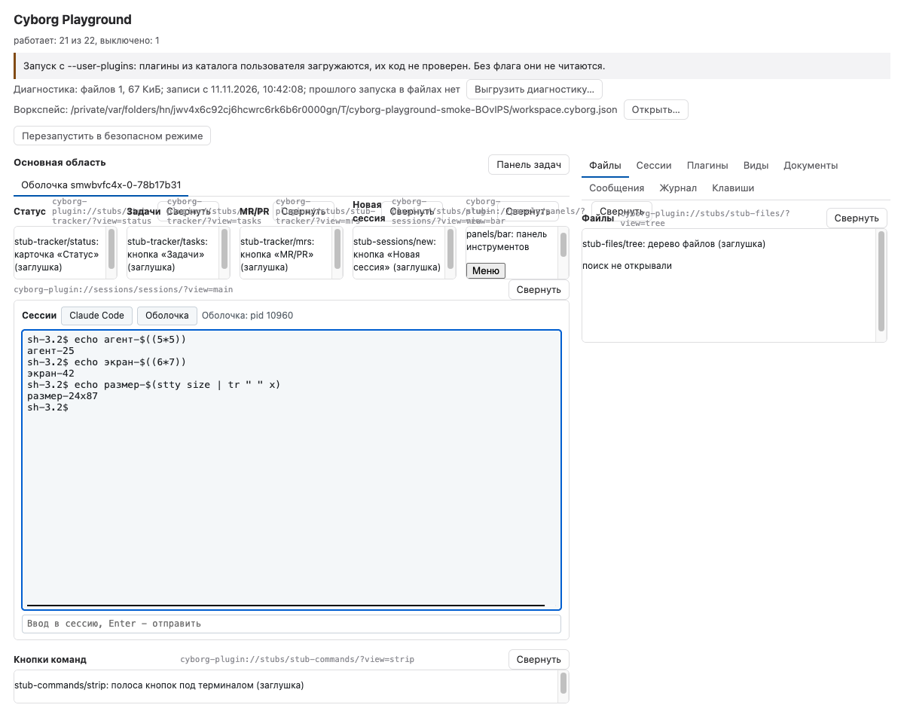
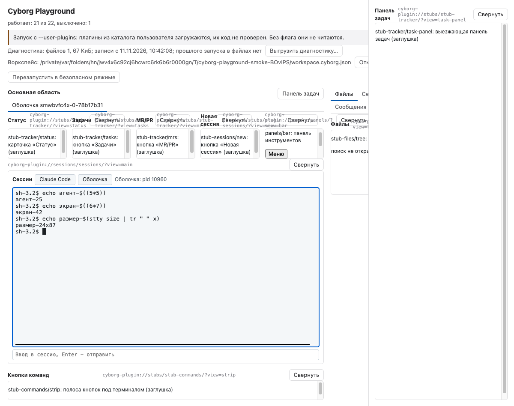

# Пилот PL-08: раскладка окна Cyborg на областях и вкладах в меню

Задача [PL-08 #32](https://github.com/dex-it/cyborg-harness/issues/32). Дата: 2026-11-11. Вопрос: можно ли собрать окно, похожее на Cyborg по расположению и порядку, из данных ядра (род области, `order`, `title` вида; вклады в меню; заголовок окна), не называя плагины по именам в коде окна. Результат: да, на существующих пяти родах областей; нового рода не потребовалось. Граница «ядро/приложение» записана в [SAD, 3.8](../04-architecture/design/sad.md#38-изоляция-рендера), решения - в [SAD, раздел 8, п. 25](../04-architecture/design/sad.md#8-открытые-вопросы).

Файл лежит в `docs/05-verification/`: в задаче назван `docs/04-verification/`, но так устроен `.docs_layout` репозитория.

## Что сделано

| Пункт задачи | Что в репозитории |
|---|---|
| 1. Раскладка из ядра, без имён плагинов | `Kernel.layout` (K-03) читает окно: `playground/src/renderer/window-plan.ts` (`windowPlan`) раскладывает виды по областям и вкладкам, `views-panel.ts` ставит их. Тест на имена плагинов в исходниках окна: `playground/test/plugins-model.test.ts` («в renderer нет строковых имён плагинов»); модель - `playground/test/window-plan.test.ts` |
| 2. Области Cyborg и соответствие родам SAD | Таблицы ниже; граница - SAD 3.8 |
| 3. Вклады в меню от плагинов | `contributes.menus` у `stub-project`, `stub-files`, `stub-tracker`; тест - `playground/test/pilot-shell.test.ts` («меню окна…»), smoke - блок «пилот PL-08» |
| 4. Заголовок окна из вкладов плагинов | `stub-project` ставит фрагмент `ctx.window.setTitle`; тест - `pilot-shell.test.ts` («заголовок окна…»), smoke - `BrowserWindow.getTitle()` |
| 5. Экран на пилотных плагинах, `F6` / `Shift+F6`, вкладки с клавиатуры | Плагины `stub-*` и `sessions`; `playground/src/renderer/focus.ts`, `side-tabs.ts`, `session-strip.ts`; smoke - «порядок фокуса» |
| 6. Отключение вида без перезагрузки | smoke - «перестройка»; модель - тест «снятый плагин остаётся в своей области заглушкой» |
| 7. Документ, снимок, таблица | Этот файл, снимки `pl08-window.png` и `pl08-window-popup.png` |

## Области Cyborg на родах областей SAD

| Область Cyborg | Род области SAD | Как задано в манифесте | Что рисует окно |
|---|---|---|---|
| Полоса сессий | `main` (документы) | `documents.session.area: "main"`, `order` типа | Вкладки документов основной области над панелью инструментов; порядок - `order` типа, затем порядок открытия |
| Боковая панель с вкладками «Файлы/Сессии» | `sidebar` | `ui.views.<имя>: { area: "sidebar", order, title }` | Вид с `title` - отдельная вкладка колонки с подписью `title`; вид без `title` - в общей сетке вкладки «Виды» |
| Панель инструментов основной области («Статус», «Задачи», «MR/PR», «Новая сессия») | `toolbar` | `area: "toolbar"`, `order` 100..400 | Полоса видов над основной областью слева направо |
| Полоса кнопок под терминалом | `main` | `area: "main"`, `order` позже терминала | Основная область выкладывает виды друг под другом по `order`: терминал занимает всё место, следующие - полосу |
| Выезжающая панель задач | `popup` | `area: "popup"`, `title` | Панель справа во всю высоту; кнопка окна с подписью `title` открывает и закрывает её, закрытая недоступна для фокуса |

Нового рода области не заведено. Полоса под терминалом как *содержимое от других плагинов* (кнопки отдаёт `command-buttons`, рисует владелец) - вклад данных, [спорный пункт 12 SAD2](../04-architecture/design/sad2-disputed-points.md#12-полоса-кнопок-под-терминалом), вариант (в); в пилоте это заглушка вида `main`.

## Таблица «область Cyborg - плагин - вид - kind - order»

Снимает `playground/test/pilot-shell.test.ts` по настоящим манифестам через `Kernel.layout`.

| Область Cyborg | Плагин | Вид / тип | kind | area | order | title |
|---|---|---|---|---|---|---|
| Полоса сессий | `sessions` | `session` | document | `main` | 100 | - |
| Основная область (терминал) | `sessions` | `main` | view | `main` | 100 | - |
| Полоса под терминалом | `stub-commands` | `strip` | view | `main` | 200 | Кнопки команд |
| Панель инструментов | `stub-tracker` | `status` | view | `toolbar` | 100 | Статус |
| Панель инструментов | `stub-tracker` | `tasks` | view | `toolbar` | 200 | Задачи |
| Панель инструментов | `stub-tracker` | `mrs` | view | `toolbar` | 300 | MR/PR |
| Панель инструментов | `stub-sessions` | `new` | view | `toolbar` | 400 | Новая сессия |
| Боковая панель, вкладка | `stub-files` | `tree` | view | `sidebar` | 100 | Файлы |
| Боковая панель, вкладка | `stub-sessions` | `list` | view | `sidebar` | 200 | Сессии |
| Выезжающая панель | `stub-tracker` | `task-panel` | view | `popup` | 100 | Панель задач |

Демо `panels` перенесено в конец панели инструментов (`bar`, `order` 900) и лишено `title` у вида `panel`, чтобы не становиться вкладкой боковой колонки: проверки демо не меняются.

## Меню

| Пункт | Меню | Плагин | `enabled` / `checked` | Сочетание |
|---|---|---|---|---|
| Свойства проекта | `workspace` | `stub-project` | `enabled`: `demo.project.hasSelected` | - |
| Уведомления | `view` | `stub-project` | `checked`: `demo.project.notificationsOn` | - |
| Поиск | `view` | `stub-files` | `enabled`: `demo.project.hasSelected` (контракт соседа, `optional`) | `CmdOrCtrl+Shift+F` |
| Расширения | `tools` | `stub-tracker` | доступен, пока работает плагин | - |

Нажатие выполняет команду плагина вкладчика (`Kernel.runMenuItem`): «Поиск» вызывает `stub-files.search`, та шлёт толчок виду «Файлы» по каналу, вид пишет «поиск открыт командой плагина» (проверено в тесте и в smoke). «Следующий проект» (`stub-project.next`) меняет состояние: проект Альфа, Бета, снова без проекта; пункты двух плагинов идут за ним, заголовок окна получает название проекта: `<воркспейс> - Альфа - Cyborg Playground`.

Пункты, которых в задаче нет в виде плагинов: «Воркспейс» - это меню (`workspace`), его пункт «Свойства проекта» и пришёл от плагина; роли `appMenu`, `editMenu` остаются у приложения.

## Порядок фокуса

`F6` идёт по областям в порядке окна, внутри области - по `order` ядра: Статус, Задачи, MR/PR, Новая сессия, демо `bar`, терминал, полоса под ним, (открытая выезжающая панель), вкладки боковой колонки (выбранная вкладка), открытая панель окна. `Shift+F6` - в обратную сторону, оба по кругу. Закрытая панель (`inert`) и скрытые вкладки пропускаются. Вкладки боковой колонки и полоса сессий ходят стрелками, `Home` / `End` - в начало и конец. Проверяет smoke («порядок фокуса»).

## Перестройка

Выгрузка `stub-tracker` кнопкой «Выгрузить» в списке плагинов ставит заглушки с причиной на места трёх видов панели инструментов и вида выезжающей панели; порядок остальных видов прежний, фреймы соседей не пересоздаются (признаки на элементе и в документе соседнего вида сохраняются), окно не перезагружается. Выгрузка `stub-files` оставляет вкладку «Файлы» с заглушкой. «Загрузить» возвращает виды на их места. Проверяет smoke («перестройка»).

Порядок уже созданных видов окно меняет стилем (`order`), а не переносом `<iframe>`: перенос перезагружает документ. `order` в манифесте меняется только перезапуском, поэтому живой smoke перестановки не проверяет: она закрыта тестом модели (план идёт порядком снимка) и кодом `ViewsPanel.sync`.

## Снимок окна

Снимки сделаны smoke с `CYBORG_SMOKE_SHOT=<путь без расширения> npm run smoke`.

## Что не проверено

- Пункты меню нажимались из кода (`MenuItem.click`), а не мышью в меню ОС.
- Ручная проверка меню и `F6` на живом Cyborg-подобном сценарии с настоящим `claude` не делалась (нет входа). Что сделать человеку: `npm run build && npx electron playground/dist/main.js`, выбрать «Плагины» - «Следующий проект», убедиться, что «Свойства проекта» и «Поиск» стали доступны, заголовок окна сменился.
- Перестановка `order` на ходу (см. выше).
- Нажатие на вкладку полосы сессий только выбирает её в окне: переключение содержимого терминала по выбору вкладки - дело плагина `sessions` и API для него нет.

## Открытые наблюдения

- Просьбы «показать выезжающую панель» из плагина в API нет: кнопка окна.
- Видимость видов выезжающей панели (`setViewVisible`) от открытия панели не зависит.
- Расстановка, которую меняет человек (порядок вкладок, ширины), не сохраняется - SAD 3.8, «Дальше».
- Вопросы 1 (просмотр файла) и 2 SAD остаются как были.
