# Эпик: микроядро Cyborg Harness, готовое к системе плагинов

> Эпик в GitHub: [#15](https://github.com/dex-it/cyborg-harness/issues/15). Здесь полное описание, карта, план по итерациям и реестр задач. Статус каждой задачи - в самих issues; этот документ описывает замысел и порядок.

## 1. Цель

Довести `core/`, `contracts/` и слой склейки с Electron до состояния, в котором:

1. приложение (Cyborg и любое другое) подключает ядро и пакет контрактов как зависимости, а не копированием файлов из `playground/`;
2. автор плагина получает документацию, шаблон, сборку, проверку и тест-кит, не заглядывая в код ядра;
3. сценарии, ради которых Cyborg вообще переезжает на ядро (терминал агента под нагрузкой, уведомления, единый реестр сочетаний, дерево и git через границу плагинов, Monaco, миграция данных, CLI-плагины с отменой, раскладка окна), доказаны на ядре пилотами.

После эпика можно переносить функции Cyborg в плагины (следующий эпик), не меняя ядро под каждую из них.

## 2. Что значит «готово»

1. Цели SAD 3.1-3.10 выполнены, кроме явно вынесенных (источник секретов `cyborg.secret-source`, включение плагина вне графа без перезапуска, этап 2).
2. В `core/src` нет предметных имён и npm-зависимостей: проверяет тест, а не ревью.
3. API плагина (`PluginContext`, `UiContext`, манифест, элементы `cy-*`) зафиксирован как 1.0: снимок API под тестом, справочник и руководство опубликованы.
4. Приложение подключает `@cyborg-harness/core`, `@cyborg-harness/contracts` и `@cyborg-harness/electron` по номеру версии.
5. Автору плагина доступны шаблон, сборка, `checkPlugin` и тест-кит; человек со стороны за один заход собирает плагин с видом, командой, контрактом и разделом `config`.
6. Бюджеты заданы числами и проверяются в CI; macOS подтверждён замерами и настоящей клавиатурой.
7. Принята политика загрузки плагинов из каталога пользователя на этапе 1.
8. SAD и ADR приняты владельцем (сейчас `review`/`proposed`).
9. Пилоты PL-01..PL-09 пройдены, результаты записаны в `docs/05-verification/`.

## 3. Границы

**Входит:** остаток этапа 1 SAD (см. [roadmap](roadmap.md)), оформление ядра и адаптера как пакетов, поверхность автора плагина, техдолг и проверки, пилоты Cyborg.

**Не входит:**

- этап 2 SAD (процесс на плагин с `--permission`, `Compartment`, окна согласия, установка из внешнего источника, `openat`): нет повода (SAD 6.2), решения по вопросам 7 и 8 не приняты. Три дешёвые страховки для него входят: K-15, K-17, P-06;
- полный перенос функций Cyborg в плагины (трекеры целиком, кнопки-команды целиком, расширения Claude Code, поиск, проекты с диалогами, история с удалением, оболочка, вывод ai-cyborg из эксплуатации): отдельный эпик после этого;
- Windows (вопрос 12 SAD): решение в D-00;
- источник секретов `cyborg.secret-source`, включение плагина вне графа: отложены владельцем.

## 4. Карта

```mermaid
flowchart TB
  subgraph W0["Итерация 0: решения и спайки"]
    D00["D-00 решения"]
    SP01["SP-01 хвост или снимок pty"]
  end
  subgraph W1["Итерация 1: независимые доработки"]
    direction LR
    K02["K-02 льготное время pty"]
    K11["K-11 safe mode"]
    K14["K-14 пределы и горячий путь pty"]
    K15["K-15 cyborg.* только встроенным"]
    K16["K-16 fs.write + openPath"]
    K18["K-18 мелочи"]
    K19["K-19 уведомления, заголовок"]
    T["T-01..T-05, T-07, T-11"]
    PL09["PL-09 метрики Cyborg"]
  end
  subgraph W2["Итерация 2: пакеты и форма API"]
    direction LR
    P02["P-02 @cyborg-harness/core"] --> P03["P-03 @cyborg-harness/electron"]
    P01["P-01 @cyborg-harness/contracts"]
    P02 --> P08["P-08 тест-кит"]
    P02 --> P09["P-09 checkPlugin"]
    K03["K-03 области, order"]
    K06["K-06 @deprecated"]
    K10["K-10 удаление плагина"]
    K12["K-12 ctx.os"]
    K17["K-17 каталог пользователя"]
    T08["T-08 разбить loader.ts"]
    T09["T-09 экспорт ядра"]
  end
  subgraph W3["Итерация 3: крупные узлы"]
    direction LR
    K01["K-01 pty-хост"]
    K04["K-04 группы рендера"]
    K05["K-05 строгая CSP"]
    K07["K-07 реестр сочетаний"]
    K08["K-08 меню"]
    K09["K-09 отмена запросов"]
    K13["K-13 канал вид - главная часть"]
    K20["K-20 экземпляры"]
    P05["P-05 шаблон"]
    P06["P-06 сборка плагинов"]
    P07["P-07 поставка"]
    T10["T-10 упакованная сборка"]
    PL05["PL-05 Monaco + xterm"]
    K28["K-28 - K-30 диагностика"]
    T06["T-06 снимок API"]
    P10["P-10 CI и бюджеты"]
    PL0204["PL-02, PL-04 ранние пилоты"]
  end
  subgraph W4["Итерация 4: пилоты и заморозка"]
    direction LR
    PL["PL-01, PL-03, PL-06 - PL-08 пилоты"]
    K21["K-21 заморозка API 1.0 - последней"]
    P04["P-04 документация автору"]
    P11["P-11 приёмка, план миграции"]
  end
  W0 --> W2
  W0 --> W3
  W1 --> W2
  W2 --> W3
  W3 --> W4
```

Слои, которые затрагивает эпик:

| Слой | Где | Что меняется |
|---|---|---|
| Ядро | `core/src` | пакет `@cyborg-harness/core`, остаток этапа 1, реестр сочетаний, меню, отмена запросов, области, группы рендера |
| Контракты | `contracts/` | пакет `@cyborg-harness/contracts`, версия, снимок API, вынос демо-контрактов |
| Адаптер Electron | сейчас `playground/src/main`, `playground/src/renderer` | пакет `@cyborg-harness/electron`: хосты, адаптер ОС, схема `cyborg-plugin://`, мост, оболочка вида |
| Плагины и инструменты | `playground/plugins`, новые каталоги | шаблон, сборка, `checkPlugin`, тест-кит |
| Документы и CI | `docs/`, `.github/` | руководство автору, релизы пакетов, бюджеты, проверка ссылок |

## 5. План по итерациям

Порядок работ с 2026-11-09 - слияние итерации 2, решения, линии итерации 3 и условия заморозки - [дорожная карта, раздел 17](roadmap.md#17-порядок-работ); состояние задач - там же. Итерация - набор задач, которые можно вести параллельно разными людьми; следующая начинается, когда закрыты задачи, от которых зависят её первые. Внутри итерации порядок не важен, если иное не указано в «Зависимостях» задачи.

### Итерация 0. Решения и спайки

Цель: снять блокеры до того, как люди начнут писать код.

- **D-00** решения владельца и автора SAD: форма API (вопрос 15), бюджеты (вопрос 9), Windows (вопрос 12), порядок областей (вопрос 2), запреты аргументов (вопрос 5), цепочка `fs.write` + `shell.openPath`, как приложение получает ядро (пакеты), политика каталога пользователя, число экземпляров приложения, судьба `eager`-восстановления сессий, место встроенных плагинов, приёмка ADR-0012 и ADR-0014.
- **SP-01** спайк: хвост pty или снимок терминала.

### Итерация 1. Независимые доработки

Цель: закрыть всё, что не упирается в чужие решения и не конфликтует по файлам. Можно вести одновременно: K-02, K-11, K-14, K-15, K-16, K-18, K-19, T-01..T-05, T-07, T-11, PL-09.

Общие файлы: `core/src/os-gateway.ts` (K-14, K-16, K-18, T-07), `core/src/loader.ts` (K-11, K-15, K-19) - при пересечении сначала сливается меньшая задача.

### Итерация 2. Пакеты и форма API

Цель: ядро и адаптер становятся пакетами; закреплена форма манифеста и API, на которую опираются крупные узлы.

- Линия пакетов: P-02 -> P-03; параллельно P-01 (после T-03), P-08 и P-09 (после P-02), T-09 (после P-02).
- Линия манифеста: K-03, K-06, K-10, K-12, K-17.
- Линия внутренней структуры: **T-08** (разбить `loader.ts`) делается раньше K-04, K-07, K-09 и не параллельно с ними: все правят один файл.

### Итерация 3. Крупные узлы

Цель: самые тяжёлые куски, у которых есть общие зависимости (P-03, T-08, решения D-00).

- Процессы: K-01 (pty-хост), K-20 (экземпляры).
- Окно: K-04, K-05, K-13, PL-05 (Monaco и xterm - заранее, чтобы K-05 не гадал о CSP).
- Клавиши, меню, отмена: K-07, затем K-08; K-09 независимо.
- Плагины: P-06 (после P-09), P-07, P-05 (после P-06 и P-08), T-10.
- Диагностика: K-29 (меняет `PluginContext`), затем K-30; K-28 - параллельно.
- Проверки и ранние пилоты: T-06, P-10 (после P-03), PL-02, PL-04 (после K-12) - перенесены из итерации 4, чтобы API проверялся тестом и потребителем до заморозки.
- Остатки ревью и тесты: T-12 (после T-08), T-13 (стабильность macOS CI), T-14 (после P-03 и K-03), #136 (после K-27; закрыть до появления плагина `projects`).

### Итерация 4. Пилоты Cyborg и заморозка API

Цель: доказать сценарии Cyborg на ядре и зафиксировать API 1.0.

- Пилоты PL-01, PL-03, PL-06, PL-07, PL-08 запускаются по мере готовности своих зависимостей (см. реестр), не все сразу.
- K-21 (заморозка API 1.0) - последней: после пилотов, кроме PL-01, после K-29, K-30 и задач, закрывающих угрозы этапа 1 со статусом «открыто» (NFR-CH-2003): P-06 и #134 (K-17, K-22, K-10, K-25 влиты к 2026-11-09). Затем P-04 (документация автору), P-11 (приёмка и план миграции Cyborg в репозитории ai-cyborg).

### Критический путь

D-00 -> P-02 -> P-03 -> K-13 -> PL-06 -> K-21; параллельно D-00 и T-08 -> K-07 -> K-08 -> {PL-03, PL-08} -> K-21; K-03 -> {K-04, K-08}. Самая длинная цепочка вне пути к заморозке: P-03 -> K-01 -> PL-01. Самые долгие независимые задачи: K-01, K-04, K-07 (размер L). Решение по форме API (вопрос 15) блокирует K-08, K-09 и тем самым K-21. На 2026-11-09 T-08, K-03, K-07, P-02 и P-03 влиты: вторая цепочка начинается с формы поля меню (D-00, строка 8) -> K-08, первая - с K-13.

## 6. Реестр задач

### Итерация 0. Решения и спайки

Снять блокеры до того, как люди начнут писать код: решения владельца и автора SAD, короткие исследования.

| Задача | Название | Размер | Зависит от |
|---|---|---|---|
| [D-00](https://github.com/dex-it/cyborg-harness/issues/21) | Решения владельца, блокирующие эпик | S | - |
| [SP-01](https://github.com/dex-it/cyborg-harness/issues/24) | Спайк: хвост pty или снимок терминала (вопрос 14 SAD) | S | - |

### Итерация 1. Независимые доработки

Закрыть всё, что не упирается в чужие решения и не конфликтует по файлам. Задачи ведутся одновременно.

| Задача | Название | Размер | Зависит от |
|---|---|---|---|
| [K-02](https://github.com/dex-it/cyborg-harness/issues/31) | Льготное время осиротевшего pty | S | - |
| [K-11](https://github.com/dex-it/cyborg-harness/issues/50) | Переключатель безопасного режима в приложении | S | - |
| [K-14](https://github.com/dex-it/cyborg-harness/issues/58) | Пределы ресурсов и горячий путь pty: лимит ввода, пакетирование вывода, COLORTERM | M | - |
| [K-15](https://github.com/dex-it/cyborg-harness/issues/53) | Пространство контрактов cyborg.* только для встроенных плагинов | S | - |
| [K-16](https://github.com/dex-it/cyborg-harness/issues/54) | Цепочка fs.write + shell.openPath: принять решение и закрыть | S | [D-00](https://github.com/dex-it/cyborg-harness/issues/21) |
| [K-18](https://github.com/dex-it/cyborg-harness/issues/56) | Мелочи ядра из спорных пунктов: область path:open, показать файл воркспейса, копия повреждённого файла, experimental_ | M | [D-00](https://github.com/dex-it/cyborg-harness/issues/21) |
| [K-19](https://github.com/dex-it/cyborg-harness/issues/57) | Уведомления с кликом и закрытием; заголовок окна от плагинов | M | - |
| [PL-09](https://github.com/dex-it/cyborg-harness/issues/37) | Базовые метрики Cyborg и записанные сессии для сравнения | M | - |
| [T-01](https://github.com/dex-it/cyborg-harness/issues/48) | Неперехваченные ошибки вне вызова в хосте: проверить итог PR #5 и закрыть остаток | S | PR #5 |
| [T-02](https://github.com/dex-it/cyborg-harness/issues/49) | Предметные имена в core/src/workspace.ts вынести в хук приложения | S | - |
| [K-24](https://github.com/dex-it/cyborg-harness/issues/84) | Кнопки следующего шага не отвечают за человека | S | - |
| [K-25](https://github.com/dex-it/cyborg-harness/issues/85) | net.fetch не ведёт на локальные и частные адреса | S | [T-07](https://github.com/dex-it/cyborg-harness/issues/14), [K-14](https://github.com/dex-it/cyborg-harness/issues/58) |
| [K-26](https://github.com/dex-it/cyborg-harness/issues/86) | Окно не открывает новых окон и не уходит со своих адресов | S | - |
| [T-03](https://github.com/dex-it/cyborg-harness/issues/51) | Один источник версии API и демо-контракты вне боевого пакета | S | - |
| [T-04](https://github.com/dex-it/cyborg-harness/issues/52) | Тест чистоты ядра: нет предметных имён, Electron и npm-зависимостей | S | [T-02](https://github.com/dex-it/cyborg-harness/issues/49) |
| [T-05](https://github.com/dex-it/cyborg-harness/issues/10) | Тест: секрет не попадает в журнал, config и state | S | - |
| [T-07](https://github.com/dex-it/cyborg-harness/issues/14) | Задержка шлюза ctx.os на горячих путях и бюджеты | M | [D-00](https://github.com/dex-it/cyborg-harness/issues/21) |
| [T-11](https://github.com/dex-it/cyborg-harness/issues/26) | Гигиена кода и документов: комментарии, нумерация вопросов, имена ADR, расхождения roadmap | S | - |

### Итерация 2. Пакеты и форма API

Ядро и адаптер становятся пакетами; закрепляется форма манифеста и API, на которую опираются крупные узлы.

| Задача | Название | Размер | Зависит от |
|---|---|---|---|
| [K-03](https://github.com/dex-it/cyborg-harness/issues/33) | Род области, order и kind вида в манифесте; раскладка из ядра | M | [D-00](https://github.com/dex-it/cyborg-harness/issues/21) |
| [K-06](https://github.com/dex-it/cyborg-harness/issues/41) | Журнал вызовов членов контракта с @deprecated | M | [D-00](https://github.com/dex-it/cyborg-harness/issues/21) |
| [K-10](https://github.com/dex-it/cyborg-harness/issues/47) | Удаление плагина с зачисткой его данных, секретов и прав | M | - |
| [K-12](https://github.com/dex-it/cyborg-harness/issues/59) | Достаточность ctx.os для базовых плагинов (fs, process, net) | M | [D-00](https://github.com/dex-it/cyborg-harness/issues/21) |
| [K-17](https://github.com/dex-it/cyborg-harness/issues/55) | Политика загрузки плагинов из каталога пользователя на этапе 1 | S | [D-00](https://github.com/dex-it/cyborg-harness/issues/21) |
| [K-22](https://github.com/dex-it/cyborg-harness/issues/82) | Права вызывающего у команд: кому открыта команда | S | - |
| [K-23](https://github.com/dex-it/cyborg-harness/issues/83) | Агент в модели доверия: текст агенту, инструменты MCP, граница prompt injection | S | [K-15](https://github.com/dex-it/cyborg-harness/issues/53) |
| [K-27](https://github.com/dex-it/cyborg-harness/issues/87) | Доверие к воркспейсу: значения, расширяющие права, не из файла воркспейса | M | [D-00](https://github.com/dex-it/cyborg-harness/issues/21) |
| [P-01](https://github.com/dex-it/cyborg-harness/issues/29) | Версионирование и публикация @cyborg-harness/contracts | M | [D-00](https://github.com/dex-it/cyborg-harness/issues/21), [T-03](https://github.com/dex-it/cyborg-harness/issues/51) |
| [P-02](https://github.com/dex-it/cyborg-harness/issues/34) | Ядро как пакет @cyborg-harness/core | L | [D-00](https://github.com/dex-it/cyborg-harness/issues/21) |
| [P-03](https://github.com/dex-it/cyborg-harness/issues/35) | Адаптер Electron как пакет @cyborg-harness/electron | L | [P-02](https://github.com/dex-it/cyborg-harness/issues/34) |
| [P-08](https://github.com/dex-it/cyborg-harness/issues/8) | Тест-кит для авторов и общий набор тестов контрактов | M | [P-02](https://github.com/dex-it/cyborg-harness/issues/34) |
| [P-09](https://github.com/dex-it/cyborg-harness/issues/9) | Проверка плагина вне репозитория: checkPlugin | M | [P-02](https://github.com/dex-it/cyborg-harness/issues/34) |
| [T-08](https://github.com/dex-it/cyborg-harness/issues/16) | Разбить loader.ts на части без смены поведения | M | - |
| [T-09](https://github.com/dex-it/cyborg-harness/issues/20) | Публичный экспорт ядра для встраивающего приложения | S | [P-02](https://github.com/dex-it/cyborg-harness/issues/34) |

### Итерация 3. Крупные узлы

Самые тяжёлые куски, у которых есть общие зависимости: процессы, окно, клавиши и меню, сборка плагинов.

| Задача | Название | Размер | Зависит от |
|---|---|---|---|
| [K-01](https://github.com/dex-it/cyborg-harness/issues/27) | pty-хост отдельным процессом ядра | L | [D-00](https://github.com/dex-it/cyborg-harness/issues/21), [SP-01](https://github.com/dex-it/cyborg-harness/issues/24), [P-03](https://github.com/dex-it/cyborg-harness/issues/35) |
| [K-04](https://github.com/dex-it/cyborg-harness/issues/36) | Группы рендера: ui.group, plugins.uiGroups, origin по группе | L | [K-03](https://github.com/dex-it/cyborg-harness/issues/33), [P-03](https://github.com/dex-it/cyborg-harness/issues/35), [T-08](https://github.com/dex-it/cyborg-harness/issues/16) |
| [K-05](https://github.com/dex-it/cyborg-harness/issues/40) | Строгая CSP вида и флаг инлайн-стилей | M | [P-03](https://github.com/dex-it/cyborg-harness/issues/35), [PL-05](https://github.com/dex-it/cyborg-harness/issues/25) |
| [K-07](https://github.com/dex-it/cyborg-harness/issues/44) | ctx.keys.register с условием и единый реестр сочетаний (закрывает D-27) | L | [D-00](https://github.com/dex-it/cyborg-harness/issues/21), [T-08](https://github.com/dex-it/cyborg-harness/issues/16) |
| [K-08](https://github.com/dex-it/cyborg-harness/issues/45) | Вклады плагинов в меню окна (contributes.menus) | M | [D-00](https://github.com/dex-it/cyborg-harness/issues/21), [K-03](https://github.com/dex-it/cyborg-harness/issues/33), [K-07](https://github.com/dex-it/cyborg-harness/issues/44) |
| [K-09](https://github.com/dex-it/cyborg-harness/issues/46) | Отмена запросов между плагинами (идентификатор и сообщение отмены) | M | [D-00](https://github.com/dex-it/cyborg-harness/issues/21), [T-08](https://github.com/dex-it/cyborg-harness/issues/16) |
| [K-13](https://github.com/dex-it/cyborg-harness/issues/60) | Канал «главная часть - вид» и модальные окна плагина | M | [P-03](https://github.com/dex-it/cyborg-harness/issues/35), [K-07](https://github.com/dex-it/cyborg-harness/issues/44) |
| [K-20](https://github.com/dex-it/cyborg-harness/issues/61) | Несколько воркспейсов и экземпляров приложения | M | [D-00](https://github.com/dex-it/cyborg-harness/issues/21) |
| [P-05](https://github.com/dex-it/cyborg-harness/issues/39) | Шаблон плагина и минимальный пример | M | [P-06](https://github.com/dex-it/cyborg-harness/issues/42), [P-08](https://github.com/dex-it/cyborg-harness/issues/8) |
| [P-06](https://github.com/dex-it/cyborg-harness/issues/42) | Сборка и упаковка плагинов: бандл главной части, проверка состава | L | [P-09](https://github.com/dex-it/cyborg-harness/issues/9) |
| [P-07](https://github.com/dex-it/cyborg-harness/issues/43) | Загрузка встроенных плагинов из каталога поставки | M | [P-03](https://github.com/dex-it/cyborg-harness/issues/35), [P-06](https://github.com/dex-it/cyborg-harness/issues/42) |
| [PL-05](https://github.com/dex-it/cyborg-harness/issues/25) | Пилот: Monaco и xterm в iframe на cyborg-plugin:// | M | - |
| [T-10](https://github.com/dex-it/cyborg-harness/issues/22) | Загрузка .ts/.js плагинов вне репозитория и из упакованной сборки | M | [P-06](https://github.com/dex-it/cyborg-harness/issues/42), [P-07](https://github.com/dex-it/cyborg-harness/issues/43) |
| [T-06](https://github.com/dex-it/cyborg-harness/issues/12) | Снимок публичного API под тестом | M | - |
| [P-10](https://github.com/dex-it/cyborg-harness/issues/11) | CI и релизы: публикация пакетов, бюджеты, проверка ссылок | M | [P-01](https://github.com/dex-it/cyborg-harness/issues/29), [P-02](https://github.com/dex-it/cyborg-harness/issues/34), [P-03](https://github.com/dex-it/cyborg-harness/issues/35), [T-07](https://github.com/dex-it/cyborg-harness/issues/14) |
| [PL-02](https://github.com/dex-it/cyborg-harness/issues/18) | Пилот: цепочка хук - статус - уведомление в другом плагине | M | [K-19](https://github.com/dex-it/cyborg-harness/issues/57) |
| [PL-04](https://github.com/dex-it/cyborg-harness/issues/23) | Пилот: дерево файлов и git через границу плагинов, fs.watch вместо опроса | L | [K-12](https://github.com/dex-it/cyborg-harness/issues/59), [T-07](https://github.com/dex-it/cyborg-harness/issues/14) |
| [K-28](https://github.com/dex-it/cyborg-harness/issues/116) | Трасса операций на границах Г1 - Г5 | L | [T-08](https://github.com/dex-it/cyborg-harness/issues/16), [P-03](https://github.com/dex-it/cyborg-harness/issues/35) |
| [K-29](https://github.com/dex-it/cyborg-harness/issues/117) | ctx.log с уровнем, вывод хоста по плагину, предел строк | M | [T-08](https://github.com/dex-it/cyborg-harness/issues/16), [P-01](https://github.com/dex-it/cyborg-harness/issues/29) |
| [K-30](https://github.com/dex-it/cyborg-harness/issues/118) | Хранение диагностики: кольцо, файл с ротацией, выгрузка | L | [K-29](https://github.com/dex-it/cyborg-harness/issues/117), [P-03](https://github.com/dex-it/cyborg-harness/issues/35) |
| [T-12](https://github.com/dex-it/cyborg-harness/issues/128) | enable поставщика поднимает зависимого и после склеенной записи denied | S | [T-08](https://github.com/dex-it/cyborg-harness/issues/16) |
| [T-13](https://github.com/dex-it/cyborg-harness/issues/129) | Стабильные по времени тесты на macOS CI: ожидание условия вместо пауз, предел времени на файл | M | - |
| [T-14](https://github.com/dex-it/cyborg-harness/issues/130) | Smoke: два вида одного плагина в живом окне | S | [P-03](https://github.com/dex-it/cyborg-harness/issues/35), [K-03](https://github.com/dex-it/cyborg-harness/issues/33) |
| [#136](https://github.com/dex-it/cyborg-harness/issues/136) | Корни области workspace из присланного воркспейса через setRoots (остаток ревью K-27, У-40) | M | [K-27](https://github.com/dex-it/cyborg-harness/issues/87) |

### Итерация 4. Пилоты Cyborg и заморозка API

Доказать сценарии Cyborg на ядре пилотами и зафиксировать API 1.0.

| Задача | Название | Размер | Зависит от |
|---|---|---|---|
| [K-21](https://github.com/dex-it/cyborg-harness/issues/62) | Заморозка API 1.0 | S | [K-03](https://github.com/dex-it/cyborg-harness/issues/33), [K-06](https://github.com/dex-it/cyborg-harness/issues/41), [K-07](https://github.com/dex-it/cyborg-harness/issues/44), [K-08](https://github.com/dex-it/cyborg-harness/issues/45), [K-09](https://github.com/dex-it/cyborg-harness/issues/46), [K-12](https://github.com/dex-it/cyborg-harness/issues/59), [K-13](https://github.com/dex-it/cyborg-harness/issues/60), [T-06](https://github.com/dex-it/cyborg-harness/issues/12), [K-29](https://github.com/dex-it/cyborg-harness/issues/117), [K-30](https://github.com/dex-it/cyborg-harness/issues/118), [K-22](https://github.com/dex-it/cyborg-harness/issues/82), [K-10](https://github.com/dex-it/cyborg-harness/issues/47), [K-25](https://github.com/dex-it/cyborg-harness/issues/85), [K-17](https://github.com/dex-it/cyborg-harness/issues/55), [P-06](https://github.com/dex-it/cyborg-harness/issues/42); пилоты, кроме PL-01 |
| [P-04](https://github.com/dex-it/cyborg-harness/issues/38) | Документация автору плагина: руководство, справочники, схема манифеста | L | [K-17](https://github.com/dex-it/cyborg-harness/issues/55), [K-21](https://github.com/dex-it/cyborg-harness/issues/62) |
| [P-11](https://github.com/dex-it/cyborg-harness/issues/13) | Приёмка документов владельцем и план миграции Cyborg в репозитории ai-cyborg | S | [D-00](https://github.com/dex-it/cyborg-harness/issues/21) |
| [PL-01](https://github.com/dex-it/cyborg-harness/issues/17) | Пилот: настоящая сессия claude через sessions и agent-claude-code под нагрузкой | L | [K-01](https://github.com/dex-it/cyborg-harness/issues/27), [K-14](https://github.com/dex-it/cyborg-harness/issues/58) |
| [PL-03](https://github.com/dex-it/cyborg-harness/issues/19) | Пилот: единый реестр сочетаний на macOS | M | [K-07](https://github.com/dex-it/cyborg-harness/issues/44), [K-08](https://github.com/dex-it/cyborg-harness/issues/45) |
| [PL-06](https://github.com/dex-it/cyborg-harness/issues/28) | Пилот: миграция данных воркспейса и localStorage | M | [T-02](https://github.com/dex-it/cyborg-harness/issues/49), [K-13](https://github.com/dex-it/cyborg-harness/issues/60) |
| [PL-07](https://github.com/dex-it/cyborg-harness/issues/30) | Пилот: CLI-плагин с отменой и пулом процессов (срез трекеров) | M | [K-09](https://github.com/dex-it/cyborg-harness/issues/46), [K-12](https://github.com/dex-it/cyborg-harness/issues/59) |
| [PL-08](https://github.com/dex-it/cyborg-harness/issues/32) | Пилот: раскладка окна Cyborg на областях и вкладах в меню | L | [K-03](https://github.com/dex-it/cyborg-harness/issues/33), [K-08](https://github.com/dex-it/cyborg-harness/issues/45), [K-19](https://github.com/dex-it/cyborg-harness/issues/57) |

### Позже

Вне итераций, пока владелец не примет их в эпик.

| Задача | Название | Размер | Зависит от |
|---|---|---|---|
| [K-31](https://github.com/dex-it/cyborg-harness/issues/119) | Память и CPU по хостам и видам в «Плагины Cyborg» | M | [P-03](https://github.com/dex-it/cyborg-harness/issues/35), [K-30](https://github.com/dex-it/cyborg-harness/issues/118) |
| [K-32](https://github.com/dex-it/cyborg-harness/issues/120) | Доступность каркаса: контраст темы, сочетания и дикторы, граница для видов | M | [K-07](https://github.com/dex-it/cyborg-harness/issues/44) |
| [#134](https://github.com/dex-it/cyborg-harness/issues/134) | Бюджет ввода вида в pty-хост: очередь node-pty растёт и роняет pty-хост (остаток ревью K-01, У-47); итерация не назначена | M | [K-01](https://github.com/dex-it/cyborg-harness/issues/27) |

Размеры: S - до 2 человеко-дней, M - 3-8, L - больше 8 (оценки составителя, не обязательства). Каждая задача содержит: зачем, что сделать, места в коде и документах, критерии приёмки, зависимости и что можно делать параллельно, риски, что не входит.

## 7. Правила для всех задач эпика

1. Задача закрыта, когда выполнены все пункты «Критериев приёмки», а не когда слит код.
2. `npm run typecheck`, `npm run lint`, `npm test` чистые; `smoke` зелёный в CI на macOS и Linux. Новое поведение закреплено тестом ядра или playground.
3. Изменение поведения, видимого автору плагина, сопровождается правкой SAD, ADR или SRS и записью в журнал изменений пакета (после P-01).
4. Ядро не импортирует Electron и ничего из `playground`; в `core/src` нет предметных имён (после T-04 это проверяет тест).
5. Файлы, которые правят многие (`core/src/kernel-types.ts`, `core/src/lifecycle.ts`, `core/src/kernel-context.ts`, `core/src/os-gateway.ts`; до T-08 - `core/src/loader.ts`), не берутся двумя людьми одновременно; порядок указан в «Зависимостях».
6. Решения, которые принимает владелец или автор SAD, вносятся в SAD/ADR и в D-00; без этого задача, которая от них зависит, не стартует.

## 8. Риски эпика

| Риск | Влияние | Мера |
|---|---|---|
| Форма API (вопрос 15) не решена к итерации 3: поле меню открыто, форма отмены ждёт подтверждения; форма keys решена и влита с K-07 | K-08, K-09, K-21 встанут | D-00, строка 8 |
| ~~Ядро остаётся копией из `playground`~~ - снят: ядро - пакет (P-02, PR #103), адаптер - пакет (P-03, PR #115) | перенос Cyborg превращается в копирование | P-02, P-03 раньше крупных узлов |
| ~~`loader.ts` как единое замыкание в 830 строк~~ - снят: T-08 разбил его (PR #105) | конфликты правок, регрессии | T-08 до K-04, K-07, K-09 |
| ~~pty в главном процессе замораживает окно~~ - снят: K-01 вынесла pty в отдельный процесс (PR #126, ADR-CH-0012 принят); остаток - бюджет ввода вида (#134) | потеря сессий агентов | K-01, #134 |
| Бюджеты старта и памяти не заданы (база Cyborg снята PL-09, PR #108) | спор на приёмке, незаметные регрессии | D-00, T-07, P-10 |
| macOS проверен частично | сочетания во фрейме на macOS могут не гаситься | [#7](https://github.com/dex-it/cyborg-harness/issues/7), PL-03 |
| Плагины с npm-зависимостями не загрузятся без бандла | авторы упираются в первую зависимость | P-06 |
| Упаковка (asar, подпись, `node-pty`) не проверена | собранное приложение не запускает плагины | T-10, P-07 |
| Документы в статусах `review` и `proposed` | решения составителя могут быть пересмотрены | D-00, P-11 |

## 9. Источники

- [Анализ готовности ядра](../research/microkernel-readiness.md) - состояние кода и документов, полный перечень работ и противоречий документации;
- [Инвентарь Cyborg и карта переноса](../research/cyborg-migration-inventory.md) - что есть в ai-cyborg, что нужно от ядра, пилоты;
- [SAD](../04-architecture/design/sad.md), [ADR](../04-architecture/adr/), [дорожная карта](roadmap.md), [проверка macOS](../05-verification/macos-check.md), [спорные пункты](../04-architecture/design/sad2-disputed-points.md).

Оба аналитических отчёта подготовлены чтением кода и документов без запуска приложения и тестов: числа и утверждения в них проверяются в задачах.
