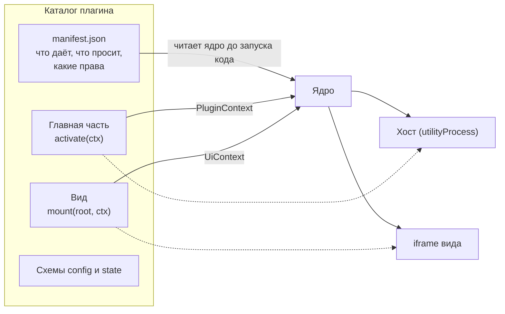

Плагин - каталог с манифестом, главной частью и, по желанию, видом. Всё, что плагин знает о ядре и об остальных плагинах, он узнаёт через `ctx`; всё, что нужно от ОС, просит у шлюза. Ядро не читает ваш код, пока не проверит манифест.

## Из чего состоит плагин

| Часть | Где работает | Что получает от ядра |
|---|---|---|
| Манифест | Читается ядром | Ничего: это описание |
| Главная часть | В хосте плагинов (`utilityProcess`) | `PluginContext`: команды, контракты, `config`, `state`, `ctx.os`, документы, события окна и системы |
| Вид | В `<iframe>` с origin `cyborg-plugin://<группа>/` | `UiContext`: команды своего плагина, контракты, тема, терминал по билету, диалоги, память вида. Без `ctx.os` |

## Правила автора

Эти правила проверяются тестами и инструментом `cyborg-plugin check`, а не ревью.

1. **Главная часть импортирует только `@cyborg/contracts` и свои модули.** Ни `node:*`, ни `electron`, ни чужой плагин. Вид может использовать npm-пакеты, но не `node:*` и не `electron`.
2. **К ОС только через `ctx.os`.** Права объявлены в манифесте; нет права - нет члена в `ctx.os`.
3. **Через границу идут только данные.** Аргументы и результаты методов контракта должны переживать `structuredClone`. Функция, класс и `Map` не проходят (`NotCloneable`).
4. **Методы контракта асинхронные.** Потребитель получает `Remote<T>`, и каждый вызов там возвращает `Promise`.
5. **Синхронная работа дольше секунды недопустима.** Ответ хоста равен самой долгой синхронной работе в нём, и соседи по хосту ждут столько же.
6. **Всё, что регистрируете, кладите в `ctx.subscriptions`** или возвращайте из `activate`: ядро снимет это при выгрузке в обратном порядке.

:::caution[Честная граница]
Хост защищает окно и соседей от падения плагина, но не защищает от злого кода внутри процесса: плагины одного хоста живут в одном процессе, а статическая проверка импортов ловит дисциплину, а не обход. Для сторонних плагинов ядро всегда даёт отдельный хост. Что именно гарантируется - на странице [Границы доверия](/concepts/trust/).
:::

## Путь автора

1. [Первый плагин](/start/first-plugin/) - пятнадцать минут от нуля до работающего плагина.
2. [Манифест](/authors/manifest/) - что объявить.
3. [Главная часть](/authors/main-api/) и [Вид](/authors/view-api/) - что писать.
4. [Контракты](/authors/contracts/) - как отдавать и брать возможности у других плагинов.
5. [Тестирование](/authors/testing/) - проверить без Electron.
6. [Сборка и упаковка](/authors/packaging/) - подготовить к поставке.
7. [Рецепты](/authors/recipes/) - решения типичных задач.

## Жизнь плагина в одну строку

Манифест разобран, граф контрактов сошёлся, разделы `config` и `state` прошли схему и миграцию, вызван `activate`, плагин работает под сторожем, при выгрузке снято всё, что он зарегистрировал. Подробно - [Жизненный цикл](/concepts/lifecycle/).

## Дальше

- [Первый плагин](/start/first-plugin/) - если ещё не писали ни одного.
- [Манифест](/authors/manifest/) - следующий шаг руководства.
- [Справка по манифесту](/reference/manifest/) - сухая таблица полей.
- [Модель контрактов](/concepts/contracts-model/) - зачем контракты и какие у них правила.
