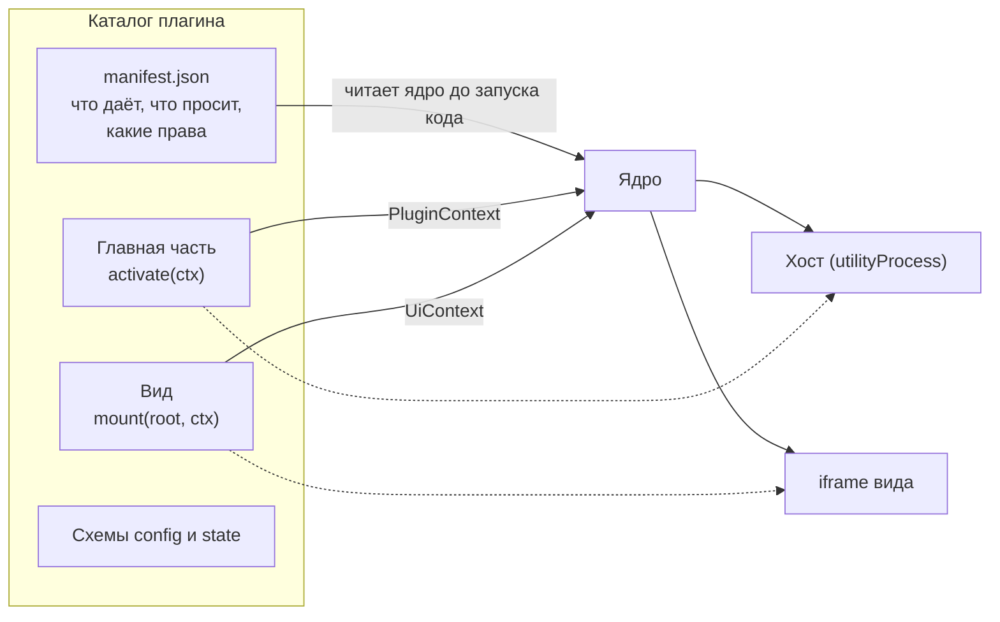

Плагин - каталог с манифестом, главной частью и, по желанию, видом. Всё, что плагин знает о ядре и об остальных плагинах, он узнаёт через `ctx`; всё, что нужно от ОС, просит у шлюза. Ядро не читает ваш код, пока не проверит манифест.

## Из чего состоит плагин

| Часть | Где работает | Что получает от ядра |
|---|---|---|
| Манифест | Читается ядром | Ничего: это описание |
| Главная часть | В хосте плагинов (`utilityProcess`) | `PluginContext`: команды, контракты, `config`, `state`, `ctx.os`, документы, события окна и системы |
| Вид | В `<iframe>` с origin `cyborg-plugin://<группа>/` | `UiContext`: команды своего плагина, контракты, тема, терминал по билету, диалоги, память вида. Без `ctx.os` |

## Правила автора

Эти правила проверяются тестами и инструментом `cyborg-plugin check`, а не ревью.

1. **Главная часть импортирует только `@cyborg-harness/contracts` и свои модули.** Ни `node:*`, ни `electron`, ни чужой плагин. Вид может использовать npm-пакеты, но не `node:*` и не `electron`.
2. **К ОС только через `ctx.os`.** Права объявлены в манифесте; нет права - нет члена в `ctx.os`.
3. **Через границу идут только данные.** Аргументы и результаты методов контракта должны переживать `structuredClone`. Функция, класс и `Map` не проходят (`NotCloneable`).
4. **Методы контракта асинхронные.** Потребитель получает `Remote<T>`, и каждый вызов там возвращает `Promise`.
5. **Синхронная работа дольше секунды недопустима.** Ответ хоста равен самой долгой синхронной работе в нём, и соседи по хосту ждут столько же.
6. **Всё, что регистрируете, кладите в `ctx.subscriptions`** или возвращайте из `activate`: ядро снимет это при выгрузке в обратном порядке.

:::caution[Честная граница]
Хост защищает окно и соседей от падения плагина, но не защищает от злого кода внутри процесса: плагины одного хоста живут в одном процессе, а статическая проверка импортов ловит дисциплину, а не обход. Для сторонних плагинов ядро всегда даёт отдельный хост. Что именно гарантируется - на странице [Границы доверия](/concepts/trust/).
:::

## Путь автора

1. [Первый плагин](/start/first-plugin/) - пятнадцать минут от нуля до работающего плагина.
2. [Манифест](/authors/manifest/) - что объявить.
3. [Главная часть](/authors/main-api/) и [Вид](/authors/view-api/) - что писать.
4. [Контракты](/authors/contracts/) - как отдавать и брать возможности у других плагинов.
5. [Тестирование](/authors/testing/) - проверить без Electron.
6. [Сборка и упаковка](/authors/packaging/) - подготовить к поставке.
7. [Рецепты](/authors/recipes/) - решения типичных задач.
8. [Жизненный цикл для автора](/authors/lifecycle/), [Отладка](/authors/debugging/) и [Честная граница](/authors/boundary/) - что должен знать автор, чтобы плагин жил в окне, а не только проходил тест.

Справочники: [манифест](/reference/manifest/) и его [JSON Schema](/reference/manifest/#схема-манифеста), [ctx и UiContext](/reference/ctx-api/) (собран из TSDoc контрактов), [права](/reference/permissions/), [журнал](/reference/journal/).

:::note[Версия руководства]
Руководство и справочник `ctx` описывают API 1.0 по состоянию на кандидата `1.0.0-rc.1` (2026-11-11): форма API заморожена, до `1.0.0` остаётся закрытие угрозы У-42 (происхождение npm-пакетов). Версия и дата в шапке [справочника `ctx`](/reference/ctx-api/) подставляются при сборке из пакета контрактов. Язык руководства - русский, как у всего пакета (принято по поручению владельца 2026-11-11); английский вариант для внешних авторов - решение владельца позже.
:::

## Что должен знать автор: десять тем и откуда они взяты

| # | Тема | Где написано | Основание |
|---|---|---|---|
| 1 | Порядок активации по графу, `lazy` | [Жизненный цикл для автора](/authors/lifecycle/#порядок-активации-идёт-по-графу-контрактов) | [SAD 3.2](https://github.com/dex-it/cyborg-harness/blob/master/docs/04-architecture/design/sad.md#32-загрузка-плагинов), [ADR-CH-0005](https://github.com/dex-it/cyborg-harness/blob/master/docs/04-architecture/adr/ADR-CH-0005-plugin-interaction.md), `core/src/graph.ts` |
| 2 | Срок `activate` (`activationTimeout`, 10 с) и выгрузка без `deactivate` | [там же](/authors/lifecycle/#срок-activate---десять-секунд) | `core/src/context-build.ts`, `core/src/lifecycle.ts`, `core/src/host-runtime.ts` |
| 3 | Миграция разделов `config` и `state` | [там же](/authors/lifecycle/#разделы-config-и-state-миграция-идёт-до-activate) | [SAD 3.3](https://github.com/dex-it/cyborg-harness/blob/master/docs/04-architecture/design/sad.md#33-версии-и-миграции), [ADR-CH-0002](https://github.com/dex-it/cyborg-harness/blob/master/docs/04-architecture/adr/ADR-CH-0002-manifest-and-compatibility.md), `core/src/config.ts` |
| 4 | `onBeforeQuit` и закрытие приложения; падение хоста, сторож, страйки, `switched-off` | [там же](/authors/lifecycle/#падение-и-зависание-хоста-сторож-страйки-switched-off) | [SAD 3.5](https://github.com/dex-it/cyborg-harness/blob/master/docs/04-architecture/design/sad.md#35-изоляция-сбоев-хосты-и-сторож), [ADR-CH-0003](https://github.com/dex-it/cyborg-harness/blob/master/docs/04-architecture/adr/ADR-CH-0003-trust-and-isolation.md), `core/src/host-pool.ts` |
| 5 | Рецепты прав: `process` и `$SHELL`, `guard` через `via-contract`, `net` с `config:<поле>`, `secrets.ref` | [Рецепты](/authors/recipes/) | [SAD 3.7](https://github.com/dex-it/cyborg-harness/blob/master/docs/04-architecture/design/sad.md#37-безопасность-данных-и-контроль-плагинов), [ADR-CH-0014](https://github.com/dex-it/cyborg-harness/blob/master/docs/04-architecture/adr/ADR-CH-0014-secrets.md), [ADR-CH-0016](https://github.com/dex-it/cyborg-harness/blob/master/docs/04-architecture/adr/ADR-CH-0016-command-callers.md), `core/src/permissions.ts` |
| 6 | Правила хоста: синхронная работа не дольше секунды, данные клонируемы (`structuredClone`) | [Жизненный цикл для автора](/authors/lifecycle/#падение-и-зависание-хоста-сторож-страйки-switched-off) | [замер хостов](https://github.com/dex-it/cyborg-harness/blob/master/docs/05-verification/spike-hosts.md), SAD 6.1 («Дисциплина»), `core/src/rpc.ts` |
| 7 | Ограничения `.ts` без сборки: стираемый синтаксис, `"type": "module"`, импорты с расширением | [Сборка и упаковка](/authors/packaging/#главная-часть-на-ts-без-сборки) | [проверка T-10](https://github.com/dex-it/cyborg-harness/blob/master/docs/05-verification/external-plugins.md), `core/src/entry-load.ts` |
| 8 | Отладка: журнал и `describeEntry`, `ctx.log`, консоли хоста и вида | [Отладка](/authors/debugging/) | FR-CH-4010, `core/src/status.ts`, `core/src/host-output.ts` |
| 9 | Упаковка, распространение и политика каталога пользователя (K-17) | [Сборка и упаковка](/authors/packaging/#политика-каталога-пользователя-k-17) | [SAD 6.1](https://github.com/dex-it/cyborg-harness/blob/master/docs/04-architecture/design/sad.md#61-этап-1-ядро-без-изоляции-доступа), `tools/cyborg-plugin`, `electron/src/plugins.ts` |
| 10 | Граница этапа 1 и что даёт этап 2 | [Честная граница](/authors/boundary/) | [SAD 6.1 и 6.2](https://github.com/dex-it/cyborg-harness/blob/master/docs/04-architecture/design/sad.md#62-этап-2-изоляция-доступа-по-поводу), [ADR-CH-0003](https://github.com/dex-it/cyborg-harness/blob/master/docs/04-architecture/adr/ADR-CH-0003-trust-and-isolation.md), [модель угроз](https://github.com/dex-it/cyborg-harness/blob/master/docs/04-architecture/design/threat-model.md) |

## Жизнь плагина в одну строку

Манифест разобран, граф контрактов сошёлся, разделы `config` и `state` прошли схему и миграцию, вызван `activate`, плагин работает под сторожем, при выгрузке снято всё, что он зарегистрировал. Подробно - [Жизненный цикл](/concepts/lifecycle/).

## Дальше

- [Первый плагин](/start/first-plugin/) - если ещё не писали ни одного.
- [Манифест](/authors/manifest/) - следующий шаг руководства.
- [Справка по манифесту](/reference/manifest/) - сухая таблица полей.
- [Модель контрактов](/concepts/contracts-model/) - зачем контракты и какие у них правила.
