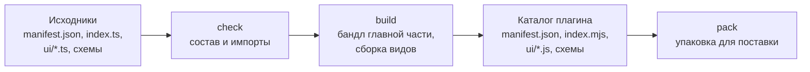

Ядро загружает плагин как есть: `manifest.json`, файл главной части и модули видов. Пока плагин живёт в одном файле без зависимостей, сборка не нужна. Как только появляется npm-зависимость или вид на TypeScript, подключается инструмент `cyborg-plugin`.



## Команды

| Команда | Что делает |
|---|---|
| `cyborg-plugin new <имя>` | Создаёт каталог плагина: манифест, главную часть, вид, схему `config`, тест и настройки сборки |
| `cyborg-plugin check <каталог>` | Проверяет состав и правила, ничего не собирая |
| `cyborg-plugin build` | Собирает каталог, который грузит ядро |
| `cyborg-plugin pack` | Упаковывает собранный плагин для поставки |

`build` вызывает `check` до сборки, так что запрещённый импорт не доезжает до результата.

## Что проверяет check

- Манифест разбирается; все ошибки выводятся сразу строками `файл:строка: причина`.
- `engines.cyborg` принимает версию API, под которую плагин собран. Иначе причина одна - версия, как у ядра при загрузке.
- Точка входа главной части, модули `ui.views` и `ui.overlay` и файлы схем `config` и `state` существуют и лежат внутри каталога.
- Правило импортов: главная часть берёт только `@cyborg-harness/contracts`, свой пакет объявлений контрактов и свои модули; вид, кроме того, может брать npm-пакеты. `node:*`, `electron`, чужой плагин и `import()` с вычисляемым путём - нарушение.
- Права выведены словами, чтобы вы видели то, что увидит пользователь.

Код возврата 0 - всё в порядке, 1 - есть нарушения.

## Что делает build

1. Собирает главную часть в один файл `index.mjs`: npm-зависимости уходят внутрь, `node:*` и `electron` запрещены.
2. Собирает каждый вид `ui/*.ts` в ESM `ui/*.js`.
3. Копирует `manifest.json` и файлы схем.
4. Кладёт рядом карты исходников, чтобы трассировка стека в журнале вела к вашим файлам, а не к бандлу.

Результат - каталог, который можно положить в каталог поставки приложения или в каталог плагинов пользователя:

```text
greeter/
  manifest.json
  index.mjs
  config.schema.json
  ui/
    ui.js
    ui.css
```

Стили и прочие файлы вида кладите рядом с его модулем: фрейм грузит ресурсы только со своего origin.

## Зависимости

:::caution[Зависимости и второй этап]
Бандл с зависимостями грузится сегодня без ограничений, но к плагинам стороннего автора на втором этапе изоляции применяется сканер `Compartment`, и часть популярных библиотек (например, `zod` и `marked`) его не проходит. Если плагин рассчитан на сторонних пользователей, предпочитайте небольшие зависимости без динамического кода и проверяйте бандл заранее.
:::

В главной части без сборки действуют ограничения снятия типов: допустим только стираемый синтаксис (без `enum` и параметров-свойств конструктора), импорты пишутся с расширением, а рядом должен лежать `package.json` с `"type": "module"`. Сборка снимает эти ограничения.

## Версия и совместимость

Версия плагина (`version`) и диапазон API (`engines.cyborg`) независимы. Плагин, собранный под API 1.x, объявляет `^1`. При выходе новой мажорной версии API старые плагины не получают поля, которых не знали: ядро отказывает им одной причиной - версией, а не списком незнакомых полей.

## Как плагин попадает к пользователю

| Путь | Как |
|---|---|
| Поставка приложения | Собранный каталог кладётся в каталог поставки; плагин встроенный, работает в общем хосте `builtin` |
| Каталог пользователя | Выключен по умолчанию. Приложение запускают с `--user-plugins`, плагин кладётся в `plugins/` в каталоге данных и включается в `plugins.enabled`; такой плагин сторонний: отдельный хост, запись `third-party` в журнале, метка в окне ([политика](/features/plugins/#каталог-пользователя-на-первом-этапе)) |

Установка из внешнего источника с окном согласия, подписью и повторным согласием при расширении прав - второй этап изоляции, он не входит в первый.

## Дальше

- [Тестирование](/authors/testing/) - проверка перед сборкой.
- [Рецепты](/authors/recipes/) - права, секреты, миграции.
- [Установка](/start/install/) - куда приложение складывает плагины.
- [Версии](/features/versions/) - совместимость API и контрактов.
