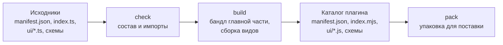

Ядро загружает плагин как есть: `manifest.json`, файл главной части и модули видов. Пока плагин живёт в одном файле без зависимостей, сборка не нужна. Как только появляется npm-зависимость или вид на TypeScript, подключается инструмент `cyborg-plugin`.



## Команды

:::caution[Команда ещё не выпущена]
Команда `cyborg-plugin` и пакеты `@cyborg-harness/*` публикуются задачами [P-05](https://github.com/dex-it/cyborg-harness/issues/39), [P-06](https://github.com/dex-it/cyborg-harness/issues/42), [P-09](https://github.com/dex-it/cyborg-harness/issues/9), [P-02](https://github.com/dex-it/cyborg-harness/issues/34). До выпуска плагин живёт в каталоге `playground/plugins/` репозитория и проверяется гейтами репозитория (`npm run typecheck`, `npm run lint`, `npm test`).
:::

| Команда | Что делает |
|---|---|
| `cyborg-plugin new <имя>` | Создаёт каталог плагина: манифест, главную часть, вид, схему `config`, тест и настройки сборки (появится с шаблоном, P-05) |
| `cyborg-plugin check [каталог]` | Проверяет состав и правила, ничего не собирая |
| `cyborg-plugin build [каталог]` | Собирает каталог, который грузит ядро (по умолчанию `dist` в каталоге плагина) |
| `cyborg-plugin pack [каталог]` | Упаковывает собранный каталог (по умолчанию `./dist` текущего каталога) в `<id>-<версия>.tgz` |

Флаги:

| Флаг | Команды | Что делает |
|---|---|---|
| `--out <каталог>` | `check`, `build` | Каталог результата сборки, по умолчанию `dist` в каталоге плагина; относительный путь считается от текущего каталога. `check` не читает его как исходники; `build` заменяет его только после успешной сборки и проверки, и только если путь свободен, каталог пуст или в нём метка `.cyborg-plugin-build` прежней сборки (любой другой каталог, даже с `manifest.json`, - отказ, ничего не стирается; результат прежней версии инструмента без метки удалите вручную), и не принимает `--out`, совпадающий с каталогом плагина или содержащий его |
| `--out <файл>` | `pack` | Файл архива, по умолчанию `<id>-<версия>.tgz` в текущем каталоге; внутри упаковываемого каталога его быть не может |
| `--api-version <x.y.z>` | все | Версия API, против которой проверяется `engines.cyborg`; по умолчанию версия установленного ядра |
| `--source` | `check` | Главная часть грузится без сборки: npm-пакеты в ней нарушение. Без флага `check` считает, что её соберёт `build`, и пакеты допускает |
| `--declarations <файл>`, `--declarations-package <имя>` | `check`, `build` | Свой пакет объявлений: из него разрешён только `import type`. Флаги можно повторять |
| `--dry-run` | `pack` | Проверить состав и перечислить файлы, архив не писать |

Код возврата 0 - всё в порядке, 1 - есть нарушения, 2 - неверный вызов. Нарушения печатаются строками `файл:строка: причина`.

`build` вызывает проверку до сборки, так что запрещённый импорт не доезжает до результата: при нарушении в исходниках или ошибке сборки ничего не записывается, прежний результат остаётся как был. Результат проверяется и сам, во временном каталоге рядом, до замены: не прошёл - `build` завершается кодом 1, а прежний результат остаётся как был. Символическая ссылка в `ui/` на файл внутри каталога плагина копируется как обычный файл, любая другая (за пределы каталога, на каталог, битая) - нарушение; `pack` отказывает на любой ссылке в собранном каталоге.

## Что проверяет check

- Манифест разбирается; все ошибки выводятся сразу строками `файл:строка: причина`.
- `engines.cyborg` принимает версию API, под которую плагин собран. Иначе причина одна - версия, как у ядра при загрузке.
- Точка входа главной части, модули `ui.views` и `ui.overlay` и файлы схем `config` и `state` существуют и лежат внутри каталога.
- Правило импортов: главная часть берёт `@cyborg-harness/contracts`, свой пакет объявлений контрактов (только типы), свои модули и - если её собирает `build` - npm-пакеты; вид может брать npm-пакеты всегда. `node:*`, `electron`, чужой плагин и `import()` с вычисляемым путём в главной части - нарушение.
- Права выведены словами, чтобы вы видели то, что увидит пользователь.

## Что делает build

1. Проверяет исходники (`check` с допуском npm-пакетов в главной части).
2. Собирает главную часть в один файл `index.mjs`: npm-зависимости уходят внутрь, `node:*` и `electron` запрещены, в том числе в самих зависимостях: отказ называет файл зависимости, которая их подтянула.
3. Собирает каждый вид и экран замка в ESM `ui/*.js`: модули `ui/*.ts` и модули из `ui.views` и `ui.overlay`, у которых есть исходник `.ts`.
4. Копирует `manifest.json`, файлы схем и всё из `ui/`, что не исходник (стили, ресурсы).
5. Кладёт рядом карты исходников (`index.mjs.map`, `ui/*.js.map`), чтобы трассировка стека в журнале вела к вашим файлам, а не к бандлу.
6. Проверяет результат: на нём работает та же проверка, что и `check`, без допуска пакетов в главной части.

Результат - каталог, который можно положить в каталог поставки приложения или в каталог плагинов пользователя:

```text
greeter/
  manifest.json
  index.mjs
  config.schema.json
  ui/
    ui.js
    ui.css
```

Стили и прочие файлы вида кладите рядом с его модулем: фрейм грузит ресурсы только со своего origin.

## Что делает pack

`pack` берёт уже собранный каталог и проверяет его: манифест и файлы из манифеста на месте, главная часть - `index.mjs`, исходников `.ts` нет, `engines.cyborg` принимает версию API. Затем пишет `tar.gz`, где корень - `<id>/`: распаковка в каталог плагинов даёт `<id>/manifest.json`. Архив воспроизводим: те же файлы дают те же байты. Подписи и хеша в архиве нет, а формат архива предварительный: источник, подпись и повторное согласие - второй этап изоляции. Проверить состав без записи: `cyborg-plugin pack --dry-run`.

## Зависимости

:::caution[Зависимости и второй этап]
Бандл с зависимостями грузится сегодня без ограничений, но к плагинам стороннего автора на втором этапе изоляции применяется сканер `Compartment`, и часть популярных библиотек (например, `zod` и `marked`) его не проходит. Если плагин рассчитан на сторонних пользователей, предпочитайте небольшие зависимости без динамического кода и проверяйте бандл заранее.
:::

В главной части без сборки действуют ограничения снятия типов: допустим только стираемый синтаксис (без `enum` и параметров-свойств конструктора), импорты пишутся с расширением, а рядом должен лежать `package.json` с `"type": "module"`. Сборка снимает эти ограничения.

## Версия и совместимость

Версия плагина (`version`) и диапазон API (`engines.cyborg`) независимы. Нижний порог диапазона - минор, под который плагин собран: собранный под API 1.5 объявляет `^1.5`. С `^1` он загрузится и на ядро 1.3, где членов из 1.4 и 1.5 ещё нет, и узнает об этом только при вызове, а не отказом с причиной до запуска. При выходе новой мажорной версии API старые плагины не получают поля, которых не знали: ядро отказывает им одной причиной - версией, а не списком незнакомых полей.

## Как плагин попадает к пользователю

| Путь | Как |
|---|---|
| Поставка приложения | Собранный каталог кладётся в каталог поставки; плагин встроенный, работает в общем хосте `builtin` |
| Каталог пользователя | Выключен по умолчанию. Приложение запускают с `--user-plugins`, плагин кладётся в `plugins/` в каталоге данных и включается в `plugins.enabled`; такой плагин сторонний: отдельный хост, запись `third-party` в журнале, метка в окне ([политика](/features/plugins/#каталог-пользователя-на-первом-этапе)) |

Установка из внешнего источника с окном согласия, подписью и повторным согласием при расширении прав - второй этап изоляции, он не входит в первый.

## Дальше

- [Тестирование](/authors/testing/) - проверка перед сборкой.
- [Рецепты](/authors/recipes/) - права, секреты, миграции.
- [Установка](/start/install/) - куда приложение складывает плагины.
- [Версии](/features/versions/) - совместимость API и контрактов.
