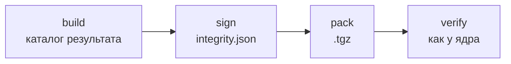

Пакет, который лежит на диске, мог кто-то переписать. Подпись это не предотвращает (тот же пользователь может изменить файл), но делает подмену заметной: ядро запускает только тот код, который подписал издатель, которому доверяет человек, и ничего другого. Решение и его границы - [ADR-CH-0017](https://github.com/dex-it/cyborg-harness/blob/master/docs/04-architecture/adr/ADR-CH-0017-plugin-provenance.md).

:::note[Проверка включается приложением]
Подпись проверяет ядро только в приложении, которое включило проверку (`trust` в настройках запуска). Без неё пакеты загружаются, как раньше. В стенде репозитория проверка включается флагами командной строки: `--release-key=ed25519:…`, `--plugin-signatures=warn|enforce`, `--delivery-signatures=warn|enforce`.
:::



## Порядок

```sh
cyborg-plugin keygen --out acme            # один раз: acme.key (секрет) и acme.pub (открытый)
cyborg-plugin build . --out dist
cyborg-plugin sign dist --key acme.key --days 365
cyborg-plugin pack dist --out acme.hello-1.0.0.tgz
cyborg-plugin verify acme.hello-1.0.0.tgz --key acme.pub
```

- **Ключ.** `keygen` пишет пару Ed25519. Файл `acme.key` создаётся с правами 0600 и хранится как секрет: в репозиторий и в сборку его не кладут; существующие файлы `keygen` не затирает. Открытый ключ `acme.pub` (`ed25519:…`) отдают людям, которые ставят ваши плагины: они добавляют его в доверенные.
- **Подпись.** `sign` считает sha256 каждого файла собранного каталога и пишет `integrity.json` с `id`, версией, сроком (`--days`, по умолчанию 365, или `--expires 2027-01-31`), идентификатором ключа и подписью. Подписывать нужно после `build` и до `pack`; правка любого файла после подписи делает её устаревшей, и `pack` откажет, называя файл.
- **Срок.** После срока подпись не принимается: перевыпускайте пакет заранее.
- **Проверка.** `verify` читает каталог или архив целиком (архив не распаковывается) и проверяет так, как проверит ядро: изменённый байт, лишний или пропавший файл, символическая ссылка, чужой ключ, истёкший срок и несовпадение `id` и версии с `manifest.json` - отказ с кодом 1 и словами, что именно не так. Лишний файл тоже отказ: `.DS_Store`, оказавшийся в распакованном каталоге, пакет отвергнет, поэтому ставьте плагин из архива, а не из рабочего каталога.
- **Воспроизводимость.** Одни и те же файлы дают один и тот же архив, поэтому подпись можно сверить по пересборке.

## Что делает ядро с пакетом

Перед каждым запуском плагина ядро читает его каталог один раз, проверяет эти байты и исполняет именно их, а не файл с диска: подменить код между проверкой и запуском нельзя. Проверка идёт по порядку: ключ издателя известен и не отозван, подпись верна, срок не вышел, `id` и версия совпали с `manifest.json`, версия не ниже уже принимавшейся, файлы пакета те же, отозванных хешей нет.

| Что случилось | Что видит человек |
|---|---|
| Пакет не подписан, файл изменён, ключ чужой, срок вышел | Плагин «остановлен», причина словами в окне «Плагины Cyborg» (запись журнала `integrity-failed`); в режиме «предупреждать» плагин запущен, но предупреждение остаётся |
| Версия ниже виденной ранее | Откат отвергнут, даже если подпись верна: пакет с известной дырой не вернуть. Сбросить виденную версию может только человек |
| Ключ издателя или хеш пакета отозван | Плагин остановлен; отзыв приходит подписанным списком (`cyborg-plugin revoke`) или вносится человеком |
| Повреждён `trust.json` | Все проверки отказывают с причиной, файл не стирается |

Режим «отказывать» по умолчанию действует для плагинов каталога пользователя; встроенные плагины приложения проверяются по подписанному `delivery.json` и сначала только предупреждают (чтобы подпись не «окирпичила» приложение до обкатки выпуска). Доверенные ключи издателей лежат в `trust.json` каталога данных приложения (слой пользователя): воркспейс из репозитория команды ни добавить ключ, ни отключить проверку не может.

## Чего подпись не даёт

Подпись говорит, кто выпустил пакет и что его не меняли, но не что код безопасен. Подмену самого приложения или списка его ключей процессом пользователя она не закрывает: корень доверия - приложение. Права плагина по-прежнему задаёт манифест ([Доверие](/concepts/trust/)); до второго этапа изоляции код плагина может обойти шлюз.

## Список зависимостей в бандле

`cyborg-plugin build` и `delivery` печатают пакеты npm, код которых вошёл в `index.mjs`, с версиями и вкладом в байтах:

```text
Пакеты npm в бандле главной части (2):
  @acme/util 3.1.4 - 412 Б
  tiny-dep 1.0.0 - 188 Б
```

Это перечень для ревью и для `npm audit --omit=dev` по lock-файлу плагина: он показывает состав, а не проверяет содержимое пакетов.
