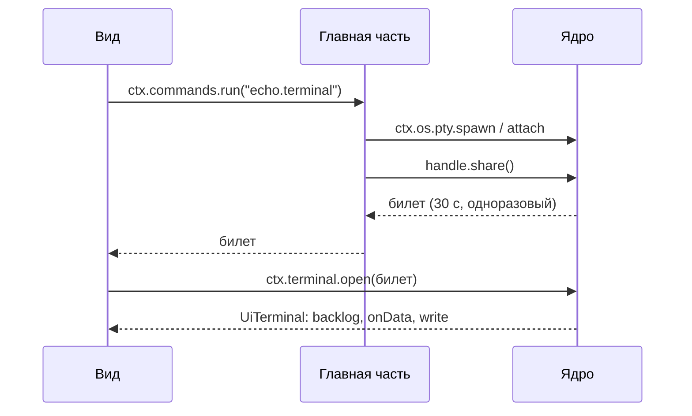

Вид - браузерный модуль, который окно загружает в отдельный `<iframe>`. Модуль экспортирует функцию `mount`; ядро зовёт её один раз на документ вида и вызывает `dispose` у возвращённого значения, когда снимает вид.

```ts
import type { Disposable, UiContext, UiModule } from '@cyborg-harness/contracts';

export function mount(root: HTMLElement, ctx: UiContext): Disposable {
  const list = document.createElement('cy-list');
  root.append(list);
  return { dispose: () => list.remove() };
}

mount satisfies UiModule<HTMLElement>['mount'];
```

В манифесте вид объявлен как `"ui": { "views": { "main": "./ui/ui.js" } }`. Путь ведёт только вниз от каталога плагина и заканчивается на `.js`: TypeScript вида собирается в ESM командой `cyborg-plugin build`.

## Где живёт вид

Каждый вид работает в `<iframe>` по адресу `cyborg-plugin://<группа>/<плагин>/`, origin задаёт группа рендера. Мост вида узнаёт плагин по группе и пути адреса, а не по словам самого вида, поэтому вид не может выдать себя за плагин вне своей группы; плагины одной группы мост различает по пути, но друг другу не доверяет не больше, чем плагины одного хоста. Следствия для автора:

- `localStorage` и IndexedDB общие у всех плагинов группы, а память вида хранит `ctx.state`;
- пути ресурсов вида только относительные: адрес кадра содержит группу и id плагина (раньше origin был `cyborg-plugin://<id>/`, кадр начинался с корня плагина), поэтому абсолютный путь (`/x.js`, `fetch('/data.json')`) даёт 404 или уходит к соседу по группе; путь кадра не меняйте (`history.pushState` или `replaceState` с новым путём): мост перестанет узнавать вид, и он потеряет мост, журнал и видимость; состояние держите в `?` или `#`;
- у вида нет `ctx.os`: файлы, процессы и сеть - дело главной части, вид просит её командой;
- страница по умолчанию не ходит в сеть сама: политика содержимого разрешает `connect-src 'self'`;
- скрипты и таблицы стилей загружаются только со своего origin: положите нужный CSS рядом с модулем вида и подключите по `new URL('./ui.css', import.meta.url)`;
- встроенный `<style>` и атрибут `style` в разметке не применяются, пока манифест не объявил `"ui": { "inlineStyles": true }` (так делают библиотеки вроде xterm и Monaco); без флага применяются запись через CSSOM (`el.style.x = …`), файлы стилей и элементы `cy-*`; отказ CSP виден в консоли фрейма вида и в журнале вашего плагина (запись `denied`, `reason: 'csp'`);
- шрифты берутся только со своего origin (`font-src 'self'`), воркеры - файлами того же origin, `blob:` закрыт;
- вид не встраивает `<iframe>`: фреймы закрыты;
- вид не отмонтируется при сворачивании: DOM, прокрутка и выделение сохраняются.

## Что есть в UiContext

| Член | Что даёт |
|---|---|
| `pluginId`, `view` | Кто и какой вид |
| `commands.run(command, ...args)` | Только команды своего плагина; чужую ядро отклонит |
| `contracts.get(contract, major)` | Контракт из `requires` или `optional` своего плагина. Возвращает удалённый объект: только методы, ответы - данные. Нет поставщика - `undefined`, нет в манифесте - исключение |
| `theme.tokens`, `theme.onChange` | CSS-переменные `--cy-*`, уже стоящие на `:root` до `mount` |
| `visible`, `onVisibilityChange` | Показан ли вид сейчас |
| `logs()`, `onLog` | Сообщения `ctx.log` своей главной части: накопленные и новые |
| `terminal.open(ticket)` | Терминал по билету от своей главной части |
| `state` | Память вида: `value` и `set(value)` |
| `dialogs.show(spec)` | Вопрос или меню в слое окна поверх всех фреймов |
| `channel` | Канал с главной частью по имени этого вида: `post(message)` и `onMessage(listener)` |
| `modal` | Есть только у вида модального окна (`area: "modal"`): `data` от главной части и `close(result)` |
| `keys.of(command)` | Сочетание своей команды для подсказки в интерфейсе |
| `drag` | `start(path)` и `drop()` - перетаскивание файла через ядро |

## Элементы ядра cy-*

Оболочка определяет их до `mount`: пишите `document.createElement('cy-list')` без импорта. Они стилизованы на токенах темы, поэтому цвета вид не задаёт.

| Тег | Свойства | События |
|---|---|---|
| `cy-button` | `variant` (`primary`, `danger`), `disabled` | `click` |
| `cy-field` | `label`, `placeholder`, `value`, `type` (`text`, `search`, `password`), `disabled` | `input`, `change`, `keydown` |
| `cy-list` | `items`, `selected`, `label`; слот `empty` | `cy-select`, `cy-activate` |
| `cy-tree` | `items`, `expanded`, `selected`, `label` | `cy-select`, `cy-activate`, `cy-toggle` |
| `cy-tabs` | `tabs`, `selected`, `label` | `cy-select` |
| `cy-empty` | `heading`; текст - содержимое | - |
| `cy-spinner` | `label` | - |

`id` пунктов списка и дерева непустые и уникальные, иначе присваивание бросает `TypeError`. В `detail` событий лежит `{ id }`, у `cy-toggle` ещё `expanded`. Программная смена `selected` событий не шлёт. Клавиши работают по WAI-ARIA. Тег не удаляется и не меняет атрибуты в пределах мажорной версии `engines.cyborg`.

## Терминал в виде

Вид сам процесс не запускает. Главная часть создаёт pty, вызывает `share()` и отдаёт виду билет (например, ответом своей команды). Вид открывает терминал билетом, а поток вывода идёт из ядра прямо в окно, мимо хоста плагина: зависший хост терминал не останавливает.



Билет живёт 30 секунд, и чужой плагин его не откроет. `close()` у `UiTerminal` только перестаёт смотреть: процесс завершает главная часть.

## Память вида и диалоги

`ctx.state.value` - то, что вид оставил прошлому документу; `set(value)` пишет JSON до 64 КБ в состояние воркспейса, не в `localStorage`: у каждого воркспейса своя память. Схем и миграций нет, формат - забота плагина.

`ctx.dialogs.show({ kind: 'ask', title, buttons })` и `{ kind: 'menu', items, at }` показывает диалог в слое ядра, ответ - `id` выбранного пункта или `undefined` при отмене. Диалоги идут по одному.

## Канал с главной частью

Главная часть шлёт виду данные без опроса: `ctx.views.channel('panel').post({ ping: 1 })` у неё, `ctx.channel.onMessage(listener)` у вида. Вид отвечает `ctx.channel.post(message)`, главная часть слушает `ctx.views.channel('panel').onMessage(...)`. Сообщение - данные, которые переживают `structuredClone`, до 64 КиБ; больше - `Invalid`, и канал работает дальше. Сообщение доходит только до видов своего плагина с этим именем; пока вид не открыт, оно не копится, поэтому текущее состояние вид просит командой при `mount`. Выгрузка плагина закрывает канал.

## Модальное окно

Вид с `"area": "modal"` в манифесте открывается по просьбе главной части: `await ctx.views.modal('form', { title: 'Новый проект', data })`. Ядро показывает его поверх всех фреймов, остальное окно недоступно, фокус остаётся в окне, Escape закрывает. Размер задаёт автор: `size: { width: 720, height: 480 }` (целые пиксели от 100 до 4096 по стороне; пропущенная сторона остаётся умолчанием окна, а на малом экране окно не больше 90% ширины и 80% высоты). Если вид сам обрабатывает Escape (поповер, отмена ввода), главная часть просит `escape: 'view'`: ядро Escape не забирает, нажатие получает вид, и закрывает окно он сам через `ctx.modal.close`; кнопка «Закрыть» в окне остаётся у человека всегда и отдаёт `undefined`. Вид читает `ctx.modal.data` и возвращает ответ `await ctx.modal.close(result)`; Escape, закрытие окна человеком и выгрузка плагина дают главной части `undefined`. Окно всегда подписано именем плагина.

## Буфер обмена

У вида буфера обмена нет: `navigator.clipboard` во фрейме закрыт политикой разрешений. Копирование и вставка выделения в Monaco и xterm работают через меню «Правка» окна; из кода вида буфер читает и пишет команда главной части с правом `clipboard`.

## Дальше

- [Главная часть](/authors/main-api/) - команды, которые вызывает вид.
- [Виды во фреймах](/features/views/) - изоляция рендера и группы.
- [Рецепты](/authors/recipes/) - типичные задачи автора.
- [Изоляция](/concepts/isolation/) - что отделяет вид от остального окна.
