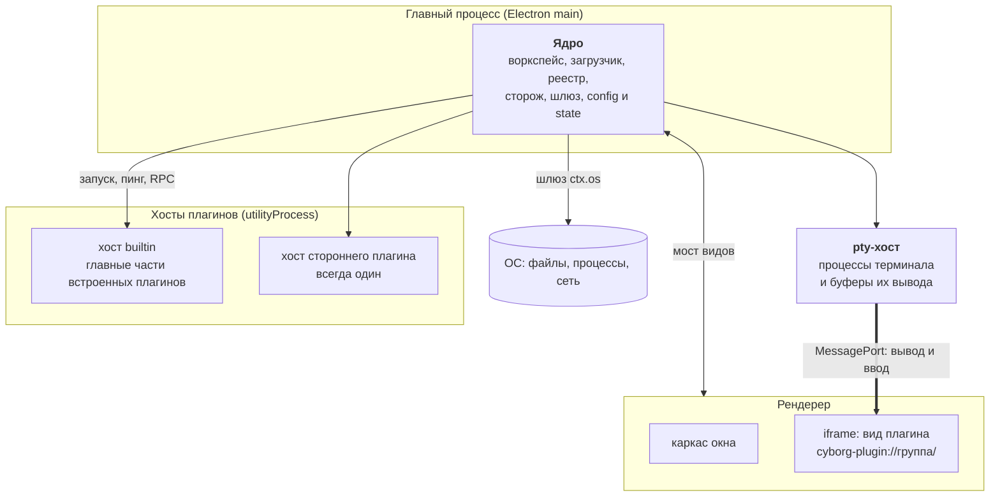

Приложение на ядре - это Electron-приложение с четырьмя видами процессов. Ядро работает в главном процессе, код плагинов - в отдельных хостах, терминалы держит собственный процесс ядра, а интерфейс плагинов живёт в `<iframe>`.

## Схема процессов

| Процесс | Что в нём | Что случится при сбое |
|---|---|---|
| Главный | Ядро: воркспейс, загрузчик, реестр контрактов и команд, сторож, шлюз, `config` и `state` | Приложение перезапускается целиком; ядро не исполняет код плагинов, поэтому его сбой не связан с ними |
| pty-хост | Процессы терминала и кольцевые буферы вывода; код плагинов не исполняет | Владельцы получают завершение процессов, сторож перезапускает хост, окно не замирает |
| Хост плагинов | Главные части плагинов одной группы; плагин видит только свой `ctx` | Сторож перезапускает хост, остальные хосты, окно и терминалы не затронуты |
| Рендерер | Каркас окна от ядра и `<iframe>` видов | Сбой кадра одной группы остальные группы рендера не затрагивает |

## Что в ядре, а что нет

Ядро берёт задачу, только если выполнены оба условия: она нужна всем плагинам или окну без плагинов, и плагин не может решить её сам, не нарушив гарантию для остальных.

| В ядре | Почему |
|---|---|
| Воркспейс, замок, «Недавние» | Воркспейс выбирается до загрузки любого плагина |
| Загрузчик, граф контрактов, версии | Граф проверяется до запуска кода |
| Хосты и сторож | Плагин не может сторожить сам себя |
| pty | Процесс обязан пережить перезапуск своего плагина |
| Шлюз `ctx.os`, права, секреты | Проверка должна стоять вне плагина |
| Каркас окна, клавиши, тема, слой диалогов | Системное сочетание обязано сработать из любого `<iframe>` |
| `config` и `state` по разделам | Ошибка в разделе ломает только владельца раздела |

Агентов, сессий, дерева файлов, просмотрщика, проектов, трекеров и общей шины событий в ядре нет. Центральных плагинов тоже нет: в коде ядра нет ни одного имени плагина.

## Пакеты

| Пакет | Что содержит |
|---|---|
| `@cyborg/core` | Ядро без зависимостей и без Electron: загрузчик, граф, реестр, шлюз, журнал, сторож |
| `@cyborg/electron` | Адаптер Electron: хосты в `utilityProcess`, адаптер ОС, схема `cyborg-plugin://`, мост видов, оболочка вида |
| `@cyborg/contracts` | Типы контрактов и API плагина: `PluginContext`, `UiContext`, права, карта `Contracts` |
| `@cyborg/testing` | Тест-кит автора плагина |

Ядро не импортирует Electron. Всё, что ему нужно от системы, приложение передаёт как среду, поэтому ядро проверяется тестами на чистом Node. Подробнее - [пакеты и версии](/reference/packages/).

## Три маршрута вызова

1. **Плагин - плагин.** Вызов члена контракта идёт в ядро, оно проверяет объявление в манифесте и права вызывающего и передаёт вызов поставщику, в том же хосте или в другом. Для автора разницы нет.
2. **Вид - главная часть.** Вид зовёт команды и контракты своего плагина через мост. Главный процесс узнаёт плагин по origin фрейма, а не по словам вида.
3. **Терминал.** Главная часть получает билет и отдаёт его виду, вид открывает терминал по билету. Вывод идёт из pty-хоста прямо во фрейм по `MessagePort`, а ввод обратно, мимо хоста плагина. Хост может зависнуть, а терминал продолжит работать.

## Граница передачи данных

Всё, что пересекает границу плагина, - данные, переживающие `structuredClone`. Функции, классы и `Map` через вызов не проходят: канал отвечает `NotCloneable`. Обратные вызовы возможны только как подписка с `Disposable`. Эта дисциплина одна для плагинов в одном хосте и в разных: от неё зависит, что изоляцию можно усилить, не переписывая плагины.

:::note[Почему интерфейс не общий]
Ядро не навязывает UI-фреймворк. Плагин рисует что угодно в своём `<iframe>`, а ядро даёт токены темы и семь элементов `cy-*`. Подробнее - [виды](/features/views/).
:::

## Дальше

- [Жизнь плагина](/concepts/lifecycle/) - что происходит от манифеста до выгрузки
- [Изоляция](/concepts/isolation/) - как устроены хосты, группы рендера и сторож
- [Хосты](/features/hosts/) - что видит пользователь при сбое плагина
- [Терминалы](/features/terminals/) - pty-хост и билеты
