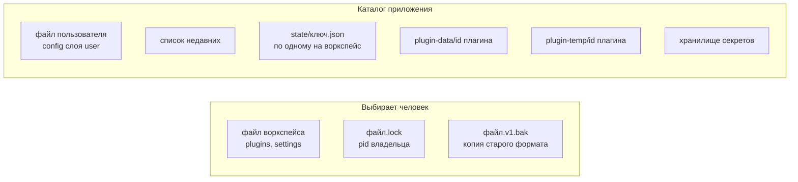

Ядро хранит данные в простых файлах и не использует базу. Что куда попадает, зависит от того, чьи это данные и кто их меняет: человек или программа.

## Config и state

| | Config | State |
|---|---|---|
| Что | Намеренные настройки | Память машины: активный проект, ширины, раскрытые узлы, расстановка, открытые документы |
| Кто меняет | Человек, иногда плагин по просьбе человека | Плагин и ядро по ходу работы |
| Где | Файл воркспейса и файл пользователя | Каталог приложения, отдельный файл на воркспейс |
| API плагина | `ctx.config` - только свой раздел | `ctx.state` - только свой раздел |
| Слои | `user` и `workspace`; верхний перекрывает нижний | Один слой `workspace` |

Раздел принадлежит плагину. Другой плагин его не видит, поэтому `config` не канал связи.

:::caution[Секреты не лежат нигде из них]
В `config` допустима только ссылка вида `{ "$secret": "ключ" }`, а значение живёт в хранилище секретов ядра. Ни `config`, ни `state`, ни журнал значений секретов не содержат.
:::

## Где что лежит



| Данные | Где | Особенности |
|---|---|---|
| Файл воркспейса | Путь, который выбрал человек (`--workspace` или «Недавние») | JSON с полями `cyborg` (формат), `plugins` и `settings`; правка извне подхватывается |
| Замок `<файл>.lock` | Рядом с файлом воркспейса | Содержит pid; замок умершего процесса забирается. Один воркспейс - один процесс - одно окно; воркспейсов с общим `userData` может быть несколько, общие файлы (`recent.json`, `secrets.json`, слой пользователя `cyborg.json`) пишутся под замком `<файл>.write.lock` |
| Копия `<файл>.v1.bak` | Рядом с файлом воркспейса | Остаётся после однократного переноса старого формата `{projects, lastProjectId}` |
| Файл пользователя | Каталог приложения | Тот же формат; слой `user` перекрывается воркспейсом |
| «Недавние» | Каталог приложения | До десяти путей, последний открытый первым, без повторов по `realpath`; файл, которого уже нет, не показывается |
| State | `<каталог приложения>/state/<ключ>.json` | Ключ - хеш от `realpath` файла воркспейса: один воркспейс по разным путям, через ссылку - одно состояние |
| Данные плагина | `plugin-data/<id плагина>` | Область `plugin-data`: читать и писать можно без права. Каталог общий для всех процессов приложения с этим `userData`: атомарность записи (временный файл и `rename`) на плагине |
| Временные файлы | `plugin-temp/<id плагина>` | Область `plugin-temp`, у каждого плагина свой; как и `plugin-data`, общий для процессов приложения |
| Секреты | Хранилище ядра | Ключи вида `<плагин>/<ключ>`, шифрование средствами ОС |

## Что внутри файла воркспейса

```jsonc
{
  "cyborg": 2,
  "plugins": {
    "enabled": ["sessions", "agent-claude-code", "files", "projects"],
    "hosts": { "builtin": ["sessions", "agent-claude-code", "files", "projects"] },
    "keybindings": [{ "key": "CmdOrCtrl+K", "command": "search.open" }]
  },
  "settings": {
    "projects": { "items": [] }
  }
}
```

- `plugins.enabled` - какие плагины включены; `plugins.hosts` - группы хостов; `plugins.uiGroups` - группы рендера; `plugins.keybindings` - переназначение сочетаний.
- `settings.<id плагина>` - раздел `config` плагина.
- Файл, который не удалось разобрать, ядро не перезаписывает: разделы остаются прежними, причина попадает в журнал.

## Что ядро кладёт в state

Служебные разделы начинаются с `$`; манифест плагину имя с `$` не даёт.

| Раздел | Что в нём |
|---|---|
| `$documents` | Открытые документы с типами `restorable`: порядок вкладок, заголовки, данные до 64 КБ |
| `$views` | Память видов, `ctx.state` вида: JSON до 64 КБ на ключ `<плагин>/<вид>` |
| `$granted` | Пути, которые человек выбрал в диалоге: по плагинам, только абсолютные пути |

Выбор в диалоге привязан к id плагина и к воркспейсу. Выключение плагина его не снимает, удаление плагина стирает вместе с его данными и секретами, чтобы новый плагин с тем же id не унаследовал чужие пути.

## Версии разделов и миграции

Манифест объявляет версию раздела и схему: `"config": { "schema": "./config.schema.json", "version": 3 }`. Ядро проверяет раздел по схеме до активации и при каждой правке файла.

| Ситуация | Что делает ядро |
|---|---|
| Версия раздела ниже версии плагина | До активации вызывает `migrate(fromVersion, data)` и сохраняет результат |
| Версия выше (плагин откатили) | Не активирует плагин, раздел не трогает, причина в журнале |
| Раздел не прошёл схему | Отказ только этому плагину; остальные работают |
| Файл поправили руками неверно | Прежнее значение остаётся, отказ пишется в журнал |

Схема - подмножество JSON Schema: `type`, `properties`, `required`, `additionalProperties`, `items`, `enum`, `const`, границы чисел и длин, `pattern`, `uniqueItems`. Прочие ключи вроде `$ref` и `oneOf` считаются ошибкой схемы, чтобы автор не считал проверенным то, что ядро не проверяет.

## Что происходит при удалении плагина

Приложение вызывает `kernel.uninstall(id)` после `disable`. Активный плагин ядро не удаляет: `Invalid`, пока плагин не выключен (в безопасном режиме `disable` недоступен, и включённый плагин удаляется сразу). Снятый плагин общего хоста после этого ничего не пишет: ядро отвечает `Unavailable` на его `os`, `documents` и `section.write`. Ядро стирает каталоги `plugin-data` и `plugin-temp`, ключи секретов `<id>/*`, записи в `$granted`, `$views` и `$documents`, раздел `state` плагина, а оставшиеся терминалы, в том числе оставленные человеком при выключении, завершает. Новый плагин с тем же id не наследует ничего из этого.

Остаётся то, что ядро не должно трогать без человека, и то, чего оно не видит:

- раздел `config` в файлах пользователя и воркспейса: его правит человек;
- `state`, память видов, документы и выбранные пути в других воркспейсах: ядро знает только открытый;
- плагин, работающий в соседнем окне того же `userData` (другой воркспейс): `plugin-data`, `plugin-temp` и секреты общие для окон, поэтому стирание задевает и его, а соседние процессы ядро не видит; человек закрывает плагин в соседних окнах до удаления;
- код плагина на диске: его убирает приложение.

Что стёрто и что осталось, ядро пишет в журнал записью `uninstalled` и возвращает тем же списком слов.

## Дальше

- [Конфигурация и состояние](/features/config-state/) - как пользоваться и как объявлять
- [Воркспейсы](/features/workspaces/) - замок, «Недавние», смена воркспейса
- [Версии и миграции](/features/versions/) - как обновлять формат раздела
- [Манифест](/reference/manifest/) - поля `config` и `state`
