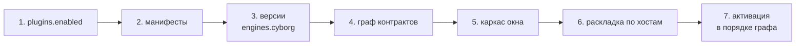

Ядро делает все дешёвые проверки до запуска кода плагина. Поэтому сломанный манифест, нехватка поставщика или чужая версия API обнаруживаются сразу, причина попадает в журнал, а остальные плагины продолжают работать.

## Загрузка

1. Ядро читает `plugins.enabled`: файл пользователя, перекрытый файлом воркспейса. Для старта больше ничего не нужно.
2. Разбирает манифесты. Незнакомое поле - отказ с именем поля; все ошибки манифеста сообщаются сразу.
3. Сверяет `engines.cyborg` с версией API. Несовместимая версия - единственная причина отказа, даже если в манифесте есть и другие ошибки: поле новой версии старое ядро знать не обязано.
4. Решает граф контрактов. Нет поставщика для `requires`, два поставщика при кратности `one`, цикл, повтор id - плагин не загружается, отказ каскадом переходит на тех, кто его требовал.
5. Рисует каркас окна по манифестам: виды и документы известны до кода плагинов.
6. Раскладывает плагины по хостам ([изоляция](/concepts/isolation/)).
7. Активирует в порядке графа: поставщик раньше потребителя.

## Активация

Для каждого плагина ядро выполняет шаги в таком порядке.

| Шаг | Что происходит | Если не вышло |
|---|---|---|
| Поставщики | Поставщики из `requires` и `optional` активны; ленивых ядро будит само | Плагин пропускается, в журнале `skipped` с названием поставщика |
| Хост | Нужный хост запускается, если ещё не работает | Запись `failed` |
| `config` и `state` | Раздел проверяется по схеме; версия ниже - вызывается `migrate`; версия выше - отказ | Запись `config` или `state` с причиной; остальные плагины работают |
| `activate(ctx)` | Хост импортирует модуль и вызывает `activate` с лимитом десять секунд | Запись `failed`, плагин снимается |
| Готово | Плагин считается активным | Запись `activated` со временем запуска |

Исключение внутри `activate` или в вызове ловит хост: отказывает только этот плагин.

### Ленивая активация

Плагин с `"activation": "lazy"` при старте получает состояние «ждёт». Будят его:

- первая команда плагина;
- сочетание клавиш плагина: оно перехватывается и у спящего владельца;
- показ вида;
- активация потребителя его контракта.

Человек выключил ленивый плагин - команда его уже не разбудит. Плагин с `lock.onStart` всегда активируется сразу.

## Работа

Пока плагин активен, хост отвечает на пинги сторожа. Ядро пингует хост раз в секунду; нет ответа дольше пяти секунд - хост считается зависшим.

| Событие | Что делает ядро |
|---|---|
| Хост завис или упал | Виновником считается плагин с незавершённым вызовом или активацией. Хост перезапускается, плагины активируются заново. Остальные хосты, окно и терминалы не затронуты |
| Три сбоя плагина подряд | Плагин выключается, в журнале `switched-off` с перечнем тех, кто брал его контракты. «Включить снова» возвращает его |
| Хост падает без виновника несколько раз подряд | Хост больше не перезапускается, плагины остаются выключенными до «Включить снова» |
| Пропал или вернулся поставщик | Потребители из других хостов узнают об этом из `ctx.contracts.onChange` |

Пока хост перезапускается, виды его плагинов остаются на месте под плашкой «Перезапуск» и не принимают ввод. Если плагин не поднялся, вместо вида показывается заглушка с причиной, кнопками «Включить снова» и «Журнал».

Процессы терминала с `persist` перезапуск хоста переживают, плагин забирает их через `attach`. Короткие процессы `ctx.os.process` завершаются: результат принимать некому.

## Выгрузка

Плагин можно выключить и включить без перезапуска окна. При выключении:

1. Ядро находит всех, кто держится за него через `requires`, прямо или по цепочке.
2. Вызывает у них `deactivate` в обратном порядке активации, тоже с лимитом десять секунд.
3. Снимает регистрации, подписки, наблюдения за файлами, серверы, диалоги и сетевые запросы, а запущенные плагином программы завершает вместе с их дочерними процессами.
4. Спрашивает человека, что делать с живыми терминалами этих плагинов: оставить работать или завершить.
5. Гасит хост, в котором не осталось плагинов; следующая загрузка поднимает код в новом процессе.

Потребители через `optional` остаются и получают `onChange`. Плагин, выгруженный человеком, сторож не поднимает. Если окно закрыто замком, выключить плагин замка или тех, от кого он зависит, нельзя.

## Остановка приложения

Закрытие окна или смена воркспейса выключает плагины. До этого ядро рассылает `ctx.system.onBeforeQuit` с бюджетом времени: зависший слушатель в сбои плагина не записывается. Живые терминалы завершаются после подтверждения человека, замок воркспейса снимается. Перезагрузка окна закрытием не считается: воркспейс, хосты и терминалы остаются.

## Состояния плагина в окне

| Состояние | Что значит |
|---|---|
| Работает | Запись `activated` последняя |
| Ждёт | Ленивый плагин ещё не разбужен |
| Перезапускается | Хост поднимается после сбоя или человек нажал «Включить снова» |
| Остановлен | Отказ загрузки, сбой активации, выключение сторожем или человеком |
| Выключен в настройках | Плагина нет в `plugins.enabled` |

Безопасный режим выключает все плагины без исключений, код ни одного из них не запускается. Каждый получает запись `safe-mode`, окно управления плагинами остаётся доступным.

## Дальше

- [Журнал](/reference/journal/) - все записи, которыми ядро описывает эту жизнь
- [Хосты](/features/hosts/) - что видит человек при сбое
- [Версии и миграции](/features/versions/) - разделы `config` и `state`
- [Модель контрактов](/concepts/contracts-model/) - как строится граф
