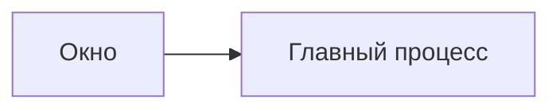

Сайт - проект [Astro](https://astro.build/) с [Starlight](https://starlight.astro.build/) в каталоге `site/`. Страницы лежат не в нём, а в `docs/guide/` рядом с корпусом документов: текст виден там же, где код, и правится обычным PR. Адрес сайта на GitHub Pages: `https://dex-it.github.io/cyborg-harness/`.

## Что где лежит

| Путь | Что |
|---|---|
| `docs/guide/` | Страницы сайта в Markdown: `start/`, `features/`, `concepts/`, `authors/`, `reference/`, `development/`, `faq.md`, главная |
| `site/astro.config.mjs` | Настройка Astro и Starlight: боковое меню (`sidebar`), русская локаль, плагины Markdown |
| `site/site.config.mjs` | Адрес и бренд: `OWNER`, `REPO_NAME`, из них выводятся базовый путь, `canonical` и карта сайта |
| `site/src/content.config.ts` | Говорит Starlight брать страницы из `docs/guide/`, а не из `site/src` |
| `site/src/components/Head.astro` | Рисование схем Mermaid в браузере |
| `site/scripts/` | `copy-brand.mjs` (значок) и `check-dist.mjs` (проверка сборки) |
| `assets/icon.svg` | Значок приложения; сайт не держит своей копии |
| `.github/workflows/docs-site.yml` | Сборка, проверка и публикация |

## Локально

```bash
cd site
npm ci
npm run dev        # сервер разработки
npm run build      # сборка в site/dist
npm run verify     # проверка собранного сайта
npm run check      # типы страниц и конфига
```

Версия Node для сайта записана в `site/.nvmrc`. Скрипты `dev`, `build` и `check` сначала копируют значок из `assets/icon.svg` в `site/src/generated` и `site/public`; оба пути исключены из git. Сайт в корневой `npm run lint` не входит.

## Как добавить страницу

1. Создайте `docs/guide/<раздел>/<страница>.md` с полями `title` и `description` в начале файла. Заголовок первого уровня не пишите: его рисует сайт.
2. Добавьте страницу в `sidebar` в `site/astro.config.mjs`: порядок в меню задаёт он, а не имена файлов.
3. Корневые ссылки пишите как `/features/hosts/`, с конечным слэшем. Базовый путь `/cyborg-harness` к ним добавляет сборка. Внешние ссылки пишутся целиком.
4. Выполните `npm run build && npm run verify` в `site/`.

Страницы пишутся простым языком: короткие разделы, таблицы, врезки Starlight (`:::note[Заголовок]`, `:::tip`, `:::caution`). Дефис с пробелами вместо длинного тире, без эмодзи.

## Схемы

Схемы пишутся на [Mermaid](https://mermaid.js.org/) блоком кода с языком `mermaid`:

````text

````

Сайт рисует схему в браузере в цветах выбранной темы и перерисовывает при смене темы; без скриптов виден текст схемы. Библиотека грузится только на страницах, где есть такой блок. GitHub рисует тот же блок в файлах `.md`. Задавайте `accTitle` и `accDescr` и держите подписи короткими: широкая схема на узком экране прокручивается внутри рамки.

## Проверка сборки

`npm run verify` (скрипт `site/scripts/check-dist.mjs`) идёт по собранному `site/dist` без сети:

- каждая внутренняя ссылка и ассет ведут под базовый путь на существующий файл, а якоря находят свой `id` на целевой странице;
- у каждой страницы есть `canonical` под адресом сайта;
- индекс поиска Pagefind собран, он русский и покрывает все страницы, кроме 404;
- есть `sitemap-index.xml`.

Внешние ссылки намеренно не проверяются: проверка должна быть детерминированной и не падать от чужих сайтов.

## Публикация

Workflow `docs-site.yml` работает так:

| Событие | Что делает |
|---|---|
| Pull request, затрагивающий `docs/guide/`, `site/`, `assets/` или сам workflow | Собирает сайт и проверяет ссылки, ничего не публикуя |
| Пуш в `master` | Собирает, проверяет и публикует на GitHub Pages |
| Запуск вручную (`workflow_dispatch`) | То же, что пуш в `master` |

:::caution[Проверка не обязательная]
Не делайте проверку сайта обязательной в защите ветки. У запуска на PR есть фильтр путей, а обязательная проверка, которая не запустилась, оставляет PR заблокированным.
:::

Публиковать может только ветка, разрешённая в окружении `github-pages` (Settings, Environments, Deployment branches): `master`. Переименование репозитория меняет `REPO_NAME` (и `OWNER` при смене организации) в `site/site.config.mjs`, остальное подтягивается оттуда.

## Дальше

- [Участие в разработке](/development/contributing/) - ветки, PR и метки.
- [Тесты и CI](/development/tests-ci/) - остальные проверки репозитория.
- [Обзор разработки](/development/) - как устроен репозиторий.
