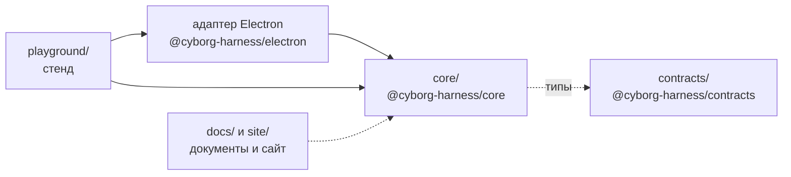

Репозиторий [dex-it/cyborg-harness](https://github.com/dex-it/cyborg-harness) содержит ядро плагинов, пакет контрактов, стенд для проверки ядра вживую и документацию. Приложение Cyborg живёт в другом репозитории и подключает ядро как зависимость.

## Каталоги

| Путь | Что |
|---|---|
| `core/src/` | Ядро без зависимостей: загрузчик, граф контрактов, хосты со сторожем, журнал, шлюз `ctx.os`, разделы `config` и `state`, pty, слой окна |
| `core/elements/` | Браузерная часть элементов ядра `cy-*` |
| `core/test/` | Тесты ядра на `node:test`; общие подделки и фикстуры |
| `core/examples/` | Сценарии ядра в консоли (`npm run demo`) и демо-плагины на вымышленных контрактах |
| `contracts/` | Пакет `@cyborg-harness/contracts`: карта контрактов, API плагина и вида, данные элементов. Типы без кода |
| `electron/` | Пакет `@cyborg-harness/electron`: адаптер Electron для ядра - хосты в `utilityProcess`, среда `ctx.os`, схема `cyborg-plugin://`, мост видов, каналы IPC, `PluginsService`, слой окна, оболочка вида; описание - `electron/README.md` |
| `playground/src/main/` | Приложение стенда поверх адаптера: аргументы, воркспейс, окно, замеры |
| `playground/src/renderer/` | Раскладка окна стенда: сессия слева, справа вкладки плагинов, видов, документов, сообщений, журнала и клавиш |
| `playground/plugins/` | Базовые плагины и демо (см. ниже) |
| `playground/scripts/` | Сборка, дымовой тест, замеры фреймов и хостов |
| `playground/bench/` | Плагины для замера цены вызова |
| `docs/` | Корпус документов, нумерация по плану: стратегия, продукт, сценарии, архитектура, проверки, планы, ресёрч |
| `site/` | Проект сайта документации |
| `assets/` | Значок приложения |
| `.github/workflows/` | CI (`ci.yml`) и сайт (`docs-site.yml`) |

Склейка с Electron вынесена в пакет `@cyborg-harness/electron`. Стенд остаётся примером: в нём только раскладка окна по областям и то, что нужно проверять вживую.

## Модули ядра

| Модуль | За что отвечает |
|---|---|
| `manifest`, `semver`, `json-schema` | Разбор манифеста с перечнем всех ошибок сразу, версии, схемы разделов |
| `graph`, `registry`, `via-contract` | Граф контрактов до запуска кода, реестр контрактов и команд, права вызывающего через `guard` |
| `loader`, `host-runtime`, `host-entry`, `transports`, `rpc`, `wire` | Загрузка и выгрузка, активация, хосты и сторож, канал вызовов и проверка данных |
| `config`, `workspace`, `recent` | Разделы `config` и `state` по слоям, воркспейс и замок, «Недавние» |
| `os-gateway`, `permissions`, `serve` | Шлюз `ctx.os`, права и их описание словами, `serve.http` |
| `pty` | Псевдотерминалы, которые живут дольше плагина |
| `ui-shell`, `elements-model`, `window-layer`, `documents`, `keys` | Оболочка вида, модель элементов, диалоги и замок окна, документы, запись сочетаний |
| `journal`, `status` | Журнал плагинов и состояние, выведенное из него |
| `errors`, `disposable` | `CoreError` и коды, снятие подписок |

## Плагины стенда

| Группа | Плагины |
|---|---|
| Базовые | `sessions`, `agent-claude-code`, `agent-shell`, `session-isolation`, `next-actions`, `pin-lock` |
| Демо ядра | `echo`, `chat`, `alice`, `bob`, `flaky`, `later` |

Код вида плагина лежит в каталоге `ui/` самого плагина.

## Документы

Корпус в `docs/` повторяет раскладку корпуса Cyborg: `00-strategy`, `01-product`, `02-use-cases`, `03-architecture`, `04-verification`, `05-plans`, плюс `research`. Решения и их статусы - на странице [Решения](/development/decisions/). Вход в корпус - `docs/README.md`, краткий обзор - `docs/OVERVIEW.md`.

## Работа с репозиторием

- Как собрать и проверить - [Участие в разработке](/development/contributing/).
- Какие проверки и как устроен CI - [Тесты и CI](/development/tests-ci/).
- Как собирается этот сайт - [Сайт документации](/development/docs-site/).
- Что делается и в каком порядке - [Дорожная карта](/development/roadmap/).

## Дальше

- [Решения](/development/decisions/) - SAD, ADR и спорные пункты.
- [Участие в разработке](/development/contributing/) - ветки, PR и метки.
- [Тесты и CI](/development/tests-ci/) - что гоняется на каждый PR.
- [Пакеты и версии](/reference/packages/) - состав пакетов и правила версий.
