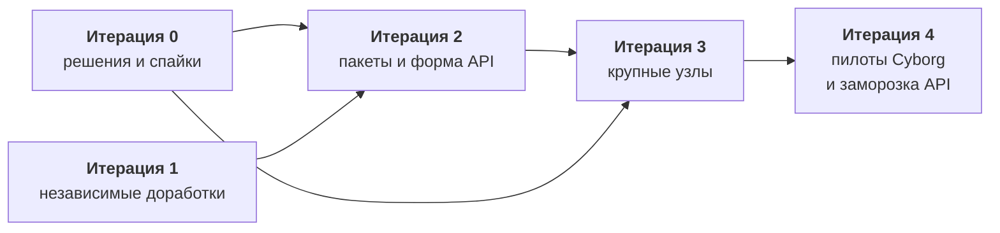

Работа над ядром ведётся одним эпиком: [github.com/dex-it/cyborg-harness/issues/15](https://github.com/dex-it/cyborg-harness/issues/15). Его цель - ядро, готовое к системе плагинов: пакеты вместо копирования из стенда, документация и инструменты для автора плагина, сценарии Cyborg, доказанные на ядре. Эта страница - карта по итерациям; статус каждой задачи показывает GitHub.

:::note[Что уже сделано]
Что выполнено и что осталось по каждому направлению ядра, сводкой сверху, - в [дорожной карте проекта](https://github.com/dex-it/cyborg-harness/blob/master/docs/06-plans/roadmap.md). Сделано: воркспейс, загрузка, граф контрактов, хосты со сторожем, `ctx.os` и права, pty с `persist` и `attach`, виды во фреймах, диалоги и замок, документы, клавиши по манифесту, `config` и `state`. Замеры на Linux и macOS - в [проверке на macOS](https://github.com/dex-it/cyborg-harness/blob/master/docs/05-verification/macos-check.md).
:::

## Когда эпик готов

1. Цели SAD 3.1-3.10 выполнены, кроме вынесенных (`cyborg.secret-source`, включение плагина вне графа, этап 2).
2. В `core/src` нет предметных имён и npm-зависимостей; это проверяет тест.
3. API плагина зафиксирован как 1.0, снимок под тестом, справочник и руководство опубликованы.
4. Приложение подключает `@cyborg-harness/core`, `@cyborg-harness/contracts`, `@cyborg-harness/electron` по номеру версии.
5. Автору доступны шаблон, сборка, `checkPlugin` и тест-кит.
6. Бюджеты заданы числами и проверяются в CI; macOS подтверждён замерами и настоящей клавиатурой.
7. Принята политика загрузки плагинов из каталога пользователя; SAD и ADR приняты владельцем.
8. Пилоты PL-01..PL-09 пройдены, результаты записаны в `docs/05-verification/`.

## Что не входит

- **Второй этап изоляции**: процесс на плагин с `--permission`, `Compartment`, окна согласия, установка из внешнего источника. Начинается, когда появится плагин от автора вне команды; три дешёвые страховки входят в эпик.
- **Полный перенос функций Cyborg** в плагины (трекеры, кнопки-команды, расширения Claude Code, поиск, проекты, оболочка): отдельный эпик после этого.
- **Windows**: решается в первой итерации.

## Карта итераций

Итерация - набор задач, которые ведутся параллельно. Следующая начинается, когда закрыты задачи, от которых зависят её первые; внутри итерации порядок не важен, если иное не указано в «Зависит от». Одну задачу берёт один человек; файлы `core/src/loader.ts` и `core/src/os-gateway.ts` правят многие, поэтому сначала идёт разбиение `loader.ts`, а крупные узлы потом.

**Критический путь:** D-00 -> P-02 -> P-03 -> K-13 -> K-21; параллельно D-00 и T-08 -> K-07 -> {K-08, K-13}; K-03 -> {K-04, K-08}. Самые долгие независимые задачи - pty-хост, группы рендера и реестр сочетаний (размер L).

## Задачи

### Итерация 0. Решения и спайки

Снять блокеры до того, как люди начнут писать код: решения владельца и автора SAD, короткие исследования.

| Задача | Название | Размер | Зависит от |
|---|---|---|---|
| [D-00](https://github.com/dex-it/cyborg-harness/issues/21) | Решения владельца, блокирующие эпик | S | - |
| [SP-01](https://github.com/dex-it/cyborg-harness/issues/24) | Спайк: хвост pty или снимок терминала (вопрос 14 SAD) | S | - |

### Итерация 1. Независимые доработки

Закрыть всё, что не упирается в чужие решения и не конфликтует по файлам. Задачи ведутся одновременно.

| Задача | Название | Размер | Зависит от |
|---|---|---|---|
| [K-02](https://github.com/dex-it/cyborg-harness/issues/31) | Льготное время осиротевшего pty | S | - |
| [K-11](https://github.com/dex-it/cyborg-harness/issues/50) | Переключатель безопасного режима в приложении | S | - |
| [K-14](https://github.com/dex-it/cyborg-harness/issues/58) | Пределы ресурсов и горячий путь pty: лимит ввода, пакетирование вывода, COLORTERM | M | - |
| [K-15](https://github.com/dex-it/cyborg-harness/issues/53) | Пространство контрактов cyborg.* только для встроенных плагинов | S | - |
| [K-16](https://github.com/dex-it/cyborg-harness/issues/54) | Цепочка fs.write + shell.openPath: принять решение и закрыть | S | [D-00](https://github.com/dex-it/cyborg-harness/issues/21) |
| [K-18](https://github.com/dex-it/cyborg-harness/issues/56) | Мелочи ядра из спорных пунктов: область path:open, показать файл воркспейса, копия повреждённого файла, experimental_ | M | [D-00](https://github.com/dex-it/cyborg-harness/issues/21) |
| [K-19](https://github.com/dex-it/cyborg-harness/issues/57) | Уведомления с кликом и закрытием; заголовок окна от плагинов | M | - |
| [PL-09](https://github.com/dex-it/cyborg-harness/issues/37) | Базовые метрики Cyborg и записанные сессии для сравнения | M | - |
| [T-01](https://github.com/dex-it/cyborg-harness/issues/48) | Неперехваченные ошибки вне вызова в хосте: проверить итог PR #5 и закрыть остаток | S | PR #5 |
| [T-02](https://github.com/dex-it/cyborg-harness/issues/49) | Предметные имена в core/src/workspace.ts вынести в хук приложения | S | - |
| [T-03](https://github.com/dex-it/cyborg-harness/issues/51) | Один источник версии API и демо-контракты вне боевого пакета | S | - |
| [T-04](https://github.com/dex-it/cyborg-harness/issues/52) | Тест чистоты ядра: нет предметных имён, Electron и npm-зависимостей | S | [T-02](https://github.com/dex-it/cyborg-harness/issues/49) |
| [T-05](https://github.com/dex-it/cyborg-harness/issues/10) | Тест: секрет не попадает в журнал, config и state | S | - |
| [T-07](https://github.com/dex-it/cyborg-harness/issues/14) | Задержка шлюза ctx.os на горячих путях и бюджеты | M | [D-00](https://github.com/dex-it/cyborg-harness/issues/21) |
| [T-11](https://github.com/dex-it/cyborg-harness/issues/26) | Гигиена кода и документов: комментарии, нумерация вопросов, имена ADR, расхождения roadmap | S | - |

### Итерация 2. Пакеты и форма API

Ядро и адаптер становятся пакетами; закрепляется форма манифеста и API, на которую опираются крупные узлы.

| Задача | Название | Размер | Зависит от |
|---|---|---|---|
| [K-03](https://github.com/dex-it/cyborg-harness/issues/33) | Род области, order и kind вида в манифесте; раскладка из ядра | M | [D-00](https://github.com/dex-it/cyborg-harness/issues/21) |
| [K-06](https://github.com/dex-it/cyborg-harness/issues/41) | Журнал вызовов членов контракта с @deprecated | M | [D-00](https://github.com/dex-it/cyborg-harness/issues/21) |
| [K-10](https://github.com/dex-it/cyborg-harness/issues/47) | Удаление плагина с зачисткой его данных, секретов и прав | M | - |
| [K-12](https://github.com/dex-it/cyborg-harness/issues/59) | Достаточность ctx.os для базовых плагинов (fs, process, net) | M | [D-00](https://github.com/dex-it/cyborg-harness/issues/21) |
| [K-17](https://github.com/dex-it/cyborg-harness/issues/55) | Политика загрузки плагинов из каталога пользователя на этапе 1 | S | [D-00](https://github.com/dex-it/cyborg-harness/issues/21) |
| [P-01](https://github.com/dex-it/cyborg-harness/issues/29) | Версионирование и публикация @cyborg-harness/contracts | M | [D-00](https://github.com/dex-it/cyborg-harness/issues/21), [T-03](https://github.com/dex-it/cyborg-harness/issues/51) |
| [P-02](https://github.com/dex-it/cyborg-harness/issues/34) | Ядро как пакет @cyborg-harness/core | L | [D-00](https://github.com/dex-it/cyborg-harness/issues/21) |
| [P-03](https://github.com/dex-it/cyborg-harness/issues/35) | Адаптер Electron как пакет @cyborg-harness/electron | L | [P-02](https://github.com/dex-it/cyborg-harness/issues/34) |
| [P-08](https://github.com/dex-it/cyborg-harness/issues/8) | Тест-кит для авторов и общий набор тестов контрактов | M | [P-02](https://github.com/dex-it/cyborg-harness/issues/34) |
| [P-09](https://github.com/dex-it/cyborg-harness/issues/9) | Проверка плагина вне репозитория: checkPlugin | M | [P-02](https://github.com/dex-it/cyborg-harness/issues/34) |
| [T-08](https://github.com/dex-it/cyborg-harness/issues/16) | Разбить loader.ts на части без смены поведения | M | - |
| [T-09](https://github.com/dex-it/cyborg-harness/issues/20) | Публичный экспорт ядра для встраивающего приложения | S | [P-02](https://github.com/dex-it/cyborg-harness/issues/34) |

### Итерация 3. Крупные узлы

Самые тяжёлые куски, у которых есть общие зависимости: процессы, окно, клавиши и меню, сборка плагинов.

| Задача | Название | Размер | Зависит от |
|---|---|---|---|
| [K-01](https://github.com/dex-it/cyborg-harness/issues/27) | pty-хост отдельным процессом ядра | L | [D-00](https://github.com/dex-it/cyborg-harness/issues/21), [SP-01](https://github.com/dex-it/cyborg-harness/issues/24), [P-03](https://github.com/dex-it/cyborg-harness/issues/35) |
| [K-04](https://github.com/dex-it/cyborg-harness/issues/36) | Группы рендера: ui.group, plugins.uiGroups, origin по группе | L | [K-03](https://github.com/dex-it/cyborg-harness/issues/33), [P-03](https://github.com/dex-it/cyborg-harness/issues/35), [T-08](https://github.com/dex-it/cyborg-harness/issues/16) |
| [K-05](https://github.com/dex-it/cyborg-harness/issues/40) | Строгая CSP вида и флаг инлайн-стилей | M | [P-03](https://github.com/dex-it/cyborg-harness/issues/35), [PL-05](https://github.com/dex-it/cyborg-harness/issues/25) |
| [K-07](https://github.com/dex-it/cyborg-harness/issues/44) | ctx.keys.register с условием и единый реестр сочетаний (закрывает D-27) | L | [D-00](https://github.com/dex-it/cyborg-harness/issues/21), [T-08](https://github.com/dex-it/cyborg-harness/issues/16) |
| [K-08](https://github.com/dex-it/cyborg-harness/issues/45) | Вклады плагинов в меню окна (contributes.menus) | M | [D-00](https://github.com/dex-it/cyborg-harness/issues/21), [K-03](https://github.com/dex-it/cyborg-harness/issues/33), [K-07](https://github.com/dex-it/cyborg-harness/issues/44) |
| [K-09](https://github.com/dex-it/cyborg-harness/issues/46) | Отмена запросов между плагинами (идентификатор и сообщение отмены) | M | [D-00](https://github.com/dex-it/cyborg-harness/issues/21), [T-08](https://github.com/dex-it/cyborg-harness/issues/16) |
| [K-13](https://github.com/dex-it/cyborg-harness/issues/60) | Канал «главная часть - вид» и модальные окна плагина | M | [P-03](https://github.com/dex-it/cyborg-harness/issues/35), [K-07](https://github.com/dex-it/cyborg-harness/issues/44) |
| [K-20](https://github.com/dex-it/cyborg-harness/issues/61) | Несколько воркспейсов и экземпляров приложения | M | [D-00](https://github.com/dex-it/cyborg-harness/issues/21) |
| [P-05](https://github.com/dex-it/cyborg-harness/issues/39) | Шаблон плагина и минимальный пример | M | [P-06](https://github.com/dex-it/cyborg-harness/issues/42), [P-08](https://github.com/dex-it/cyborg-harness/issues/8) |
| [P-06](https://github.com/dex-it/cyborg-harness/issues/42) | Сборка и упаковка плагинов: бандл главной части, проверка состава | L | [P-09](https://github.com/dex-it/cyborg-harness/issues/9) |
| [P-07](https://github.com/dex-it/cyborg-harness/issues/43) | Загрузка встроенных плагинов из каталога поставки | M | [P-03](https://github.com/dex-it/cyborg-harness/issues/35), [P-06](https://github.com/dex-it/cyborg-harness/issues/42) |
| [PL-05](https://github.com/dex-it/cyborg-harness/issues/25) | Пилот: Monaco и xterm в iframe на cyborg-plugin:// | M | - |
| [T-10](https://github.com/dex-it/cyborg-harness/issues/22) | Загрузка .ts/.js плагинов вне репозитория и из упакованной сборки | M | [P-06](https://github.com/dex-it/cyborg-harness/issues/42), [P-07](https://github.com/dex-it/cyborg-harness/issues/43) |

### Итерация 4. Пилоты Cyborg и заморозка API

Доказать сценарии Cyborg на ядре пилотами и зафиксировать API 1.0.

| Задача | Название | Размер | Зависит от |
|---|---|---|---|
| [K-21](https://github.com/dex-it/cyborg-harness/issues/62) | Заморозка API 1.0 | S | [K-03](https://github.com/dex-it/cyborg-harness/issues/33), [K-06](https://github.com/dex-it/cyborg-harness/issues/41), [K-07](https://github.com/dex-it/cyborg-harness/issues/44), [K-08](https://github.com/dex-it/cyborg-harness/issues/45), [K-09](https://github.com/dex-it/cyborg-harness/issues/46), [K-12](https://github.com/dex-it/cyborg-harness/issues/59), [K-13](https://github.com/dex-it/cyborg-harness/issues/60), [T-06](https://github.com/dex-it/cyborg-harness/issues/12) |
| [P-04](https://github.com/dex-it/cyborg-harness/issues/38) | Документация автору плагина: руководство, справочники, схема манифеста | L | [K-17](https://github.com/dex-it/cyborg-harness/issues/55), [K-21](https://github.com/dex-it/cyborg-harness/issues/62) |
| [P-10](https://github.com/dex-it/cyborg-harness/issues/11) | CI и релизы: публикация пакетов, бюджеты, проверка ссылок | M | [P-01](https://github.com/dex-it/cyborg-harness/issues/29), [P-02](https://github.com/dex-it/cyborg-harness/issues/34), [P-03](https://github.com/dex-it/cyborg-harness/issues/35), [T-07](https://github.com/dex-it/cyborg-harness/issues/14) |
| [P-11](https://github.com/dex-it/cyborg-harness/issues/13) | Приёмка документов владельцем и план миграции Cyborg в репозитории ai-cyborg | S | [D-00](https://github.com/dex-it/cyborg-harness/issues/21) |
| [PL-01](https://github.com/dex-it/cyborg-harness/issues/17) | Пилот: настоящая сессия claude через sessions и agent-claude-code под нагрузкой | L | [K-01](https://github.com/dex-it/cyborg-harness/issues/27), [K-14](https://github.com/dex-it/cyborg-harness/issues/58) |
| [PL-02](https://github.com/dex-it/cyborg-harness/issues/18) | Пилот: цепочка хук - статус - уведомление в другом плагине | M | [K-19](https://github.com/dex-it/cyborg-harness/issues/57) |
| [PL-03](https://github.com/dex-it/cyborg-harness/issues/19) | Пилот: единый реестр сочетаний на macOS | M | [K-07](https://github.com/dex-it/cyborg-harness/issues/44), [K-08](https://github.com/dex-it/cyborg-harness/issues/45) |
| [PL-04](https://github.com/dex-it/cyborg-harness/issues/23) | Пилот: дерево файлов и git через границу плагинов, fs.watch вместо опроса | L | [K-12](https://github.com/dex-it/cyborg-harness/issues/59), [T-07](https://github.com/dex-it/cyborg-harness/issues/14) |
| [PL-06](https://github.com/dex-it/cyborg-harness/issues/28) | Пилот: миграция данных воркспейса и localStorage | M | [T-02](https://github.com/dex-it/cyborg-harness/issues/49), [K-13](https://github.com/dex-it/cyborg-harness/issues/60) |
| [PL-07](https://github.com/dex-it/cyborg-harness/issues/30) | Пилот: CLI-плагин с отменой и пулом процессов (срез трекеров) | M | [K-09](https://github.com/dex-it/cyborg-harness/issues/46), [K-12](https://github.com/dex-it/cyborg-harness/issues/59) |
| [PL-08](https://github.com/dex-it/cyborg-harness/issues/32) | Пилот: раскладка окна Cyborg на областях и вкладах в меню | L | [K-03](https://github.com/dex-it/cyborg-harness/issues/33), [K-08](https://github.com/dex-it/cyborg-harness/issues/45), [K-19](https://github.com/dex-it/cyborg-harness/issues/57) |
| [T-06](https://github.com/dex-it/cyborg-harness/issues/12) | Снимок публичного API под тестом | M | - |

Размеры: S - до 2 человеко-дней, M - 3-8, L - больше 8 (оценки составителя, не обязательства).

## Метки и вехи

Каждая задача эпика - подзадача [эпика](https://github.com/dex-it/cyborg-harness/issues/15), несёт метку итерации `iteration: N`, веху «Итерация N», уровень `level: task`, тип, компонент, приоритет и размер (`effort:`). Все метки описаны на странице [«Участие»](/development/contributing/).
