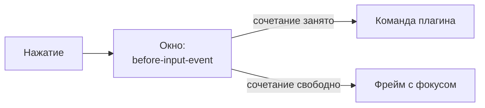

Сочетание клавиш должно срабатывать одинаково, где бы ни стоял фокус: в каркасе окна, в списке, в терминале. Поэтому сочетания ловит ядро, а не страница плагина.

## Как это работает

Ядро перехватывает сочетание в главном процессе (`before-input-event` окна) до того, как нажатие дойдёт до фрейма. Остальные клавиши идут в область с фокусом как обычно. Плагин в своём `<iframe>` видит только клавиши, пришедшие в его фокус, и не вешает глобальных обработчиков.



Список сочетаний держится коротким: терминалу нужны почти все клавиши (`Ctrl+C`, `Ctrl+R`).

## Сочетания из манифеста

Плагин объявляет сочетания в манифесте и привязывает к своим командам:

```jsonc
"keybindings": [
  { "key": "CmdOrCtrl+Shift+F", "command": "search.open" },
  { "key": "CmdOrCtrl+T", "command": "sessions.new" }
]
```

- `CmdOrCtrl` - это `Cmd` на macOS и `Ctrl` на остальных платформах.
- Без модификатора допустимы только `F1`-`F24`.
- Команда должна быть без обязательных аргументов.
- Сочетание читается до запуска кода: конфликт виден при загрузке, а не при нажатии.
- Сочетание ловится и у спящего ленивого плагина: нажатие его будит.

## Конфликты

Два плагина на одно сочетание - не ошибка загрузки, но запись в журнале (`key-conflict`) и предупреждение в окне управления плагинами. Нажатие получает победитель: встроенный плагин побеждает сторонний, между равными - первый по `id`. Если победитель выгружен, сочетание не переходит к проигравшему, а идёт в окно: что делает нажатие, не зависит от того, кто сейчас работает.

## Правки человека

Человек переназначает сочетания в разделе `plugins.keybindings` настроек пользователя или воркспейса. Запись воркспейса идёт после записи пользователя и побеждает её.

```jsonc
"plugins": { "keybindings": [
  { "key": "CmdOrCtrl+K", "command": "search.open" },
  { "key": "CmdOrCtrl+T", "command": null }     // null отдаёт сочетание окну
] }
```

Сочетание, которое не разобралось, или команда, которой нет ни у одного плагина, дают запись `key-ignored`; остальные привязки продолжают работать. Привязки манифестов, вытесненные человеком, остаются в списке как перекрытые, но без записи о конфликте: его разрешил человек.

## Условные сочетания

Некоторые сочетания задаёт не манифест, а человек: например, горячие клавиши пользовательских кнопок-команд. В манифест они не попадают и срабатывают по условию. Для них в главной части есть `ctx.keys.register({ key, command, args, when })`: своя команда с готовыми аргументами и условия `when` - закрытый список флагов:

| Флаг | Смысл | По умолчанию |
|---|---|---|
| `repeat` | срабатывать на автоповтор удерживаемой клавиши | нет |
| `dialog` | срабатывать, пока открыт диалог вида | нет |
| `input` | `not-text` - не в поле ввода (терминал полем ввода не считается), `any` - везде | `not-text` |
| `visible` | только пока вид плагина виден | нет |

Регистрация идёт в тот же единый реестр, что и манифестные сочетания, команды окна и акселераторы меню. Сочетание окна и меню занять нельзя: регистрация отклоняется. Старше всех выбор человека в `plugins.keybindings` (им можно забрать и сочетание окна или меню, или освободить его через `null`); затем окно и меню, манифест и, последним, динамическое. Манифестное и выбранное человеком сочетание старше динамического: проигравший получает `active: false` и имя победителя, а в журнале появляется запись `key-conflict`. Регистрации снимаются при выгрузке плагина и откате активации; после возвращения плагина он регистрирует их заново. Приложение сообщает ядру фокус ввода, видимость вида и автоповтор, поэтому условия проверяются до того, как нажатие дойдёт до страницы.

## Команды окна

Часть сочетаний принадлежит самому ядру: `F6` и `Shift+F6` двигают фокус между областями ([Раскладка](/features/layout/)). Они идут в таблицу до плагинов, плагин на то же сочетание проигрывает записью `key-conflict`, а `id` `cyborg`, `cyborg.window` и `cyborg.workspace` манифест не даст занять. Человек переназначает их той же записью `plugins.keybindings`.

## Под замком окна

Пока окно заблокировано плагином замка, работают только сочетания его владельца, остальные доходят до окна как незанятые ([Окно и система](/features/window-system/)).

## Подсказки в виде

Вид узнаёт сочетание своей команды через `ctx.keys.of(command)`: оно учитывает правки человека и платформу (`Ctrl+Shift+F`, `Cmd+Shift+F`). Не привязана - `undefined`.

## Платформы

Сочетания проверены настоящими нажатиями на Linux и macOS, в том числе при фокусе внутри фрейма. Полный список сочетаний окна - в [справочнике](/reference/hotkeys/).

## Дальше

- [Окно и система](/features/window-system/) - меню окна делит реестр с сочетаниями.
- [Сочетания окна](/reference/hotkeys/) - перечень по платформам.
- [Манифест](/authors/manifest/) - как объявить сочетание и команду.
