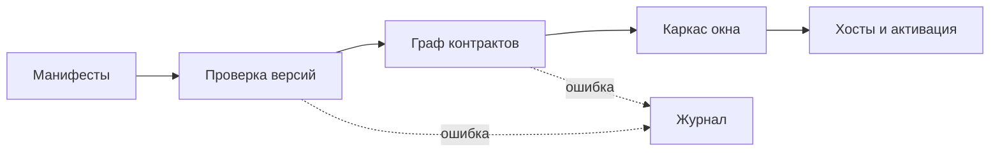

Плагин - каталог с манифестом `manifest.json` и кодом. Манифест ядро читает до запуска любого кода плагина: по нему видно, что плагин даёт, чего требует, о чём просит и где рисует.

## Что видит человек

Окно управления плагинами показывает каждый плагин с состоянием, правами человеческими словами и журналом. Состояния такие:

| Состояние | Что значит |
|---|---|
| работает | плагин активирован в своём хосте |
| ждёт | ленивый плагин, его разбудит первая команда, сочетание, показ вида или потребитель |
| перезапускается | хост плагина поднимается заново, вид закрыт плашкой ядра |
| выключен | плагин остановлен сбоем или человеком, причина записана в журнале |
| не включён | плагина нет в списке `plugins.enabled` |

Если плагин остановлен сбоем, на месте его вида стоит заглушка с именем плагина, причиной из журнала и кнопками «Включить снова» и «Журнал». Окно без плагинов - нормальное состояние: в нём доступно управление плагинами.

## Как плагин загружается

1. Ядро читает `plugins.enabled`: файл пользователя, перекрытый файлом воркспейса. Больше для старта ничего не нужно.
2. Читает манифесты и проверяет совместимость версий ([Версии](/features/versions/)).
3. Решает граф контрактов **до запуска кода**. Недостающий `requires`, два поставщика при кратности `one`, цикл - плагин не загружается, причина пишется в журнал.
4. Рисует каркас окна по манифестам ([Раскладка](/features/layout/)).
5. Раскладывает плагины по хостам ([Хосты](/features/hosts/)) и активирует их в порядке графа.

Активация плагина ограничена по времени: зависшая активация засчитывается как сбой этого плагина, остальные продолжают работу.

## Ленивая активация

С `"activation": "lazy"` плагин при старте получает состояние «ждёт». Его будят:

- первая команда плагина;
- сочетание клавиш, объявленное в его манифесте;
- первый показ его вида;
- активация потребителя: поставщика из `requires` и `optional` ядро поднимает раньше потребителя.

Выключенный человеком ленивый плагин команда не будит.

## Включение, выключение, удаление

- **Выгрузка и загрузка** идут без перезапуска окна. Выгрузка снимает плагин и тех, кто требует его через `requires`, в обратном порядке активации. Потребители через `optional` остаются и получают `onChange`.
- **Процессы терминала.** Если у выгружаемых плагинов есть живые процессы, ядро спрашивает человека, оставить их работать или завершить ([Терминалы](/features/terminals/)).
- **Удаление** стирает следы плагина: его данные и временные файлы, секреты, выданные человеком пути, документы и память видов, оставшиеся процессы. Новый плагин с тем же `id` ничего не наследует.
- **Безопасный режим** выключает все плагины без исключений, включая плагин замка окна. Включается флагом запуска `--safe-mode` или пунктом окна приложения.
- Плагин, которого не было в графе при запуске, включается после перезапуска приложения.

## Откуда берутся плагины

| Источник | Особенности |
|---|---|
| Поставка приложения | встроенные плагины; признак - каталог установки, а не манифест |
| Каталог пользователя | выключен по умолчанию; включается флагом запуска `--user-plugins`. Плагины оттуда сторонние: помечены в окне, записаны в журнал (`third-party`), каждый работает в своём хосте |

Автор манифеста может написать в нём что угодно, поэтому «встроенный» ядро определяет по каталогу установки. Пространство контрактов `cyborg.*` и идентификаторы `cyborg*` доступны только встроенным плагинам: сторонний плагин, объявивший `provides` для `cyborg.*`, отвергается записью в журнале, и встроенные потребители не страдают.

### Каталог пользователя на первом этапе

Это политика первого этапа, решение владельца от 2026-11-08.

- **По умолчанию каталог не читается.** Плагин, лежащий в `plugins/` каталога данных приложения, не загружается, даже если его `id` есть в `plugins.enabled`: в журнале запись `not-found`, в логе приложения - строка с числом таких плагинов и названием флага.
- **Включает человек, флагом запуска `--user-plugins`**, а не настройкой. Файл воркспейса перекрывает пользовательские настройки и может лежать в репозитории, поэтому запись в нём не должна включать чужой код. Нужны оба условия: флаг и `id` в `plugins.enabled`. Флаг переживает смену воркспейса и перезапуск в безопасном режиме и обратно; повторный запуск при открытом окне его не применяет.
- **Плагин оттуда сторонний.** Строка в окне «Плагины Cyborg» помечена «сторонний» с предупреждением, права показаны словами; над списком - плашка о флаге; при загрузке в журнале запись `third-party`.
- **Это предупреждение, а не защита.** Пока главная часть исполняется в обычном процессе Node, код из каталога пользователя может обойти шлюз `ctx.os`, а проверка импортов смотрит только каталоги репозитория ([Доверие](/concepts/trust/)). Права в манифесте - то, что плагин заявил. Включайте каталог только для собственных плагинов.
- **Не входит:** установка плагинов, подпись, доверенный список, окна согласия - второй этап изоляции.

## Что видит автор

Автор пишет манифест ([Манифест](/authors/manifest/)) и модуль с `activate(ctx)`, который возвращает `Disposable` или ничего. Всё, что плагин зарегистрировал через `ctx.subscriptions`, ядро снимает при выгрузке в обратном порядке. Падение при активации отказывает только этому плагину.

## Журнал

В журнал пишутся отказы загрузки, ошибки активации, отказы прав, перезапуски хостов и конфликты сочетаний. Каждую запись ядро умеет пересказать словами; полный перечень - в [справочнике журнала](/reference/journal/). Одинаковые отказы шлюза склеиваются за несколько секунд в одну запись со счётчиком повторов.

## Дальше

- [Контракты](/features/contracts/) - как плагины находят друг друга.
- [Жизнь плагина](/concepts/lifecycle/) - полный путь от разбора манифеста до выгрузки.
- [Манифест](/authors/manifest/) - все поля и ограничения.
