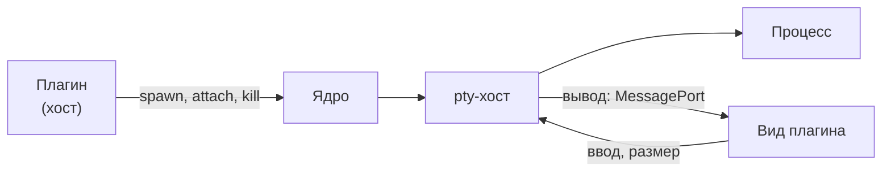

Ресурс ОС, который должен пережить своего владельца, держит ядро. Такой ресурс - псевдотерминал (pty): плагин решает, что запустить, а ядро запускает процесс и хранит его у себя. Ядро не знает, что внутри агент: для него это pty с программой из права плагина.

## Что это даёт

- Перезапуск хоста плагина или окна не убивает процесс: владелец возвращается и забирает его.
- Экран терминала работает, даже если хост плагина завис: вывод и ввод идут мимо хоста.
- Окно не замораживается, если зависает нативный модуль `node-pty`: процессы держит отдельный **pty-хост** ядра.



## Как это выглядит для человека

Терминал - вид плагина: ядро отвечает за процесс, плагин за экран. Когда человек выключает плагин, у которого есть живые процессы, ядро спрашивает, завершать ли их. Кнопка по умолчанию - «Оставить работать»: процессы ждут, пока плагин вернётся. При выходе из приложения процессы завершаются.

Если процесс завершился сам, терминал остаётся на месте, а плагин получает код выхода.

## Как это выглядит для автора

Право `pty` в манифесте перечисляет программы, которые плагин вправе запускать. Запускает он их через `ctx.os.pty`:

```ts
const pty = await ctx.os.pty.spawn({ ...spec, cols, rows, persist: true });
pty.onData(chunk => { /* разбор вывода */ });
pty.write(input); pty.resize(cols, rows); await pty.kill();

// после перезапуска хоста
for (const info of await ctx.os.pty.list()) {   // только свои pty
  const h = await ctx.os.pty.attach(info.id);   // h.backlog - накопленный хвост
}
```

| Что | Кто |
|---|---|
| какую программу запускать, с какими аргументами и окружением | плагин, ядро сверяет с правом `pty` |
| сам процесс | ядро, в pty-хосте |
| хвост вывода, пока владельца нет | ядро ведёт, плагин читает при `attach` |
| когда завершать | плагин через `kill()`, либо ядро по правилам ниже |

Чужой pty для плагина не существует: попытка дотянуться до него отвечает `NotFound`. `kill` принимает сигналы `SIGTERM`, `SIGKILL`, `SIGINT`, `SIGHUP`.

## Горячий путь мимо хоста

Экран терминала живёт в `<iframe>` вида, а `ctx.os` у вида нет. Главная часть выдаёт виду **билет**: одноразовый, на 30 секунд, только для своего вида.

```ts
// главная часть
const ticket = await pty.share();
// вид
const term = await ctx.terminal.open(ticket);   // onData, onExit, write, resize, close
```

Вывод идёт из pty-хоста прямо во фрейм по `MessagePort`, ввод и размер - обратно; главный процесс порт создаёт, но в потоке не участвует. Чужой, просроченный или повторный билет отвечает `NotFound`. Размер окна принимается в пределах от 1 до 1000.

## Перезапуск и сироты

| Событие | Что с процессом |
|---|---|
| хост плагина перезапущен | жив, если запущен с `persist`; плагин берёт его через `attach` |
| плагин выключен с «Оставить работать» | жив, ждёт возвращения плагина |
| плагин не вернулся за льготное время | завершён, в журнале причина и срок; значение - настройка ядра |
| плагин удалён, воркспейс закрыт, приложение завершается | завершён |
| упал сам pty-хост | процессы потеряны, владельцы получают завершение, хост перезапускается |

Короткие процессы `ctx.os.process` при падении хоста завершаются: их результат больше некому принять. Перезапуск переживает только pty с `persist`.

## Хвост вывода

Ядро хранит кольцевой буфер вывода каждого pty, по умолчанию 256 К символов. После `attach` оно «шевелит» размер окна (на шаг в сторону и обратно), чтобы программа получила `SIGWINCH` и перерисовалась сама. Хвост - сырой вывод и может начинаться посреди escape-последовательности, поэтому вид должен читать его как поток, а не как готовый экран.

## Ограничения

- Процесс запускается группой: выключение, выгрузка и падение хоста завершают всю группу, так что сборки и серверы, запущенные программой, не остаются сиротами.
- Программа получает только базовое окружение (`PATH`, `HOME`, локаль) и переменные, названные в `env` правила. Для интерактивных программ ядро задаёт `COLORTERM=truecolor`.
- Размер одного ввода и число процессов на плагин ограничены пределами ядра; превышение отвечает `Invalid`.
- Программа `$SHELL` в правиле означает оболочку входа человека: ядро подставит её путь, а правило обязано закрепить флаг и скрипт. Рецепт - в [рецептах](/authors/recipes/).
- Работа на Windows не заявлена, см. [платформы](/reference/platforms/).

## Дальше

- [Виды](/features/views/) - как вид показывает терминал.
- [Права](/features/permissions/) - как устроены правила `pty` и `launch`.
- [Изоляция](/concepts/isolation/) - почему pty-хост отделён от окна.
