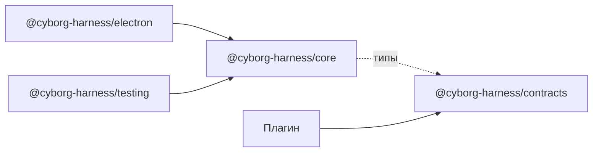

Ядро поставляется несколькими пакетами. Приложение подключает ядро, адаптер и контракты по номеру версии, а не копирует файлы из стенда. Автор плагина ставит контракты, тест-кит и инструмент сборки.

## Состав

| Пакет | Для кого | Что внутри |
|---|---|---|
| `@cyborg-harness/core` | приложение | ядро без Electron: загрузчик, граф контрактов, хосты со сторожем, журнал, шлюз `ctx.os`, права, разделы `config` и `state`, воркспейс, pty, слой окна, документы |
| `@cyborg-harness/electron` | приложение | всё, что связывает ядро с Electron: хосты плагинов на `utilityProcess`, адаптер ОС (`safeStorage`, `node-pty`, диалоги, буфер обмена, уведомления), схема `cyborg-plugin://`, мост видов, оболочка вида, перехват клавиш |
| `@cyborg-harness/contracts` | приложение и автор | типы без кода: карта контрактов `Contracts`, `PluginContext`, `UiContext`, `CoreErrorCode`, данные элементов `cy-*` |
| `@cyborg-harness/testing` | автор | `startKernel`, поддельные среды (псевдотерминал, секреты, память разделов) и общие наборы тестов контрактов |
| `cyborg-plugin` | автор | командная строка: `new`, `check`, `build`, `pack` |

Стенд playground в пакеты не входит: это пример окна поверх `@cyborg-harness/core` и `@cyborg-harness/electron`. Раскладка по областям, меню, уведомления и заголовок окна остаются за приложением.

## Зависимости между пакетами

- У `@cyborg-harness/core` нет зависимостей из npm. На `@cyborg-harness/contracts` он ссылается только типами (`import type`), поэтому контракты указаны как peer-зависимость.
- Ядро не импортирует Electron и ничего из стенда. Эту границу держит тест, а не ревью.
- Плагин импортирует только `@cyborg-harness/contracts` и свои модули: ни `node:*`, ни `electron`, ни чужих плагинов. Это проверяет `cyborg-plugin check`. Виду npm-пакеты разрешены, `node:*` и `electron` - нет.

## Публичный API

Каждый пакет отдаёт явный перечень имён по точкам входа, а не всё подряд. У `@cyborg-harness/core` точки входа разделены по среде выполнения:

| Точка входа | Среда | Что в ней |
|---|---|---|
| главный процесс | Node | загрузчик, транспорты хостов, среда шлюза `ctx.os`, воркспейс и «Недавние», разделы `config` и `state`, разбор журнала |
| окно | браузер, без `node:*` | запись сочетаний, оболочка вида, снимок слоя окна, строки документов, элементы `cy-*` |
| хост | процесс хоста | рантайм хоста (`runHost`) |

Перечень имён закреплён тестом: добавить или убрать имя без правки перечня нельзя. Остальное внутреннее и без обещаний совместимости. Для API плагина (`PluginContext`, `UiContext`, манифест, элементы `cy-*`) закреплён снимок под тестом: изменение формы видно в сравнении.

## Что считается версией

Версий три, и они не зависят друг от друга.

| Версия | Где записана | Что значит |
|---|---|---|
| Пакета | `version` пакета, `CHANGELOG.md` | выпуск пакета; выпуск идёт по тегу, и версия в теге совпадает с версией пакета и записью в `CHANGELOG.md` |
| API плагина | `engines.cyborg` в манифесте, например `^1` | форма `ctx`, манифест и элементы `cy-*`; несовместимый плагин не загружается, причина в журнале |
| Контракта | мажорная часть в карте `Contracts`, например `Contracts['cyborg.agent'][1]` | форма одного контракта между плагинами; поставщик может отдавать две мажорные версии сразу |

Правила одни для всех трёх: новый необязательный член, поле или значение - минорная версия, удаление, переименование, новое обязательное поле и смена смысла - мажорная. Член с пометкой `@deprecated` живёт минимум до следующей мажорной версии, а ядро пишет в журнал, кто его вызывает. Подробности - в [модели контрактов](/concepts/contracts-model/) и на странице [версий](/features/versions/).

## Требования к среде

| | Значение |
|---|---|
| Node | 24 (его несёт Electron 45; в `engines.node` пакетов указана та же версия) |
| Electron | 45 |
| Платформы | macOS и Linux, см. [Платформы](/reference/platforms/) |
| Формат пакетов | ESM, в пакете лежит JavaScript и `.d.ts` |

## Дальше

- [Установка](/start/install/) - как подключить пакеты к приложению.
- [Тестирование плагина](/authors/testing/) - `@cyborg-harness/testing` на практике.
- [Сборка и упаковка](/authors/packaging/) - команды `cyborg-plugin`.
- [Версии и совместимость](/features/versions/) - как ядро сверяет три версии.
