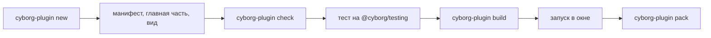

Соберём плагин `greeter`: команда, контракт, раздел `config` и вид с кнопкой. Это минимум, на котором видны все части плагина.



## 1. Создайте каталог

```bash
npx cyborg-plugin new greeter
cd greeter
```

:::caution[Пакеты ещё не опубликованы]
Пакеты `@cyborg/*` и команда `cyborg-plugin` публикуются задачами [P-01](https://github.com/dex-it/cyborg-harness/issues/29), [P-02](https://github.com/dex-it/cyborg-harness/issues/34), [P-05](https://github.com/dex-it/cyborg-harness/issues/39), [P-09](https://github.com/dex-it/cyborg-harness/issues/9); имя npm-scope решается в [D-00](https://github.com/dex-it/cyborg-harness/issues/21). Не ставьте пакеты с таким именем из npmjs.com до публикации: scope `@cyborg` на npmjs.com занят посторонним владельцем. До выпуска работайте из репозитория (`npm ci`, `npm start`).
:::

Команда создаёт манифест, главную часть, вид, схему раздела `config`, тест и настройки сборки. Дальше правим их по порядку.

## 2. Манифест

`manifest.json` ядро читает до запуска кода: по нему строится граф, каркас окна и список прав.

```json
{
  "id": "greeter",
  "version": "1.0.0",
  "engines": { "cyborg": "^1" },
  "provides": { "my.greeting": "1.0" },
  "commands": { "greeter.hello": {} },
  "keybindings": [{ "key": "CmdOrCtrl+Shift+G", "command": "greeter.hello" }],
  "config": { "version": 1, "schema": "./config.schema.json" },
  "ui": { "views": { "main": "./ui/ui.js" } }
}
```

Имя команды должно начинаться с `id` плагина и точки. Прав в манифесте нет, потому что плагину не нужны ни файлы, ни сеть. Все поля - на странице [Манифест](/authors/manifest/).

## 3. Схема настроек

`config.schema.json` описывает раздел `config`. Ядро проверяет значение по схеме до активации и после каждой правки файла извне.

```json
{
  "type": "object",
  "properties": { "greeting": { "type": "string" } },
  "additionalProperties": false
}
```

## 4. Главная часть

```ts
import type { PluginModule } from '@cyborg/contracts';

declare module '@cyborg/contracts' {
  interface Contracts {
    'my.greeting': { 1: { greet(name: string): Promise<string> } };
  }
}

const greeter: PluginModule = {
  config: { defaults: { greeting: 'привет' } },
  activate(ctx) {
    const greeting = () => String(ctx.config?.get().greeting ?? 'привет');
    ctx.contracts.provide('my.greeting', '1.0', {
      greet: async (name: string) => `${greeting()}, ${name}`,
    });
    ctx.commands.register('greeter.hello', () => {
      ctx.log('команда вызвана');
      return greeting();
    });
    return undefined;
  },
};

export default greeter;
```

Три вещи стоит заметить. Плагин импортирует только `@cyborg/contracts`. Контракт `my.greeting` назван по автору, а не `cyborg.*`, поэтому тип добавлен в карту `Contracts` через `declare module`. Всё, что вы регистрируете через `ctx`, ядро снимет само при выгрузке.

## 5. Вид

Вид - модуль с функцией `mount`. Он работает в своём `<iframe>`, а элементы `cy-*` уже определены оболочкой.

```ts
import type { Disposable, UiContext } from '@cyborg/contracts';

export function mount(root: HTMLElement, ctx: UiContext): Disposable {
  const button = document.createElement('cy-button');
  button.textContent = 'Поздороваться';
  const answer = document.createElement('p');
  button.addEventListener('click', () => {
    void ctx.commands.run('greeter.hello').then((value) => (answer.textContent = String(value)));
  });
  root.append(button, answer);
  return { dispose: () => { button.remove(); answer.remove(); } };
}
```

У вида нет `ctx.os`: к ОС он обращается через команды своей главной части. Подробности - [Вид](/authors/view-api/).

## 6. Проверка, тест, сборка

```bash
npx cyborg-plugin check     # манифест, импорты, права словами
npm test                    # тест на @cyborg/testing
npx cyborg-plugin build     # главная часть и вид со своими зависимостями
```

`check` сообщает все ошибки сразу в виде `файл:строка: причина` и возвращает ненулевой код, если что-то не так. Тест поднимает ядро без Electron, активирует плагин и проверяет, что команда отвечает, а раздел `config` проходит схему ([Тестирование](/authors/testing/)).

## 7. Запуск

Положите собранный каталог в каталог плагинов приложения, добавьте `greeter` в `plugins.enabled` и перезапустите окно. В стенде каталог пользователя - `plugins/` в каталоге данных приложения, на Linux это `~/.config/Cyborg Playground/plugins`. После запуска в журнале появится запись `activated`, вид - в каркасе окна, а `Ctrl+Shift+G` (на macOS `Cmd+Shift+G`) вызовет команду.

:::tip[Если что-то не загрузилось]
Причина всегда в журнале плагина: ошибки манифеста, недостающий поставщик, несовместимая версия API, отказ права. Журнал не требует отладчика - начинайте с него.
:::

Чтобы подготовить плагин к поставке, выполните `cyborg-plugin pack` ([Сборка и упаковка](/authors/packaging/)).

## Дальше

- [Автору плагина](/authors/) - обзор руководства.
- [Манифест](/authors/manifest/) - все поля и ограничения.
- [Рецепты](/authors/recipes/) - права на программы, секреты, миграции.
- [Стенд playground](/start/playground/) - примеры реальных плагинов.
