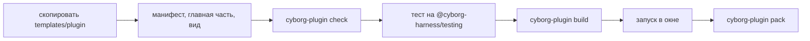

Соберём плагин `greeter`: команда, контракт, раздел `config` и вид с кнопкой. Это минимум, на котором видны все части плагина.



## 1. Скопируйте шаблон

Шаблон - каталог [`templates/plugin`](https://github.com/dex-it/cyborg-harness/tree/master/templates/plugin) репозитория: готовый плагин `example` с командой, контрактом, разделом `config`, видом, тестом и настройками сборки. Он проходит те же проверки, что вы будете запускать у себя, и проверяется в CI репозитория. Скопируйте его под своим именем:

```bash
git clone https://github.com/dex-it/cyborg-harness.git
cp -R cyborg-harness/templates/plugin greeter
cd greeter
```

Замените слово `example` на `greeter` во всех файлах каталога: `manifest.json`, `index.ts`, `contracts.ts`, `ui/ui.ts`, `package.json`, тест `test/example.test.ts` (файл переименуйте тоже) и потребитель контракта `test/consumer/index.ts` и `test/consumer/manifest.json` - иначе он попросит `example.greeting`, которого больше нет. Команды `cyborg-plugin new` нет: шаблон - обычный каталог.

:::caution[Пакеты ещё не опубликованы]
Пакеты `@cyborg-harness/*` и команда `cyborg-plugin` ещё не в реестре. `@cyborg-harness/contracts` готов к выпуску ([P-01](https://github.com/dex-it/cyborg-harness/issues/29): собирается, упаковывается и ставится в пустой проект из tarball), его выпуск - [P-10](https://github.com/dex-it/cyborg-harness/issues/11); остальное публикуется задачами [P-02](https://github.com/dex-it/cyborg-harness/issues/34), [P-05](https://github.com/dex-it/cyborg-harness/issues/39), [P-09](https://github.com/dex-it/cyborg-harness/issues/9). Пакеты scope `@cyborg` на npmjs.com к проекту не относятся. До выпуска соберите архивы в клоне и поставьте их в каталог плагина:

```bash
cd ..
mkdir -p packages
(cd cyborg-harness && npm ci && npm run build:packages && \
  npm pack --workspace=contracts --workspace=core --workspace=testing --workspace=tools/cyborg-plugin --pack-destination "$PWD/../packages")
cd greeter
npm install --save-dev ../packages/*.tgz
```

Так же шаблон проверяет `testing/test/template.test.ts`: копия вне репозитория, пакеты из архивов, без `paths`.
:::

В шаблоне уже есть манифест, главная часть, вид, схема раздела `config`, тест и настройки сборки (`tsconfig.json`, `package.json` со скриптами `check`, `typecheck`, `test`, `build`). Дальше они разобраны по порядку.

## 2. Манифест

`manifest.json` ядро читает до запуска кода: по нему строится граф, каркас окна и список прав.

```json
{
  "$schema": "./node_modules/@cyborg-harness/contracts/manifest.schema.json",
  "id": "greeter",
  "version": "1.0.0",
  "engines": { "cyborg": "^1" },
  "provides": { "greeter.greeting": "1.0" },
  "commands": { "greeter.hello": {} },
  "keybindings": [{ "key": "CmdOrCtrl+Shift+E", "command": "greeter.hello" }],
  "config": { "version": 1, "schema": "./config.schema.json" },
  "ui": { "views": { "main": "./ui/ui.js" } }
}
```

Имя команды должно начинаться с `id` плагина и точки. Прав в манифесте нет, потому что плагину не нужны ни файлы, ни сеть. Первая строка, `$schema`, подключает [схему манифеста](/reference/manifest/#схема-манифеста): редактор подскажет поля и подчеркнёт ошибки формы (ядро строку игнорирует). Все поля - на странице [Манифест](/authors/manifest/).

## 3. Схема настроек

`config.schema.json` описывает раздел `config`. Ядро проверяет значение по схеме до активации и после каждой правки файла извне.

```json
{
  "type": "object",
  "properties": { "greeting": { "type": "string" } },
  "additionalProperties": false
}
```

## 4. Главная часть

Тип контракта лежит в отдельном файле `contracts.ts`: в нём только типы и дополнение карты `Contracts`, кода нет.

```ts
declare module '@cyborg-harness/contracts' {
  interface Contracts {
    'greeter.greeting': { 1: Greeting };
  }
}

export interface Greeting {
  greet(name: string): Promise<string>;
}
```

Главная часть, `index.ts`:

```ts
import type { PluginModule } from '@cyborg-harness/contracts';
import type { Greeting } from './contracts.ts';

const DEFAULT_GREETING = 'привет';

const greeter: PluginModule = {
  config: { defaults: { greeting: DEFAULT_GREETING } },
  activate(ctx) {
    const greeting = (): string => {
      const value = ctx.config?.get().greeting;
      return typeof value === 'string' ? value : DEFAULT_GREETING;
    };
    const provider: Greeting = { greet: async (name) => `${greeting()}, ${name}` };
    ctx.contracts.provide('greeter.greeting', '1.0', provider);
    ctx.commands.register('greeter.hello', () => {
      ctx.log('команда вызвана');
      return greeting();
    });
    return undefined;
  },
};

export default greeter;
```

Три вещи стоит заметить. Плагин импортирует только `@cyborg-harness/contracts` и свои модули; `contracts.ts` подключён через `import type`, и проверка не пустит из него значения. Контракт `greeter.greeting` назван по автору, а не `cyborg.*`, поэтому тип добавлен в карту `Contracts` через `declare module`. Всё, что вы регистрируете через `ctx`, ядро снимет само при выгрузке.

Потребитель этого контракта в шаблоне - плагин `test/consumer`: он нужен только тесту и в сборку не входит.

## 5. Вид

Вид - модуль с функцией `mount`. Он работает в своём `<iframe>`, а элементы `cy-*` уже определены оболочкой.

```ts
import type { Disposable, UiContext, UiModule } from '@cyborg-harness/contracts';

export function mount(root: HTMLElement, ctx: UiContext): Disposable {
  const button = document.createElement('cy-button');
  button.id = 'hello';
  button.textContent = 'Поздороваться';
  const answer = document.createElement('p');
  answer.id = 'answer';
  button.addEventListener('click', () => {
    void ctx.commands.run('greeter.hello').then(
      (value) => (answer.textContent = String(value)),
      (error: unknown) => (answer.textContent = `отказ: ${error instanceof Error ? error.message : String(error)}`),
    );
  });
  root.append(button, answer);
  return { dispose: () => root.replaceChildren() };
}

mount satisfies UiModule<HTMLElement>['mount'];
```

У вида нет `ctx.os`: к ОС он обращается через команды своей главной части. Подробности - [Вид](/authors/view-api/).

## 6. Проверка, тест, сборка

```bash
npm run check       # cyborg-plugin check: манифест, импорты, права словами
npm run typecheck   # tsc --noEmit
npm test            # тест на @cyborg-harness/testing
npm run build       # cyborg-plugin build: главная часть и вид со своими зависимостями
```

`check` сообщает все ошибки сразу в виде `файл:строка: причина` и возвращает ненулевой код, если что-то не так. Тест поднимает ядро без Electron, активирует плагин и проверяет, что команда отвечает, а раздел `config` проходит схему ([Тестирование](/authors/testing/)).

## 7. Запуск

Положите собранный каталог в каталог плагинов приложения, добавьте `greeter` в `plugins.enabled` и перезапустите приложение с флагом `--user-plugins` (для стенда `npm start -- --user-plugins`). В стенде каталог пользователя - `plugins/` в каталоге данных приложения, на Linux это `~/.config/Cyborg Playground/plugins`. Без флага каталог не читается: плагин не загрузится, а в журнале будет `not-found` ([политика](/features/plugins/#каталог-пользователя-на-первом-этапе)). С флагом строка плагина в окне помечена «сторонний», в журнале появятся `third-party` и `activated`, вид - в каркасе окна, а `Ctrl+Shift+E` (на macOS `Cmd+Shift+E`) вызовет команду.

:::tip[Если что-то не загрузилось]
Причина всегда в журнале плагина: ошибки манифеста, недостающий поставщик, несовместимая версия API, отказ права. Журнал не требует отладчика - начинайте с него.
:::

Чтобы подготовить плагин к поставке, выполните `cyborg-plugin pack` ([Сборка и упаковка](/authors/packaging/)).

## Дальше

- [Автору плагина](/authors/) - обзор руководства.
- [Манифест](/authors/manifest/) - все поля и ограничения.
- [Рецепты](/authors/recipes/) - права на программы, секреты, миграции.
- [Стенд playground](/start/playground/) - примеры реальных плагинов.
