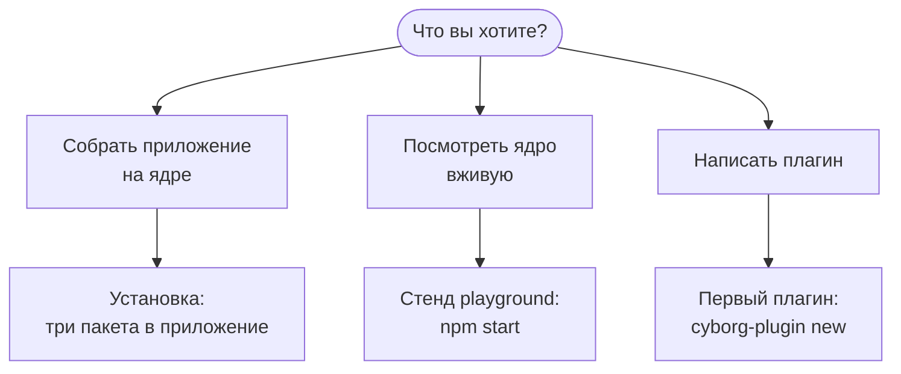

Cyborg Harness - это ядро для настольных приложений на плагинах. С чего начать, зависит от того, что вы хотите сделать.

## Что понадобится

Для любого из путей нужны macOS или Linux, Node.js 24 и npm. Приложение работает на Electron 45. Подробности и список того, что не поддерживается, - на странице [Что нужно](/start/requirements/).

## Пакеты

Ядро поставляется четырьмя пакетами. Приложению нужны первые три, автору плагина - `@cyborg/contracts` и `@cyborg/testing`.

| Пакет | Что внутри | Кому нужен |
|---|---|---|
| `@cyborg/core` | Ядро: загрузчик, граф контрактов, реестр, сторож, шлюз `ctx.os`, журнал. Без зависимостей и без Electron | Приложению |
| `@cyborg/electron` | Адаптер Electron: хосты плагинов, адаптер ОС, схема `cyborg-plugin://`, мост видов, оболочка вида | Приложению |
| `@cyborg/contracts` | Типы контрактов и API плагина (`PluginModule`, `PluginContext`, `UiContext`, права) | Приложению и автору |
| `@cyborg/testing` | Тест-кит автора: поднять ядро с поддельными pty и секретами, общий набор тестов контракта | Автору плагина |

Для автора есть ещё инструмент командной строки `cyborg-plugin` с командами `new`, `check`, `build` и `pack`.

## Три пути

1. **Приложение на ядре.** Поставьте пакеты в своё приложение на Electron и сложите плагины в каталог поставки. Шаги - в разделе [Установка](/start/install/).
2. **Стенд.** В репозитории лежит окно playground с базовыми и демонстрационными плагинами: можно выключить плагин, уронить его хост и посмотреть, как сторож называет виновника. Запуск - `npm start`, описание - [Стенд playground](/start/playground/).
3. **Свой плагин.** От пустого каталога до плагина с видом, командой, контрактом и настройками - [Первый плагин](/start/first-plugin/), около пятнадцати минут.

:::tip[Если не уверены]
Начните со стенда: он ставится одной командой и показывает на живых плагинах всё, о чём говорят остальные страницы.
:::

## Дальше

- [Что нужно](/start/requirements/) - версии, системы и зависимости.
- [Установка](/start/install/) - подключение пакетов к приложению.
- [Первый плагин](/start/first-plugin/) - короткое руководство автора.
- [Возможности ядра](/features/) - что даёт ядро, по одной странице на возможность.
