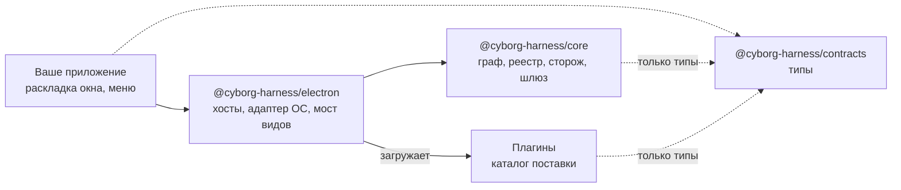

Ядро подключается к приложению как зависимость, а не копируется из репозитория. Приложение ставит три пакета, остальное делают они.

```bash
npm install @cyborg-harness/core @cyborg-harness/electron @cyborg-harness/contracts
```

:::caution[Пакеты ещё не опубликованы]
Пакеты `@cyborg-harness/*` и команда `cyborg-plugin` публикуются задачами [P-01](https://github.com/dex-it/cyborg-harness/issues/29), [P-02](https://github.com/dex-it/cyborg-harness/issues/34), [P-05](https://github.com/dex-it/cyborg-harness/issues/39), [P-09](https://github.com/dex-it/cyborg-harness/issues/9). Пакеты scope `@cyborg` на npmjs.com к проекту не относятся. До выпуска работайте из репозитория (`npm ci`, `npm start`).
:::

## Что делает каждый пакет



- **`@cyborg-harness/core`** - ядро без зависимостей и без импортов Electron. У пакета только одна внешняя связь: peer-зависимость от `@cyborg-harness/contracts`, откуда он берёт типы.
- **`@cyborg-harness/electron`** - всё, что связывает ядро с Electron: хосты в `utilityProcess`, адаптер ОС (хранилище секретов `safeStorage`, `node-pty`, диалоги, буфер обмена, уведомления), схема `cyborg-plugin://`, мост видов и оболочка вида, перехват клавиш, одиночный экземпляр, события питания и окна, служба плагинов.
- **`@cyborg-harness/contracts`** - типы без логики. Приложение и каждый плагин импортируют их отсюда.

## Что остаётся приложению

Пакеты берут на себя механику. Решения о внешнем виде остаются за приложением:

| Приложение решает | Пакеты дают |
|---|---|
| Раскладка окна по областям | Каркас по манифестам и оболочку вида |
| Меню окна и его пункты | Реестр сочетаний и акселераторы |
| Как показывать уведомления | Шлюз `notify` с проверкой прав |
| Какие плагины входят в поставку | Загрузку, граф, журнал и безопасный режим |
| Заголовок окна и имя приложения | События окна и фокуса для плагинов |

## Нативный модуль

`node-pty` нужно пересобрать под версию Electron в приложении. В стенде это шаг `postinstall`:

```bash
electron-rebuild -f -w node-pty
```

Добавьте такой же шаг в свой `package.json`. Без него терминалы плагинов не запустятся.

## Каталог поставки

Встроенные плагины приложение складывает в каталог поставки: по подкаталогу на плагин, в каждом `manifest.json` и точка входа главной части. Ядро читает манифесты, строит граф контрактов и только потом запускает код. Плагин, который нашёлся в каталоге поставки, считается встроенным и получает общий хост `builtin`.

:::note[Каталог пользователя]
Приложение само решает, читать ли ещё и каталог плагинов пользователя (`plugins/` в каталоге данных приложения). Плагин оттуда всегда получает собственный хост: на встроенный общий хост он не попадёт, даже если его назвали в группе `plugins.hosts`. Политика загрузки описана на странице [Плагины](/features/plugins/).
:::

## Какие плагины включены

Набор включённых плагинов - список `plugins.enabled` в файле пользователя, который можно перекрыть файлом воркспейса. Больше ядру для старта ничего не нужно. Включение плагина, которого не было в графе при запуске, вступает в силу после перезапуска; журнал напишет об этом.

## Проверка

После установки запустите окно и откройте журнал плагинов: у каждого включённого плагина должна быть запись `activated` с именем хоста и временем активации. Если вместо неё `rejected`, `invalid` или `failed`, причина названа в той же записи; список записей - в справке [Журнал](/reference/journal/).

:::tip[Нет своего приложения]
Чтобы увидеть, как это выглядит собранным, запустите стенд из репозитория: [Стенд playground](/start/playground/).
:::

## Дальше

- [Что нужно](/start/requirements/) - версии и системы.
- [Архитектура](/concepts/architecture/) - как устроены процессы.
- [Пакеты](/reference/packages/) - состав и версии пакетов.
- [Первый плагин](/start/first-plugin/) - что положить в каталог поставки.
