# Доверие ядра, плагинов и хостов: подлинность, изоляция данных и криптография на macOS и Linux

> **Статус: предложение, ждёт решения владельца.** Дата: 2026-11-13. Задача: [#243](https://github.com/dex-it/cyborg-harness/issues/243), исполнитель yaryrslv. Исследование: код ядра не менялся, решений в SAD, ADR и SRS этот документ не принимает; что придётся править при принятии - в [6.8](#68-какие-документы-править-при-принятии). Снимок на коммит `0c3c081` (`master`, слияние PR #242); строки кода указаны от корня репозитория и верны для него.
>
> Метки достоверности: **Факт** - прочитано в коде этого репозитория (`путь:строка`) или в первоисточнике по ссылке. **Опыт** - получено запуском на macOS (Darwin 27.2, arm64, Electron 45.2.3, Node 24.20.0), описание и результаты в [приложении Б](#приложение-б-замеры-и-опыты). **Вывод** - наше заключение из фактов. **Не проверено** - не запускали и не нашли первоисточник; сведено в [разделе 7.2](#72-что-не-проверено). **На Linux не запускалось ничего**: все числа и опыты - macOS.

Как читать. Раздел 0 - вся суть на одной странице. Раздел 1 - словарь, чтобы дальше не спотыкаться о термины. Разделы 2-3 - как есть и чего хотим. Раздел 4 - способы по слоям, раздел 5 - выбор, раздел 6 - план. Раздел 7 - вопросы владельцу. Сначала в каждом разделе идёт картинка и идея, потом детали.

## 0. Коротко: на одну страницу

**Проблема.** Ядро Cyborg Harness должно отдавать плагину только то, что тому нужно, не давать плагину читать чужое и не давать вредоносному плагину выдать себя за другой плагин. Сегодня это держится на двух вещах: на **проверке в ядре** (шлюз `ctx.os` проверяет права, ядро сверяет, что сообщение пришло из «своего» хоста) и на **соглашении** (плагин не должен обходить `ctx`). Соглашение защищает от ошибки, не от умысла ([модель угроз, раздел 6](../04-architecture/design/threat-model.md#6-допущения-и-честные-границы)).

**Главные находки** (каждая проверена по коду или опытом):

| # | Находка | Основание |
|---|---|---|
| 1 | ❌ Хост плагина **не изолирован от ОС**: плагин в `utilityProcess` читает файл ядра, окружение главного процесса, запускает программы, открывает сеть и слушает «сырой» канал `parentPort`. Флаг `--permission` в `utilityProcess` принимается и **не действует** | Опыт А и Б ([Б.1](#б1-опыт-что-может-код-плагина-в-utilityprocess)); `electron/src/plugin-hosts.ts:15` |
| 2 | ✅ Подмену плагина соседом из **другого** хоста ядро отсекает. ⚠️ В **общем** хосте плагины неразличимы: плагин может писать от имени соседа. Закрыто только правилом «сторонний плагин всегда один в своём хосте» | `core/src/host-bridge.ts:18-22`; контрольный тест `core/test/trust.test.ts:289-295` |
| 3 | ⚠️ Каждый хост получает **манифесты всех плагинов** и описание данных всех поставщиков контрактов, даже если не просил | `core/src/host-pool.ts:101`, `core/src/context-build.ts:181`, `core/src/contract-calls.ts:25-27` |
| 4 | ✅/❌ Криптографии идентичности (токенов, подписей, проверки пира) в коде нет. Но и **не нужна на приватных каналах**: второй конец канала есть только у запущенного ядром процесса, а HMAC и шифрование не отделят плагины внутри одного процесса | `grep` по `core/src`, `electron/src`, `tools` ([2.3](#23-идентичность-на-канале-кто-говорит)); [Факт](https://www.electronjs.org/docs/latest/api/utility-process), [Опыт А](#б1-опыт-что-может-код-плагина-в-utilityprocess) |
| 5 | ❌ Происхождение плагина не проверяется: список sha256 лежит рядом с файлами, не подписан и только сообщает; для каталога пользователя и `pack` нет ничего | `core/src/delivery.ts:102-119`, `electron/src/plugins.ts:149-151` |
| 6 | ⚠️ Секреты на macOS защищены Keychain, на Linux без keyring `safeStorage` шифрует «зашитым открытым паролем»; приложение этого не проверяет | [Факт Electron](https://www.electronjs.org/docs/latest/api/safe-storage); `electron/src/os-env.ts:7-11` |
| 7 | ⚠️ Готового «одним флагом» способа нет: песочницу процесса на macOS и seccomp/Landlock на Linux из чистого Node не поставить, нужен вспомогательный бинарник; встроенная модель разрешений Node - «ремень безопасности», сеть в Node 24 не закрывает | [Node permissions](https://nodejs.org/docs/latest-v24.x/api/permissions.html); Опыт Г |

**Рекомендация** (по слоям, подробно в [разделе 5](#5-выбор-способа)):

1. **Канал и идентичность:** оставить «подлинность = владение концом канала» (уже так), не вводить HMAC, шифрование, mTLS, Noise и `SO_PEERCRED` на приватных каналах. Закрепить это тестом на **настоящем** `utilityProcess`.
2. **Минимум данных:** хосту отдавать только его манифесты и нужные ему контракты; окружение хоста задавать явно (опыт: убирает токены главного процесса одной строкой).
3. **Изоляция процесса (этап 2):** сторонний плагин - отдельный процесс Node с пустым окружением и `--permission` по каналу, который у ядра уже есть (`forkHosts`), а поверх - ограничитель ОС (Landlock и seccomp на Linux, Seatbelt на macOS) как отдельный шаг с вспомогательным бинарником. До него честно говорим человеку, что сеть и чтение мимо шлюза не закрыты.
4. **Происхождение:** подпись Ed25519 манифеста пакета с хешами файлов (всё на `node:crypto`), список доверенных ключей и отозванных версий, проверка **перед** запуском, байты читаются один раз.
5. **Секреты:** остаются в `safeStorage`; добавить отказ при `basic_text` на Linux и права файлов. Аппаратные хранилища (Secure Enclave, TPM), `mlock`, шифрование данных плагинов ключом на плагин - не берём.
6. **Виды:** оставить origin на группу и проверку `senderFrame`; добавить тест на настоящем Electron.

**Что это даёт.** Закрывает находки 3, 5 и 6, а для сторонних плагинов - 1 (файлы, процессы, сеть) и 2 (отдельный процесс на плагин); для встроенных плагинов в общем хосте остаётся доверие друг к другу. Не меняет форму `ctx.os`, не трогает бюджеты шлюза (канал остаётся тем же; новых вычислений на горячем пути нет). **Что стоит.** Этап А (проверенные мелочи, stdlib, без изменения публичного API) - около 4 недель одного разработчика, 2-3 при двоих. Этап Б (подпись) - около 4 недель. Этап В (процесс на плагин и ограничитель ОС) - 8-10 недель и вспомогательный бинарник на каждую ОС. Это оценки составителя, не измерения ([6.5](#65-порядок-и-параллельность)).

**Ближайшие шаги** (можно начать, не дожидаясь решения по этапу 2): тест-подделка на настоящем `utilityProcess` (TR-01), явный `env` хоста (TR-02), фильтрация `init` и `contracts` (TR-03), проверка backend `safeStorage` (TR-05), спайк «сторонний плагин как процесс Node» (TR-20).

**Что решить владельцу** (полный список с рекомендациями - [раздел 7.1](#71-вопросы-владельцу)): (1) принять ли «этап А» без повода для этапа 2; (2) как запускать процесс стороннего плагина: сборка Electron с включённым `RunAsNode` или отдельный бинарник Node (около 122 МБ у нас на машине); (3) вспомогательный бинарник ограничителя ОС - берём или живём на `--permission` с честным предупреждением; (4) формат и корень доверия подписи (ключ издателя в приложении, список ключей пользователя); (5) вопрос 15 SRS (пути конфигурации агента).

## 1. Словарь простыми словами

Каждый термин - одна-две строки и пример из нашего проекта. Если термин знаком, раздел можно пропустить.

| Термин | Что это | Где у нас |
|---|---|---|
| **Процесс** | Запущенная программа со своей памятью. Один процесс не читает память другого без особых прав | Главный процесс Electron (ядро), хосты плагинов (`utilityProcess`), pty-хост |
| **Канал** | Труба между двумя процессами. «Приватный», если второй конец есть только у двух сторон | `parentPort` хоста, `MessagePort` вид-pty |
| **Дескриптор (fd)** | Число-«ручка» открытого файла, сокета или трубы в процессе. Передать ручку другому процессу можно только наследованием при запуске или специальным вызовом | fd 3 при `spawn` со `stdio: 'pipe'` ([Опыт](#б2-прочие-опыты)) |
| **socketpair** | Пара соединённых сокетов, созданная одним вызовом: что записано в один, читается из другого. Посторонний второго конца не получит | Так Node связывает родителя и потомка при `stdio: 'pipe'` ([исходник libuv](https://raw.githubusercontent.com/libuv/libuv/v1.x/src/unix/process.c)) |
| **Подлинность** | «Это действительно тот, за кого себя выдаёт» | Ядро знает, что сообщение пришло из хоста X, потому что оно пришло по каналу хоста X |
| **nonce** | Число или строка, которую используют один раз; повтор значит подделку или повторную отправку | Билет терминала `randomUUID`, погашается при первом предъявлении (`core/src/pty.ts:217-229`) |
| **Replay (повтор)** | Злоумышленник записал настоящее сообщение и отправил его снова | Повтор билета терминала; откат на старую подписанную версию плагина |
| **Capability (билет, «способность»)** | Непрозрачный, трудно угадываемый токен, который сам по себе даёт право на одну вещь. Нет билета - нет права | Билет терминала: даёт порт одного pty на 30 с |
| **Bearer-токен** | Токен «на предъявителя»: кто знает, тот и пользуется | Токен MCP-сессии агента (в окружении процесса `claude`) |
| **Confused deputy (запутавшийся посредник)** | Привилегированная программа делает что-то за слабую, не проверив, что слабая вправе просить | Плагин без права `pty` просит `sessions.new` запустить агента: закрыто полем `callers` ([ADR-CH-0016](../04-architecture/adr/ADR-CH-0016-command-callers.md)); [первоисточник Харди](http://www.cap-lore.com/CapTheory/ConfusedDeputy.html) |
| **Хеш (SHA-256)** | Отпечаток данных: изменился один бит - отпечаток другой. Обратно данные не восстановить | `delivery.json` хранит sha256 каждого файла поставки |
| **HMAC** | Отпечаток данных с секретным ключом: подделать без ключа нельзя. Доказывает «сообщение от держателя ключа и не изменено» | Не используется; вариант в [4.2](#42-токены-и-подписи) |
| **AEAD (AES-GCM, ChaCha20-Poly1305)** | Шифрование, которое заодно защищает от подмены: изменённый шифртекст не расшифруется | Не используется; `safeStorage` шифрует секреты внутри Chromium |
| **HKDF** | Способ получить из одного ключа много независимых: «ключ для плагина X» из мастер-ключа | Вариант в [4.5](#45-секреты-и-ключи) (не рекомендуем) |
| **Ed25519** | Подпись с парой ключей: секретным подписывают, публичным проверяют. Публичный можно раздавать | Вариант подписи пакетов плагинов ([4.3](#43-происхождение-плагинов)) |
| **TOFU** | «Доверяй при первом использовании»: запоминаем ключ при первой встрече и тревожимся, если он сменится (как SSH) | Запомнить ключ издателя при первой установке |
| **Peercred** (`SO_PEERCRED`, `LOCAL_PEERPID`, audit token) | Просьба к ОС «скажи, какой процесс на другом конце сокета-файла» | Сегодня не нужна: у каналов хостов нет посторонних концов |
| **Namespace (пространство имён)** | Linux-способ показать процессу «свою» ФС, сеть или список процессов | Основа bubblewrap и контейнеров ([4.4](#44-изоляция-процессов-средствами-ос)) |
| **seccomp** | Linux: фильтр системных вызовов процесса. Запретили вызов `connect` - процесс не откроет соединение | Вариант ограничителя ОС |
| **Landlock** | Linux (ядро 5.13+): процесс сам себе закрывает доступ к файлам и, с более новыми ядрами, к TCP. Не требует прав администратора | Вариант ограничителя ОС |
| **Seatbelt / `sandbox-exec`** | macOS: профиль запретов для процесса. Утилита `sandbox-exec` помечена устаревшей, но механизм используется Chromium | Вариант ограничителя ОС |
| **App Sandbox** | macOS: песочница всего приложения с правами в подписи (entitlements) | Целиком приложению не подходит ([4.4](#44-изоляция-процессов-средствами-ос)) |
| **Hardened Runtime, нотаризация** | macOS: режим подписанной программы, запрещающий инъекции и отладку; проверка Apple перед распространением | Для самого приложения, не для JS-плагинов |
| **Keychain, Secret Service, `safeStorage`** | Хранилища секретов ОС (macOS; Linux: GNOME Keyring, KWallet) и обёртка Electron над ними | `secrets.json` хранит значения, зашифрованные `safeStorage` |
| **mTLS** | TLS, где обе стороны предъявляют сертификаты | Избыточно для локального канала ([4.2](#42-токены-и-подписи)) |
| **Noise** | Набор готовых схем рукопожатия с шифрованием ([спецификация](https://noiseprotocol.org/noise.html)) | Избыточно; в stdlib нет готовой реализации |
| **Sigstore, provenance, SLSA** | Подписи «безключевые» через идентичность CI, публичный журнал и аттестация «кто и из чего собрал» | Для выпусков самих пакетов `@cyborg-harness/*` ([4.3](#43-происхождение-плагинов)) |
| **TOCTOU** | «Проверил - потом использовал»: между ними файл успели подменить | Проверили хеш, потом заново открыли файл - гонка. Лечится «прочитал байты один раз» |
| **SES / `Compartment`** | Библиотека «Hardened JS»: изолированные области кода в одном процессе. Не граница против злого кода | Второй слой этапа 2 ([ADR-CH-0003](../04-architecture/adr/ADR-CH-0003-trust-and-isolation.md), п. 9) |
| **Fuse (фьюз) Electron** | Выключатель возможностей в бинарнике Electron, ставится при сборке: например, запретить `--inspect` | `RunAsNode`, `EnableNodeCliInspectArguments` ([4.4](#44-изоляция-процессов-средствами-ос)) |
| **Origin и CSP** | Адрес-«паспорт» веб-страницы и политика, что ей можно загружать | `cyborg-plugin://<группа>/` и `default-src 'none'` для видов |
| **Брокер** | Привилегированный посредник: слабый процесс просит, посредник проверяет и делает сам | Весь `ctx.os`: плагин просит, ядро решает ([Chromium Mojo](https://chromium.googlesource.com/chromium/src/+/main/docs/security/mojo.md)) |
| **Ограничитель ОС (confiner)** | Наше слово для маленькой программы-запускателя, которая накладывает запреты ОС на процесс плагина до запуска его кода | Предложение этапа В ([5.3](#53-слой-изоляция-процесса)) |

## 2. Как устроено сейчас

### 2.1. Процессы и границы доверия

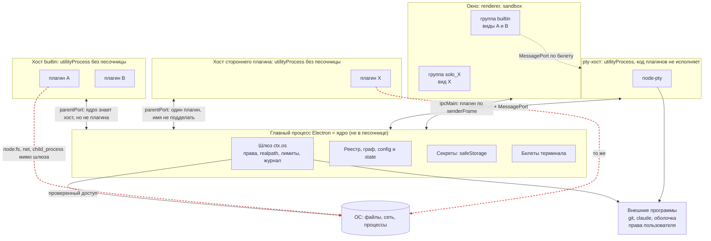

**Что здесь видно.** Каждая рамка - отдельный процесс ОС, граница доверия проходит по рамке. Сплошные стрелки - каналы, на которых ядро проверяет сообщения. Красные пунктирные стрелки - пути мимо шлюза: хост плагина запущен как обычный Node, и код плагина может сам открыть файл, сокет или процесс ([опыт А](#б1-опыт-что-может-код-плагина-в-utilityprocess)). Внутри рамки хоста builtin плагины A и B друг от друга неотличимы, поэтому сторонний плагин всегда получает свою рамку.

### 2.2. Каналы

| Канал | Кто с кем | Транспорт | Код |
|---|---|---|---|
| A | ядро - хост плагинов | `utilityProcess.fork(entry, [hostId], { serviceName, stdio: 'inherit' })`, `postMessage`, структурное клонирование; `env` не задан | `electron/src/plugin-hosts.ts:15`, `electron/src/host-entry.ts:4-12` |
| A' | то же в тестах и вне Electron | `child_process.fork` с `serialization: 'advanced'` и каналом `ipc`; хост в том же процессе (`inlineHosts`) | `core/src/transports.ts:19-70` |
| B | ядро - pty-хост | `utilityProcess` + `MessagePortMain` | `electron/src/plugin-hosts.ts:50-79` |
| C | окно и виды - ядро | `ipcMain.handle`/`on`, preload и `contextBridge` | `electron/src/channels.ts:13-153`, `electron/src/preload.ts` |
| E | вид - pty-хост | `MessageChannelMain`: один конец у pty-хоста, другой у фрейма, ядро в потоке не стоит | `electron/src/view-terminals.ts:42-86` |
| F | ядро - внешние программы | `child_process.spawn` лидером группы, `node-pty` | `core/src/os-gateway.ts:1182-1213` |
| G | ядро - сеть; сеть - ядро | `node:http(s)` со своим `lookup`; `http.createServer` на `127.0.0.1` | `core/src/net-transport.ts`, `core/src/serve.ts:37,75-82` |
| H | экземпляры приложения | unix-сокет `claimInstance`, 0600 в каталоге 0700 | `core/src/instance.ts:54-86,126-130` |

**Факт.** Окно создаёт приложение (playground: `contextIsolation: true`, `sandbox: true`, `nodeIntegrationInSubFrames: true`, `playground/src/main/main.ts:196`); пакет `electron/` настройки окна не навязывает ([SAD, раздел 1](../04-architecture/design/sad.md#1-общая-архитектура)).

### 2.3. Идентичность на канале: кто говорит

| Сторона | Как ядро её узнаёт | Код |
|---|---|---|
| Хост | По самому каналу: у каждого хоста свой `Endpoint` на своём порту. Событие `message` принадлежит объекту `UtilityProcess`, а не полю сообщения | `core/src/host-pool.ts:95` |
| Плагин внутри хоста | **Не узнаёт.** Имя берёт из тела сообщения (`pluginId`, `caller`) и проверяет лишь «этот плагин живёт в этом хосте» | `core/src/host-bridge.ts:18-22` |
| Вид | По `event.senderFrame`: группа из origin, плагин из пути адреса, плагин обязан состоять в группе | `electron/src/view-frames.ts:17-27`, `electron/src/channels.ts:25-30` |
| Окно | `senderFrame === mainFrame` | `electron/src/views.ts:44-46` |
| Пользователь | Отдельный вход `Kernel.run`; из хоста назваться пользователем нельзя | `core/test/trust.test.ts:145-170`, [ADR-CH-0016](../04-architecture/adr/ADR-CH-0016-command-callers.md) п. 3 |

**Факт (поиск).** `grep` на `createHmac`, `createSign`, `verify(`, `ed25519`, `minisign`, `sigstore`, `SO_PEERCRED`, `process.permission`, `--permission` по `core/src`, `electron/src`, `tools/cyborg-plugin/src` ничего не находит. `node:crypto` встречается шесть раз и только для `randomUUID`, `randomBytes` и `createHash` (ключ воркспейса, билет терминала, список поставки): `core/src/workspace.ts:1`, `core/src/pty.ts:1`, `core/src/os-gateway.ts:8`, `core/src/documents.ts:3`, `core/src/delivery.ts:1`, `electron/src/instances.ts:2`. Токенов способности, nonce на сообщения, HMAC, подписи плагина и проверки пира нет.

**Как проверяется сообщение хоста.** `Endpoint` пропускает только объекты формы `{t:'req'|'res'|'note'|'cancel'}` (`core/src/rpc.ts:23-31`); `parseWire` проверяет тип каждого поля, типы TypeScript хост не гарантируют (`core/src/wire.ts:12-52`); каждый обработчик, называющий плагина, зовёт `mine()` или `live()` (`core/src/host-bridge.ts:18-28`); `cancel` приводится к коду из белого списка, чтобы хост не выдал свой отказ за отказ ядра (`core/src/rpc.ts:45-53`). Номера запросов идут подряд с единицы (`core/src/rpc.ts:75`). Пока канал точка-точка, это не уязвимость (вывод ниже).

**Что мешает подделке.**

| Попытка | Что мешает | Статус |
|---|---|---|
| Хост A говорит от имени плагина из хоста B | `mine()` отвергает «не в этом хосте» для всех методов, называющих плагина; тесты `core/test/trust.test.ts:82-460` | ✅ |
| Хост отменяет чужой запрос | `cancel` действует только на запросы, которые обслуживает этот `Endpoint`; тест `trust.test.ts:351` | ✅ |
| Сторонний плагин занимает `cyborg.*` | граф отвергает у не-встроенных (У-13) | ✅ |
| Сторонний плагин выдаёт себя за встроенный | признак «встроенный» берётся из каталога установки (`electron/src/plugins.ts:264`), не из манифеста | ✅ |
| Сторонний плагин делит хост с другим | всегда свой хост (`assignHosts`, `core/src/host-pool.ts:9-47`); тест `trust.test.ts:263-296` | ✅ |
| Вид плагина X зовёт мост от имени Y из другой группы | группа из origin, плагин обязан состоять в группе; `electron/test/view-frames.test.ts:18` | ✅ |
| Чужая страница во фрейме вида зовёт мост | preload выдаёт мост только по `location.protocol === 'cyborg-plugin:'` (`electron/src/preload.ts:85-119`) | ✅ |
| Плагин A в **общем** хосте пишет от имени соседа B | не мешает ничего: `live('B')` пропускает | ❌ закрыто лишь политикой «сторонний один в хосте» |
| Вид A в общей группе рендера становится B через `history.pushState` | `pluginOfFrame` берёт плагина из текущего `frame.url` (`electron/src/view-frames.ts:12-21`) | ⚠️ частично (У-19) |

**Вывод.** Подлинность стороны на канале ядро-хост сегодня равна «процесс запущен ядром и держит единственный конец канала». Для хоста с одним плагином этого достаточно: второго конца у постороннего нет, имя другого плагина в сообщении ядро отбросит. Для хоста с несколькими плагинами этого недостаточно, и никакой ключ в памяти хоста не помог бы: он лежал бы в памяти того же процесса, где живёт и недоверенный код ([4.1](#41-канал-и-идентичность)).

### 2.4. Данные и кому они уходят

| Данные | Где лежат | Что получает плагин | Код |
|---|---|---|---|
| `config` (слои `user`, `workspace`) | `cyborg.json` в `userData` и файл воркспейса | только свой раздел, оба слоя | `core/src/sections.ts:42-54` |
| `state` | файл воркспейса, разделы по плагинам | только свой раздел | `core/src/sections.ts` |
| Секреты | `userData/secrets.json`: `{ "<плагин>/<ключ>": base64(safeStorage) }` | свои ключи через `ctx.os.secrets`; ссылки `secrets.ref` по праву | `electron/src/secrets-file.ts:13-70`, `core/src/os-gateway.ts:1065-1078` |
| Данные и временные файлы плагина | `<userData>/plugin-data/<id>`, `plugin-temp/<id>` | область без права; чужие каталоги закрыты шлюзом | `core/src/os-gateway.ts:431-440` |
| Журнал, трасса | кольцо в памяти + `userData/diagnostics/…` | свой журнал плагин не читает | `core/src/diagnostics.ts`, [SAD, 3.5](../04-architecture/design/sad.md#35-изоляция-сбоев-хосты-и-сторож) |
| Окружение главного процесса | `process.env` | через шлюз: `env.get` только по перечню; программе - `BASE_ENV` и имена из правила | `core/src/os-gateway.ts:227,1051-1056,1182-1192` |
| Токен MCP-сессии | окружение процесса агента | плагину `sessions` | [У-32](../04-architecture/design/threat-model.md#52-плагин-против-плагина) |

Минимум раскрытия **реализован в шлюзе**: нет права - нет члена в `ctx.os` (`core/src/host-runtime.ts:301-364`) и проверка на каждый вызов (`core/src/os-requests.ts:64-82`); вне области всегда `PermissionDenied`, не `NotFound`; значения секретов вычёркиваются из журнала и вывода хоста (K-29, `core/src/plugin-log.ts:70-80`); аргументы трассы пишутся только с `--trace-args` (K-33, `core/src/trace-args.ts`).

**Минимум раскрытия не реализован на транспорте:**

| # | Что уходит лишнего | Основание |
|---|---|---|
| 1 | В `init` каждому хосту - **манифесты всех плагинов** и привязки графа: права, схемы `config`, команды чужих плагинов | `core/src/host-pool.ts:101`, `core/src/context-build.ts:181`, `core/src/host-runtime.ts:523-526` |
| 2 | Сообщение `contracts` с полем `data` каждого поставщика - **всем** хостам, независимо от `requires` потребителя | `core/src/contract-calls.ts:25-27,163-165`; структура `ContractDescriptor` - `core/src/host-runtime.ts:20-26` |
| 3 | `system` (фокус, сон, замок экрана, простой) - всем хостам; чувствительность низкая | `core/src/host-pool.ts:191` |
| 4 | `paths.home` каждому плагину при активации; имя пользователя и так в `os.homedir()` | `contracts/os.ts:308`, `core/src/host-runtime.ts:62-66` |
| 5 | **Окружение хоста** = `process.env` главного процесса: токены, `SSH_AUTH_SOCK`, `AWS_*` | `electron/src/plugin-hosts.ts:15` (нет `env`); Опыт А |

Зеркало контрактов в хосте фильтрует выдачу `ctx.contracts.get` по объявлению плагина, но код плагина в том же процессе читает сообщение мимо зеркала (Опыт А: «сырой канал»).

### 2.5. Права и шлюз

**Факт.** Четырнадцать прав в манифесте (`core/src/permissions.ts:9`); единственная точка применения - `OsGateway` в главном процессе (`core/src/os-gateway.ts:441+`), вызывающего определяет канал хоста (`core/src/os-requests.ts:64-82`), клиент `ctx.os` в хосте - тонкий RPC, который не проверяет ничего. Для файлов: `realpath`, области, защищённые пути и соседи `<файл>.*`, `O_NOFOLLOW` на последнем компоненте; для сети: хосты права, `redirect: 'manual'`, проверка адреса в соединении (`core/src/net-transport.ts:108-135`). Тесты шлюза: `core/test/trust.test.ts:576-653`, `core/test/security-gateway.test.ts`.

**Известный дефект.** [#241](https://github.com/dex-it/cyborg-harness/issues/241): `pty.share`, `pty.list`, `pty.attach`, `pty.write`, `pty.resize`, `pty.kill` и `serve.close` без права отвечают не `PermissionDenied` и не пишут `denied` (нарушена NFR-CH-3001). Прямого обхода нет (таблицы собственные), но попытка не попадает в журнал. Исправление - отдельная задача и в этот документ не входит.

**Где держится на проверке, а где на соглашении.**

| Свойство | Держится на | Статус |
|---|---|---|
| Доступ к файлам, сети, программам **через `ctx.os`** | Проверке в ядре (шлюз) | ✅ |
| Доступ к ОС **мимо `ctx.os`** (`import('node:fs')`) | Соглашении: статическая проверка импортов `checkPlugin`, которую загрузчик **не вызывает** (`grep checkPlugin` по `core/src`, `electron/src` находит только экспорт `core/src/index-plugin-check.ts:2` и определение `core/src/plugin-check.ts:269`) | ❌ У-04 «открыто до этапа 2» |
| Сторонний код не грузится без ведома человека | Флаге `--user-plugins` и записи `third-party` (У-38) | ⚠️ предупреждение, не защита |

### 2.6. Секреты

**Факт.** `safeStorage` (Keychain на macOS; на Linux GNOME Keyring, KWallet или запасной вариант) через `encryptStringAsync` (`electron/src/os-env.ts:7-11`); файл `secrets.json` пишется через временный файл и `rename` с правами `0600` (`electron/src/secrets-file.ts:20-28`); без шифрования ОС `Unavailable`, открытым текстом не пишется ([ADR-CH-0014](../04-architecture/adr/ADR-CH-0014-secrets.md)). Ключи `<плагин>/<ключ>` лежат **открыто** (`electron/src/secrets-file.ts:58`) и показывают, у какого плагина какие секреты есть.

**Факт (Electron).** На Linux «если хранилища нет, данные шифруются зашитым открытым паролем» и защиты не дают; `getSelectedStorageBackend()` вернёт `basic_text` при неопознанной среде; синхронный API объявлен устаревшим и будет удалён в Electron 46, асинхронный (который мы используем) остаётся ([документация](https://www.electronjs.org/docs/latest/api/safe-storage)). `getSelectedStorageBackend()` у нас вызывается только в замере (`playground/src/main/spike-gateway.ts:42,184`). **Не проверено:** что возвращает `isAsyncEncryptionAvailable()` при `basic_text`.

**Факт (изоляция от других приложений).** GNOME Keyring не изолирует секреты от других программ того же сеанса, его авторы называют такую изоляцию «security theater» ([GNOME wiki](https://wiki.gnome.org/Projects/GnomeKeyring/SecurityPhilosophy)). На macOS Keychain различает приложения, но не плагины внутри приложения ([Electron safeStorage](https://www.electronjs.org/docs/latest/api/safe-storage)).

### 2.7. Происхождение плагинов

| Аспект | Состояние | Код |
|---|---|---|
| «Встроенный» | каталог установки, не манифест | `electron/src/plugins.ts:264` |
| Подпись | нет (подписано только приложение: `codesign` проверена ad hoc, [`bundled-delivery.md`](../05-verification/bundled-delivery.md)) | - |
| Контрольные суммы поставки | `delivery.json` (sha256 по файлам); при старте `verifyDelivery` **сообщает** о расхождении, плагины поднимаются | `core/src/delivery.ts:102-119`, `electron/src/plugins.ts:147-151` |
| Слабые места сверки | список лежит в том же каталоге и не подписан; сверка один раз при старте, не перед `import()`; каталог пользователя не сверяется; отказа нет | там же |
| Внешние плагины | `<userData>/plugins`, по умолчанию не читается; с `--user-plugins` и записью в `plugins.enabled` - сторонний, свой хост, метка | `electron/src/plugins.ts:246-250` |
| `cyborg-plugin pack` | воспроизводимый `tar.gz`, «формат предварительный: источник, подпись, хеш и повторное согласие - этап 2» | `tools/cyborg-plugin/src/pack.ts`, [SAD, 6.1](../04-architecture/design/sad.md#61-этап-1-ядро-без-изоляции-доступа) |
| Зависимости npm | не проверяются на происхождение (У-42, открыто) | [модель угроз](../04-architecture/design/threat-model.md#56-загрузка-воркспейс-жизненный-цикл) |
| Обновление, отзыв | установки нет; повторного согласия нет (У-39); списка отозванных нет | [SRS 03, FR-CH-3024](../03-requirements/03-security-trust/srs.md) |

### 2.8. Что показал опыт: код плагина в `utilityProcess`

Запускалась упрощённая копия нашего способа запуска (`utilityProcess.fork` без песочницы и без `env`, как в `electron/src/plugin-hosts.ts:15`) с «вредоносным плагином» внутри: обычный Node-код. Полное описание и скрипты - [приложение Б.1](#б1-опыт-что-может-код-плагина-в-utilityprocess).

| Что пробует плагин | А. Как у нас | Б. + `--permission` | В. + явный `env` |
|---|---|---|---|
| `process.permission` | не определён | **не определён** (флаг принят, не действует) | не определён |
| Видит токен главного процесса в `process.env` | ❌ видит | ❌ видит | ✅ не видит |
| Читает «файл секретов» ядра через `node:fs` | ❌ читает | ❌ читает | ❌ читает |
| Запускает процесс (`child_process`) | ❌ запустил | ❌ запустил | ❌ запустил |
| Открывает TCP-соединение | ❌ открыл | ❌ открыл | ❌ открыл |
| Слушает «сырой» `process.parentPort`, видит `init` с чужими манифестами | ❌ видит | ❌ видит | ❌ видит |
| Пишет в `parentPort` сообщение от имени плагина-«соседа» | ❌ ядро получило сообщение с чужим `pluginId` (отсечёт `mine()`, если сосед в другом хосте) | то же | то же |

Тот же бинарник как обычный Node (`ELECTRON_RUN_AS_NODE=1`) с `--permission --allow-fs-read=<каталог>` **ограничивает** чтение и запуск процессов (`ERR_ACCESS_DENIED`), но сеть остаётся открытой (Опыт Г, [Б.2](#б2-прочие-опыты)). Это совпадает с документацией Node: модель разрешений называется «seat belt», от злого кода не защищает, сети в v24 не закрывает ([Node 24, permissions](https://nodejs.org/docs/latest-v24.x/api/permissions.html)).

### 2.9. Угрозы: мера сейчас и пробел

Статусы: ✅ закрыто и проверено, ⚠️ закрыто частично или соглашением, ❌ не закрыто. Номера У-xx - из [модели угроз](../04-architecture/design/threat-model.md).

| # | Угроза | Мера сейчас | Пробел | |
|---|---|---|---|---|
| 1 | Подмена плагина другим плагином в **общем** хосте | `mine()` проверяет «плагин в этом хосте»; сторонний всегда один (`core/src/host-pool.ts:9-47`); контроль `core/test/trust.test.ts:289-295` | внутри хоста плагины неразличимы; встроенные в `builtin` доверяют друг другу полностью | ⚠️ |
| 2 | Подмена плагина из **другого** хоста (У-11) | `mine()` по каналу | нет, тест `trust.test.ts:82-460` | ✅ |
| 3 | Подмена хоста: чужой процесс вставляется в канал | канал создан ядром (`utilityProcess`), второго конца у постороннего нет | нет проверки пира; подлинность = факт запуска; в документации Electron гарантий об отправителе нет ([утилитарный процесс](https://www.electronjs.org/docs/latest/api/utility-process)) | ⚠️ |
| 4 | Подмена вида (iframe выдаёт себя за другой плагин или за окно) (У-19, У-22) | плагин из `senderFrame`; мост по схеме; навигация ограничена (`electron/src/navigation.ts:40-58`) | в общей группе рендера: `pushState` меняет путь, виды читают DOM друг друга; тесты на подставных кадрах, не на настоящем Electron | ⚠️ |
| 5 | Чтение чужих данных через `ctx.os` (У-01, У-02, У-16) | области, `realpath`, ключи `<плагин>/`, защищённые пути | - | ✅ |
| 6 | Чтение чужих данных **мимо** `ctx.os` (`node:fs`) (У-04) | статическая проверка импортов (не вызывается при загрузке) | хост плагина читает любой файл пользователя, включая `secrets.json`, `plugin-data` чужих (Опыт А) | ❌ |
| 7 | Утечка данных ядра в плагин: манифесты и контракты | нет права - нет члена; `LIMITS` | `init` и `contracts` уходят всем хостам; сырой `parentPort` | ❌ |
| 8 | Утечка окружения процесса в хост | в **программу** идёт `BASE_ENV` и `env` правила | хост наследует `process.env` главного (Опыт А) | ❌ |
| 9 | Обход шлюза: сеть, процессы (У-04) | запрет каталога пользователя без `--user-plugins` (У-38) | `utilityProcess` без песочницы, `--permission` не действует (Опыт Б); `net` и `process` обходятся | ❌ |
| 10 | Подмена пакета плагина на диске | `delivery.json` sha256, сверка при старте | список рядом и не подписан; нет сверки перед `import()`; каталог пользователя не сверяется | ❌ |
| 11 | Откат на старую уязвимую версию плагина (replay пакета) (У-39) | нет | установки и версии-«не младше» нет | ❌ |
| 12 | Replay сообщений ядро-хост | канал точка-точка, `id` подряд, неизвестный `res` отбрасывается (`core/src/rpc.ts:192-200`) | нет nonce; но и повторять нечем: отправитель один, а повтор равен новому запросу того же отправителя | ✅ при приватном канале; ⚠️ если появится общий транспорт |
| 13 | Replay билета терминала | одноразовый, привязан к плагину, 30 с (`core/src/pty.ts:212-229`) | - | ✅ |
| 14 | Утечка секрета в журнал и трассу (У-17) | K-29, K-33, тест `core/test/secrets-journal.test.ts` | значение короче 4 знаков; секрет, собранный плагином без шлюза; открытое значение в IPC и в памяти хоста | ⚠️ |
| 15 | Секреты в покое | `safeStorage`, файл 0600 | `basic_text` на Linux не проверяется; ключи открыты; другое приложение сеанса на Linux | ⚠️ |
| 16 | Общий каталог или сокет (У-50) | сокет 0600 в 0700, `XDG_RUNTIME_DIR` | права `cyborg.json`, `state`, `diagnostics` берутся из umask (не проверено) | ⚠️ |
| 17 | Повышение прав через `pty` и `process` (У-10, У-46) | закреплённые аргументы, `deny` флагов (K-34) | «честная граница»: программа имеет права пользователя; пути конфигурации агента не защищены (У-46 открыто) | ⚠️ |
| 18 | Вредный код в npm-зависимостях встроенных плагинов (У-42) | P-06 проверяет состав бандла | происхождение пакетов не проверяется; код зависимости в общем хосте имеет доступ ко всем соседям | ❌ |
| 19 | Подделка диалога ядра из вида (У-24) | слой ядра над фреймами | вид рисует что угодно в своём прямоугольнике | ⚠️ принято |
| 20 | Воркспейс из чужих рук расширяет права (У-40) | `TRUSTED_LAYER` ([ADR-CH-0015](../04-architecture/adr/ADR-CH-0015-workspace-trust.md)) | `plugins.enabled` и `settings` из воркспейса принимаются | ⚠️ |
| 21 | Отказ шлюза без записи (#241) | собственные таблицы pty | 7 членов без `PermissionDenied` и без `denied` | ⚠️ |
| 22 | Компрометация ядра (главного процесса) | минимум зависимостей | вне охвата ([5.9](#59-что-остаётся-незащищённым-и-почему)) | ❌ |

### 2.10. Что проверяют тесты и что нет

`core/test/trust.test.ts` (686 строк, 16 тестов, у восьми в имени ключ `ST-NNNN/k`) запускает ядро с хостами **в том же процессе** (`inlineHosts`, `core/src/transports.ts:19-43`) и подделывает сообщения хоста со стороны теста (`forging`, `trust.test.ts:28-80`). Закрыты: `register`, `run`, `invoke`, `provide`, `section.write`, `emit`/`release`, `cancel`, `keys.register`, `log`/`output`, 24 метода `ctx.os` без права.

**Не покрыто:** настоящий процесс хоста и канал ОС (перехват `process.parentPort` кодом плагина, чтение рассылок `init`/`contracts`); вредоносный плагин, обходящий `ctx` через `node:*` (динамически: `core/test/plugin-imports.test.ts` проверяет только статически); подмена в общем хосте для всех методов, кроме `section.write`; виды и окно на настоящем Electron; повтор и предсказуемость `id`; семь членов #241.
## 3. Что мы хотим

### 3.1. Целевые свойства

| # | Свойство | Что значит простыми словами | Сейчас | Откуда требование |
|---|---|---|---|---|
| С1 | Подлинность сторон | Ядро знает, **кто** говорит: какой хост, какой плагин, какой вид, человек | ✅ хост, вид, человек; ⚠️ плагин внутри общего хоста | FR-CH-2007, [ADR-CH-0003](../04-architecture/adr/ADR-CH-0003-trust-and-isolation.md) п. 5 |
| С2 | Конфиденциальность и целостность каналов | Постороннему не прочитать и не подменить сообщения ядро-хост-вид | ✅ пока каналы приватны (нет посторонних концов); ❌ для плагина в том же процессе (читает `parentPort`) | [модель угроз, Г1, Г2, Г10](../04-architecture/design/threat-model.md#4-границы-доверия) |
| С3 | Минимум раскрытия | Плагин получает от ядра только нужное: свои манифест, настройки, контракты | ⚠️ через `ctx` да, на транспорте нет ([2.4](#24-данные-и-кому-они-уходят)) | FR-CH-3014 по духу; нового требования нет |
| С4 | Данные плагина не утекают к другим плагинам | Чужие файлы, секреты, `config`, `state`, манифесты недоступны | ✅ через шлюз; ❌ мимо него | FR-CH-3022 (этап 2), У-04, У-16 |
| С5 | Происхождение плагина | Известно, кто выпустил пакет, и он не подменён после выпуска | ❌ | FR-CH-3024, У-39 |
| С6 | Секреты в покое и в памяти | В файле и в окружении процессов секреты не читаются посторонним | ⚠️ файл ✅ (где есть keyring); окружение и память хоста ❌ | FR-CH-2014, [ADR-CH-0014](../04-architecture/adr/ADR-CH-0014-secrets.md) |
| С7 | Отзыв доверия | Плагин, ключ или билет можно отозвать, и это действует сразу | ⚠️ выключить плагин, остановить хост; списка отозванных нет | [ADR-CH-0003](../04-architecture/adr/ADR-CH-0003-trust-and-isolation.md) п. 8 |
| С8 | Следы | Каждый отказ и каждое решение видны в журнале без секретов | ✅ кроме #241 | NFR-CH-3001, K-28, K-29 |

### 3.2. Модель нападающего: что в охвате

Опираемся на нарушителей Н1-Н6 [модели угроз](../04-architecture/design/threat-model.md#3-нарушители) и уточняем их под вопросы этой задачи.

| Нападающий | Что может | В охвате этого исследования |
|---|---|---|
| **Вредоносный плагин в своём хосте** (Н2) | Любой код Node: файлы, сеть, процессы, чтение `parentPort`, сообщения в ядро от своего имени | ✅ да: главная цель этапа 2 |
| **Вредоносный плагин в общем хосте со встроенными** | Всё вышеперечисленное + писать от имени соседей | ⚠️ запрещаем политикой (сторонний всегда один в хосте); защиты внутри процесса не строим ([4.1](#41-канал-и-идентичность)) |
| **Вредный пакет npm в зависимостях встроенного плагина** (У-42) | Код с правами хоста, где живёт плагин | ⚠️ частично: снижаем ущерб выбором хоста и проверкой происхождения; от кода в том же процессе не защитимся |
| **Подмена пакета плагина на диске** процессом пользователя | Переписать файлы плагина и список хешей | ✅ обнаружение при загрузке подписью; ❌ предотвращение невозможно ([4.3](#43-происхождение-плагинов)) |
| **Вредоносный вид / XSS** (Н3) | Исполнять скрипт в своём `<iframe>` | ✅ CSP и origin уже есть; ⚠️ внутри общей группы виды видят друг друга |
| **Другой пользователь машины** (Н5) | Читать `argv`, общие каталоги, порты | ✅ права файлов, токены в окружении (оно защищено от других пользователей, не от своего) |
| **Процесс того же пользователя** (чужая программа, агент под инъекцией) | Читать окружение и память процессов при слабой настройке, писать в каталог плагинов | ❌ не в охвате: ОС эту границу сама не охраняет ([Yama/ptrace](https://www.kernel.org/doc/html/latest/admin-guide/LSM/Yama.html), `/proc/<pid>/environ` читается тем же пользователем: [ptrace(2)](https://man7.org/linux/man-pages/man2/ptrace.2.html)); [модель угроз, раздел 1](../04-architecture/design/threat-model.md#1-предмет-и-граница) |
| **Компрометация ядра** (главный процесс) | Всё | ❌ не в охвате: после неё границ нет; меры - минимум зависимостей и строгий разбор входа |
| **Уязвимости Electron, Chromium, Node, ОС** | Побег из песочницы | ❌ не в охвате: обновления ([модель угроз, раздел 1](../04-architecture/design/threat-model.md#1-предмет-и-граница)) |
| **Человек у разблокированной машины** (Н6) | Нажимать кнопки | ❌ не в охвате |

### 3.3. Уровни защиты

Не «безопасно или нет», а лестница. Каждый уровень включает предыдущий; человеку честно показывается, на каком уровне работает плагин ([FR-CH-3021](../03-requirements/03-security-trust/srs.md)).

| Уровень | Что делаем | Закрывает | Остаётся | Цена |
|---|---|---|---|---|
| **0 (сейчас)** | Процесс на хост, шлюз, соглашение | Сбои и ошибки; подмена плагина из другого хоста | Всё, что идёт мимо шлюза | - |
| **1 «честный минимум»** (этап А) | Минимум данных на входе хоста, явный `env`, проверка backend секретов, тесты на настоящем процессе | Любопытный плагин, случайные утечки, понятные дыры в данных | Умышленный обход через `node:*` | Недели; без изменения API |
| **2 «подпись и процесс Node»** (этапы Б и В1) | Подписанные пакеты; сторонний плагин - процесс Node с `--permission`, пустым `env`, каналом `ipc` | Подмену пакета; чтение файлов и запуск процессов мимо шлюза | Сеть мимо шлюза; уязвимости самого Node | Месяц-два; без OS-помощника |
| **3 «ограничитель ОС»** (этап В2) | + запреты ОС (Seatbelt, Landlock, seccomp) до запуска кода плагина | Сеть и сокеты мимо шлюза, отдельные системные вызовы | Побеги из ядра ОС, поведение разрешённых программ (`process`, `pty`) | Вспомогательный бинарник на ОС; CI на двух ОС |

### 3.4. Ограничения из принятых решений

Выбор обязан им соответствовать (подробнее в [roadmap, раздел 15](../06-plans/roadmap.md#15-решения-владельца), [ADR-CH-0003](../04-architecture/adr/ADR-CH-0003-trust-and-isolation.md), [SAD, раздел 6](../04-architecture/design/sad.md#6-этапы)):

1. **Два этапа изоляции.** Этап 2 начинается по поводу: плагин от автора вне команды или каталог плагинов. Сторонние плагины - не цель v1; важно не менять плагины при переходе (ADR-CH-0003, п. 1, 9).
2. **`ctx.os` - единственный путь к ОС**; вызывающего определяет канал, не слова плагина. Новый механизм обязан сохранить форму `ctx.os` и записи `denied` (п. 5).
3. **Бюджеты шлюза:** вызов не более 1 мс на p99 до 64 КиБ, `fs.watch` не более 5 мс сверх склейки, вывод терминала не более 16 мс (принято владельцем 2026-11-07; `playground/budgets.json`). Круг ядро-хост сегодня 0,07-0,3 мс, между хостами 0,13-0,78 мс ([spike-hosts](../05-verification/spike-hosts.md)).
4. **Ядро без зависимостей:** `core/` не тянет npm-пакетов ([CLAUDE.md](../../CLAUDE.md)); вспомогательный бинарник - отдельная поставка, не зависимость кода ядра.
5. **API не заморожен:** `1.0.0-rc.N`, каждое изменение формы API - новый кандидат с записью в [`contracts/CHANGELOG.md`](../../contracts/CHANGELOG.md).
6. **Дисциплина этапа 1** (импорты, `structuredClone`, UI через `ctx`) сохраняется: переход меняет среду хоста, а не код плагинов.
7. **Платформы:** macOS и Linux, CI на обеих; Windows вне v1.
8. **Права, значения из слоя пользователя, секреты в `safeStorage`** ([ADR-CH-0014](../04-architecture/adr/ADR-CH-0014-secrets.md), [ADR-CH-0015](../04-architecture/adr/ADR-CH-0015-workspace-trust.md)) не пересматриваем.
9. **Решение по подписи не принято:** предложение «хеш манифеста и бандла из файла рядом, подпись позже» остаётся предложением ([SRS 03, вопрос 10](../03-requirements/03-security-trust/srs.md)).

В документах нет решений о подписи сообщений, взаимной аутентификации, токенах способности на хост, привязке к pid и uid, App Sandbox, Seatbelt, seccomp, Landlock, пространствах имён, Sigstore, minisign, Secure Enclave, TPM и отзыве подписей: они не принимались и не запрещены (поиск по `docs/` и коду).

## 4. Разбор способов

Метки: **Факт** - первоисточник по ссылке; **Опыт** - наш запуск на macOS ([приложение Б](#приложение-б-замеры-и-опыты)); **Вывод** - наше заключение. Задержки - Опыт, macOS arm64, Node 24.20.0, если не сказано иное. Для сравнения: бюджет шлюза 1 мс = 1000 мкс.

### 4.1. Канал и идентичность

Главная мысль слоя: **канал, у которого нет второго конца, надёжнее любой проверки пира**. Проверять, кто пришёл, нужно только там, где к каналу может подключиться кто угодно (сокет с именем в файловой системе).

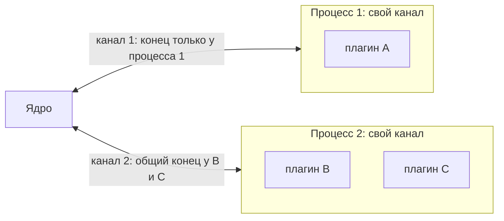

**Что здесь видно.** Ядро надёжно знает «это процесс 1» и «это процесс 2». Но B и C в процессе 2 пишут в один и тот же конец канала и могут называться друг другом. Никакой ключ или подпись это не исправят: любой секрет, выданный B, лежит в памяти процесса, где живёт C.

| Способ | Как работает и что даёт | Чего не даёт | macOS / Linux | Зависимости, стоимость | Задержка | Зрелость, где применяют |
|---|---|---|---|---|---|---|
| **Приватный `socketpair` через `spawn` (`stdio: 'pipe'`)** | Родитель создаёт пару сокетов, потомок получает fd 3; постороннему второй конец взять неоткуда. Подлинность = владение концом. Факт: libuv делает `uv_socketpair(SOCK_STREAM…)` ([libuv](https://raw.githubusercontent.com/libuv/libuv/v1.x/src/unix/process.c)); в `node:net` есть `new net.Socket({fd})` ([Node](https://nodejs.org/docs/latest-v24.x/api/net.html)). Опыт: в потомке `fs.fstatSync(3).isSocket()` истинно | Различия плагинов внутри процесса; защиты от `ptrace`; шифрования | ✅ / ✅ (Linux: libuv, на Linux не запускали) | stdlib; низкая | RTT 256 Б: p50 17-18 мкс, p99 около 42 мкс (20 000 кругов) | Классика Unix; уже у нас в `forkHosts` с каналом `ipc` (`core/src/transports.ts:50-70`) |
| **`utilityProcess` `parentPort` / `MessagePortMain`** | Канал создаёт главный процесс через Mojo; второй конец есть у запущенного процесса. Факт: документация Electron описывает `postMessage` и `parentPort`, но об отправителе гарантий не даёт ([utilityProcess](https://www.electronjs.org/docs/latest/api/utility-process), [process](https://www.electronjs.org/docs/latest/api/process)); в Mojo Core нативные дескрипторы - «kernel-mediated capabilities» ([README](https://chromium.googlesource.com/chromium/src/+/main/mojo/core/README.md)) | То же, что выше; процесс без песочницы | ✅ / ✅ | Electron; низкая | RTT 256 Б: p50 50 мкс, p99 116 мкс | Наш хост сегодня; VS Code extension host ([блог](https://code.visualstudio.com/blogs/2022/11/28/vscode-sandbox)) |
| **Порт на ресурс** (`MessageChannelMain`, билет) | Для каждого ресурса (pty) отдельный канал, выданный ядром по одноразовому билету; идея Mojo «модель интерфейсов вокруг семантических capability» ([Mojo](https://chromium.googlesource.com/chromium/src/+/main/mojo/README.md)) | Ничего сверх своего ресурса | ✅ / ✅ | Electron; средняя | как канал | Уже есть для терминала (`electron/src/view-terminals.ts:42-86`) |
| **`SO_PEERCRED` / `SO_PEERPIDFD` (Linux)** | ОС сообщает серверу uid, gid, pid процесса на другом конце; значения «на момент `connect`, `listen` или `socketpair`» ([unix(7)](https://man7.org/linux/man-pages/man7/unix.7.html)); pidfd убирает гонку повторного использования pid, введён в Linux 6.5 ([слайды LPC 2024](https://lpc.events/event/18/contributions/1691/attachments/1499/3166/-LPC-2024-%20PID%20FDs-%20where%20we%20were,%20where%20we%20are%20and%20were%20we%20would%20like%20to%20go.pdf)); версию проверять по ядру | Различия плагинов (все с одним uid); передачи дескриптора третьему | - / ✅ | Нативный аддон, вспомогательный бинарник или `node:ffi` (Node 26.1+, Stability 1; в Electron 45 нет: [ffi](https://nodejs.org/docs/latest/api/ffi.html)). Опыт: у `net.Socket` нет API учётных данных | микросекунды на соединение | Очень высокая: dbus, systemd |
| **`LOCAL_PEERPID` / `LOCAL_PEERTOKEN` (audit token), `getpeereid` (macOS)** | Аналог для macOS; audit token защищает от повторного использования pid. Факт: Apple DTS подтвердила `LOCAL_PEERTOKEN` как поддерживаемый API с macOS 13, но рекомендует XPC и предупреждает, что передачу дескриптора это не закрывает ([форум Apple](https://developer.apple.com/forums/thread/850777)); константы в [XNU `un.h`](https://github.com/apple-oss-distributions/xnu/blob/main/bsd/sys/un.h) | То же | ✅ / - | Нативный код, `Security.framework` для проверки подписи пира | микросекунды | Высокая (подтверждено Apple) |
| **XPC с требованием подписи** | `xpc_connection_set_peer_code_signing_requirement`, macOS 12+ ([Apple](https://developer.apple.com/tutorials/data/documentation/xpc/xpc_connection_set_peer_code_signing_requirement(_:_:).json)) | Различия плагинов | ✅ / - | Недоступно из Node без нативного кода | - | Высокая; нам не подходит |
| **mTLS** | TLS с сертификатами обеих сторон. Факт: `X509Certificate` в Node только разбирает ([crypto](https://nodejs.org/docs/latest-v24.x/api/crypto.json)), выпуска нет | Различия плагинов; избыточно для приватного канала | ✅ / ✅ | `openssl` или внешняя библиотека; жизненный цикл CA | рукопожатие в мс (не мерили) | Вывод: не берём |
| **Noise (XX, IK, KK)** | Готовые схемы рукопожатия: X25519, HKDF, AEAD. Факт: ревизия 34, 2018, статус «unstable»; повтор нужно отлавливать счётчиком nonce ([спецификация](https://noiseprotocol.org/noise.html)); примитивы в `node:crypto` есть, готовой реализации в stdlib нет | То же | ✅ / ✅ | Самописная схема - риск ошибок | X25519 DH 31 мкс (Опыт) | Вывод: только если появится сокет с путём |
| **SPIFFE / SPIRE** | Короткоживущие сертификаты рабочих нагрузок, Workload API ([SPIFFE](https://spiffe.io/docs/latest/spiffe-about/spiffe-concepts/)) | - | ✅ / ✅ | Внешний демон | - | Для распределённых систем; избыточно |

**Вывод по слою.** Для каналов ядро-хост подлинность даёт владение концом канала; HMAC, AEAD, mTLS и Noise на нём не добавляют защиты от внешнего процесса и не отделяют плагины внутри процесса. `SO_PEERCRED` и `LOCAL_PEERTOKEN` нужны только если появится канал по пути в файловой системе (сегодня такой один, сокет экземпляров `claimInstance`, и по нему идёт запрос второго запуска, не данные). Для хостов-`utilityProcess` Electron не обещает ничего о том, кто пишет в порт; опора на «конец канала есть только у процесса» - **вывод** из того, как устроен Mojo, а не документированная гарантия, поэтому её нужно закрепить тестом (TR-01).

### 4.2. Токены и подписи

| Способ | Как работает, что даёт | Чего не даёт | Зависимости, стоимость | Задержка (Опыт) | Зрелость, где применяют |
|---|---|---|---|---|---|
| **Случайный билет + HMAC-SHA256** | Ядро выдаёт 256-битный ключ, сообщения подписываются; `createHmac`, `timingSafeEqual`, `hkdfSync` есть в `node:crypto` ([crypto](https://nodejs.org/docs/latest-v24.x/api/crypto.json)) | Различия плагинов в одном процессе (ключ лежит в его памяти); повтор без счётчика | stdlib; низкая | HMAC 1 КиБ 9 мкс, 64 КиБ 37 мкс; `randomBytes(32)` 0,9 мкс; HKDF 9,5 мкс | Максимальная |
| **AEAD с ключом канала и счётчиком** | Шифрование и подмена-защита каждого сообщения; повтор ловится счётчиком (правило [Noise 11.4](https://noiseprotocol.org/noise.html)) | На приватном канале добавляет защиту только от компрометации самого канала | stdlib; низкая-средняя | AES-256-GCM 1 КиБ: шифр. 12,6 мкс, расшифр. 10,5 мкс; ChaCha20-Poly1305 13,7 мкс. Наивная обвязка подняла RTT с 17 до 91 мкс (верхняя оценка) | Максимальная |
| **Подписи Ed25519 на сообщениях** | Асимметрично; даёт неотрицаемость в журнале | Защиты от чтения ключа из памяти хоста | stdlib | sign 1 КиБ 32 мкс, verify 88 мкс, генерация пары 31 мкс (в 3-9 раз дороже HMAC) | Высокая |
| **Macaroons** | Токены на цепочках HMAC с «ограничениями» (caveats), сужать может любой держатель ([Google Research](https://research.google/pubs/macaroons-cookies-with-contextual-caveats-for-decentralized-authorization-in-the-cloud/)) | Отзыв без списка | Самописные на `createHmac`, около 50 строк (вывод) | как HMAC | Средняя |
| **Biscuit** | Токен с подписью открытым ключом и политиками Datalog; «токен можно только ограничить» ([Biscuit](https://doc.biscuitsec.org/getting-started/introduction)) | Идентификаторы отзыва на странице не описаны | Внешняя библиотека | не мерили | Средняя |
| **Привязка к каналу, ротация, отзыв** | Токен принимается только по каналу, на который выдан; ротация сменой «эпохи» в HKDF; отзыв закрытием канала и сменой эпохи. SPIFFE прямо предпочитает X.509 токенам JWT из-за повтора ([SPIFFE](https://spiffe.io/docs/latest/spiffe-about/spiffe-concepts/)) | - | stdlib | - | Вывод |

**Вывод по слою.** В нашей архитектуре ядро - единственный посредник и хранит таблицу прав само. Подписанные переносимые токены (Macaroons, Biscuit) нужны, только если право предъявляют другому процессу, который ядро не может спросить в реальном времени, или права должны пережить перезапуск. Таких случаев сегодня нет. Токены полезны в виде **непрозрачных билетов на ресурс** (как билет терминала): выдаются ядром, одноразовые, короткоживущие, привязаны к плагину. Токен для **идентичности плагина в общем процессе** не берём, и вот почему: сообщения несли бы билет по общему `parentPort`, и вредоносный код в том же процессе увидел бы билет соседа, подменив `postMessage` (вывод; Опыт А показывает, что `parentPort` читается плагином).

### 4.3. Происхождение плагинов

| Способ | Как работает, что даёт | Чего не даёт | Зависимости, стоимость | Когда проверяется | Зрелость, где применяют |
|---|---|---|---|---|---|
| **Подпись Ed25519 манифеста пакета + хеши файлов (свой формат, как minisign)** | В подписанном манифесте: `id`, версия, sha256 каждого файла, срок; ключ издателя в списке доверенных. minisign: Ed25519, «доверенный комментарий» в подписи удобен для имени, версии и времени против отката ([minisign](https://jedisct1.github.io/minisign/)). Все примитивы в `node:crypto` (Ed25519: [crypto](https://nodejs.org/docs/latest-v24.x/api/crypto.json)) | Безопасности содержимого; подмены корня доверия (приложения) | stdlib; средняя | При установке и **перед каждой загрузкой** | Высокая; наш формат |
| **Sigstore (cosign, Fulcio, Rekor), npm provenance** | Короткоживущий сертификат под идентичность CI, публичный журнал; проверка: подпись, идентичность, цепочка, запись в журнале ([Sigstore](https://docs.sigstore.dev/about/overview/)). `npm publish --provenance` из облачного CI, проверка `npm audit signatures`; «Provenance does not mean a package is free of malicious code» ([npm](https://docs.npmjs.com/generating-provenance-statements)) | Безопасности кода; защиты от подмены каталога после установки | Проверка без сторонней библиотеки нереальна (X.509, доказательства Rekor, корень TUF) | При установке, внешним шагом | Высокая в экосистеме; для ядра без зависимостей не подходит |
| **SLSA v1.0** | Уровни происхождения сборки; L1 «тривиально подделать», L2 подписывает хостинг сборки, L3 изолирует сборки; страница помечена «Retired» ([SLSA](https://slsa.dev/spec/v1.0/levels)) | Выполнения | Процесс CI | Выпуск | Для наших пакетов `@cyborg-harness/*` |
| **TUF (идея)** | Метаданные: ключи, хеши, версии и **сроки**; защита от freeze, rollback, mix-and-match ([TUF](https://theupdateframework.io/docs/overview/)) | - | Полная реализация тяжела | При обновлении | Образец для отката и отзыва |
| **macOS: подпись кода, Hardened Runtime, нотаризация** | Защита бинарников от инъекций и подмены; нотаризация - автопроверка Apple ([Hardened Runtime](https://developer.apple.com/tutorials/data/documentation/security/hardened-runtime.json), [нотаризация](https://developer.apple.com/tutorials/data/documentation/security/notarizing-macos-software-before-distribution.json)) | `.js` плагина не подписывается и при каждой загрузке не проверяется (вывод) | Процесс сборки | Старт приложения | Высокая; для приложения и нативных помощников |
| **Закрепление хеша, TOFU, «читать один раз»** | Хеш в манифесте; ядро читает байты, хеширует **их же** и исполняет их (иначе гонка TOCTOU); запоминает ключ при первой встрече | Подделки первой установки | stdlib | Перед каждой загрузкой | Практика (вывод); загрузка из памяти **не проверена** |
| **fs-verity (Linux)** | Дерево Меркла на файле, файл нельзя перезаписать; подписи ядра не поддерживают Ed25519; включать можно только на целевой машине ([kernel docs](https://docs.kernel.org/filesystems/fsverity.html)) | - | Права администратора | - | Не для приложения пользователя |
| **ASAR integrity (Electron)** | Хеш заголовка `app.asar`; только macOS и Windows, Linux в документации не упомянут ([Electron](https://www.electronjs.org/docs/latest/tutorial/asar-integrity)) | Пользовательские плагины | Сборка | Старт | Для самого приложения |

**Вывод по слою.** Подпись защищает то, что **вне корня доверия**. Корень - само приложение: если процесс пользователя может переписать приложение и список ключей в нём, подпись плагина бессмысленна. Поэтому подпись нужна для **сторонних пакетов** (этап 2) и как обнаружение для поставки на Linux; на macOS целостность упакованной поставки частично покрывает подпись приложения (в пробе `pack-delivery.mjs` проверены ad hoc `codesign` и целостность asar; Developer ID и нотаризация не проверены: [`bundled-delivery.md`](../05-verification/bundled-delivery.md)). Полную защиту от подмены каталога процессом того же пользователя дать нельзя; достижимо: проверять подпись и хеши при **каждой** загрузке, исполнять прочитанные байты, помнить наибольшую версию и список отозванных.

### 4.4. Изоляция процессов средствами ОС

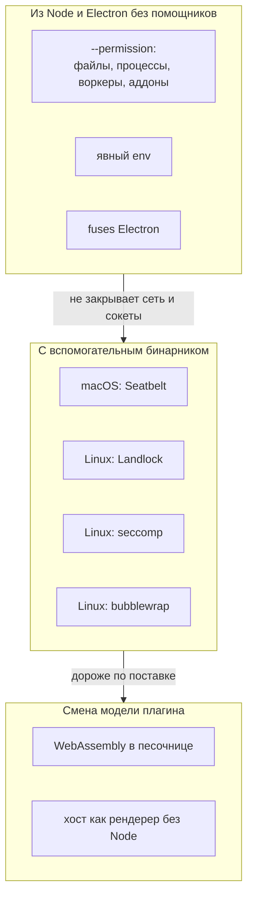

**Что здесь видно.** Слева направо растут защита и цена. Первая группа бесплатна, но не закрывает сеть. Вторая закрывает всё, но требует маленького бинарника на каждую ОС. Третья меняет сам формат плагинов и нашей архитектуре не подходит.

| Способ | Как работает, что даёт | Чего не даёт | macOS / Linux | Зависимости, стоимость | Задержка | Зрелость, где применяют |
|---|---|---|---|---|---|---|
| **Node `--permission`** | Флаги `--allow-fs-read/write`, `--allow-child-process`, `--allow-worker`, `--allow-addons`; Stability 2; **«seat belt», не защита от злого кода** ([permissions v24](https://nodejs.org/docs/latest-v24.x/api/permissions.html)). Опыт: под `--permission` `net.connect` проходит; `--allow-net` есть только в документации новее (v26: [permissions](https://nodejs.org/docs/latest/api/permissions.html)), в Electron 45 (Node 24.22) его нет | Сеть, окружение; обход через уже открытые дескрипторы, символические ссылки, `process._debugProcess` (все названы в документации) | ✅ / ✅ **только как отдельный процесс Node** | stdlib; низкая | 0 | Stable в Node 24; наш выбор для этапа 2 по ADR-CH-0003 п. 9 |
| **`utilityProcess` как граница** | Опыт Б: `execArgv: ['--permission',…]` принят, виден в `process.execArgv`, **не действует** (`process.permission` не определён). Факт: сервис `NodeService` помечен `[ServiceSandbox=…kNoSandbox]` ([mojom](https://raw.githubusercontent.com/electron/electron/main/shell/services/node/public/mojom/node_service.mojom)); опции `sandbox` у `fork` нет ([utilityProcess](https://www.electronjs.org/docs/latest/api/utility-process)) | Любой запрет ОС | ✅ / ✅ как есть | - | - | **Не граница безопасности**; подтверждено своим опытом |
| **Процесс Node через `ELECTRON_RUN_AS_NODE` или `child_process.fork`** | Тот же бинарник как обычный Node: `--permission` действует (Опыт Г: `ERR_ACCESS_DENIED` на чтение вне каталога и на `child_process`). В `forkHosts` такой путь уже есть | Сеть | ✅ / ✅ | Фьюз `RunAsNode` обязан быть включён: любой процесс пользователя тогда запустит подписанный бинарник приложения как Node ([fuses](https://www.electronjs.org/docs/latest/tutorial/fuses)); вывод: с доверием подписи и разрешениями приложения | не измерена: 17 мкс получены на `socketpair` со `stdio: 'pipe'` и самописным кадрированием, канал `fork` с `ipc` не мерили | Основа этапа 2 по ADR-CH-0003 |
| **Отдельный бинарник Node** | Свой `node`, подписанный и лежащий в приложении; фьюз `RunAsNode` можно выключить | Сеть | ✅ / ✅ | Размер: `node` 24.20.0 на этой машине 122 МБ, `Electron Framework` 251 МБ (Опыт); сборка и подпись | как выше | Вывод; обсуждается в вопросе 2 |
| **macOS Seatbelt (`sandbox-exec`, `sandbox_init`)** | Профиль запретов. Опыт Д: на macOS 27.2 профиль `(deny network*)(deny process-fork)(deny file-read* …)` **действует**: чтение, сеть и fork отказаны. Факт: `sandbox-exec` в man помечен DEPRECATED (страница 2017 г.) ([man](https://keith.github.io/xcode-man-pages/sandbox-exec.1.html)); Chromium использует непубличный `sandbox_init_with_parameters` и профили SBPL, «официальной документации SBPL нет» ([Chromium](https://chromium.googlesource.com/chromium/src/+/main/sandbox/mac/seatbelt_sandbox_design.md)) | Утечки через разрешённое | ✅ / - | Запуск `sandbox-exec -p … node host.js`, если утилита останется; иначе помощник с `sandbox_init` | при запуске | Средняя: механизм в ходу, API не публичен |
| **macOS App Sandbox** | Песочница всего приложения с entitlement `com.apple.security.app-sandbox` | Динамические плагины с произвольным доступом к `ctx.os` | ✅ / - | Меняет модель всего приложения | 0 | Вывод: архитектурно не подходит (текст страницы Apple получить не удалось: **не проверено**) |
| **Hardened Runtime** | Запрет инъекций `DYLD_*`, неподписанных библиотек, отладчика без `get-task-allow`; «библиотеки и in-process плагины наследуют entitlements хозяина» ([Apple](https://developer.apple.com/tutorials/data/documentation/security/hardened-runtime.json)). `allowLoadingUnsignedLibraries` у `utilityProcess` включает загрузку неподписанных библиотек и «лучше не включать» (вывод: по умолчанию хелпер чужих `.node` не грузит); `disclaim` отделяет TCC ([utilityProcess](https://www.electronjs.org/docs/latest/api/utility-process)) | JS | ✅ / - | Подпись | 0 | Для приложения; хорошая сопутствующая мера |
| **Linux Landlock** | Процесс сам себе закрывает файлы; ABI 1 ядро 5.13, ABI 4 (TCP connect/bind) ядро 6.7, ABI 6 (скоупы сокетов и сигналов) 6.12 ([landlock(7)](https://man7.org/linux/man-pages/man7/landlock.7.html), [kernel docs](https://docs.kernel.org/userspace-api/landlock.html)); нужен `no_new_privs`, ограничения необратимы. Не ограничивает `chdir`, `stat`, `chmod`, `/proc/<pid>/fd` | UDP до новых ABI; старые ядра | - / ✅ (ядро 5.13+, сеть 6.7+) | Нативный помощник; Chromium Landlock пока не использует ([Chromium](https://chromium.googlesource.com/chromium/src/+/main/sandbox/linux/README.md)) | при запуске | Зрелая в ядре, ABI растёт |
| **Linux seccomp-bpf** | Фильтр системных вызовов, `no_new_privs`; рекомендован allow-list ([seccomp(2)](https://man7.org/linux/man-pages/man2/seccomp.2.html)) | Логики прав на пути | - / ✅ | Нативный помощник | доли мкс на вызов (не мерили) | Очень высокая: Chromium, Flatpak, Android |
| **User namespaces, bubblewrap** | Новое пространство ФС, сети, процессов; bubblewrap - инструмент, не политика, setuid-режим удалён ([bubblewrap](https://github.com/containers/bubblewrap)); непривилегированные userns с Linux 3.8 ([user_namespaces(7)](https://man7.org/linux/man-pages/man7/user_namespaces.7.html)); **Ubuntu 24.04 ограничивает их через AppArmor** ([Ubuntu](https://ubuntu.com/blog/ubuntu-23-10-restricted-unprivileged-user-namespaces)) | Ничего сверх профиля | - / ✅ с оговоркой | Бинарник `bwrap` | при запуске | Очень высокая; Linux-дистрибутивы по-разному |
| **Firejail** | SUID-утилита, namespaces + seccomp ([README](https://raw.githubusercontent.com/netblue30/firejail/master/README.md)) | - | - / ✅ | SUID root расширяет поверхность атаки (вывод) | при запуске | Средняя (история CVE) |
| **AppArmor, SELinux** | Политики администратора | - | - / ✅ | Не для встроенного в приложение пользователя (вывод, **не проверено** по первоисточнику) | - | - |
| **cgroups, контейнеры** | Лимиты ресурсов; Deno перечисляет cgroups среди внешних слоёв ([Deno](https://docs.deno.com/runtime/fundamentals/security/)) | Права | - / ✅ | Администратор | - | Не исследовано |
| **WebAssembly-компоненты** | Линейная память с проверкой границ, ловушки ([WebAssembly](https://webassembly.org/docs/security/)); `node:wasi` **не** песочница: «does not provide secure sandboxing», Stability 1 ([WASI](https://nodejs.org/docs/latest-v24.x/api/wasi.html)) | - | ✅ / ✅ | Внешний рантайм (wasmtime, браузер); смена модели плагина | накладные CPU | Вывод: отвергаем для v1 |
| **Хост как рендерер без Node** | Песочница Chromium ([Electron sandbox](https://www.electronjs.org/docs/latest/tutorial/sandbox)); канал `MessagePort` | Плагин с Node (`child_process`, `fs`) | ✅ / ✅ | Плагины без Node | RTT порта | Вывод: меняет модель плагинов |
| **`node:vm`** | «Not a security mechanism. Do not use it to run untrusted code» ([vm](https://nodejs.org/docs/latest-v24.x/api/vm.html)) | - | - | - | - | Не берём |
| **Deno-подобный брокер разрешений** | Доступ закрыт по умолчанию; `DENO_PERMISSION_BROKER_PATH` - внешний процесс решает каждую проверку ([Deno](https://docs.deno.com/runtime/fundamentals/security/)) | - | - | - | - | Образец: наше ядро с `ctx.os` и есть такой брокер |
| **Фьюзы Electron** | `EnableNodeCliInspectArguments` выкл. закрывает `--inspect` и запуск инспектора по сигналу в главном процессе; `EnableNodeOptionsEnvironmentVariable` выкл. - `NODE_OPTIONS` не влияет; `RunAsNode` | Отладка снаружи через ptrace | ✅ / ✅ | Шаг сборки **приложения** (в репозитории фьюзы не настраиваются: поиск по `docs`, `electron`, `playground/scripts` пуст) | 0 | [Electron](https://www.electronjs.org/docs/latest/tutorial/fuses) |

**Вывод по слою.**

1. Для `utilityProcess` в Electron 45 запретов ОС на процесс **нет и нет способа их поставить** изнутри: песочница сервиса отключена, `--permission` не работает. Если мы хотим граничить код плагина, он должен быть **не** `utilityProcess`, а обычным процессом Node.
2. В обычном процессе Node `--permission` закрывает файлы, процессы, воркеры и аддоны, но не сеть (Node 24) и не окружение. Окружение закрывает явный `env` при запуске. Сеть закрывает только ОС: Seatbelt на macOS (Опыт Д подтверждает, что профиль действует), Landlock (ядро 6.7+) или seccomp на Linux.
3. Все ОС-способы требуют кода вне stdlib Node. Самый дешёвый вариант - обёртка из готовой утилиты (`sandbox-exec`; `bwrap`), самый устойчивый - свой маленький бинарник. Выбор - вопрос 3.
4. `--permission` внутри процесса, прошедшего ограничитель ОС, даёт два слоя; если ограничителя нет - один слой и честная пометка человеку.

### 4.5. Секреты и ключи

| Способ | Как работает, что даёт | Чего не даёт | macOS / Linux | Зависимости, стоимость | Зрелость |
|---|---|---|---|---|---|
| **`safeStorage` (сейчас)** | macOS: ключи в Keychain, «prevents other applications from loading them without user override». Linux: kwallet/kwallet5/kwallet6/libsecret; «если хранилища нет, шифрование зашитым открытым паролем»; асинхронный API идёт через портал `org.freedesktop.portal.Secret`, Secret Service или запасной вариант; синхронный будет удалён в Electron 46 ([safeStorage](https://www.electronjs.org/docs/latest/api/safe-storage)) | Различия плагинов внутри приложения; на Linux защиты от других приложений сеанса | ✅ / ⚠️ | Electron; низкая | Высокая на macOS, средняя на Linux |
| **Группы доступа Keychain** | Элемент принадлежит группе подписанных приложений одной команды ([Apple](https://developer.apple.com/tutorials/data/documentation/security/sharing-access-to-keychain-items-among-a-collection-of-apps.json)) | Плагины внутри приложения | ✅ / - | Нативный код | Высокая |
| **Secret Service / libsecret** | GNOME Keyring защищает от пассивных атак и других пользователей, но «does not isolate secrets from other applications in the same user session» ([GNOME](https://wiki.gnome.org/Projects/GnomeKeyring/SecurityPhilosophy)) | Изоляцию приложений | - / ✅ | Через `safeStorage` | Средняя |
| **Портал Secret** | `RetrieveSecret()` отдаёт мастер-секрет приложения, стабильный на время установки ([portal](https://flatpak.github.io/xdg-desktop-portal/docs/doc-org.freedesktop.portal.Secret.html)) | Доступность вне Flatpak не гарантирована | - / ⚠️ | - | Средняя |
| **Secure Enclave** | Только P-256 (подпись и ECDH), ключ нельзя извлечь ([Apple](https://developer.apple.com/tutorials/data/documentation/security/protecting-keys-with-the-secure-enclave.json)) | Ed25519 и AES; Linux; защиту от процесса, которому разрешён запрос | ✅ / - | Нативный код | Высокая; нам не подходит |
| **TPM2 (`systemd-creds`)** | Ключ в TPM, привязка к PCR; хостовой ключ доступен root ([systemd-creds](https://www.freedesktop.org/software/systemd/man/latest/systemd-creds.html)) | Десктоп-приложение без root | - / ⚠️ | `child_process` к утилите | Не берём |
| **Ключ на плагин: HKDF от мастер-ключа + AES-GCM с AAD** | Утечка файла одного плагина не раскрывает чужие; подмена файла между плагинами видна по AAD (все примитивы в stdlib) | Процесс, которому ядро разрешит запрос; чтение ключа из памяти ядра | ✅ / ✅ | stdlib; низкая | Вывод: пока не нужно ([5.7](#57-слой-секреты-и-ключи)) |
| **Отладка и дамп памяти** | Linux Yama `ptrace_scope` 0-3 ([Yama](https://www.kernel.org/doc/html/latest/admin-guide/LSM/Yama.html)); macOS `PT_DENY_ATTACH` ([ptrace(2)](https://keith.github.io/xcode-man-pages/ptrace.2.html)); `mlock` держит страницы в ОЗУ, но сон сохранит память на диск ([mlock(2)](https://man7.org/linux/man-pages/man2/mlock.2.html)) | Чтение окружения: `/proc/<pid>/environ` читается тем же пользователем | ✅ / ✅ | В Node нет API для `mlock`, `PT_DENY_ATTACH`: нужен аддон | 0 | Не берём |
| **Секреты не через `env` и `argv`** | Опыт: `ps -E -p <pid>` на macOS показывает окружение дочернего процесса того же пользователя; `ps -o args=` - argv целиком | - | ✅ / ✅ | Передача по каналу после старта | Практика |

**Вывод по слою.** Корень доверия - хранилище ОС через `safeStorage`; на Linux он слабее. Аппаратные хранилища и шифрование «ключом на плагин» не добавляют защиты от процесса того же пользователя, у которого есть доступ к ядру. Дешёвое и нужное: проверять `getSelectedStorageBackend()`, не передавать секреты через `env` и `argv`, и не держать их там, где их читает недоверенный код (отдельный процесс стороннего плагина).

### 4.6. Изоляция данных между плагинами и опыт других систем

| Система | Что делает | Что берём |
|---|---|---|
| **Confused deputy** (Харди, 1988) | Привилегированная программа выполнила просьбу слабой, не проверив её право; «возможности» передают право вместе со ссылкой на объект ([cap-lore](http://www.cap-lore.com/CapTheory/ConfusedDeputy.html)) | Ядро не должно разрешать «прочитай ключ X» по имени из запроса; нужны непрозрачные ссылки на права; уже так: `guard`, `callers`, `describedBy` |
| **Chromium Mojo** | «Policy should be controlled solely by the browser process»; не передавать из процесса-рендерера origin или путь, которым верят; сообщения слабых процессов считать злонамеренными ([Mojo security](https://chromium.googlesource.com/chromium/src/+/main/docs/security/mojo.md)); имена узлов и портов 128-битные, утечка имени = утечка права ([Mojo Core](https://chromium.googlesource.com/chromium/src/+/main/mojo/core/README.md)) | Уже наша модель: имя вызывающего берётся из канала. Билет на ресурс - как порт |
| **VS Code** | Extension host «has the same permissions as VS Code itself»; защита - доверие издателю, скан, подпись, список блокировок, Workspace Trust, который «can't prevent a malicious extension from executing code» ([runtime security](https://code.visualstudio.com/docs/configure/extensions/extension-runtime-security), [Workspace Trust](https://code.visualstudio.com/docs/editing/workspaces/workspace-trust)); запрос песочницы расширений открыт с 2018 г. ([#52116](https://github.com/microsoft/vscode/issues/52116)) | Это наш уровень 0: «подпись + репутация + журнал» - слой доверия, не изоляции |
| **Браузерные расширения MV3** | Запрет удалённо размещённого кода, изолированные миры content scripts ([MV3](https://developer.chrome.com/docs/extensions/develop/migrate/what-is-mv3), [content scripts](https://developer.chrome.com/docs/extensions/develop/concepts/content-scripts)) | Правило «исполняется только код, хеш которого в манифесте» |
| **Android** | UID на приложение, SELinux по приложению, seccomp-bpf ([Android](https://source.android.com/docs/security/app-sandbox)) | Аналог для десктопа без root: процесс на плагин + Landlock или Seatbelt |
| **Capsicum (FreeBSD)** | `cap_enter` необратим, права на дескрипторах ([capsicum(4)](https://man.freebsd.org/cgi/man.cgi?query=capsicum&sektion=4)) | Идея «дескриптор = право» ложится на «порт на ресурс»; на macOS и Linux аналога нет |
| **Zircon** | Handles с правами, ослаблять можно, усиливать нельзя ([Fuchsia](https://fuchsia.dev/fuchsia-src/concepts/kernel/handles)) | Та же идея |
| **Deno** | Разрешения по умолчанию закрыты, подпроцесс с `--allow-run` «happens outside the sandbox» ([Deno](https://docs.deno.com/runtime/fundamentals/security/)) | Подтверждает нашу «честную границу» `process` и `pty` |

### 4.7. Виды в `<iframe>`

| Способ | Что даёт | Что известно |
|---|---|---|
| **Свой origin на плагин или группу** (`cyborg-plugin://<группа>/`, схема `standard`) | Same-origin policy между видами; идентичность в мосте - по `senderFrame.origin`, не по полю сообщения | Факт: `registerSchemesAsPrivileged` ([protocol](https://www.electronjs.org/docs/latest/api/protocol)); site isolation по схеме и eTLD+1 на настольных платформах ([Chromium](https://chromium.googlesource.com/chromium/src/+/main/docs/process_model_and_site_isolation.md)). Как Electron обрабатывает свои схемы в этом смысле: **не проверено** |
| **Проверка `senderFrame` каждого IPC** | Чек-лист Electron: «Validate the sender of all IPC messages»; URL обманчивы для `about:blank`, `blob:`, sandboxed ([security](https://www.electronjs.org/docs/latest/tutorial/security)) | У нас сделано (`electron/src/view-frames.ts`); тесты на подставных кадрах |
| **`sandbox` атрибут, CSP** | `sandbox` без `allow-same-origin` даёт непрозрачный origin; `allow-scripts` вместе с `allow-same-origin` позволяет снять песочницу ([MDN](https://developer.mozilla.org/en-US/docs/Web/HTML/Reference/Elements/iframe)) | У нас CSP `default-src 'none'` (FR-CH-3015) |
| **Порты вместо `postMessage('*')`** | Широковещательное сообщение читают все слушатели ([MDN](https://developer.mozilla.org/en-US/docs/Web/API/Window/postMessage)); порт доставляется только владельцу второго конца | Уже для терминала; шаблон для чувствительных каналов видов |
| **Настройки окна** | `contextIsolation`, `sandbox` по умолчанию `true` с Electron 20; `nodeIntegrationInSubFrames` - экспериментальная, «all your preloads will load for every iframe» ([webPreferences](https://raw.githubusercontent.com/electron/electron/main/docs/api/structures/web-preferences.md)) | Наш preload выдаёт мост только документам схемы `cyborg-plugin:` (`electron/src/preload.ts:85-119`) |

### 4.8. Сводная таблица сравнения

✅ берём, ⚠️ позже или по условию, ❌ не берём. «Защищает от» - [угрозы](#29-угрозы-мера-сейчас-и-пробел) этого документа; «Динамика» - задержка по нашим опытам.

| # | Способ | Слой | macOS | Linux | Вне stdlib? | Стоимость | Задержка | Решение |
|---|---|---|---|---|---|---|---|---|
| 1 | `socketpair` через `spawn` (`stdio: 'pipe'`) или `fork` с `ipc` | канал | ✅ | ✅ | нет | низкая | 17 мкс (для `socketpair`; `ipc` не мерили) | ✅ для процессов Node (этап 2) |
| 2 | `utilityProcess` `parentPort` | канал | ✅ | ✅ | нет | низкая | 50 мкс | ✅ для встроенных (как сейчас) |
| 3 | Порт на ресурс по билету | канал, данные | ✅ | ✅ | нет | средняя | как канал | ✅ шаблон для новых ресурсов |
| 4 | `SO_PEERCRED` / `SO_PEERPIDFD` | канал | - | ✅ | да | средняя | мкс | ⚠️ только для сокета с путём |
| 5 | `LOCAL_PEERTOKEN` + подпись пира | канал | ✅ | - | да | средне-высокая | мкс | ⚠️ то же |
| 6 | HMAC-билет сессии | токены | ✅ | ✅ | нет | низкая | 9 мкс | ⚠️ как билеты на ресурсы; ❌ для идентичности в общем процессе |
| 7 | AEAD на канале | токены | ✅ | ✅ | нет | средняя | +70 мкс (наивно) | ❌ канал приватный |
| 8 | Подписи Ed25519 на сообщениях | токены | ✅ | ✅ | нет | средняя | 32/88 мкс | ❌ не на горячем пути |
| 9 | Macaroons, Biscuit | токены | ✅ | ✅ | нет / да | средняя-высокая | - | ❌ нет делегирования |
| 10 | mTLS, Noise, SPIFFE | канал | ✅ | ✅ | да | высокая | мс | ❌ избыточно |
| 11 | Подпись Ed25519 пакета + хеши | происхождение | ✅ | ✅ | нет | средняя | один раз | ✅ |
| 12 | Sigstore, npm provenance, SLSA | происхождение | ✅ | ✅ | да (проверка) | средняя | один раз | ⚠️ для выпуска наших пакетов, не для проверки ядром |
| 13 | TUF (идея: версия, срок, отзыв) | происхождение | ✅ | ✅ | нет (идея) | средняя | - | ⚠️ берём идеи, не реализацию |
| 14 | codesign, notarization, Hardened Runtime | происхождение | ✅ | - | нет | средняя | 0 | ✅ для приложения |
| 15 | fs-verity | происхождение | - | ✅ | да, root | высокая | - | ❌ |
| 16 | ASAR integrity, фьюзы | приложение | ✅ | ⚠️ только фьюзы | сборка | низкая | 0 | ✅ (задача приложения) |
| 17 | Node `--permission` | изоляция | ✅ | ✅ | нет | низкая | 0 | ✅ как слой, не граница |
| 18 | `utilityProcess` как граница | изоляция | ✅ | ✅ | нет | - | - | ❌ не работает (Опыт Б) |
| 19 | Процесс Node: `RunAsNode` или свой бинарник | изоляция | ✅ | ✅ | нет / да | средняя | - | ✅ вопрос 2 |
| 20 | Seatbelt (`sandbox-exec`/`sandbox_init`) | изоляция | ✅ | - | да | высокая | старт | ✅ этап В2 |
| 21 | Landlock + seccomp | изоляция | - | ✅ | да | высокая | старт | ✅ этап В2 |
| 22 | bubblewrap, userns | изоляция | - | ✅ | да | средняя | старт | ⚠️ запасной путь; ограничен AppArmor на Ubuntu 24.04 |
| 23 | Firejail, AppArmor, SELinux, контейнеры | изоляция | - | ✅ | да | высокая | - | ❌ |
| 24 | App Sandbox | изоляция | ✅ | - | да | высокая | 0 | ❌ не подходит модели |
| 25 | WASM-компоненты; `node:wasi` | изоляция | ✅ | ✅ | да | высокая | CPU | ❌ для v1 |
| 26 | Хост как рендерер без Node | изоляция | ✅ | ✅ | нет | высокая | порт | ❌ меняет модель плагинов |
| 27 | `node:vm`, `Compartment` как граница | изоляция | - | - | - | - | - | ❌ слой против ошибок, не граница |
| 28 | `safeStorage` | секреты | ✅ | ⚠️ | нет | низкая | мс | ✅ + проверка backend |
| 29 | Secure Enclave, TPM2 | секреты | ✅ | ⚠️ | да | высокая | мс | ❌ |
| 30 | Ключ на плагин (HKDF + AES-GCM) | секреты, данные | ✅ | ✅ | нет | низкая | 12 мкс | ⚠️ по запросу |
| 31 | Yama, `PT_DENY_ATTACH`, `mlock` | секреты | ✅ | ✅ | да | средняя | 0 | ❌ |
| 32 | Origin на группу, `senderFrame`, CSP, порты | виды | ✅ | ✅ | нет | низкая | 0 | ✅ уже есть |

## 5. Выбор способа

Выбор делается **по слоям**: одного способа, который закрыл бы все угрозы, нет. Принцип выбора: брать то, что (1) закрывает проверенную дыру, (2) укладывается в стандартную библиотеку Node и Electron либо явно называет цену вспомогательного бинарника, (3) не ломает `ctx.os`, бюджеты шлюза и дисциплину этапа 1, (4) одинаково работает на macOS и Linux или честно называет разницу.

### 5.1. Целевая схема

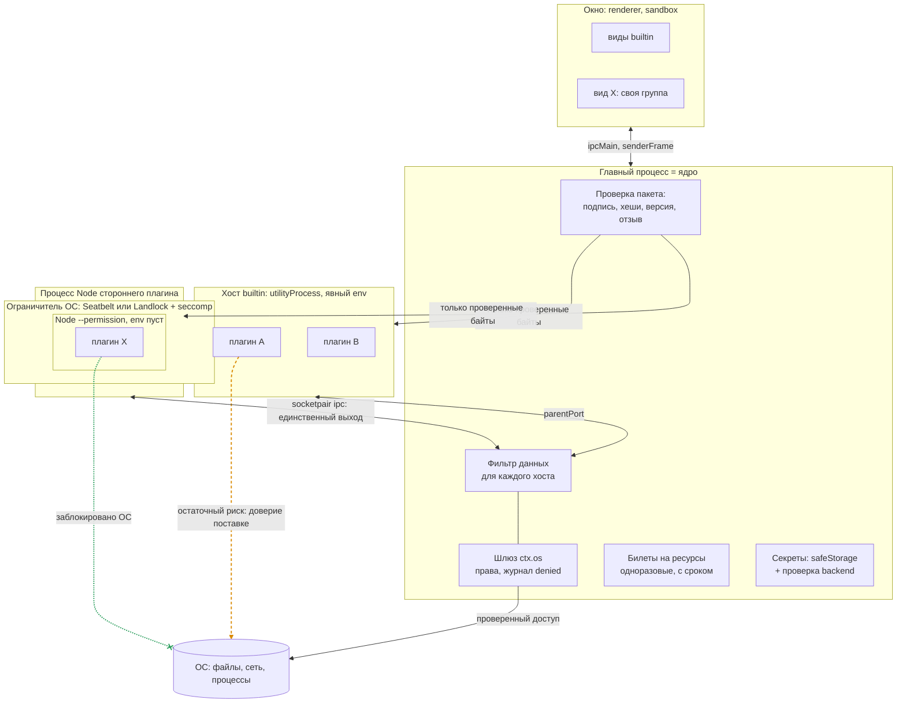

**Что здесь видно.** Три отличия от схемы «сейчас» ([2.1](#21-процессы-и-границы-доверия)). Первое: до запуска любой пакет проходит проверку подписи и хешей. Второе: сторонний плагин сидит в трёх вложенных оболочках - разрешения Node внутри ограничителя ОС внутри отдельного процесса, и у него один выход - канал к ядру, то есть шлюз. Третье: встроенные плагины остаются в общем хосте и по-прежнему доверяют друг другу (оранжевая стрелка: остаточный риск, [5.9](#59-что-остаётся-незащищённым-и-почему)).

### 5.2. Слой «канал, идентичность и минимум данных»

**Решение.**

1. **Подлинность стороны = владение концом канала**, как сейчас. HMAC, AEAD, mTLS, Noise, подписи сообщений, `SO_PEERCRED` и `LOCAL_PEERTOKEN` на каналах ядро-хост **не вводим**: они не закрывают ни одной из угроз [таблицы 2.9](#29-угрозы-мера-сейчас-и-пробел) (подмена в общем хосте и чтение сырого канала плагином в том же процессе они не лечат), стоят вычислений на горячем пути и порождают риск ошибок в самописной схеме.
2. **Идентичность плагина = процесс.** Недоверенный плагин всегда один в процессе (как сейчас: `assignHosts`, запись `host-isolated`). Правило закрепить тестом на **настоящем** процессе (TR-01), а не только на подделке сообщений.
3. **Минимум данных на входе в хост** (TR-03): `init` несёт манифесты плагинов этого хоста и тех, с кем у них есть привязки графа; `contracts` уходят только в хосты, где есть потребитель, объявивший этот контракт в `requires`, `optional` или `consumes`.
4. **Окружение хоста задаётся явно** (TR-02): список переменных вместо наследования `process.env`. Опыт В ([Б.1](#б1-опыт-что-может-код-плагина-в-utilityprocess)): `env: { PATH }` убирает токен главного процесса; плагин не видит ничего, что не передано.
5. **Билеты на ресурсы** (терминал; впредь любой ресурс, который ядро отдаёт процессу напрямую): непрозрачные, одноразовые, привязанные к плагину, с коротким сроком, гасятся при отключении плагина и падении хоста ([5.7](#57-слой-секреты-и-ключи)). Билет **идентичности** внутри общего процесса не вводим: сообщения несли бы его по общему `parentPort`, и вредоносный код в том же процессе увидел бы билет соседа.

**Почему так.** Вывод [4.1](#41-канал-и-идентичность): криптография различает процессы, а не плагины внутри одного процесса. Для разных процессов различие уже даёт канал. Реальные дыры слоя - лишние данные на входе и наследование окружения (Опыт А, В) - закрываются удалением данных, а не шифрованием.

**Что можно на stdlib:** всё перечисленное. **Цена:** TR-03 - изменение внутреннего протокола ядро-хост (`init`, `contracts`), публичный API плагина не меняется; требует аккуратности при включении и выключении плагинов во время работы.

### 5.3. Слой «изоляция процесса»

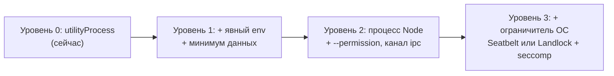

**Что здесь видно.** Каждая ступень включает предыдущую и закрывает больше. Уровень 1 делается сейчас; уровни 2 и 3 включаются по поводу этапа 2 для сторонних плагинов.

**Решение.**

1. **Встроенные плагины остаются в `utilityProcess`** (уровень 1). Они поставляются нами, проверяются в CI, ограничение для них - защита от ошибки ([ADR-CH-0003](../04-architecture/adr/ADR-CH-0003-trust-and-isolation.md), п. 1), `utilityProcess` уже работает, а память хоста известна замером (около 34 МБ PSS на Linux, 15 МБ физического следа на macOS: [SAD 3.5](../04-architecture/design/sad.md#35-изоляция-сбоев-хосты-и-сторож)); цена процесса на плагин в ADR-CH-0003 оценена в 12 МБ, мы её не сверяли.
2. **Сторонний плагин - процесс Node, не `utilityProcess`** (уровень 2). Основание: Опыт Б - в `utilityProcess` запреты Node не действуют, песочницы сервиса нет ([mojom](https://raw.githubusercontent.com/electron/electron/main/shell/services/node/public/mojom/node_service.mojom)). Канал - `child_process.fork` с `ipc` (`forkHosts`, `core/src/transports.ts:46-70` уже есть), параметры: пустой `env`, `execArgv: ['--permission', '--allow-fs-read=<проверенный каталог пакета>']`, без `--allow-child-process`, `--allow-worker`, `--allow-addons`.
3. **Проверка эффективности при старте (canary).** Хост при загрузке проверяет, что `process.permission` определён, и пробует запрещённое действие; результат отправляет ядру в `ready`. Ядро не активирует плагин, если запрет не действует. Именно такая проверка поймала бы «принятый и неработающий» `--permission` в `utilityProcess` ([Б.1](#б1-опыт-что-может-код-плагина-в-utilityprocess)).
4. **Ограничитель ОС** (уровень 3), отдельный шаг с вспомогательным бинарником или готовой утилитой:
   - macOS: профиль Seatbelt (`deny network*`, `deny process-fork`, чтение вне каталога). Опыт Д: `sandbox-exec` с таким профилем **работает** на macOS 27.2, вместе с `--permission` закрыты файлы, процессы, сеть. Риск: утилита помечена устаревшей ([man](https://keith.github.io/xcode-man-pages/sandbox-exec.1.html)), `sandbox_init` непубличен ([Chromium](https://chromium.googlesource.com/chromium/src/+/main/sandbox/mac/seatbelt_sandbox_design.md)). Смягчение: ограничитель спрятан за интерфейсом «ConfinerLauncher» с проверкой эффективности (п. 3).
   - Linux: Landlock (файлы, TCP с ядра 6.7) и seccomp в маленьком запускателе; bubblewrap - запасной путь, но Ubuntu 24.04 ограничивает userns через AppArmor. **На Linux мы ничего из этого не запускали** (приложение Б, «не проверено»).
   - Без ограничителя ОС плагин честно помечается «уровень 2: сеть и сокеты не закрыты» (FR-CH-3021).
5. **Фьюз `RunAsNode` против отдельного бинарника Node** (вопрос 2). В Electron процесс Node из бинарника приложения запускается через `ELECTRON_RUN_AS_NODE` (спайк задавал его явно: `docs/research/spikes/sad2/main-u2.js:28`); для этого фьюз `RunAsNode` должен быть включён (по умолчанию он включён), и любой процесс пользователя тогда может запустить подписанный бинарник приложения как Node ([fuses](https://www.electronjs.org/docs/latest/tutorial/fuses)). Отдельный бинарник Node (122 МБ на этой машине) снимает этот риск и позволяет выключить фьюз. Рекомендация - решить по замеру спайка TR-20, начать с `RunAsNode`.
6. **`Compartment` (`ses`)** остаётся вторым слоем против ошибок и цепочки поставок, не границей ([ADR-CH-0003](../04-architecture/adr/ADR-CH-0003-trust-and-isolation.md), п. 9).

**Что этот слой закрывает:** Опыт А после решения: чтение `secrets.json`, запуск процессов, `parentPort` соседа - да (уровень 2), сеть - да (уровень 3). **Что не закрывает:** разрешённые права (`process`, `pty` - «полный доступ через программу», У-10), побеги из ядра ОС и Node, уязвимости самого Node. **Влияние на задержки:** сырой `socketpair` с самописным кадрированием дал RTT 17 мкс против 50 мкс у `parentPort` (канал `fork` с `ipc` не мерили); сколько даст весь протокол ядра (структурное клонирование, `advanced`-сериализация), покажет TR-20 - бюджет шлюза 1 мс на p99 оставляет запас на порядок, но **это не проверено**.

### 5.4. Слой «происхождение плагинов»

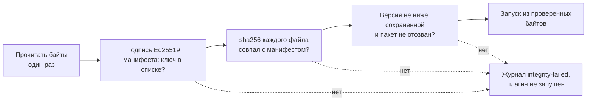

**Что здесь видно.** Четыре проверки идут подряд на одних и тех же прочитанных байтах; любое «нет» останавливает запуск и пишет причину. Ключевое слово «один раз»: файл не открывается второй раз после проверки, поэтому подменить его между проверкой и запуском нельзя.

**Решение.**

1. **Подписанный манифест пакета** (TR-10): `integrity.json` рядом с плагином с полями `id`, `version`, sha256 каждого файла, срок действия и идентификатор ключа; подпись Ed25519 над канонической записью. Формат своё, по образцу minisign ([minisign](https://jedisct1.github.io/minisign/)); `node:crypto` закрывает Ed25519, SHA-256 и `timingSafeEqual`. Доверие **не** берём из `manifest.json` плагина (автор пишет там что угодно).
2. **Хранилище доверия** (TR-11): ключ издателя поставки зашит в приложение; ключи сторонних издателей - в `userData` из слоя пользователя (по [ADR-CH-0015](../04-architecture/adr/ADR-CH-0015-workspace-trust.md), п. 6 подтверждение не лежит в файле воркспейса). Рядом - наибольшая виденная версия по `id` (защита от отката) и подписанный список отозванных ключей и хешей со сроком годности (идея TUF, [TUF](https://theupdateframework.io/docs/overview/)).
3. **Исполнять то, что проверили.** Ядро читает байты, проверяет, и в процесс плагина отдаёт проверенную копию (например, во временный каталог ядра с правами владельца и только на чтение для процесса плагина), а не исходный путь. Конкретный способ загрузки из проверенных байтов **не проверен**: `import()` из `data:` ломает относительные импорты, а `cyborg-plugin build` собирает бандл главной части - один файл (SAD 6.1); проверка в спайке TR-20/TR-11.
4. **Поставка (встроенные)**: подписать `delivery.json` ключом выпуска (TR-12) и проверять при старте; режим «предупреждать» на пилотах, «отказывать» после (чтобы подпись не «окирпичила» приложение). Подпись приложения macOS (`codesign`, Hardened Runtime) остаётся обязанностью сборки приложения; для JS-плагинов она не помогает (вывод).
5. **Выпуск наших пакетов** `@cyborg-harness/*`: `npm publish --provenance` в CI даёт происхождение сборки (аттестация Sigstore, [npm](https://docs.npmjs.com/generating-provenance-statements)); это для потребителей пакета, не для проверки плагинов ядром (TR-13, по желанию).
6. **Отзыв:** список отозванных, смена эпохи ключа, выключение плагина и остановка хоста. Отзыв действует при следующей загрузке и сразу, если ядро получило обновлённый список.

**Что не даёт:** защиты от подмены самого приложения и списка ключей процессом пользователя (корень доверия - приложение); безопасности содержимого подписанного плагина. **Sigstore проверкой в ядре не берём:** для проверки сертификатов, журнала Rekor и корня нужны сторонние библиотеки, а ядро без зависимостей.

### 5.5. Рукопожатие ядро-хост при старте (целевой вариант)

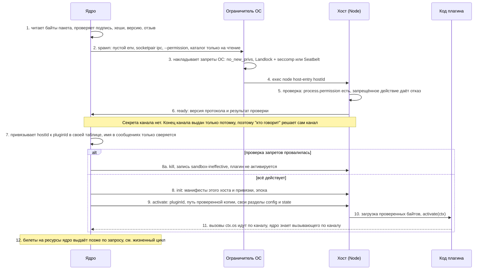

**Что здесь видно.** В рукопожатии нет секрета канала, и это сознательно: единственный конец канала выдан запущенному процессу. Вместо секрета есть три проверки: подпись пакета (шаг 1), эффективность запретов (шаги 5-6) и таблица «хост - плагин» в самом ядре (шаг 7). Имя плагина в сообщениях остаётся, но решает не оно.

**Где вообще нужен секрет канала.** Только там, где канал не приватен. Сегодня таких каналов у ядра нет (сокет экземпляров `claimInstance` передаёт запрос второго запуска, права 0600 в каталоге 0700). Если появится сокет с путём в ФС (например, отдельный процесс-посредник), придётся добавить `SO_PEERCRED` или `LOCAL_PEERTOKEN` и, возможно, токен сессии: тогда ключ сессии получают как `HMAC` от случайного 256-битного значения ядра и ротируют сменой эпохи ([4.2](#42-токены-и-подписи)).

### 5.6. Запрос `ctx.os`: проверка права и запись в журнал

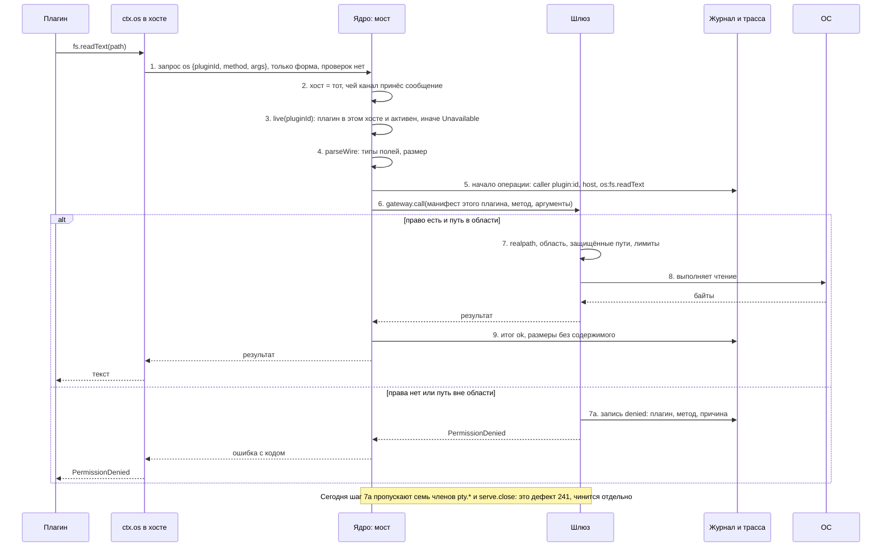

**Что здесь видно.** Решение о праве принимает ядро по **манифесту того плагина, чей канал принёс запрос**, а не по словам запроса. Клиент в хосте ничего не проверяет. Любой отказ оставляет запись `denied`. В целевом варианте этот путь **не меняется**: новые слои стоят вокруг него (процесс не может обойти его мимо канала), а не внутри, поэтому бюджет шлюза не затронут.

### 5.7. Слой «секреты и ключи»

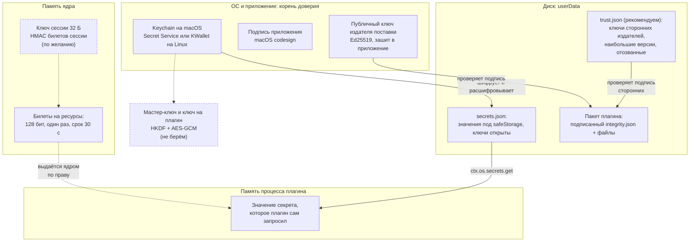

**Что здесь видно.** Сплошные стрелки - то, что рекомендуем и что уже есть. Пунктирные узлы - по желанию (ключ сессии) или не берём (ключ на плагин). Секрет в открытом виде существует только в двух местах: во время расшифровки в ядре и в памяти процесса плагина, который его запросил. На диске и в журнале его нет.

| Что | Где хранится | Кто читает | Статус |
|---|---|---|---|
| Значения секретов | `userData/secrets.json`, под `safeStorage` | ядро; плагин свои через шлюз | ✅ есть |
| Ключи секретов `<плагин>/<ключ>` | там же, открытым текстом | любой, кто читает файл | ⚠️ раскрывают, какие секреты у кого |
| Ключ шифрования | хранилище ОС (Keychain, Secret Service, KWallet) | Chromium по запросу приложения | ✅ на macOS; ⚠️ на Linux, `basic_text` не проверяется |
| Публичный ключ издателя поставки | в приложении | ядро | новое, рекомендуем (TR-12) |
| Ключи сторонних издателей, версии, отозванные | `userData/trust.json` | ядро | новое, рекомендуем (TR-11) |
| Билеты на ресурсы | память ядра | ядро; предъявитель | ✅ для терминала; шаблон для новых |
| Ключ сессии для HMAC-билетов | память ядра | ядро | по желанию, сейчас не нужен |
| Ключ на плагин (HKDF + AES-GCM) | - | - | ❌ не берём |
| Секреты в `env`, `argv` | процесс | тот же пользователь (`ps -E`, `/proc/<pid>/environ`) | ✅ правило: не передавать |

**Решение.**

1. **Хранилище остаётся на `safeStorage`**, корень доверия - ОС ([ADR-CH-0014](../04-architecture/adr/ADR-CH-0014-secrets.md)). Асинхронный API уже используется, синхронный исчезнет в Electron 46 ([safeStorage](https://www.electronjs.org/docs/latest/api/safe-storage)).
2. **На Linux проверять backend** (TR-04): при `basic_text` объявлять шифрование недоступным (`Unavailable` с понятной причиной), как уже делается без keyring; ручная проверка на Linux с `--password-store=basic`. Каков ответ `isAsyncEncryptionAvailable()` при `basic_text`, не проверено.
3. **Права файлов** `userData` (TR-05): `0600` на файлы и `0700` на каталоги, не полагаясь на umask.
4. **Не берём:** шифрование данных плагина ключом на плагин (защита от чтения файлов одним плагином у другого даёт процесс-граница и запреты ОС, не шифрование: ключ всё равно в памяти ядра), Secure Enclave и TPM2 (не защищают от процесса того же пользователя, Enclave только P-256), `mlock`, `PT_DENY_ATTACH`, Yama (нужен нативный код, не закрывают чтение окружения).
5. **Значение секрета в памяти плагина** - неизбежно: плагин, запросивший секрет, его получил. Защита - в том, что **вредоносный** плагин в своём процессе под запретами не унесёт его мимо ядра (уровень 3), и в журнале значение вычёркивается (K-29).

#### Жизненный цикл билета

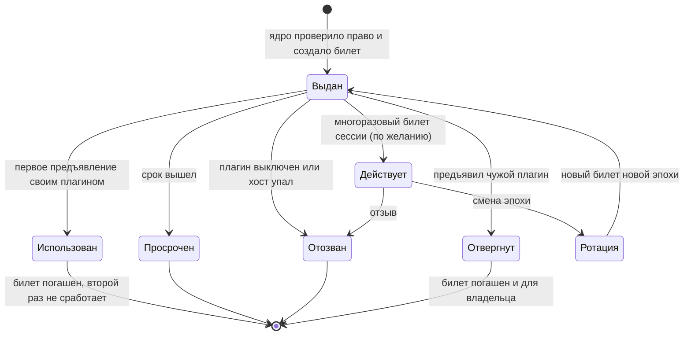

**Что здесь видно.** Билет живёт мало и погашается при первом использовании - «выдача, использование, отзыв» уже реализованы для терминала (`core/src/pty.ts:212-229`: срок 30 с, привязан к плагину, гасится даже чужим предъявлением). Ветка «Действует - Ротация» нужна только для многоразового билета сессии, которого мы сейчас **не вводим**; она показана, чтобы было ясно, как его ротировать и отзывать, если появится общий транспорт. Отзыв при падении хоста и выключении плагина закрепить тестом (**не проверено**, что все ветки отзыва покрыты).

### 5.8. Слой «виды»

**Решение: оставить как есть, закрыть тестами и одним уточнением.**

1. Origin на группу рендера, `senderFrame` на каждом IPC, мост только документам схемы `cyborg-plugin:`, CSP `default-src 'none'` - уже сделаны и под тестами; сторонний плагин всегда один в своей группе.
2. **Тест на настоящем Electron** (TR-31): сейчас идентичность вида проверяется на подставных кадрах (`electron/test/view-frames.test.ts`), в окне проверяет её только smoke. Нужен тест, где вид пробует `history.pushState` на путь соседа, чужую страницу во фрейме и вызов канала мимо моста.
3. **Уточнение:** привязывать плагина к кадру при создании и не перечитывать из текущего `frame.url` (закрывает `pushState` в общей группе). Есть ли в Electron 45 стабильный идентификатор кадра для такой привязки, **не проверено**; решение зависит от спайка.
4. Чувствительные каналы видов передавать **портом по билету**, как терминал, а не общим IPC (шаблон, не обязательная задача).

### 5.9. Что остаётся незащищённым и почему

| Остаточный риск | Почему остаётся | Как смягчаем | Принято ли |
|---|---|---|---|
| Вредоносный код в общем хосте среди встроенных (npm-зависимость, У-42) | Граница - процесс; внутри процесса плагины неразличимы, билеты не помогут ([5.2](#52-слой-канал-идентичность-и-минимум-данных)) | Проверка происхождения пакетов (вопрос 11 SRS); чувствительные встроенные плагины с `"host": "own"`; `Compartment` как слой | ⚠️ ждёт решения |
| Права `process` и `pty` дают права пользователя | Это назначение прав (У-10, У-46) | Закреплённые аргументы, `deny`, слова в окне «полный доступ через программу» | ✅ принято |
| Подмена приложения и списка ключей процессом пользователя | Корень доверия - приложение | Подпись приложения macOS; Linux - только пакетный менеджер дистрибутива | ✅ вне охвата |
| Компрометация главного процесса | После неё границ нет | Минимум зависимостей, строгий разбор входа | ✅ вне охвата |
| Процесс того же пользователя читает `/proc/<pid>/environ`, делает `ptrace` | ОС эту границу не охраняет без Yama и песочниц | Не передавать секреты в `env` и `argv`; фьюзы | ✅ вне охвата ([модель угроз, раздел 1](../04-architecture/design/threat-model.md#1-предмет-и-граница)) |
| Побеги из Node, Chromium, ядра ОС | Уязвимости ПО | Обновления | ✅ вне охвата |
| Сеть мимо шлюза до появления ограничителя ОС | Node 24 сеть не закрывает | Уровень 3; до него явная пометка человеку | ⚠️ до этапа В2 |
| Вид рисует подделку диалога ядра (У-24) | Вид владеет своим прямоугольником | Окно согласия рисует ядро | ✅ принято частично |
| Промпт-инъекция в агента (Г7) | Права агента задаёт агент | Не ослаблять режим разрешений | ✅ принято |
| Гонка проверки и использования по пути (У-05) | `O_NOFOLLOW` только на последнем компоненте | Операции от дескриптора каталога - отдельная задача | ⚠️ без задачи |

### 5.10. Пять атак: как было и что станет

Для каждой атаки: сначала диаграмма «сейчас» и «с мерами», затем таблица шагов с указанием слоя, на котором нападение останавливается. Слои: **L1** канал и таблица «хост - плагин», **L2** минимум данных и окружение, **L3** происхождение, **L4** изоляция процесса (разрешения Node, ограничитель ОС), **L5** шлюз `ctx.os`, **L6** секреты, **L7** виды.

#### Атака 1. «Плагин прикидывается соседом»

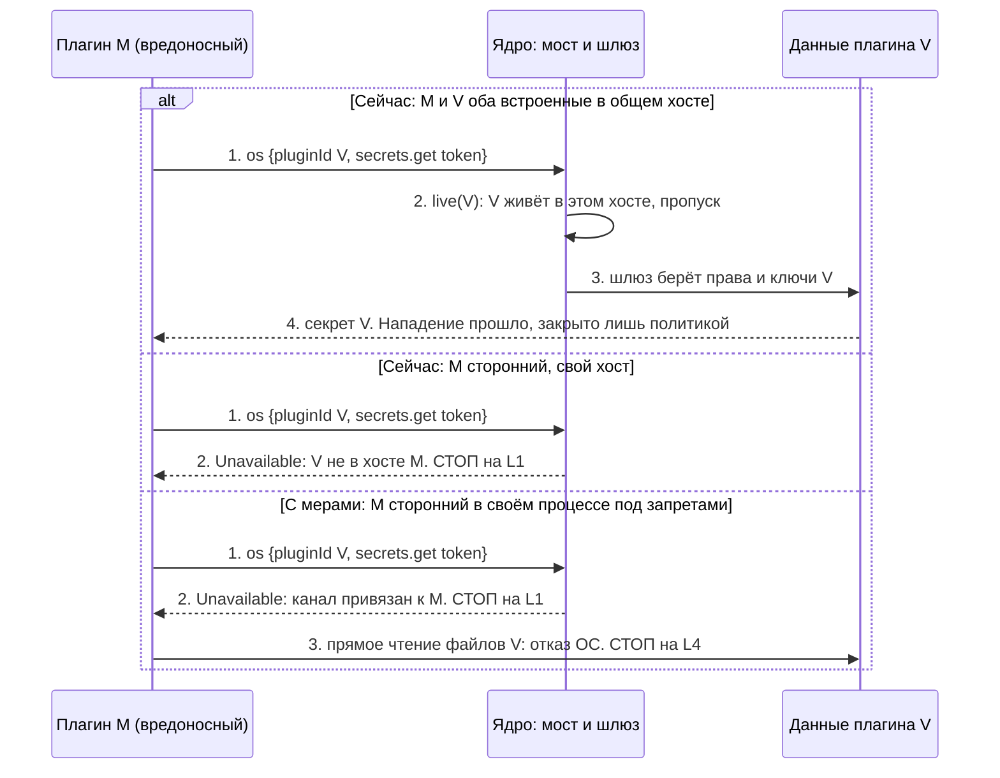

| Шаг | Сейчас | С мерами | Слой, где стоп |
|---|---|---|---|
| 1 | M шлёт `os` с чужим `pluginId` | то же | - |
| 2 | Общий хост: пропуск; свой хост: `Unavailable` (`core/src/host-bridge.ts:18-22`) | Привязка «хост - плагин» в таблице ядра, имя только сверяется; сторонний в общий хост не попадает (тест на настоящем процессе, TR-01) | **L1** |
| 3 | - | Обход канала: чтение файлов V напрямую запрещено разрешениями Node и ОС | **L4** |
| Остаток | Два **встроенных** плагина в общем хосте доверяют друг другу полностью | То же: решает политика «чувствительные встроенные в своём хосте» (вопрос 7.1.6) | не закрыто, принято |

#### Атака 2. «Плагин читает чужие данные и манифесты»

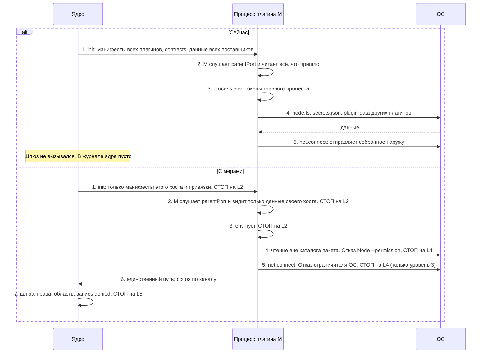

| Шаг | Сейчас (Опыт А) | С мерами | Слой |
|---|---|---|---|
| 1-2 | Видит `init` с чужими манифестами и `contracts` с чужими данными | Присылаются только данные своего хоста (TR-03) | **L2** |
| 3 | Видит `process.env` главного процесса целиком | Окружение пустое (Опыт В) | **L2** |
| 4 | Читает любой файл пользователя, включая `secrets.json` | `--permission --allow-fs-read=<каталог пакета>` и профиль ОС: `ERR_ACCESS_DENIED` / `EPERM` (Опыт Г, Д) | **L4** |
| 5 | Открывает TCP | Уровень 2: **открыто**; уровень 3: запрещено ОС (Опыт Д) | **L4** (ограничитель) |
| 6-7 | Не нужен: идёт мимо | Через канал: шлюз проверяет и пишет `denied` | **L5** |

#### Атака 3. «Подмена пакета плагина»

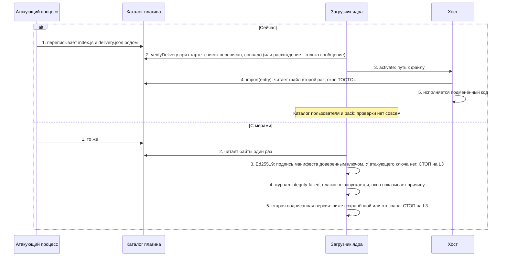

| Шаг | Сейчас | С мерами | Слой |
|---|---|---|---|
| 1 | Подмена файлов и `delivery.json` | то же (предотвратить нельзя: тот же пользователь) | - |
| 2 | Сверка один раз; список подделан вместе с файлами; сообщает, но не отказывает (`electron/src/plugins.ts:149-151`) | Байты читаются один раз | **L3** |
| 3 | - | Подпись не сходится: секретного ключа издателя у атакующего нет | **L3** |
| 4-5 | Подмена выполняется | Отказ, откат на старую версию отвергнут | **L3** |
| Остаток | Атакующий, подменивший **приложение** или список доверенных ключей, подпись обходит | Корень доверия - приложение; вне охвата ([5.9](#59-что-остаётся-незащищённым-и-почему)) | - |

#### Атака 4. Повтор (replay)

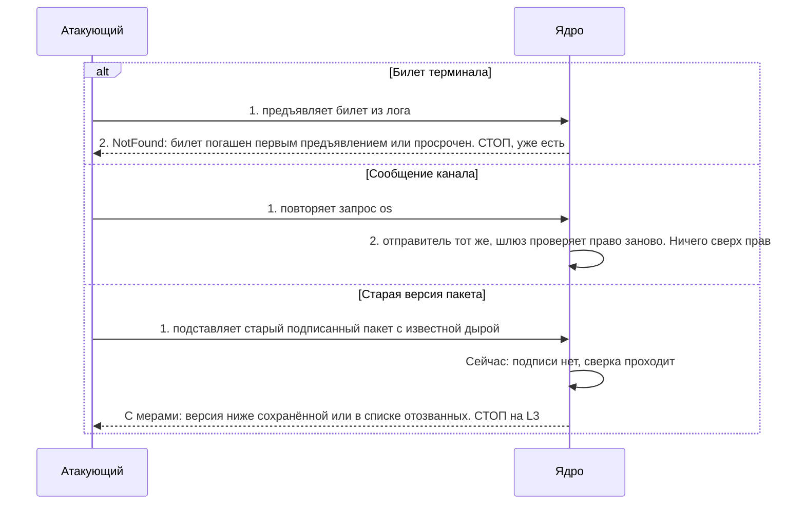

| Вариант | Сейчас | С мерами | Слой |
|---|---|---|---|
| Билет терминала | ✅ одноразовый, 30 с, привязан к плагину (`core/src/pty.ts:212-229`) | то же | L5 |
| Сообщение канала | ✅ повторять нечем: канал приватен, `id` подряд, неизвестный `res` отбрасывается | то же; nonce вводить только вместе с общим транспортом | L1 |
| Откат пакета | ❌ ничего | Наибольшая версия в `trust.json`, срок годности и список отозванных (TR-11) | **L3** |

#### Атака 5. «Вид пишет от имени хоста»

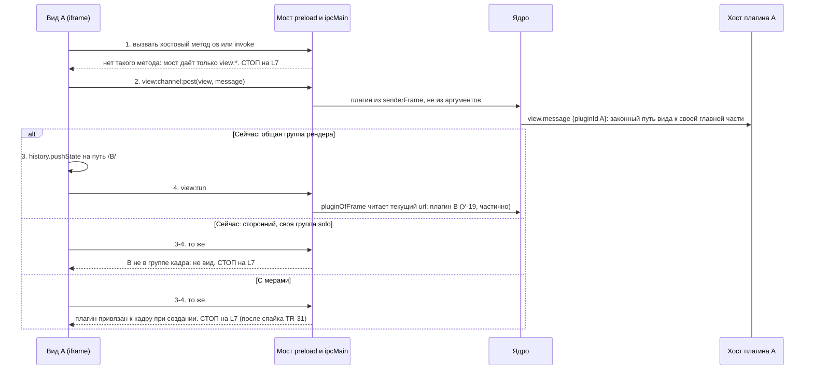

| Шаг | Сейчас | С мерами | Слой |
|---|---|---|---|
| 1 | Нет пути: мост не экспонирует методы хоста | то же | **L7** |
| 2 | Плагин из `senderFrame`, размер до 64 КиБ, имя вида сверяется с манифестом (`core/src/view-channels.ts:108-118`) | то же | L7 |
| 3-4 общая группа | `pushState` меняет путь, виды становятся соседями (`electron/src/view-frames.ts:12-21`) | Привязка к кадру при создании; чувствительные плагины в своей группе (`plugins.uiGroups` из слоя пользователя) | **L7** |
| 3-4 сторонний | Отвергается: плагин обязан состоять в группе кадра | то же; тест на настоящем Electron (TR-31) | **L7** |

### 5.11. Слои защиты

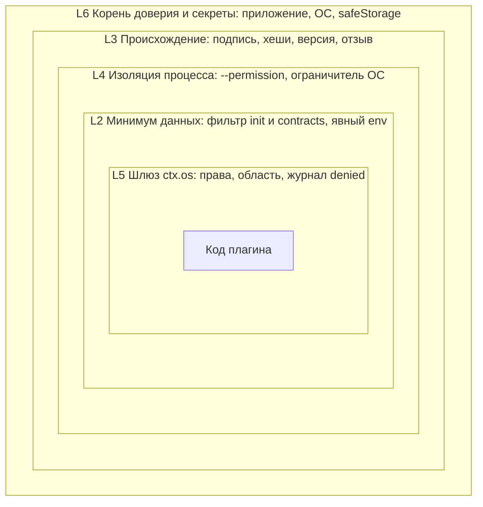

**Что здесь видно.** Код плагина в центре; чтобы навредить, ему нужно пройти слои изнутри наружу. Шлюз (L5) уже есть. Слои L2, L3, L4 - то, что предлагается. Если один слой даст сбой, остальные продолжают работать; ни один слой не заявляется как единственная граница.

**Матрица «угроза × слой».** ✅ слой закрывает угрозу; ⚠️ закрывает частично или при условии; ❌ не закрывает; «-» не относится. Колонка «сейчас» показывает состояние до плана.

| Угроза | Сейчас | L1 канал | L2 данные | L3 подпись | L4 процесс | L5 шлюз | L6 секреты | L7 виды |
|---|---|---|---|---|---|---|---|---|
| Подмена плагина из другого хоста | ✅ | ✅ | - | - | - | - | - | - |
| Подмена плагина в общем хосте | ⚠️ политикой | ⚠️ | - | - | ✅ (свой процесс) | - | - | - |
| Подмена хоста чужим процессом | ⚠️ | ✅ | - | - | ⚠️ (канал в потомке) | - | - | - |
| Подмена вида | ⚠️ | - | - | - | - | - | - | ✅ / ⚠️ общая группа |
| Чтение чужих манифестов и данных контрактов | ❌ | - | ✅ | - | ⚠️ | - | - | - |
| Чтение чужих файлов мимо шлюза | ❌ | - | - | - | ✅ | - | - | - |
| Чтение окружения главного процесса | ❌ | - | ✅ | - | ✅ | - | ⚠️ | - |
| Обход шлюза: процессы | ❌ | - | - | - | ✅ | ✅ | - | - |
| Обход шлюза: сеть | ❌ | - | - | - | ⚠️ только уровень 3 | ✅ | - | - |
| Подмена пакета плагина | ❌ | - | - | ✅ (обнаружение) | - | - | - | - |
| Откат на старую версию | ❌ | - | - | ✅ | - | - | - | - |
| Повтор сообщения канала | ✅ | ✅ | - | - | - | ✅ | - | - |
| Повтор билета | ✅ | - | - | - | - | ✅ | - | - |
| Секрет в покое (файл) | ⚠️ | - | - | - | ⚠️ | - | ✅ (+backend) | - |
| Секрет в журнале | ⚠️ | - | - | - | - | ✅ | ✅ | - |
| Вредный npm-пакет во встроенном плагине | ❌ | - | - | ⚠️ происхождение | ⚠️ если плагин в своём процессе | - | - | - |
| Побег из ядра ОС или Node | ❌ | - | - | - | ❌ | - | - | - |
| Компрометация ядра | ❌ | - | - | - | - | - | - | - |

### 5.12. Отвергнутые альтернативы

| Альтернатива | Почему отвергнута | Когда пересмотреть |
|---|---|---|
| HMAC или AEAD на каналах ядро-хост | Канал приватен; не отделяет плагины внутри процесса; не закрывает ни одной угрозы таблицы 2.9; +70 мкс на сообщение в наивной обвязке (Опыт) | Появится канал по пути в ФС или сеть |
| `SO_PEERCRED` и `LOCAL_PEERTOKEN` на хостах | У каналов хостов нет посторонних концов; нужен нативный код; все плагины одного пользователя с одним uid | Появится сокет с путём |
| mTLS, Noise, SPIFFE | Высокая сложность и риск самописной криптографии при нуле выгоды на локальном канале | Хосты за границей машины |
| Билет идентичности плагина в общем хосте | Секрет в памяти процесса виден соседу | Никогда как граница; допустим как «ремень» против ошибок |
| Macaroons, Biscuit | Нет делегирования между процессами, ядро единственный посредник | Появится передача прав между процессами |
| Sigstore как проверка в ядре | Нужны X.509, Rekor, TUF-корень: сторонние библиотеки; ядро без зависимостей | Ядро получит зависимости или проверку вынесут во внешний шаг установки |
| `--permission` в `utilityProcess` | Опыт Б: не действует | Если Electron реализует (проверять каждый релиз canary-тестом) |
| App Sandbox для приложения | Меняет модель доступа к `ctx.os` целиком | Нет |
| Firejail, AppArmor, SELinux | SUID-утилита, политики администратора | Нет |
| WASM-компоненты, хост как рендерер без Node | Меняют формат плагина; ломают принцип "переход меняет среду, а не код" | Если сторонние плагины станут продуктовой целью |
| Шифрование данных ключом на плагин | Ключ в памяти ядра; защиту от чтения чужих файлов даёт процесс, не шифрование | Если файлы плагинов будут храниться вне `userData` |
| Secure Enclave, TPM2, `mlock`, `PT_DENY_ATTACH` | Не защищают от процесса того же пользователя; нативный код; Enclave только P-256 | Нет |
| `node:vm` как граница | Не механизм безопасности ([vm](https://nodejs.org/docs/latest-v24.x/api/vm.html)) | Нет |
| Подпись в манифесте плагина | Автор пишет в манифест что угодно | Нет |

### 5.13. Что делается на stdlib, а что требует вспомогательного бинарника

| Мера | Только Node/Electron | Требует бинарника или аддона | Цена |
|---|---|---|---|
| Явный `env` хоста | ✅ | - | S |
| Фильтрация `init` и `contracts` | ✅ | - | M |
| Проверка backend `safeStorage` | ✅ | - | S |
| Права файлов `userData` | ✅ | - | S |
| Подпись Ed25519, хеши, версия, отзыв | ✅ `node:crypto` | - | M-L |
| Билеты на ресурсы | ✅ | - | S |
| Тесты на настоящем `utilityProcess` | ✅ | - | M |
| Процесс Node с `--permission` и пустым `env` | ✅ (при `RunAsNode` или отдельном `node`) | отдельный `node` - 122 МБ (опыт на этой машине) | L |
| Canary-проверка эффективности запретов | ✅ | - | S |
| Seatbelt на macOS | ⚠️ через `sandbox-exec` (устарела) | помощник с `sandbox_init` для устойчивости | M |
| Landlock и seccomp на Linux | - | ✅ маленький запускатель на C или Rust | L |
| `SO_PEERCRED`, `LOCAL_PEERTOKEN`, `mlock`, `PT_DENY_ATTACH` | - | ✅ аддон или `node:ffi` (Node 26.1+, в Electron 45 нет) | не берём |
| Проверка Sigstore | - | ✅ библиотека | не берём |

## 6. План работы

Номера задач `TR-NN` - рабочие заготовки этого документа; настоящие номера выдаст трекер. Размеры: **S** - 1-3 рабочих дня, **M** - 4-8, **L** - 10-20 одного разработчика (оценка составителя, не измерение). Столбец «API» отвечает на вопрос: меняется ли публичная форма (`contracts/`, `PluginContext`, манифест, публичные типы пакета ядра); если да, это кандидат следующего `1.0.0-rc.N` с записью в [`contracts/CHANGELOG.md`](../../contracts/CHANGELOG.md).

### 6.1. Этапы

| Этап | Название | Условие начала | Что даёт | Уровень ([3.3](#33-уровни-защиты)) |
|---|---|---|---|---|
| **А** | Честный минимум | Можно сразу: меры дешёвые, на stdlib, поведение плагинов не меняют | Находки 3 и 6 и окружение хоста (часть находки 1) из [раздела 0](#0-коротко-на-одну-страницу); тесты на настоящем процессе | 1 |
| **Б** | Происхождение | Можно параллельно с А; обязателен до установки сторонних плагинов | Подписанные пакеты, откат и отзыв; находка 5 | 1-2 |
| **В** | Изоляция доступа | Повод этапа 2 (плагин от автора вне команды или каталог плагинов); спайк TR-20 можно сделать раньше | Процесс Node на сторонний плагин, ограничитель ОС; находки 1 и 2 (для сторонних плагинов) | 2-3 |

### 6.2. Задачи

#### Этап А. Честный минимум

| ID | Суть | Зависит от | Критерии приёмки | Размер | API | Пакеты |
|---|---|---|---|---|---|---|
| **TR-01** | Тесты-подделки на **настоящем** `utilityProcess`: плагин-нарушитель в хосте стороннего плагина | - | 1. Скрипт по образцу `playground/scripts/spike-hosts.mjs` и smoke запускает настоящий хост (Linux через `xvfb-run`).<br/>2. Нарушитель читает `process.parentPort`, `process.env`, файл «ядра», запускает процесс, открывает TCP; результаты сравниваются с таблицей [2.8](#28-что-показал-опыт-код-плагина-в-utilityprocess).<br/>3. Известные дыры записаны как «ожидаемо открыто» со ссылкой на TR-21/22; после соответствующей задачи ожидание переворачивается.<br/>4. Тест «сторонний не делит хост с чужим» идёт на настоящих процессах.<br/>5. Включён в CI на macOS и Linux | M | нет | `playground`, `electron`, `core` (тесты) |
| **TR-02** | Явный `env` хоста плагинов | - | 1. `utilityProcess.fork(..., { env })` с перечнем переменных (стартовый список - `PATH`, минимум для Electron; расширять по доказательствам).<br/>2. Нарушитель из TR-01 не видит переменных, которых нет в перечне.<br/>3. Smoke зелёный на macOS и Linux.<br/>4. Список задокументирован в `electron/README.md` | S | нет | `electron` |
| **TR-03** | Фильтрация `init` и `contracts` по хостам | - | 1. `init` хосту содержит манифесты плагинов этого хоста и тех, с кем у них есть привязки графа (`requires`, `optional`, `consumes`).<br/>2. `contracts` уходит только в хосты, где объявлен потребитель этого контракта; при `enable`/`disable` и перезапуске хоста зеркала актуальны.<br/>3. Тест-запись канала в подставном хосте (`trust.test.ts`) подтверждает, что чужих манифестов и данных нет; существующие тесты `hosts.test.ts`, `loader.test.ts`, `stress-restart.test.ts` зелёные.<br/>4. `npm run spike:hosts`: круг и перезапуск не хуже на 5% | M | нет (внутренний протокол; `core/test/api-snapshot` не меняется) | `core` |
| **TR-04** | Проверка backend секретов на Linux | - | 1. При `getSelectedStorageBackend() === 'basic_text'` хранилище недоступно (`Unavailable`) с причиной словами человека, запись в журнале; на macOS поведение прежнее.<br/>2. Ручная проверка на Linux с `--password-store=basic` и с рабочим keyring (результат в `docs/05-verification/`).<br/>3. Обновлён [ADR-CH-0014](../04-architecture/adr/ADR-CH-0014-secrets.md), п. 1 | S | нет | `electron` |
| **TR-05** | Права файлов `userData` | - | `cyborg.json`, `state`, `diagnostics/*` создаются `0600`, каталоги `0700` независимо от umask; тест с `umask 022` | S | нет | `core`, `electron` |
| **TR-06** | Загрузчик вызывает проверку импортов для сторонних плагинов как **предупреждение** | - | Для плагина вне поставки перед активацией `checkPlugin`; найденное пишется в журнал; плагин не блокируется (это дисциплина, не защита). Закрывает «Расхождения» [ADR-CH-0003](../04-architecture/adr/ADR-CH-0003-trust-and-isolation.md) п. 6 | S | возможно: новый вид записи журнала (см. TR-11) | `core` |
| **TR-07** | Чек-лист фьюзов и сборки для приложения-потребителя | вопрос 2 (по `RunAsNode`) | `electron/README.md`: `EnableNodeCliInspectArguments` выкл., `EnableNodeOptionsEnvironmentVariable` выкл., ASAR integrity (macOS), решение по `RunAsNode`; проверка в smoke упакованного приложения ([`bundled-delivery.md`](../05-verification/bundled-delivery.md)) | S | нет | `electron`, `playground` |

#### Этап Б. Происхождение

| ID | Суть | Зависит от | Критерии приёмки | Размер | API | Пакеты |
|---|---|---|---|---|---|---|
| **TR-10** | Формат подписанного пакета и команды `cyborg-plugin sign` и `verify` | вопрос 4 | 1. `integrity.json`: `id`, версия, sha256 файлов, срок, идентификатор ключа; подпись Ed25519 над канонической записью.<br/>2. `verify` отказывает при любом изменённом байте, лишнем файле, чужом ключе, истёкшем сроке.<br/>3. `pack` воспроизводим и кладёт `integrity.json`.<br/>4. Только `node:crypto` | M | нет для `contracts/`; команды `cyborg-plugin` (инструмент, не `PluginContext`) | `tools/cyborg-plugin`, `core` |
| **TR-11** | Хранилище доверия и проверка перед запуском | TR-10 | 1. `userData/trust.json` из слоя пользователя: ключи издателей, наибольшие версии, список отозванных со сроком.<br/>2. Загрузчик читает байты один раз, проверяет, исполняет проверенную копию.<br/>3. Подмена файла, откат версии, отозванный ключ - плагин не запущен, запись `integrity-failed` и причина в окне.<br/>4. Режимы «предупреждать» и «отказывать» (поставка начинает с первого).<br/>5. Способ загрузки из проверенных байтов выбран и проверен на macOS и Linux | L | возможно: новые виды `JournalEntry`, публичный тип пакета ядра (`core/src/index.ts:36`); входит ли он в снимок API, не проверено; если входит - кандидат `rc.N` | `core`, `electron` |
| **TR-12** | Подпись `delivery.json` поставки | TR-10 | Ключ выпуска; `verifyDelivery` проверяет подпись; расхождение пишется в журнал; режим отказа включается отдельным решением после пилотов | S | нет | `core`, `tools/cyborg-plugin` |
| **TR-13** | Происхождение выпусков наших пакетов | - | `npm publish --provenance` в workflow выпуска, проверка `npm audit signatures` на потребителе (условие: облачные раннеры, см. [npm](https://docs.npmjs.com/generating-provenance-statements)) | S | нет | CI |
| **TR-14** | Мера против У-42: перечень пакетов бандла и версий в отчёте сборки | вопрос 11 SRS | Перечень в выводе `cyborg-plugin build`; `npm audit --omit=dev` уже есть в CI (задание `audit`) | S | нет | `tools/cyborg-plugin` |

#### Этап В. Изоляция доступа (по поводу этапа 2)

| ID | Суть | Зависит от | Критерии приёмки | Размер | API | Пакеты |
|---|---|---|---|---|---|---|
| **TR-20** | **Спайк:** хост как процесс Node (`forkHosts`) с `--permission` и пустым `env` | - (можно сейчас) | 1. Замер на macOS и Linux: RTT, p99 вызова, память, старт против `utilityProcess` (`spike-hosts`).<br/>2. Работает ли весь протокол ядра (структурное клонирование, пинг сторожа).<br/>3. `RunAsNode` против отдельного бинарника: размер, подпись, поведение фьюза.<br/>4. Способ загрузки проверенных байтов.<br/>5. Отчёт в `docs/05-verification/` с вердиктом по бюджетам | M | нет | `core`, `playground` |
| **TR-21** | Сторонний плагин как процесс Node | TR-20, TR-03, TR-11 | 1. `spawnHost` выбирает способ запуска по происхождению плагина; пустой `env`; `--permission` с чтением только проверенного каталога; без `--allow-child-process`, `--allow-worker`, `--allow-addons`.<br/>2. Canary: хост проверяет `process.permission` и запрещённое действие, ядро не активирует плагин при провале, запись `sandbox-ineffective`.<br/>3. Нарушитель из TR-01: чтение, процесс, воркер, аддон дают отказ (FR-CH-3022, часть); сеть - записана как открытая.<br/>4. Бюджеты шлюза соблюдены (`npm run check:budgets`).<br/>5. Возврат на `utilityProcess` одной настройкой | L | нет для плагина; возможны новые виды записей журнала (см. TR-11) | `core`, `electron` |
| **TR-22a** | Ограничитель ОС для macOS | TR-21 | Профиль Seatbelt (`deny network*`, `deny process-fork`, чтение вне каталога) за интерфейсом запуска; canary подтверждает; нарушитель не открывает сокет и не читает вне каталога; решение по `sandbox-exec` против помощника | M | нет | `electron` |
| **TR-22b** | Ограничитель ОС для Linux | TR-21 | Запускатель накладывает `no_new_privs`, Landlock (по версии ABI ядра) и seccomp; на ядрах без нужного ABI - честная пометка уровня; CI на двух версиях ядра (до и после 6.7); проверка на Ubuntu 24.04 | L | нет | `electron`, новый бинарник |
| **TR-23** | Окно согласия и установка | TR-10, TR-11 | Существующие задачи этапа 2 (X-03, X-04 из [sad2-disputed-points](../04-architecture/design/sad2-disputed-points.md), FR-CH-3023, FR-CH-3024); здесь только зависимость | L | да (окно, манифест установки): кандидаты `rc.N` по решению владельца | `core`, `electron` |
| **TR-24** | Уровень изоляции плагина в «Плагины Cyborg» и журнале | TR-21 | Человек видит уровень (0-3) и причину; сеть без ограничителя названа словами (FR-CH-3021) | S | возможно: поле в публичном описании состояния плагина - тогда кандидат `rc.N` (не проверено, какой публичный тип его несёт) | `core`, `electron` |
| **TR-25** | Пути конфигурации агента (У-46, вопрос 15 SRS) | решение владельца | Вариант (а): защищённые пути `~/.claude/settings.json`, `.mcp.json`, `CLAUDE.md` и т. п.; тесты шлюза; закрывает У-46 | S-M | поведение, не форма | `core` |
| **TR-31** | Тест видов на настоящем Electron и привязка плагина к кадру | - | 1. Вид пробует `history.pushState` на путь соседа, чужую страницу во фрейме, обход моста: результаты зафиксированы.<br/>2. Если в Electron 45 есть стабильный идентификатор кадра, плагин привязывается при создании кадра; иначе запись в «не проверено» | M | нет | `electron` |

**Влияние на публичный API: итог.** Рекомендованные задачи не меняют форму `ctx`, `ctx.os`, манифеста и контрактов. Кандидатов `rc.N` может быть два, оба условные: новые виды записей журнала (TR-06, TR-11, TR-21) и поле уровня изоляции в публичном описании состояния (TR-24). Окно согласия и установка (TR-23) - отдельное решение владельца. Менять `ctx.os.paths.home` не предлагаем: домашний каталог и так известен коду Node.

### 6.3. Связь с открытыми задачами и угрозами

| Что | Связь | Что делает этот план |
|---|---|---|
| **#241** (7 членов `ctx.os` без `PermissionDenied`) | Нарушает NFR-CH-3001; сам по себе обхода не даёт | Не входит; исправить **до или вместе с TR-01**, иначе тест «каждый отказ пишется» останется с исключением ST-3001/1 |
| **У-04** обход шлюза через `node:*` | Главная дыра | Закрывается TR-21 (файлы, процессы) и TR-22 (сеть); до них честная пометка |
| **У-42** вредный код в npm-зависимостях | Открыто | TR-14 (перечень пакетов) и вопрос 6 (чувствительные встроенные в своих хостах); код во встроенном общем хосте не изолируется |
| **У-46** запись в конфигурацию агента | Открыто до этапа 2, задачи нет | TR-25 после решения владельца (вопрос 15 SRS) |
| **У-39** обновление расширяет права | Вне этапа 1 | TR-10/11 дают подпись, версию и откат; повторное согласие - TR-23 |
| **У-19** DOM соседей в группе рендера | Частично | TR-31 |

### 6.4. Диаграммы плана

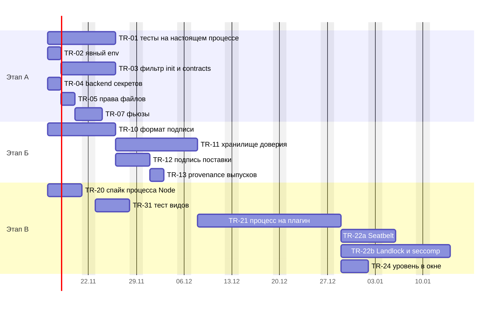

**Что здесь видно.** Этапы А и Б и спайк TR-20 стартуют одновременно и не мешают друг другу. Самая длинная цепочка - подпись (TR-10, TR-11), затем процесс на плагин (TR-21), затем два ограничителя ОС, которые идут параллельно. Даты условные: ось показывает порядок и относительную длину, а не обещание; этап В включается решением владельца по поводу.

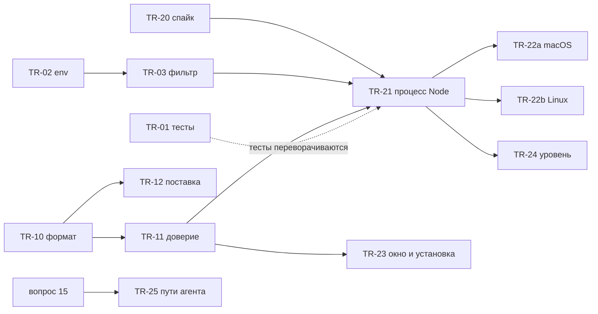

### 6.5. Порядок и параллельность

| Волна | Что | Можно параллельно | Блокирует |
|---|---|---|---|
| 0 | #241 (вне плана) | с чем угодно | чистоту TR-01 |
| 1 | TR-01, TR-02, TR-04, TR-05, TR-10, TR-20 | Да, все независимы; TR-01 и TR-02 лучше вести одним человеком | - |
| 2 | TR-03, TR-07, TR-11, TR-12, TR-31 | Да | TR-21 ждёт TR-03, TR-11, TR-20 |
| 3 | TR-21 | - | TR-22a, TR-22b, TR-24 |
| 4 | TR-22a, TR-22b, TR-24, TR-23, TR-25 | Да | выпуск сторонних плагинов |

Оценка длительности (рабочие дни одного разработчика): этап А около 19 дней, этап Б около 21, этап В около 42 (без TR-23). При двух исполнителях этапы А и Б идут параллельно, этап В зависит от них. Оценки составителя; TR-20 уточнит TR-21 и TR-22.

### 6.6. Как проверять

1. **Тесты на настоящем процессе.** Не подделка сообщений в одном процессе (`inlineHosts`), а запуск настоящего `utilityProcess` или процесса Node и «вредоносного» плагина внутри: он делает всё из таблицы [2.8](#28-что-показал-опыт-код-плагина-в-utilityprocess) и записывает результат. После каждой задачи этапа А/В соответствующая строка из ❌ становится ✅ и тест закрепляет это. Образец - опыт приложения Б.
2. **Canary на каждый релиз Electron и Node.** Тест «`--permission` действует в запущенном хосте»: ловит регрессии вроде «принято, но не работает» при обновлении Electron.
3. **Замеры против бюджетов шлюза.** До и после TR-02, TR-03, TR-21: `npm run spike:gateway`, `npm run spike:hosts`, `npm run check:budgets` (медиана p99 цены вызова ≤ 1 мс до 64 КиБ; Linux блокирующий, macOS справочный: [`playground/budgets.json`](../../playground/budgets.json)). Дополнительно RTT канала и старт хоста.
4. **Ручные проверки на Linux** (мы там ничего не запускали): `safeStorage` с keyring и с `--password-store=basic`; поведение явного `env` с Wayland и X11; Ubuntu 24.04 (ограничение userns) и ядро до и после 6.7 для Landlock; результат каждой проверки - строка в `docs/05-verification/`.
5. **Негативные тесты подписи:** изменённый байт, лишний файл, чужой ключ, истёкший срок, версия ниже сохранённой, отозванный ключ.
6. **Матрица приёмки.** Новые критерии получают ключи `ST-NNNN/k` в именах тестов; `npm run check:acceptance`.

### 6.7. Риски и откат

| Риск | Вероятность / влияние | Мера | Откат |
|---|---|---|---|
| Процесс Node медленнее `utilityProcess` на нашем протоколе | средняя / среднее | Спайк TR-20 до решения; встроенные остаются на `utilityProcess` | Режим запуска стороннего хоста возвращается на `utilityProcess` одной настройкой |
| Фильтр `init` скрывает нужное: плагин не видит контракт после `enable` | средняя / высокое | Тесты на включение и выключение во время работы, перезапуск хоста; сначала только `contracts`, потом `init` | Откат коммита TR-03: протокол внутренний |
| Явный `env` ломает хост на Linux (нет переменных, нужных Chromium) | средняя / среднее | Начинать с минимума и расширять по доказательствам; проверка на Linux | Откат TR-02 |
| `sandbox-exec` исчезнет из macOS | низкая / среднее | Интерфейс запуска, canary, запасной помощник | Уровень 2 с пометкой |
| Landlock недоступен на ядре пользователя | высокая на старых ядрах / среднее | Проба ABI при запуске, честная пометка уровня | Уровень 2 |
| Ubuntu 24.04 запрещает userns | высокая / низкое | Не опираться на userns | - |
| Подпись «окирпичивает» приложение (потерян ключ, ошибка) | низкая / высокое | Режим «предупреждать» на пилотах; запасной офлайн-ключ; процедура ротации | Выключить проверку флагом человека |
| `--permission` меняет поведение между версиями Node | средняя / среднее | Canary на каждый релиз (6.6, п. 2) | Остановить обновление |
| Увлечение: строим уровень 3 без повода | средняя / среднее | Привязка к поводу этапа 2; этап А и Б ценны сами по себе | Остановиться на уровне 1-2 |
| Фьюз `RunAsNode` и подпись приложения | высокая, если используем / среднее | Вопрос 2; отдельный бинарник Node | - |

### 6.8. Какие документы править при принятии

| Документ | Что менять |
|---|---|
| [SAD](../04-architecture/design/sad.md) 3.5 | Состав `init`/`contracts` по хостам; явный `env`; процесс Node для сторонних |
| SAD 3.7 | Подраздел про происхождение; backend секретов; уровни изоляции для человека |
| SAD 3.8 | Привязка плагина к кадру, тест видов |
| SAD 6.1, 6.2, 8 (вопросы 8, 17), 9 (риски) | Уровни, подпись, ограничитель ОС; снять «`utilityProcess` не применяет `--permission`» из рисков или переписать |
| Новый ADR-CH-0017 | Происхождение плагинов и изоляция процесса: подпись, доверие, процесс Node, ограничитель ОС, отвергнутое из [5.12](#512-отвергнутые-альтернативы). Номер из счётчика `docs/.req_counter/ADR` (сейчас 0016) |
| [ADR-CH-0003](../04-architecture/adr/ADR-CH-0003-trust-and-isolation.md) п. 9, «Расхождения» | Ссылка на ADR-CH-0017; уточнение про `forkHosts` |
| [ADR-CH-0014](../04-architecture/adr/ADR-CH-0014-secrets.md) п. 1 | Отказ при `basic_text` |
| [Модель угроз](../04-architecture/design/threat-model.md) | У-04, У-39, У-42, У-46, У-19; новые строки: чтение рассылок хоста, наследование окружения, откат пакета |
| [SRS 03](../03-requirements/03-security-trust/srs.md) | FR-CH-3022, 3023, 3024; новые нормы для минимума данных и проверки эффективности запретов; вопросы 10, 11, 15; таблица единиц |
| [Дорожная карта, раздел 14](../06-plans/roadmap.md#14-этап-2-изоляция-доступа-по-поводу) | Задачи TR-NN вместо общих строк |
| [`acceptance.md`](../05-verification/acceptance.md), [`test-plan.md`](../05-verification/test-plan.md) | Ключи новых критериев |
| `electron/README.md` | Чек-лист фьюзов и явный `env` |
| [Справочник прав](../guide/reference/permissions.md) | Слова об уровне изоляции и сети |

## 7. Открытые вопросы и непроверенное

### 7.1. Вопросы владельцу

| # | Вопрос | Рекомендация | Что зависит |
|---|---|---|---|
| 1 | Принять ли этап А (TR-01..TR-07) сейчас, не дожидаясь повода для этапа 2? | **Да.** Дёшево, закрывает проверенные дыры, API не меняется | Старт работ |
| 2 | Как запускать процесс стороннего плагина: сборка Electron с включённым `RunAsNode` или отдельный бинарник Node (около 122 МБ у нас на машине)? | Начать спайк (TR-20) на `RunAsNode`; для выпуска с внешними плагинами решить по замеру и подписи; склоняюсь к отдельному бинарнику, если размер приемлем | TR-07, TR-20, TR-21 |
| 3 | Брать ли ограничитель ОС (Seatbelt, Landlock, seccomp) или остаться на `--permission` с честной пометкой? | **Брать** для сторонних плагинов: без него сеть мимо шлюза открыта, и право `net` ничего не гарантирует. Для первой версии допустима пометка «уровень 2» | TR-22a/b |
| 4 | Корень доверия подписи: кто держит приватный ключ выпуска, как ротируется, нужен ли запасной? | Один ключ выпуска + запасной офлайн; ключ в приложении; ключи сторонних - в слое пользователя | TR-10..12 |
| 5 | Подписывать ли поставку встроенных плагинов (`delivery.json`) и когда переводить из «предупреждать» в «отказывать»? | Подписывать; отказ включить после пилотов | TR-12 |
| 6 | Какие встроенные плагины вынести в свои хосты (`"host": "own"`) из-за У-42? | `sessions`, `pin-lock` (держат `pty`, `security.roots`, `ui.lock`); решить после замера памяти (около 34 МБ PSS на хост по SAD) | Остаточный риск |
| 7 | Вопрос 15 SRS: пути конфигурации агента - защищённые (а) или слово в окне (б)? | **(а)** защищённые пути | TR-25, У-46 |
| 8 | Формат установки сторонних плагинов (SAD вопрос 8, SRS вопрос 10): источник и подпись | Файл или каталог + подписанный `integrity.json`; git-источник позже | TR-23 |
| 9 | Что считать поводом этапа 2? | Первый внешний автор; но TR-20 и этапы А, Б не ждут повода | Начало этапа В |
| 10 | Что делать, если проверка запретов (canary) провалилась? | Для сторонних - не запускать; для встроенных - предупредить | TR-21 |
| 11 | Предупреждать ли человека, что сеть не ограничена, пока нет уровня 3? | **Да**, словами в окне и журнале (FR-CH-3021) | TR-24 |
| 12 | Мера против У-42 (SRS вопрос 11): перечень пакетов + `npm audit` | Принять предложение | TR-14 |
| 13 | Нужно ли шифровать данные плагинов ключом на плагин? | Нет ([5.7](#57-слой-секреты-и-ключи)) | - |
| 14 | Нужен ли `npm publish --provenance` для наших пакетов? | Да, если выпуск идёт на облачных раннерах | TR-13 |
| 15 | Подтвердить, что Windows вне v1 и для этого исследования | Да (D-00, строка 7) | Охват |

### 7.2. Что не проверено

1. **Всё на Linux.** Опыты А-Д выполнены на macOS 27.2; поведение `utilityProcess`, `--permission`, явного `env`, `safeStorage`, `socketpair`, Landlock, seccomp, bubblewrap на Linux не запускалось. Числа задержек - только macOS arm64.
2. Что возвращает `safeStorage.isAsyncEncryptionAvailable()` при `basic_text` на Linux.
3. Причина, по которой `--permission` не включается в `utilityProcess` (Electron 45.2.3); поведение в других релизах Electron. Документация Electron об этом молчит (поиск не дал ответа).
4. Гарантии Electron об отправителе сообщений `parentPort`: в документации нет ([утилитарный процесс](https://www.electronjs.org/docs/latest/api/utility-process)); наш вывод - из устройства Mojo.
5. Задержка всего протокола ядра по каналу `ipc` процесса Node против `parentPort`: измерен только сырой `socketpair` с самописным кадрированием (17 мкс против 50 мкс у `parentPort`), канал `fork` с `ipc` не измерялся.
6. Загрузка плагина из проверенных байтов (не повторным открытием пути): способ, совместимость с бандлом из одного файла, поведение в процессе под `--permission`.
7. Стабильный идентификатор кадра в Electron 45 для привязки плагина вида.
8. Как Electron обрабатывает site isolation для пользовательской схемы `cyborg-plugin`.
9. Работа `sandbox-exec` на других версиях macOS; публичная замена `sandbox_init` (Apple документации SBPL не публикует: [Chromium](https://chromium.googlesource.com/chromium/src/+/main/sandbox/mac/seatbelt_sandbox_design.md)).
10. Текст страницы App Sandbox и описание XPC на сайте Apple получить не удалось; сведения об App Sandbox взяты из общих знаний и помечены выводом.
11. AppArmor, SELinux, cgroups, in-toto, seL4, iOS, реализации Noise и Sigstore для Node, `externally_connectable`, статья Capsicum (USENIX 2010) - не исследовались.
12. Влияние `Ubuntu 24.04` ограничения userns на `chrome-sandbox` приложения Electron: документа Electron не нашли.
13. Влияние Landlock, seccomp на задержку работающего процесса не измерялось.
14. Покрытие всех веток отзыва билета тестами (выключение плагина, падение хоста, удаление).
15. Права `cyborg.json`, `state`, `diagnostics` (берутся из umask): код не читался построчно.
16. Всё, что относится к Electron 46+ и Node 26 (ожидается, что `--allow-net` в Node 26 закроет сеть, но в Electron 45 с Node 24.22 его нет: [permissions](https://nodejs.org/docs/latest/api/permissions.html)).

## 8. Источники

Доступ ко всем внешним ссылкам: 2026-11-13. Внутренние ссылки на код и документы даны по тексту.

**Операционные системы**
- unix(7): https://man7.org/linux/man-pages/man7/unix.7.html
- seccomp(2): https://man7.org/linux/man-pages/man2/seccomp.2.html
- landlock(7): https://man7.org/linux/man-pages/man7/landlock.7.html, ядро: https://docs.kernel.org/userspace-api/landlock.html
- user_namespaces(7): https://man7.org/linux/man-pages/man7/user_namespaces.7.html; Ubuntu: https://ubuntu.com/blog/ubuntu-23-10-restricted-unprivileged-user-namespaces
- ptrace(2): https://man7.org/linux/man-pages/man2/ptrace.2.html; Yama: https://www.kernel.org/doc/html/latest/admin-guide/LSM/Yama.html; mlock(2): https://man7.org/linux/man-pages/man2/mlock.2.html
- fs-verity: https://docs.kernel.org/filesystems/fsverity.html
- bubblewrap: https://github.com/containers/bubblewrap; Firejail: https://raw.githubusercontent.com/netblue30/firejail/master/README.md
- SO_PEERPIDFD (LPC 2024): https://lpc.events/event/18/contributions/1691/attachments/1499/3166/-LPC-2024-%20PID%20FDs-%20where%20we%20were,%20where%20we%20are%20and%20were%20we%20would%20like%20to%20go.pdf
- XNU `un.h`: https://github.com/apple-oss-distributions/xnu/blob/main/bsd/sys/un.h
- Apple DTS о `LOCAL_PEERTOKEN`: https://developer.apple.com/forums/thread/850777
- XPC: https://developer.apple.com/tutorials/data/documentation/xpc/xpc_connection_set_peer_code_signing_requirement(_:_:).json
- Hardened Runtime: https://developer.apple.com/tutorials/data/documentation/security/hardened-runtime.json; нотаризация: https://developer.apple.com/tutorials/data/documentation/security/notarizing-macos-software-before-distribution.json
- Keychain: https://developer.apple.com/tutorials/data/documentation/security/sharing-access-to-keychain-items-among-a-collection-of-apps.json; Secure Enclave: https://developer.apple.com/tutorials/data/documentation/security/protecting-keys-with-the-secure-enclave.json
- sandbox-exec(1): https://keith.github.io/xcode-man-pages/sandbox-exec.1.html; ptrace(2) macOS: https://keith.github.io/xcode-man-pages/ptrace.2.html
- systemd-creds: https://www.freedesktop.org/software/systemd/man/latest/systemd-creds.html
- Секреты Linux: https://wiki.gnome.org/Projects/GnomeKeyring/SecurityPhilosophy, https://flatpak.github.io/xdg-desktop-portal/docs/doc-org.freedesktop.portal.Secret.html
- Android: https://source.android.com/docs/security/app-sandbox; Capsicum: https://man.freebsd.org/cgi/man.cgi?query=capsicum&sektion=4; Zircon: https://fuchsia.dev/fuchsia-src/concepts/kernel/handles

**Electron**
- utilityProcess: https://www.electronjs.org/docs/latest/api/utility-process; исходник: https://raw.githubusercontent.com/electron/electron/main/shell/browser/api/electron_api_utility_process.cc; mojom: https://raw.githubusercontent.com/electron/electron/main/shell/services/node/public/mojom/node_service.mojom
- process, message-ports: https://www.electronjs.org/docs/latest/api/process, https://www.electronjs.org/docs/latest/tutorial/message-ports
- sandbox, security, fuses, ASAR integrity, safeStorage, protocol: https://www.electronjs.org/docs/latest/tutorial/sandbox, https://www.electronjs.org/docs/latest/tutorial/security, https://www.electronjs.org/docs/latest/tutorial/fuses, https://www.electronjs.org/docs/latest/tutorial/asar-integrity, https://www.electronjs.org/docs/latest/api/safe-storage, https://www.electronjs.org/docs/latest/api/protocol
- webPreferences: https://raw.githubusercontent.com/electron/electron/main/docs/api/structures/web-preferences.md

**Node.js**
- permissions (v24): https://nodejs.org/docs/latest-v24.x/api/permissions.html; (latest): https://nodejs.org/docs/latest/api/permissions.html
- crypto (v24, JSON): https://nodejs.org/docs/latest-v24.x/api/crypto.json; net: https://nodejs.org/docs/latest-v24.x/api/net.html; vm: https://nodejs.org/docs/latest-v24.x/api/vm.html; wasi: https://nodejs.org/docs/latest-v24.x/api/wasi.html; ffi: https://nodejs.org/docs/latest/api/ffi.html
- libuv: https://raw.githubusercontent.com/libuv/libuv/v1.x/src/unix/process.c

**Chromium, VS Code, Deno, Web**
- Mojo: https://chromium.googlesource.com/chromium/src/+/main/mojo/README.md, https://chromium.googlesource.com/chromium/src/+/main/mojo/core/README.md, https://chromium.googlesource.com/chromium/src/+/main/docs/security/mojo.md
- Песочница и site isolation: https://chromium.googlesource.com/chromium/src/+/main/sandbox/linux/README.md, https://chromium.googlesource.com/chromium/src/+/main/sandbox/mac/seatbelt_sandbox_design.md, https://chromium.googlesource.com/chromium/src/+/main/docs/process_model_and_site_isolation.md
- VS Code: https://code.visualstudio.com/blogs/2022/11/28/vscode-sandbox, https://code.visualstudio.com/docs/configure/extensions/extension-runtime-security, https://code.visualstudio.com/docs/editing/workspaces/workspace-trust, https://github.com/microsoft/vscode/issues/52116
- Deno: https://docs.deno.com/runtime/fundamentals/security/; MV3: https://developer.chrome.com/docs/extensions/develop/migrate/what-is-mv3, https://developer.chrome.com/docs/extensions/develop/concepts/content-scripts
- MDN: https://developer.mozilla.org/en-US/docs/Web/HTML/Reference/Elements/iframe, https://developer.mozilla.org/en-US/docs/Web/API/Window/postMessage; WebAssembly: https://webassembly.org/docs/security/
- Confused deputy: http://www.cap-lore.com/CapTheory/ConfusedDeputy.html

**Подпись и токены**
- Sigstore: https://docs.sigstore.dev/about/overview/; npm provenance: https://docs.npmjs.com/generating-provenance-statements; SLSA: https://slsa.dev/spec/v1.0/levels; TUF: https://theupdateframework.io/docs/overview/; minisign: https://jedisct1.github.io/minisign/
- Macaroons: https://research.google/pubs/macaroons-cookies-with-contextual-caveats-for-decentralized-authorization-in-the-cloud/; Biscuit: https://doc.biscuitsec.org/getting-started/introduction; Noise: https://noiseprotocol.org/noise.html; SPIFFE: https://spiffe.io/docs/latest/spiffe-about/spiffe-concepts/

Источники читались моделью-читателем страниц (пересказ); критичные цитаты перепроверялись по сырым исходникам; где перепроверки не было, в тексте стоит «не проверено» или «вывод».

## Приложение А. Перепроверка утверждений предварительного разбора по коду

Утверждения, на которых построен выбор, проверены чтением кода и запуском. Расхождения исправлены в тексте.

| # | Утверждение | Результат |
|---|---|---|
| 1 | `mine()`/`live()` проверяют только «плагин в этом хосте» (`core/src/host-bridge.ts:18-28`) | ✅ подтверждено чтением; `os` зовёт `live(p.pluginId)` (`core/src/os-requests.ts:64-67`) |
| 2 | В общем хосте плагин пишет от имени соседа | ✅ контрольный тест `core/test/trust.test.ts:289-295` (`shared.forge('shared')` даёт `ok`); не воспроизводился запуском отдельно |
| 3 | `init` со всеми манифестами уходит всем хостам | ✅ `endpoint.request('init', ctx.wire)` (`core/src/host-pool.ts:101`), `wire = { manifests, bindings }` по всем плагинам (`core/src/context-build.ts:181`) |
| 4 | `contracts` с данными поставщиков рассылаются всем хостам | ✅ `broadcast` обходит все хосты, `announce` при старте хоста (`core/src/contract-calls.ts:25-27,163-165`); поле `data` попадает в `ContractDescriptor` (`:113-125`) |
| 5 | Хост запущен без песочницы, без `env`, без `execArgv` | ✅ `utilityProcess.fork(entry, [hostId], { serviceName, stdio: 'inherit' })` (`electron/src/plugin-hosts.ts:15`); typings Electron: «`env` Default is `process.env`» (`electron.d.ts`, `ForkOptions`) |
| 6 | `--permission` в `utilityProcess` принят, но не действует | ✅ **воспроизведено на macOS** (Electron 45.2.3): `process.permission` не определён, чтение, запуск процесса и сеть проходят (Опыт Б). Исходное допущение «на macOS не повторялось» снято. Linux - не проверено |
| 7 | Код плагина читает `process.parentPort` | ✅ воспроизведено: плагин увидел `init` с чужим манифестом (Опыт А) |
| 8 | Окружение главного процесса видно хосту | ✅ воспроизведено; явный `env` убирает (Опыт А, В) |
| 9 | Процесс Electron как Node с `--permission` ограничивает файлы и процессы, но не сеть | ✅ воспроизведено (Опыт Г) |
| 10 | Загрузчик не вызывает `checkPlugin` | ✅ `grep` находит только экспорт и определение |
| 11 | В коде нет HMAC, подписей, проверки пира | ✅ `grep`; найдено шесть импортов `node:crypto` (`randomUUID`, `randomBytes`, `createHash`) |
| 12 | `trust.test.ts`: 686 строк, 11 тестов | ⚠️ **исправлено**: 686 строк, 16 тестов, у восьми в имени ключ приёмки |
| 13 | `sandbox-exec` в предварительном разборе не запускался | ✅ **проверено**: профиль Seatbelt закрывает сеть, fork и чтение (Опыт Д) |
| 14 | Канал для процесса Node в ядре не описан | ⚠️ **дополнено**: `forkHosts` (`core/src/transports.ts:46-70`) уже даёт `child_process.fork` с `ipc`; этап В не требует нового транспорта |
| 15 | Тесты вида идут на настоящем Electron | ⚠️ нет: `electron/test/view-frames.test.ts` использует подставные кадры; в окне идентичность проверяет только smoke |
| 16 | Номера строк кода | Сверены с `master` на `0c3c081` выборочно: `host-bridge.ts`, `host-pool.ts`, `context-build.ts`, `contract-calls.ts`, `plugin-hosts.ts`, `transports.ts`, `view-frames.ts`, `channels.ts`, `pty.ts`; остальные взяты из предварительного разбора и не перечитывались построчно |

## Приложение Б. Замеры и опыты

Стенд: macOS 27.2 (Darwin 27.2.0, arm64), Node 24.20.0, Electron 45.2.3 из `node_modules` репозитория (внутри Node 24.22.2). Все скрипты лежат вне репозитория (рабочий каталог исследователя) и приведены ниже в сокращении. Линуксовых запусков нет.

### Б.1. Опыт: что может код плагина в `utilityProcess`

Главный процесс Electron кладёт в свой `process.env` токен `CYBORG_DEMO_TOKEN`, создаёт файл `cyborg-demo-secrets.json` (имитация `secrets.json`) и трижды форкает `utilityProcess` с «вредоносным плагином»:

- **А** - как в репозитории: `{ serviceName, stdio: 'pipe' }`;
- **Б** - то же + `execArgv: ['--permission', '--allow-fs-read=<каталог опыта>']`;
- **В** - то же, что А, + `env: { PATH }`.

Сокращённый код плагина (обычный Node; `r` - объект отчёта):

```js
const fs = require('fs'), net = require('net'), cp = require('child_process');
const seen = [];
process.parentPort.on('message', (e) => seen.push(e.data));            // сырой канал
r.env = process.env.CYBORG_DEMO_TOKEN ?? 'нет';                          // окружение
r.fsSecrets = fs.readFileSync(process.argv[3], 'utf8');                  // файл «ядра»
r.proc = cp.execSync('id -u').toString();                                // процесс
process.parentPort.postMessage({ t: 'req', id: 99, m: 'os',              // от имени «соседа»
  p: { pluginId: 'victim-plugin', method: 'secrets.get', args: ['token'] } });
net.connect(80, 'example.com');                                          // сеть
```

Результат (вывод скрипта, сокращённо):

| Проверка | А | Б | В |
|---|---|---|---|
| `execArgv` в хосте | `[]` | `["--permission","--allow-fs-read=…"]` | `[]` |
| `typeof process.permission` | `undefined` | `undefined` | `undefined` |
| токен главного процесса | `token-of-main-process` | `token-of-main-process` | `нет` |
| чтение файла «секретов» | прочитан | прочитан | прочитан |
| `/etc/hosts` | 213 байт | 213 байт | 213 байт |
| `child_process.execSync('id -u')` | `501` | `501` | `501` |
| `net.connect(80, 'example.com')` | соединение установлено | соединение установлено | соединение установлено |
| сообщение `init` в сыром канале | видно, с манифестом `victim-plugin` | видно | видно |
| ядро получило сообщение от «соседа» | да: ядро знает отправителя по объекту `UtilityProcess` (pid 38399), а не по полю сообщения | да | да |

### Б.2. Прочие опыты

| Опыт | Результат | Источник |
|---|---|---|
| Г. Тот же бинарник как Node (`ELECTRON_RUN_AS_NODE=1`) с `--permission --allow-fs-read=<каталог>` | `process.permission` есть; чтение `/etc/hosts` - `ERR_ACCESS_DENIED`; запуск процесса - `ERR_ACCESS_DENIED`; чтение разрешённого каталога - успешно; **`net.connect` - соединение установлено** | собственный, Node 24.22.2 внутри Electron 45.2.3 |
| Д. `sandbox-exec -p "(version 1)(allow default)(deny network*)(deny process-fork)(deny file-read* (literal <файл>))" node …` | чтение файла - `EPERM`; сеть - `ENOTFOUND` по имени и `EPERM` по IP; fork - `EPERM`; вместе с `--permission` все четыре действия (файл, `/etc/hosts`, процесс, сеть) отказаны | собственный, macOS 27.2 |
| fd 3 при `stdio: 'pipe'` | `fs.fstatSync(3).isSocket() === true`, обмен через `new net.Socket({fd: 3})` работает | первый проход исследования, macOS |
| fd 3 внуку при `stdio: 'inherit'` | открыт, но не сокет; при явной передаче на позицию 3 - сокет | первый проход исследования, macOS |
| `net.Socket.prototype`: поля учётных данных пира | нет (только `_getpeername`) | первый проход исследования, macOS |
| `ps -E -p <pid>` на macOS | окружение и `argv` дочернего процесса того же пользователя видны, `SECRET_ENV` читается | первый проход исследования, macOS |
| Размеры | `node` (24.20.0) 122 МБ; `Electron Framework` 251 МБ | `ls`, `du` на этой машине |

**Микробенчмарки `node:crypto`** (Node 24.20.0, macOS arm64): HMAC-SHA256 1 КиБ 9,25 мкс, 64 КиБ 37 мкс; AES-256-GCM шифрование 1 КиБ 12,6 мкс, расшифровка 10,5 мкс; ChaCha20-Poly1305 1 КиБ 13,7 мкс; Ed25519 `sign` 31,9 мкс, `verify` 87,7 мкс, генерация пары 31 мкс; X25519 DH 31,1 мкс; HKDF 9,5 мкс; SHA-256 64 КиБ 29 мкс; `randomBytes(32)` 0,92 мкс.

**RTT 256 Б.** `socketpair` между двумя процессами Node, 20 000 кругов: p50 16,8-18,3 мкс, p99 около 42 мкс; с AES-GCM на каждом сообщении (наивная обвязка, новый шифр на сообщение, счётчик `BigInt`): p50 90,6 мкс, p99 около 139 мкс. `utilityProcess.parentPort`: p50 50,0 мкс, p99 115,5 мкс.

**Ограничения.** Один хост, нет нагрузки одновременными каналами, нет Linux, нет замеров `MessageChannelMain` вид-хост, нет времени старта `utilityProcess` против `spawn`, нет влияния seccomp и Landlock.

**Воспроизведение.** Электрон из репозитория (`node_modules/electron/dist/Electron.app/Contents/MacOS/Electron main.js`) запускает скрипт, который форкает `plugin.js` тремя способами; вывод сохраняется в файл. Для опытов Г и Д достаточно `node` или Electron с `ELECTRON_RUN_AS_NODE=1` и `sandbox-exec`. Скрипты в репозиторий не добавлялись.
