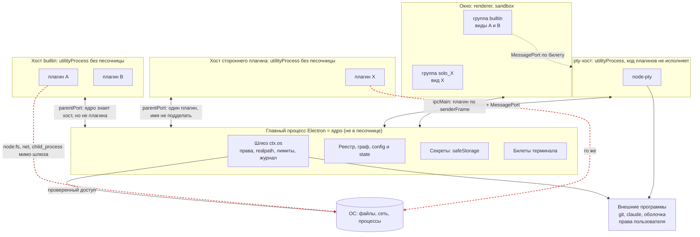

[К оглавлению (README)](README.md) · [← Словарь](01-glossary.md) · [Что мы хотим →](03-goals-and-threat-model.md)

# 2. Как устроено сейчас

## 2.1. Процессы и границы доверия

**Что здесь видно.** Каждая рамка - отдельный процесс ОС, граница доверия проходит по рамке. Сплошные стрелки - каналы, на которых ядро проверяет сообщения. Красные пунктирные стрелки - пути мимо шлюза: хост плагина запущен как обычный Node, и код плагина может сам открыть файл, сокет или процесс ([опыт А](08-sources-and-measurements.md#б1-опыт-что-может-код-плагина-в-utilityprocess)). Внутри рамки хоста builtin плагины A и B друг от друга неотличимы, поэтому сторонний плагин всегда получает свою рамку.

## 2.2. Каналы

| Канал | Кто с кем | Транспорт | Код |
|---|---|---|---|
| A | ядро - хост плагинов | `utilityProcess.fork(entry, [hostId], { serviceName, stdio: 'inherit' })`, `postMessage`, структурное клонирование; `env` не задан | `electron/src/plugin-hosts.ts:15`, `electron/src/host-entry.ts:4-12` |
| A' | то же в тестах и вне Electron | `child_process.fork` с `serialization: 'advanced'` и каналом `ipc`; хост в том же процессе (`inlineHosts`) | `core/src/transports.ts:19-70` |
| B | ядро - pty-хост | `utilityProcess` + `MessagePortMain` | `electron/src/plugin-hosts.ts:50-79` |
| C | окно и виды - ядро | `ipcMain.handle`/`on`, preload и `contextBridge` | `electron/src/channels.ts:13-153`, `electron/src/preload.ts` |
| E | вид - pty-хост | `MessageChannelMain`: один конец у pty-хоста, другой у фрейма, ядро в потоке не стоит | `electron/src/view-terminals.ts:42-86` |
| F | ядро - внешние программы | `child_process.spawn` лидером группы, `node-pty` | `core/src/os-gateway.ts:1182-1213` |
| G | ядро - сеть; сеть - ядро | `node:http(s)` со своим `lookup`; `http.createServer` на `127.0.0.1` | `core/src/net-transport.ts`, `core/src/serve.ts:37,75-82` |
| H | экземпляры приложения | unix-сокет `claimInstance`, 0600 в каталоге 0700 | `core/src/instance.ts:54-86,126-130` |

**Факт.** Окно создаёт приложение (playground: `contextIsolation: true`, `sandbox: true`, `nodeIntegrationInSubFrames: true`, `playground/src/main/main.ts:196`); пакет `electron/` настройки окна не навязывает ([SAD, раздел 1](../../04-architecture/design/sad.md#1-общая-архитектура)).

## 2.3. Идентичность на канале: кто говорит

| Сторона | Как ядро её узнаёт | Код |
|---|---|---|
| Хост | По самому каналу: у каждого хоста свой `Endpoint` на своём порту. Событие `message` принадлежит объекту `UtilityProcess`, а не полю сообщения | `core/src/host-pool.ts:95` |
| Плагин внутри хоста | **Не узнаёт.** Имя берёт из тела сообщения (`pluginId`, `caller`) и проверяет лишь «этот плагин живёт в этом хосте» | `core/src/host-bridge.ts:18-22` |
| Вид | По `event.senderFrame`: группа из origin, плагин из пути адреса, плагин обязан состоять в группе | `electron/src/view-frames.ts:17-27`, `electron/src/channels.ts:25-30` |
| Окно | `senderFrame === mainFrame` | `electron/src/views.ts:44-46` |
| Пользователь | Отдельный вход `Kernel.run`; из хоста назваться пользователем нельзя | `core/test/trust.test.ts:145-170`, [ADR-CH-0016](../../04-architecture/adr/ADR-CH-0016-command-callers.md) п. 3 |

**Факт (поиск).** `grep` на `createHmac`, `createSign`, `verify(`, `ed25519`, `minisign`, `sigstore`, `SO_PEERCRED`, `process.permission`, `--permission` по `core/src`, `electron/src`, `tools/cyborg-plugin/src` ничего не находит. `node:crypto` встречается шесть раз и только для `randomUUID`, `randomBytes` и `createHash` (ключ воркспейса, билет терминала, список поставки): `core/src/workspace.ts:1`, `core/src/pty.ts:1`, `core/src/os-gateway.ts:8`, `core/src/documents.ts:3`, `core/src/delivery.ts:1`, `electron/src/instances.ts:2`. Токенов способности, nonce на сообщения, HMAC, подписи плагина и проверки пира нет.

**Как проверяется сообщение хоста.** `Endpoint` пропускает только объекты формы `{t:'req'|'res'|'note'|'cancel'}` (`core/src/rpc.ts:23-31`); `parseWire` проверяет тип каждого поля, типы TypeScript хост не гарантируют (`core/src/wire.ts:12-52`); каждый обработчик, называющий плагина, зовёт `mine()` или `live()` (`core/src/host-bridge.ts:18-28`); `cancel` приводится к коду из белого списка, чтобы хост не выдал свой отказ за отказ ядра (`core/src/rpc.ts:45-53`). Номера запросов идут подряд с единицы (`core/src/rpc.ts:75`). Пока канал точка-точка, это не уязвимость (вывод ниже).

**Что мешает подделке.**

| Попытка | Что мешает | Статус |
|---|---|---|
| Хост A говорит от имени плагина из хоста B | `mine()` отвергает «не в этом хосте» для всех методов, называющих плагина; тесты `core/test/trust.test.ts:82-460` | ✅ |
| Хост отменяет чужой запрос | `cancel` действует только на запросы, которые обслуживает этот `Endpoint`; тест `trust.test.ts:351` | ✅ |
| Сторонний плагин занимает `cyborg.*` | граф отвергает у не-встроенных (У-13) | ✅ |
| Сторонний плагин выдаёт себя за встроенный | признак «встроенный» берётся из каталога установки (`electron/src/plugins.ts:264`), не из манифеста | ✅ |
| Сторонний плагин делит хост с другим | всегда свой хост (`assignHosts`, `core/src/host-pool.ts:9-47`); тест `trust.test.ts:263-296` | ✅ |
| Вид плагина X зовёт мост от имени Y из другой группы | группа из origin, плагин обязан состоять в группе; `electron/test/view-frames.test.ts:18` | ✅ |
| Чужая страница во фрейме вида зовёт мост | preload выдаёт мост только по `location.protocol === 'cyborg-plugin:'` (`electron/src/preload.ts:85-119`) | ✅ |
| Плагин A в **общем** хосте пишет от имени соседа B | не мешает ничего: `live('B')` пропускает | ❌ закрыто лишь политикой «сторонний один в хосте» |
| Вид A в общей группе рендера становится B через `history.pushState` | `pluginOfFrame` берёт плагина из текущего `frame.url` (`electron/src/view-frames.ts:12-21`) | ⚠️ частично (У-19) |

**Вывод.** Подлинность стороны на канале ядро-хост сегодня равна «процесс запущен ядром и держит единственный конец канала». Для хоста с одним плагином этого достаточно: второго конца у постороннего нет, имя другого плагина в сообщении ядро отбросит. Для хоста с несколькими плагинами этого недостаточно, и никакой ключ в памяти хоста не помог бы: он лежал бы в памяти того же процесса, где живёт и недоверенный код ([4.1](04-options.md#41-канал-и-идентичность)).

## 2.4. Данные и кому они уходят

| Данные | Где лежат | Что получает плагин | Код |
|---|---|---|---|
| `config` (слои `user`, `workspace`) | `cyborg.json` в `userData` и файл воркспейса | только свой раздел, оба слоя | `core/src/sections.ts:42-54` |
| `state` | файл воркспейса, разделы по плагинам | только свой раздел | `core/src/sections.ts` |
| Секреты | `userData/secrets.json`: `{ "<плагин>/<ключ>": base64(safeStorage) }` | свои ключи через `ctx.os.secrets`; ссылки `secrets.ref` по праву | `electron/src/secrets-file.ts:13-70`, `core/src/os-gateway.ts:1065-1078` |
| Данные и временные файлы плагина | `<userData>/plugin-data/<id>`, `plugin-temp/<id>` | область без права; чужие каталоги закрыты шлюзом | `core/src/os-gateway.ts:431-440` |
| Журнал, трасса | кольцо в памяти + `userData/diagnostics/…` | свой журнал плагин не читает | `core/src/diagnostics.ts`, [SAD, 3.5](../../04-architecture/design/sad.md#35-изоляция-сбоев-хосты-и-сторож) |
| Окружение главного процесса | `process.env` | через шлюз: `env.get` только по перечню; программе - `BASE_ENV` и имена из правила | `core/src/os-gateway.ts:227,1051-1056,1182-1192` |
| Токен MCP-сессии | окружение процесса агента | плагину `sessions` | [У-32](../../04-architecture/design/threat-model.md#52-плагин-против-плагина) |

Минимум раскрытия **реализован в шлюзе**: нет права - нет члена в `ctx.os` (`core/src/host-runtime.ts:301-364`) и проверка на каждый вызов (`core/src/os-requests.ts:64-82`); вне области всегда `PermissionDenied`, не `NotFound`; значения секретов вычёркиваются из журнала и вывода хоста (K-29, `core/src/plugin-log.ts:70-80`); аргументы трассы пишутся только с `--trace-args` (K-33, `core/src/trace-args.ts`).

**Минимум раскрытия не реализован на транспорте:**

| # | Что уходит лишнего | Основание |
|---|---|---|
| 1 | В `init` каждому хосту - **манифесты всех плагинов** и привязки графа: права, схемы `config`, команды чужих плагинов | `core/src/host-pool.ts:101`, `core/src/context-build.ts:181`, `core/src/host-runtime.ts:523-526` |
| 2 | Сообщение `contracts` с полем `data` каждого поставщика - **всем** хостам, независимо от `requires` потребителя | `core/src/contract-calls.ts:25-27,163-165`; структура `ContractDescriptor` - `core/src/host-runtime.ts:20-26` |
| 3 | `system` (фокус, сон, замок экрана, простой) - всем хостам; чувствительность низкая | `core/src/host-pool.ts:191` |
| 4 | `paths.home` каждому плагину при активации; имя пользователя и так в `os.homedir()` | `contracts/os.ts:308`, `core/src/host-runtime.ts:62-66` |
| 5 | **Окружение хоста** = `process.env` главного процесса: токены, `SSH_AUTH_SOCK`, `AWS_*` | `electron/src/plugin-hosts.ts:15` (нет `env`); Опыт А |

Зеркало контрактов в хосте фильтрует выдачу `ctx.contracts.get` по объявлению плагина, но код плагина в том же процессе читает сообщение мимо зеркала (Опыт А: «сырой канал»).

## 2.5. Права и шлюз

**Факт.** Четырнадцать прав в манифесте (`core/src/permissions.ts:9`); единственная точка применения - `OsGateway` в главном процессе (`core/src/os-gateway.ts:441+`), вызывающего определяет канал хоста (`core/src/os-requests.ts:64-82`), клиент `ctx.os` в хосте - тонкий RPC, который не проверяет ничего. Для файлов: `realpath`, области, защищённые пути и соседи `<файл>.*`, `O_NOFOLLOW` на последнем компоненте; для сети: хосты права, `redirect: 'manual'`, проверка адреса в соединении (`core/src/net-transport.ts:108-135`). Тесты шлюза: `core/test/trust.test.ts:576-653`, `core/test/security-gateway.test.ts`.

**Известный дефект.** [#241](https://github.com/dex-it/cyborg-harness/issues/241): `pty.share`, `pty.list`, `pty.attach`, `pty.write`, `pty.resize`, `pty.kill` и `serve.close` без права отвечают не `PermissionDenied` и не пишут `denied` (нарушена NFR-CH-3001). Прямого обхода нет (таблицы собственные), но попытка не попадает в журнал. Исправление - отдельная задача и в этот документ не входит.

**Где держится на проверке, а где на соглашении.**

| Свойство | Держится на | Статус |
|---|---|---|
| Доступ к файлам, сети, программам **через `ctx.os`** | Проверке в ядре (шлюз) | ✅ |
| Доступ к ОС **мимо `ctx.os`** (`import('node:fs')`) | Соглашении: статическая проверка импортов `checkPlugin`, которую загрузчик **не вызывает** (`grep checkPlugin` по `core/src`, `electron/src` находит только экспорт `core/src/index-plugin-check.ts:2` и определение `core/src/plugin-check.ts:269`) | ❌ У-04 «открыто до этапа 2» |
| Сторонний код не грузится без ведома человека | Флаге `--user-plugins` и записи `third-party` (У-38) | ⚠️ предупреждение, не защита |

## 2.6. Секреты

**Факт.** `safeStorage` (Keychain на macOS; на Linux GNOME Keyring, KWallet или запасной вариант) через `encryptStringAsync` (`electron/src/os-env.ts:7-11`); файл `secrets.json` пишется через временный файл и `rename` с правами `0600` (`electron/src/secrets-file.ts:20-28`); без шифрования ОС `Unavailable`, открытым текстом не пишется ([ADR-CH-0014](../../04-architecture/adr/ADR-CH-0014-secrets.md)). Ключи `<плагин>/<ключ>` лежат **открыто** (`electron/src/secrets-file.ts:58`) и показывают, у какого плагина какие секреты есть.

**Факт (Electron).** На Linux «если хранилища нет, данные шифруются зашитым открытым паролем» и защиты не дают; `getSelectedStorageBackend()` вернёт `basic_text` при неопознанной среде; синхронный API объявлен устаревшим и будет удалён в Electron 46, асинхронный (который мы используем) остаётся ([документация](https://www.electronjs.org/docs/latest/api/safe-storage)). `getSelectedStorageBackend()` у нас вызывается только в замере (`playground/src/main/spike-gateway.ts:42,184`). **Не проверено:** что возвращает `isAsyncEncryptionAvailable()` при `basic_text`.

**Факт (изоляция от других приложений).** GNOME Keyring не изолирует секреты от других программ того же сеанса, его авторы называют такую изоляцию «security theater» ([GNOME wiki](https://wiki.gnome.org/Projects/GnomeKeyring/SecurityPhilosophy)). На macOS Keychain различает приложения, но не плагины внутри приложения ([Electron safeStorage](https://www.electronjs.org/docs/latest/api/safe-storage)).

## 2.7. Происхождение плагинов

| Аспект | Состояние | Код |
|---|---|---|
| «Встроенный» | каталог установки, не манифест | `electron/src/plugins.ts:264` |
| Подпись | нет (подписано только приложение: `codesign` проверена ad hoc, [`bundled-delivery.md`](../../05-verification/bundled-delivery.md)) | - |
| Контрольные суммы поставки | `delivery.json` (sha256 по файлам); при старте `verifyDelivery` **сообщает** о расхождении, плагины поднимаются | `core/src/delivery.ts:102-119`, `electron/src/plugins.ts:147-151` |
| Слабые места сверки | список лежит в том же каталоге и не подписан; сверка один раз при старте, не перед `import()`; каталог пользователя не сверяется; отказа нет | там же |
| Внешние плагины | `<userData>/plugins`, по умолчанию не читается; с `--user-plugins` и записью в `plugins.enabled` - сторонний, свой хост, метка | `electron/src/plugins.ts:246-250` |
| `cyborg-plugin pack` | воспроизводимый `tar.gz`, «формат предварительный: источник, подпись, хеш и повторное согласие - этап 2» | `tools/cyborg-plugin/src/pack.ts`, [SAD, 6.1](../../04-architecture/design/sad.md#61-этап-1-ядро-без-изоляции-доступа) |
| Зависимости npm | не проверяются на происхождение (У-42, открыто) | [модель угроз](../../04-architecture/design/threat-model.md#56-загрузка-воркспейс-жизненный-цикл) |
| Обновление, отзыв | установки нет; повторного согласия нет (У-39); списка отозванных нет | [SRS 03, FR-CH-3024](../../03-requirements/03-security-trust/srs.md) |

## 2.8. Что показал опыт: код плагина в `utilityProcess`

Запускалась упрощённая копия нашего способа запуска (`utilityProcess.fork` без песочницы и без `env`, как в `electron/src/plugin-hosts.ts:15`) с «вредоносным плагином» внутри: обычный Node-код. Полное описание и скрипты - [приложение Б.1](08-sources-and-measurements.md#б1-опыт-что-может-код-плагина-в-utilityprocess).

| Что пробует плагин | А. Как у нас | Б. + `--permission` | В. + явный `env` |
|---|---|---|---|
| `process.permission` | не определён | **не определён** (флаг принят, не действует) | не определён |
| Видит токен главного процесса в `process.env` | ❌ видит | ❌ видит | ✅ не видит |
| Читает «файл секретов» ядра через `node:fs` | ❌ читает | ❌ читает | ❌ читает |
| Запускает процесс (`child_process`) | ❌ запустил | ❌ запустил | ❌ запустил |
| Открывает TCP-соединение | ❌ открыл | ❌ открыл | ❌ открыл |
| Слушает «сырой» `process.parentPort`, видит `init` с чужими манифестами | ❌ видит | ❌ видит | ❌ видит |
| Пишет в `parentPort` сообщение от имени плагина-«соседа» | ❌ ядро получило сообщение с чужим `pluginId` (отсечёт `mine()`, если сосед в другом хосте) | то же | то же |

Тот же бинарник как обычный Node (`ELECTRON_RUN_AS_NODE=1`) с `--permission --allow-fs-read=<каталог>` **ограничивает** чтение и запуск процессов (`ERR_ACCESS_DENIED`), но сеть остаётся открытой (Опыт Г, [Б.2](08-sources-and-measurements.md#б2-прочие-опыты)). Это совпадает с документацией Node: модель разрешений называется «seat belt», от злого кода не защищает, сети в v24 не закрывает ([Node 24, permissions](https://nodejs.org/docs/latest-v24.x/api/permissions.html)).

## 2.9. Угрозы: мера сейчас и пробел

Статусы: ✅ закрыто и проверено, ⚠️ закрыто частично или соглашением, ❌ не закрыто. Номера У-xx - из [модели угроз](../../04-architecture/design/threat-model.md).

| # | Угроза | Мера сейчас | Пробел | |
|---|---|---|---|---|
| 1 | Подмена плагина другим плагином в **общем** хосте | `mine()` проверяет «плагин в этом хосте»; сторонний всегда один (`core/src/host-pool.ts:9-47`); контроль `core/test/trust.test.ts:289-295` | внутри хоста плагины неразличимы; встроенные в `builtin` доверяют друг другу полностью | ⚠️ |
| 2 | Подмена плагина из **другого** хоста (У-11) | `mine()` по каналу | нет, тест `trust.test.ts:82-460` | ✅ |
| 3 | Подмена хоста: чужой процесс вставляется в канал | канал создан ядром (`utilityProcess`), второго конца у постороннего нет | нет проверки пира; подлинность = факт запуска; в документации Electron гарантий об отправителе нет ([утилитарный процесс](https://www.electronjs.org/docs/latest/api/utility-process)) | ⚠️ |
| 4 | Подмена вида (iframe выдаёт себя за другой плагин или за окно) (У-19, У-22) | плагин из `senderFrame`; мост по схеме; навигация ограничена (`electron/src/navigation.ts:40-58`) | в общей группе рендера: `pushState` меняет путь, виды читают DOM друг друга; тесты на подставных кадрах, не на настоящем Electron | ⚠️ |
| 5 | Чтение чужих данных через `ctx.os` (У-01, У-02, У-16) | области, `realpath`, ключи `<плагин>/`, защищённые пути | - | ✅ |
| 6 | Чтение чужих данных **мимо** `ctx.os` (`node:fs`) (У-04) | статическая проверка импортов (не вызывается при загрузке) | хост плагина читает любой файл пользователя, включая `secrets.json`, `plugin-data` чужих (Опыт А) | ❌ |
| 7 | Утечка данных ядра в плагин: манифесты и контракты | нет права - нет члена; `LIMITS` | `init` и `contracts` уходят всем хостам; сырой `parentPort` | ❌ |
| 8 | Утечка окружения процесса в хост | в **программу** идёт `BASE_ENV` и `env` правила | хост наследует `process.env` главного (Опыт А) | ❌ |
| 9 | Обход шлюза: сеть, процессы (У-04) | запрет каталога пользователя без `--user-plugins` (У-38) | `utilityProcess` без песочницы, `--permission` не действует (Опыт Б); `net` и `process` обходятся | ❌ |
| 10 | Подмена пакета плагина на диске | `delivery.json` sha256, сверка при старте | список рядом и не подписан; нет сверки перед `import()`; каталог пользователя не сверяется | ❌ |
| 11 | Откат на старую уязвимую версию плагина (replay пакета) (У-39) | нет | установки и версии-«не младше» нет | ❌ |
| 12 | Replay сообщений ядро-хост | канал точка-точка, `id` подряд, неизвестный `res` отбрасывается (`core/src/rpc.ts:192-200`) | нет nonce; но и повторять нечем: отправитель один, а повтор равен новому запросу того же отправителя | ✅ при приватном канале; ⚠️ если появится общий транспорт |
| 13 | Replay билета терминала | одноразовый, привязан к плагину, 30 с (`core/src/pty.ts:212-229`) | - | ✅ |
| 14 | Утечка секрета в журнал и трассу (У-17) | K-29, K-33, тест `core/test/secrets-journal.test.ts` | значение короче 4 знаков; секрет, собранный плагином без шлюза; открытое значение в IPC и в памяти хоста | ⚠️ |
| 15 | Секреты в покое | `safeStorage`, файл 0600 | `basic_text` на Linux не проверяется; ключи открыты; другое приложение сеанса на Linux | ⚠️ |
| 16 | Общий каталог или сокет (У-50) | сокет 0600 в 0700, `XDG_RUNTIME_DIR` | права `cyborg.json`, `state`, `diagnostics` берутся из umask (не проверено) | ⚠️ |
| 17 | Повышение прав через `pty` и `process` (У-10, У-46) | закреплённые аргументы, `deny` флагов (K-34) | «честная граница»: программа имеет права пользователя; пути конфигурации агента не защищены (У-46 открыто) | ⚠️ |
| 18 | Вредный код в npm-зависимостях встроенных плагинов (У-42) | P-06 проверяет состав бандла | происхождение пакетов не проверяется; код зависимости в общем хосте имеет доступ ко всем соседям | ❌ |
| 19 | Подделка диалога ядра из вида (У-24) | слой ядра над фреймами | вид рисует что угодно в своём прямоугольнике | ⚠️ принято |
| 20 | Воркспейс из чужих рук расширяет права (У-40) | `TRUSTED_LAYER` ([ADR-CH-0015](../../04-architecture/adr/ADR-CH-0015-workspace-trust.md)) | `plugins.enabled` и `settings` из воркспейса принимаются | ⚠️ |
| 21 | Отказ шлюза без записи (#241) | собственные таблицы pty | 7 членов без `PermissionDenied` и без `denied` | ⚠️ |
| 22 | Компрометация ядра (главного процесса) | минимум зависимостей | вне охвата ([5.9](05-decision.md#59-что-остаётся-незащищённым-и-почему)) | ❌ |

## 2.10. Что проверяют тесты и что нет

`core/test/trust.test.ts` (686 строк, 16 тестов, у восьми в имени ключ `ST-NNNN/k`) запускает ядро с хостами **в том же процессе** (`inlineHosts`, `core/src/transports.ts:19-43`) и подделывает сообщения хоста со стороны теста (`forging`, `trust.test.ts:28-80`). Закрыты: `register`, `run`, `invoke`, `provide`, `section.write`, `emit`/`release`, `cancel`, `keys.register`, `log`/`output`, 24 метода `ctx.os` без права.

**Не покрыто:** настоящий процесс хоста и канал ОС (перехват `process.parentPort` кодом плагина, чтение рассылок `init`/`contracts`); вредоносный плагин, обходящий `ctx` через `node:*` (динамически: `core/test/plugin-imports.test.ts` проверяет только статически); подмена в общем хосте для всех методов, кроме `section.write`; виды и окно на настоящем Electron; повтор и предсказуемость `id`; семь членов #241.