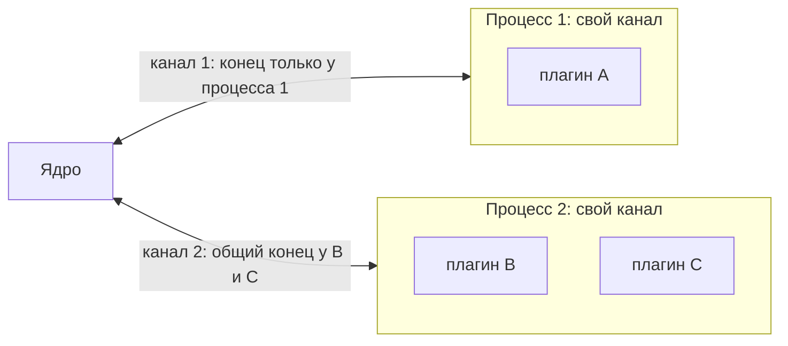
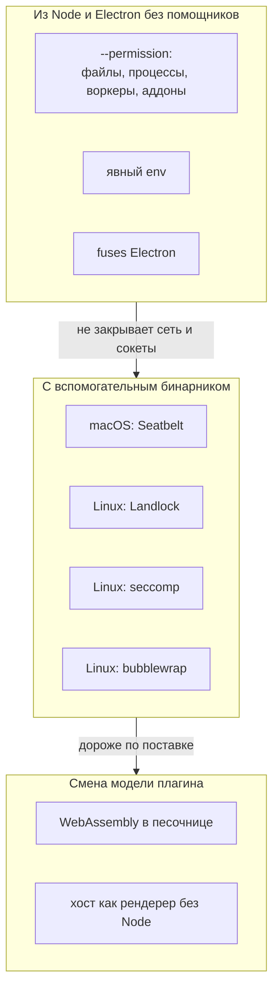

[К оглавлению (README)](README.md) · [← Что мы хотим](03-goals-and-threat-model.md) · [Выбор способа →](05-decision.md)

# 4. Разбор способов

Метки: **Факт** - первоисточник по ссылке; **Опыт** - наш запуск на macOS ([приложение Б](08-sources-and-measurements.md#приложение-б-замеры-и-опыты)); **Вывод** - наше заключение. Задержки - Опыт, macOS arm64, Node 24.20.0, если не сказано иное. Для сравнения: бюджет шлюза 1 мс = 1000 мкс.

## 4.1. Канал и идентичность

Главная мысль слоя: **канал, у которого нет второго конца, надёжнее любой проверки пира**. Проверять, кто пришёл, нужно только там, где к каналу может подключиться кто угодно (сокет с именем в файловой системе).

**Что здесь видно.** Ядро надёжно знает «это процесс 1» и «это процесс 2». Но B и C в процессе 2 пишут в один и тот же конец канала и могут называться друг другом. Никакой ключ или подпись это не исправят: любой секрет, выданный B, лежит в памяти процесса, где живёт C.

| Способ | Как работает и что даёт | Чего не даёт | macOS / Linux | Зависимости, стоимость | Задержка | Зрелость, где применяют |
|---|---|---|---|---|---|---|
| **Приватный `socketpair` через `spawn` (`stdio: 'pipe'`)** | Родитель создаёт пару сокетов, потомок получает fd 3; постороннему второй конец взять неоткуда. Подлинность = владение концом. Факт: libuv делает `uv_socketpair(SOCK_STREAM…)` ([libuv](https://raw.githubusercontent.com/libuv/libuv/v1.x/src/unix/process.c)); в `node:net` есть `new net.Socket({fd})` ([Node](https://nodejs.org/docs/latest-v24.x/api/net.html)). Опыт: в потомке `fs.fstatSync(3).isSocket()` истинно | Различия плагинов внутри процесса; защиты от `ptrace`; шифрования | ✅ / ✅ (Linux: libuv, на Linux не запускали) | stdlib; низкая | RTT 256 Б: p50 17-18 мкс, p99 около 42 мкс (20 000 кругов) | Классика Unix; уже у нас в `forkHosts` с каналом `ipc` (`core/src/transports.ts:50-70`) |
| **`utilityProcess` `parentPort` / `MessagePortMain`** | Канал создаёт главный процесс через Mojo; второй конец есть у запущенного процесса. Факт: документация Electron описывает `postMessage` и `parentPort`, но об отправителе гарантий не даёт ([utilityProcess](https://www.electronjs.org/docs/latest/api/utility-process), [process](https://www.electronjs.org/docs/latest/api/process)); в Mojo Core нативные дескрипторы - «kernel-mediated capabilities» ([README](https://chromium.googlesource.com/chromium/src/+/main/mojo/core/README.md)) | То же, что выше; процесс без песочницы | ✅ / ✅ | Electron; низкая | RTT 256 Б: p50 50 мкс, p99 116 мкс | Наш хост сегодня; VS Code extension host ([блог](https://code.visualstudio.com/blogs/2022/11/28/vscode-sandbox)) |
| **Порт на ресурс** (`MessageChannelMain`, билет) | Для каждого ресурса (pty) отдельный канал, выданный ядром по одноразовому билету; идея Mojo «модель интерфейсов вокруг семантических capability» ([Mojo](https://chromium.googlesource.com/chromium/src/+/main/mojo/README.md)) | Ничего сверх своего ресурса | ✅ / ✅ | Electron; средняя | как канал | Уже есть для терминала (`electron/src/view-terminals.ts:42-86`) |
| **`SO_PEERCRED` / `SO_PEERPIDFD` (Linux)** | ОС сообщает серверу uid, gid, pid процесса на другом конце; значения «на момент `connect`, `listen` или `socketpair`» ([unix(7)](https://man7.org/linux/man-pages/man7/unix.7.html)); pidfd убирает гонку повторного использования pid, введён в Linux 6.5 ([слайды LPC 2024](https://lpc.events/event/18/contributions/1691/attachments/1499/3166/-LPC-2024-%20PID%20FDs-%20where%20we%20were,%20where%20we%20are%20and%20were%20we%20would%20like%20to%20go.pdf)); версию проверять по ядру | Различия плагинов (все с одним uid); передачи дескриптора третьему | - / ✅ | Нативный аддон, вспомогательный бинарник или `node:ffi` (Node 26.1+, Stability 1; в Electron 45 нет: [ffi](https://nodejs.org/docs/latest/api/ffi.html)). Опыт: у `net.Socket` нет API учётных данных | микросекунды на соединение | Очень высокая: dbus, systemd |
| **`LOCAL_PEERPID` / `LOCAL_PEERTOKEN` (audit token), `getpeereid` (macOS)** | Аналог для macOS; audit token защищает от повторного использования pid. Факт: Apple DTS подтвердила `LOCAL_PEERTOKEN` как поддерживаемый API с macOS 13, но рекомендует XPC и предупреждает, что передачу дескриптора это не закрывает ([форум Apple](https://developer.apple.com/forums/thread/850777)); константы в [XNU `un.h`](https://github.com/apple-oss-distributions/xnu/blob/main/bsd/sys/un.h) | То же | ✅ / - | Нативный код, `Security.framework` для проверки подписи пира | микросекунды | Высокая (подтверждено Apple) |
| **XPC с требованием подписи** | `xpc_connection_set_peer_code_signing_requirement`, macOS 12+ ([Apple](https://developer.apple.com/tutorials/data/documentation/xpc/xpc_connection_set_peer_code_signing_requirement(_:_:).json)) | Различия плагинов | ✅ / - | Недоступно из Node без нативного кода | - | Высокая; нам не подходит |
| **mTLS** | TLS с сертификатами обеих сторон. Факт: `X509Certificate` в Node только разбирает ([crypto](https://nodejs.org/docs/latest-v24.x/api/crypto.json)), выпуска нет | Различия плагинов; избыточно для приватного канала | ✅ / ✅ | `openssl` или внешняя библиотека; жизненный цикл CA | рукопожатие в мс (не мерили) | Вывод: не берём |
| **Noise (XX, IK, KK)** | Готовые схемы рукопожатия: X25519, HKDF, AEAD. Факт: ревизия 34, 2018, статус «unstable»; повтор нужно отлавливать счётчиком nonce ([спецификация](https://noiseprotocol.org/noise.html)); примитивы в `node:crypto` есть, готовой реализации в stdlib нет | То же | ✅ / ✅ | Самописная схема - риск ошибок | X25519 DH 31 мкс (Опыт) | Вывод: только если появится сокет с путём |
| **SPIFFE / SPIRE** | Короткоживущие сертификаты рабочих нагрузок, Workload API ([SPIFFE](https://spiffe.io/docs/latest/spiffe-about/spiffe-concepts/)) | - | ✅ / ✅ | Внешний демон | - | Для распределённых систем; избыточно |

**Вывод по слою.** Для каналов ядро-хост подлинность даёт владение концом канала; HMAC, AEAD, mTLS и Noise на нём не добавляют защиты от внешнего процесса и не отделяют плагины внутри процесса. `SO_PEERCRED` и `LOCAL_PEERTOKEN` нужны только если появится канал по пути в файловой системе (сегодня такой один, сокет экземпляров `claimInstance`, и по нему идёт запрос второго запуска, не данные). Для хостов-`utilityProcess` Electron не обещает ничего о том, кто пишет в порт; опора на «конец канала есть только у процесса» - **вывод** из того, как устроен Mojo, а не документированная гарантия, поэтому её нужно закрепить тестом (TR-01).

## 4.2. Токены и подписи

| Способ | Как работает, что даёт | Чего не даёт | Зависимости, стоимость | Задержка (Опыт) | Зрелость, где применяют |
|---|---|---|---|---|---|
| **Случайный билет + HMAC-SHA256** | Ядро выдаёт 256-битный ключ, сообщения подписываются; `createHmac`, `timingSafeEqual`, `hkdfSync` есть в `node:crypto` ([crypto](https://nodejs.org/docs/latest-v24.x/api/crypto.json)) | Различия плагинов в одном процессе (ключ лежит в его памяти); повтор без счётчика | stdlib; низкая | HMAC 1 КиБ 9 мкс, 64 КиБ 37 мкс; `randomBytes(32)` 0,9 мкс; HKDF 9,5 мкс | Максимальная |
| **AEAD с ключом канала и счётчиком** | Шифрование и подмена-защита каждого сообщения; повтор ловится счётчиком (правило [Noise 11.4](https://noiseprotocol.org/noise.html)) | На приватном канале добавляет защиту только от компрометации самого канала | stdlib; низкая-средняя | AES-256-GCM 1 КиБ: шифр. 12,6 мкс, расшифр. 10,5 мкс; ChaCha20-Poly1305 13,7 мкс. Наивная обвязка подняла RTT с 17 до 91 мкс (верхняя оценка) | Максимальная |
| **Подписи Ed25519 на сообщениях** | Асимметрично; даёт неотрицаемость в журнале | Защиты от чтения ключа из памяти хоста | stdlib | sign 1 КиБ 32 мкс, verify 88 мкс, генерация пары 31 мкс (в 3-9 раз дороже HMAC) | Высокая |
| **Macaroons** | Токены на цепочках HMAC с «ограничениями» (caveats), сужать может любой держатель ([Google Research](https://research.google/pubs/macaroons-cookies-with-contextual-caveats-for-decentralized-authorization-in-the-cloud/)) | Отзыв без списка | Самописные на `createHmac`, около 50 строк (вывод) | как HMAC | Средняя |
| **Biscuit** | Токен с подписью открытым ключом и политиками Datalog; «токен можно только ограничить» ([Biscuit](https://doc.biscuitsec.org/getting-started/introduction)) | Идентификаторы отзыва на странице не описаны | Внешняя библиотека | не мерили | Средняя |
| **Привязка к каналу, ротация, отзыв** | Токен принимается только по каналу, на который выдан; ротация сменой «эпохи» в HKDF; отзыв закрытием канала и сменой эпохи. SPIFFE прямо предпочитает X.509 токенам JWT из-за повтора ([SPIFFE](https://spiffe.io/docs/latest/spiffe-about/spiffe-concepts/)) | - | stdlib | - | Вывод |

**Вывод по слою.** В нашей архитектуре ядро - единственный посредник и хранит таблицу прав само. Подписанные переносимые токены (Macaroons, Biscuit) нужны, только если право предъявляют другому процессу, который ядро не может спросить в реальном времени, или права должны пережить перезапуск. Таких случаев сегодня нет. Токены полезны в виде **непрозрачных билетов на ресурс** (как билет терминала): выдаются ядром, одноразовые, короткоживущие, привязаны к плагину. Токен для **идентичности плагина в общем процессе** не берём, и вот почему: сообщения несли бы билет по общему `parentPort`, и вредоносный код в том же процессе увидел бы билет соседа, подменив `postMessage` (вывод; Опыт А показывает, что `parentPort` читается плагином).

## 4.3. Происхождение плагинов

| Способ | Как работает, что даёт | Чего не даёт | Зависимости, стоимость | Когда проверяется | Зрелость, где применяют |
|---|---|---|---|---|---|
| **Подпись Ed25519 манифеста пакета + хеши файлов (свой формат, как minisign)** | В подписанном манифесте: `id`, версия, sha256 каждого файла, срок; ключ издателя в списке доверенных. minisign: Ed25519, «доверенный комментарий» в подписи удобен для имени, версии и времени против отката ([minisign](https://jedisct1.github.io/minisign/)). Все примитивы в `node:crypto` (Ed25519: [crypto](https://nodejs.org/docs/latest-v24.x/api/crypto.json)) | Безопасности содержимого; подмены корня доверия (приложения) | stdlib; средняя | При установке и **перед каждой загрузкой** | Высокая; наш формат |
| **Sigstore (cosign, Fulcio, Rekor), npm provenance** | Короткоживущий сертификат под идентичность CI, публичный журнал; проверка: подпись, идентичность, цепочка, запись в журнале ([Sigstore](https://docs.sigstore.dev/about/overview/)). `npm publish --provenance` из облачного CI, проверка `npm audit signatures`; «Provenance does not mean a package is free of malicious code» ([npm](https://docs.npmjs.com/generating-provenance-statements)) | Безопасности кода; защиты от подмены каталога после установки | Проверка без сторонней библиотеки нереальна (X.509, доказательства Rekor, корень TUF) | При установке, внешним шагом | Высокая в экосистеме; для ядра без зависимостей не подходит |
| **SLSA v1.0** | Уровни происхождения сборки; L1 «тривиально подделать», L2 подписывает хостинг сборки, L3 изолирует сборки; страница помечена «Retired» ([SLSA](https://slsa.dev/spec/v1.0/levels)) | Выполнения | Процесс CI | Выпуск | Для наших пакетов `@cyborg-harness/*` |
| **TUF (идея)** | Метаданные: ключи, хеши, версии и **сроки**; защита от freeze, rollback, mix-and-match ([TUF](https://theupdateframework.io/docs/overview/)) | - | Полная реализация тяжела | При обновлении | Образец для отката и отзыва |
| **macOS: подпись кода, Hardened Runtime, нотаризация** | Защита бинарников от инъекций и подмены; нотаризация - автопроверка Apple ([Hardened Runtime](https://developer.apple.com/tutorials/data/documentation/security/hardened-runtime.json), [нотаризация](https://developer.apple.com/tutorials/data/documentation/security/notarizing-macos-software-before-distribution.json)) | `.js` плагина не подписывается и при каждой загрузке не проверяется (вывод) | Процесс сборки | Старт приложения | Высокая; для приложения и нативных помощников |
| **Закрепление хеша, TOFU, «читать один раз»** | Хеш в манифесте; ядро читает байты, хеширует **их же** и исполняет их (иначе гонка TOCTOU); запоминает ключ при первой встрече | Подделки первой установки | stdlib | Перед каждой загрузкой | Практика (вывод); загрузка из памяти **не проверена** |
| **fs-verity (Linux)** | Дерево Меркла на файле, файл нельзя перезаписать; подписи ядра не поддерживают Ed25519; включать можно только на целевой машине ([kernel docs](https://docs.kernel.org/filesystems/fsverity.html)) | - | Права администратора | - | Не для приложения пользователя |
| **ASAR integrity (Electron)** | Хеш заголовка `app.asar`; только macOS и Windows, Linux в документации не упомянут ([Electron](https://www.electronjs.org/docs/latest/tutorial/asar-integrity)) | Пользовательские плагины | Сборка | Старт | Для самого приложения |

**Вывод по слою.** Подпись защищает то, что **вне корня доверия**. Корень - само приложение: если процесс пользователя может переписать приложение и список ключей в нём, подпись плагина бессмысленна. Поэтому подпись нужна для **сторонних пакетов** (этап 2) и как обнаружение для поставки на Linux; на macOS целостность упакованной поставки частично покрывает подпись приложения (в пробе `pack-delivery.mjs` проверены ad hoc `codesign` и целостность asar; Developer ID и нотаризация не проверены: [`bundled-delivery.md`](../../05-verification/bundled-delivery.md)). Полную защиту от подмены каталога процессом того же пользователя дать нельзя; достижимо: проверять подпись и хеши при **каждой** загрузке, исполнять прочитанные байты, помнить наибольшую версию и список отозванных.

## 4.4. Изоляция процессов средствами ОС

**Что здесь видно.** Слева направо растут защита и цена. Первая группа бесплатна, но не закрывает сеть. Вторая закрывает всё, но требует маленького бинарника на каждую ОС. Третья меняет сам формат плагинов и нашей архитектуре не подходит.

| Способ | Как работает, что даёт | Чего не даёт | macOS / Linux | Зависимости, стоимость | Задержка | Зрелость, где применяют |
|---|---|---|---|---|---|---|
| **Node `--permission`** | Флаги `--allow-fs-read/write`, `--allow-child-process`, `--allow-worker`, `--allow-addons`; Stability 2; **«seat belt», не защита от злого кода** ([permissions v24](https://nodejs.org/docs/latest-v24.x/api/permissions.html)). Опыт: под `--permission` `net.connect` проходит; `--allow-net` есть только в документации новее (v26: [permissions](https://nodejs.org/docs/latest/api/permissions.html)), в Electron 45 (Node 24.22) его нет | Сеть, окружение; обход через уже открытые дескрипторы, символические ссылки, `process._debugProcess` (все названы в документации) | ✅ / ✅ **только как отдельный процесс Node** | stdlib; низкая | 0 | Stable в Node 24; наш выбор для этапа 2 по ADR-CH-0003 п. 9 |
| **`utilityProcess` как граница** | Опыт Б: `execArgv: ['--permission',…]` принят, виден в `process.execArgv`, **не действует** (`process.permission` не определён). Факт: сервис `NodeService` помечен `[ServiceSandbox=…kNoSandbox]` ([mojom](https://raw.githubusercontent.com/electron/electron/main/shell/services/node/public/mojom/node_service.mojom)); опции `sandbox` у `fork` нет ([utilityProcess](https://www.electronjs.org/docs/latest/api/utility-process)) | Любой запрет ОС | ✅ / ✅ как есть | - | - | **Не граница безопасности**; подтверждено своим опытом |
| **Процесс Node через `ELECTRON_RUN_AS_NODE` или `child_process.fork`** | Тот же бинарник как обычный Node: `--permission` действует (Опыт Г: `ERR_ACCESS_DENIED` на чтение вне каталога и на `child_process`). В `forkHosts` такой путь уже есть | Сеть | ✅ / ✅ | Фьюз `RunAsNode` обязан быть включён: любой процесс пользователя тогда запустит подписанный бинарник приложения как Node ([fuses](https://www.electronjs.org/docs/latest/tutorial/fuses)); вывод: с доверием подписи и разрешениями приложения | не измерена: 17 мкс получены на `socketpair` со `stdio: 'pipe'` и самописным кадрированием, канал `fork` с `ipc` не мерили | Основа этапа 2 по ADR-CH-0003 |
| **Отдельный бинарник Node** | Свой `node`, подписанный и лежащий в приложении; фьюз `RunAsNode` можно выключить | Сеть | ✅ / ✅ | Размер: `node` 24.20.0 на этой машине 122 МБ, `Electron Framework` 251 МБ (Опыт); сборка и подпись | как выше | Вывод; обсуждается в вопросе 2 |
| **macOS Seatbelt (`sandbox-exec`, `sandbox_init`)** | Профиль запретов. Опыт Д: на macOS 27.2 профиль `(deny network*)(deny process-fork)(deny file-read* …)` **действует**: чтение, сеть и fork отказаны. Факт: `sandbox-exec` в man помечен DEPRECATED (страница 2017 г.) ([man](https://keith.github.io/xcode-man-pages/sandbox-exec.1.html)); Chromium использует непубличный `sandbox_init_with_parameters` и профили SBPL, «официальной документации SBPL нет» ([Chromium](https://chromium.googlesource.com/chromium/src/+/main/sandbox/mac/seatbelt_sandbox_design.md)) | Утечки через разрешённое | ✅ / - | Запуск `sandbox-exec -p … node host.js`, если утилита останется; иначе помощник с `sandbox_init` | при запуске | Средняя: механизм в ходу, API не публичен |
| **macOS App Sandbox** | Песочница всего приложения с entitlement `com.apple.security.app-sandbox` | Динамические плагины с произвольным доступом к `ctx.os` | ✅ / - | Меняет модель всего приложения | 0 | Вывод: архитектурно не подходит (текст страницы Apple получить не удалось: **не проверено**) |
| **Hardened Runtime** | Запрет инъекций `DYLD_*`, неподписанных библиотек, отладчика без `get-task-allow`; «библиотеки и in-process плагины наследуют entitlements хозяина» ([Apple](https://developer.apple.com/tutorials/data/documentation/security/hardened-runtime.json)). `allowLoadingUnsignedLibraries` у `utilityProcess` включает загрузку неподписанных библиотек и «лучше не включать» (вывод: по умолчанию хелпер чужих `.node` не грузит); `disclaim` отделяет TCC ([utilityProcess](https://www.electronjs.org/docs/latest/api/utility-process)) | JS | ✅ / - | Подпись | 0 | Для приложения; хорошая сопутствующая мера |
| **Linux Landlock** | Процесс сам себе закрывает файлы; ABI 1 ядро 5.13, ABI 4 (TCP connect/bind) ядро 6.7, ABI 6 (скоупы сокетов и сигналов) 6.12 ([landlock(7)](https://man7.org/linux/man-pages/man7/landlock.7.html), [kernel docs](https://docs.kernel.org/userspace-api/landlock.html)); нужен `no_new_privs`, ограничения необратимы. Не ограничивает `chdir`, `stat`, `chmod`, `/proc/<pid>/fd` | UDP до новых ABI; старые ядра | - / ✅ (ядро 5.13+, сеть 6.7+) | Нативный помощник; Chromium Landlock пока не использует ([Chromium](https://chromium.googlesource.com/chromium/src/+/main/sandbox/linux/README.md)) | при запуске | Зрелая в ядре, ABI растёт |
| **Linux seccomp-bpf** | Фильтр системных вызовов, `no_new_privs`; рекомендован allow-list ([seccomp(2)](https://man7.org/linux/man-pages/man2/seccomp.2.html)) | Логики прав на пути | - / ✅ | Нативный помощник | доли мкс на вызов (не мерили) | Очень высокая: Chromium, Flatpak, Android |
| **User namespaces, bubblewrap** | Новое пространство ФС, сети, процессов; bubblewrap - инструмент, не политика, setuid-режим удалён ([bubblewrap](https://github.com/containers/bubblewrap)); непривилегированные userns с Linux 3.8 ([user_namespaces(7)](https://man7.org/linux/man-pages/man7/user_namespaces.7.html)); **Ubuntu 24.04 ограничивает их через AppArmor** ([Ubuntu](https://ubuntu.com/blog/ubuntu-23-10-restricted-unprivileged-user-namespaces)) | Ничего сверх профиля | - / ✅ с оговоркой | Бинарник `bwrap` | при запуске | Очень высокая; Linux-дистрибутивы по-разному |
| **Firejail** | SUID-утилита, namespaces + seccomp ([README](https://raw.githubusercontent.com/netblue30/firejail/master/README.md)) | - | - / ✅ | SUID root расширяет поверхность атаки (вывод) | при запуске | Средняя (история CVE) |
| **AppArmor, SELinux** | Политики администратора | - | - / ✅ | Не для встроенного в приложение пользователя (вывод, **не проверено** по первоисточнику) | - | - |
| **cgroups, контейнеры** | Лимиты ресурсов; Deno перечисляет cgroups среди внешних слоёв ([Deno](https://docs.deno.com/runtime/fundamentals/security/)) | Права | - / ✅ | Администратор | - | Не исследовано |
| **WebAssembly-компоненты** | Линейная память с проверкой границ, ловушки ([WebAssembly](https://webassembly.org/docs/security/)); `node:wasi` **не** песочница: «does not provide secure sandboxing», Stability 1 ([WASI](https://nodejs.org/docs/latest-v24.x/api/wasi.html)) | - | ✅ / ✅ | Внешний рантайм (wasmtime, браузер); смена модели плагина | накладные CPU | Вывод: отвергаем для v1 |
| **Хост как рендерер без Node** | Песочница Chromium ([Electron sandbox](https://www.electronjs.org/docs/latest/tutorial/sandbox)); канал `MessagePort` | Плагин с Node (`child_process`, `fs`) | ✅ / ✅ | Плагины без Node | RTT порта | Вывод: меняет модель плагинов |
| **`node:vm`** | «Not a security mechanism. Do not use it to run untrusted code» ([vm](https://nodejs.org/docs/latest-v24.x/api/vm.html)) | - | - | - | - | Не берём |
| **Deno-подобный брокер разрешений** | Доступ закрыт по умолчанию; `DENO_PERMISSION_BROKER_PATH` - внешний процесс решает каждую проверку ([Deno](https://docs.deno.com/runtime/fundamentals/security/)) | - | - | - | - | Образец: наше ядро с `ctx.os` и есть такой брокер |
| **Фьюзы Electron** | `EnableNodeCliInspectArguments` выкл. закрывает `--inspect` и запуск инспектора по сигналу в главном процессе; `EnableNodeOptionsEnvironmentVariable` выкл. - `NODE_OPTIONS` не влияет; `RunAsNode` | Отладка снаружи через ptrace | ✅ / ✅ | Шаг сборки **приложения** (в репозитории фьюзы не настраиваются: поиск по `docs`, `electron`, `playground/scripts` пуст) | 0 | [Electron](https://www.electronjs.org/docs/latest/tutorial/fuses) |

**Вывод по слою.**

1. Для `utilityProcess` в Electron 45 запретов ОС на процесс **нет и нет способа их поставить** изнутри: песочница сервиса отключена, `--permission` не работает. Если мы хотим граничить код плагина, он должен быть **не** `utilityProcess`, а обычным процессом Node.
2. В обычном процессе Node `--permission` закрывает файлы, процессы, воркеры и аддоны, но не сеть (Node 24) и не окружение. Окружение закрывает явный `env` при запуске. Сеть закрывает только ОС: Seatbelt на macOS (Опыт Д подтверждает, что профиль действует), Landlock (ядро 6.7+) или seccomp на Linux.
3. Все ОС-способы требуют кода вне stdlib Node. Самый дешёвый вариант - обёртка из готовой утилиты (`sandbox-exec`; `bwrap`), самый устойчивый - свой маленький бинарник. Выбор - вопрос 3.
4. `--permission` внутри процесса, прошедшего ограничитель ОС, даёт два слоя; если ограничителя нет - один слой и честная пометка человеку.

## 4.5. Секреты и ключи

| Способ | Как работает, что даёт | Чего не даёт | macOS / Linux | Зависимости, стоимость | Зрелость |
|---|---|---|---|---|---|
| **`safeStorage` (сейчас)** | macOS: ключи в Keychain, «prevents other applications from loading them without user override». Linux: kwallet/kwallet5/kwallet6/libsecret; «если хранилища нет, шифрование зашитым открытым паролем»; асинхронный API идёт через портал `org.freedesktop.portal.Secret`, Secret Service или запасной вариант; синхронный будет удалён в Electron 46 ([safeStorage](https://www.electronjs.org/docs/latest/api/safe-storage)) | Различия плагинов внутри приложения; на Linux защиты от других приложений сеанса | ✅ / ⚠️ | Electron; низкая | Высокая на macOS, средняя на Linux |
| **Группы доступа Keychain** | Элемент принадлежит группе подписанных приложений одной команды ([Apple](https://developer.apple.com/tutorials/data/documentation/security/sharing-access-to-keychain-items-among-a-collection-of-apps.json)) | Плагины внутри приложения | ✅ / - | Нативный код | Высокая |
| **Secret Service / libsecret** | GNOME Keyring защищает от пассивных атак и других пользователей, но «does not isolate secrets from other applications in the same user session» ([GNOME](https://wiki.gnome.org/Projects/GnomeKeyring/SecurityPhilosophy)) | Изоляцию приложений | - / ✅ | Через `safeStorage` | Средняя |
| **Портал Secret** | `RetrieveSecret()` отдаёт мастер-секрет приложения, стабильный на время установки ([portal](https://flatpak.github.io/xdg-desktop-portal/docs/doc-org.freedesktop.portal.Secret.html)) | Доступность вне Flatpak не гарантирована | - / ⚠️ | - | Средняя |
| **Secure Enclave** | Только P-256 (подпись и ECDH), ключ нельзя извлечь ([Apple](https://developer.apple.com/tutorials/data/documentation/security/protecting-keys-with-the-secure-enclave.json)) | Ed25519 и AES; Linux; защиту от процесса, которому разрешён запрос | ✅ / - | Нативный код | Высокая; нам не подходит |
| **TPM2 (`systemd-creds`)** | Ключ в TPM, привязка к PCR; хостовой ключ доступен root ([systemd-creds](https://www.freedesktop.org/software/systemd/man/latest/systemd-creds.html)) | Десктоп-приложение без root | - / ⚠️ | `child_process` к утилите | Не берём |
| **Ключ на плагин: HKDF от мастер-ключа + AES-GCM с AAD** | Утечка файла одного плагина не раскрывает чужие; подмена файла между плагинами видна по AAD (все примитивы в stdlib) | Процесс, которому ядро разрешит запрос; чтение ключа из памяти ядра | ✅ / ✅ | stdlib; низкая | Вывод: пока не нужно ([5.7](05-decision.md#57-слой-секреты-и-ключи)) |
| **Отладка и дамп памяти** | Linux Yama `ptrace_scope` 0-3 ([Yama](https://www.kernel.org/doc/html/latest/admin-guide/LSM/Yama.html)); macOS `PT_DENY_ATTACH` ([ptrace(2)](https://keith.github.io/xcode-man-pages/ptrace.2.html)); `mlock` держит страницы в ОЗУ, но сон сохранит память на диск ([mlock(2)](https://man7.org/linux/man-pages/man2/mlock.2.html)) | Чтение окружения: `/proc/<pid>/environ` читается тем же пользователем | ✅ / ✅ | В Node нет API для `mlock`, `PT_DENY_ATTACH`: нужен аддон | 0 | Не берём |
| **Секреты не через `env` и `argv`** | Опыт: `ps -E -p <pid>` на macOS показывает окружение дочернего процесса того же пользователя; `ps -o args=` - argv целиком | - | ✅ / ✅ | Передача по каналу после старта | Практика |

**Вывод по слою.** Корень доверия - хранилище ОС через `safeStorage`; на Linux он слабее. Аппаратные хранилища и шифрование «ключом на плагин» не добавляют защиты от процесса того же пользователя, у которого есть доступ к ядру. Дешёвое и нужное: проверять `getSelectedStorageBackend()`, не передавать секреты через `env` и `argv`, и не держать их там, где их читает недоверенный код (отдельный процесс стороннего плагина).

## 4.6. Изоляция данных между плагинами и опыт других систем

| Система | Что делает | Что берём |
|---|---|---|
| **Confused deputy** (Харди, 1988) | Привилегированная программа выполнила просьбу слабой, не проверив её право; «возможности» передают право вместе со ссылкой на объект ([cap-lore](http://www.cap-lore.com/CapTheory/ConfusedDeputy.html)) | Ядро не должно разрешать «прочитай ключ X» по имени из запроса; нужны непрозрачные ссылки на права; уже так: `guard`, `callers`, `describedBy` |
| **Chromium Mojo** | «Policy should be controlled solely by the browser process»; не передавать из процесса-рендерера origin или путь, которым верят; сообщения слабых процессов считать злонамеренными ([Mojo security](https://chromium.googlesource.com/chromium/src/+/main/docs/security/mojo.md)); имена узлов и портов 128-битные, утечка имени = утечка права ([Mojo Core](https://chromium.googlesource.com/chromium/src/+/main/mojo/core/README.md)) | Уже наша модель: имя вызывающего берётся из канала. Билет на ресурс - как порт |
| **VS Code** | Extension host «has the same permissions as VS Code itself»; защита - доверие издателю, скан, подпись, список блокировок, Workspace Trust, который «can't prevent a malicious extension from executing code» ([runtime security](https://code.visualstudio.com/docs/configure/extensions/extension-runtime-security), [Workspace Trust](https://code.visualstudio.com/docs/editing/workspaces/workspace-trust)); запрос песочницы расширений открыт с 2018 г. ([#52116](https://github.com/microsoft/vscode/issues/52116)) | Это наш уровень 0: «подпись + репутация + журнал» - слой доверия, не изоляции |
| **Браузерные расширения MV3** | Запрет удалённо размещённого кода, изолированные миры content scripts ([MV3](https://developer.chrome.com/docs/extensions/develop/migrate/what-is-mv3), [content scripts](https://developer.chrome.com/docs/extensions/develop/concepts/content-scripts)) | Правило «исполняется только код, хеш которого в манифесте» |
| **Android** | UID на приложение, SELinux по приложению, seccomp-bpf ([Android](https://source.android.com/docs/security/app-sandbox)) | Аналог для десктопа без root: процесс на плагин + Landlock или Seatbelt |
| **Capsicum (FreeBSD)** | `cap_enter` необратим, права на дескрипторах ([capsicum(4)](https://man.freebsd.org/cgi/man.cgi?query=capsicum&sektion=4)) | Идея «дескриптор = право» ложится на «порт на ресурс»; на macOS и Linux аналога нет |
| **Zircon** | Handles с правами, ослаблять можно, усиливать нельзя ([Fuchsia](https://fuchsia.dev/fuchsia-src/concepts/kernel/handles)) | Та же идея |
| **Deno** | Разрешения по умолчанию закрыты, подпроцесс с `--allow-run` «happens outside the sandbox» ([Deno](https://docs.deno.com/runtime/fundamentals/security/)) | Подтверждает нашу «честную границу» `process` и `pty` |

## 4.7. Виды в `<iframe>`

| Способ | Что даёт | Что известно |
|---|---|---|
| **Свой origin на плагин или группу** (`cyborg-plugin://<группа>/`, схема `standard`) | Same-origin policy между видами; идентичность в мосте - по `senderFrame.origin`, не по полю сообщения | Факт: `registerSchemesAsPrivileged` ([protocol](https://www.electronjs.org/docs/latest/api/protocol)); site isolation по схеме и eTLD+1 на настольных платформах ([Chromium](https://chromium.googlesource.com/chromium/src/+/main/docs/process_model_and_site_isolation.md)). Как Electron обрабатывает свои схемы в этом смысле: **не проверено** |
| **Проверка `senderFrame` каждого IPC** | Чек-лист Electron: «Validate the sender of all IPC messages»; URL обманчивы для `about:blank`, `blob:`, sandboxed ([security](https://www.electronjs.org/docs/latest/tutorial/security)) | У нас сделано (`electron/src/view-frames.ts`); тесты на подставных кадрах |
| **`sandbox` атрибут, CSP** | `sandbox` без `allow-same-origin` даёт непрозрачный origin; `allow-scripts` вместе с `allow-same-origin` позволяет снять песочницу ([MDN](https://developer.mozilla.org/en-US/docs/Web/HTML/Reference/Elements/iframe)) | У нас CSP `default-src 'none'` (FR-CH-3015) |
| **Порты вместо `postMessage('*')`** | Широковещательное сообщение читают все слушатели ([MDN](https://developer.mozilla.org/en-US/docs/Web/API/Window/postMessage)); порт доставляется только владельцу второго конца | Уже для терминала; шаблон для чувствительных каналов видов |
| **Настройки окна** | `contextIsolation`, `sandbox` по умолчанию `true` с Electron 20; `nodeIntegrationInSubFrames` - экспериментальная, «all your preloads will load for every iframe» ([webPreferences](https://raw.githubusercontent.com/electron/electron/main/docs/api/structures/web-preferences.md)) | Наш preload выдаёт мост только документам схемы `cyborg-plugin:` (`electron/src/preload.ts:85-119`) |

## 4.8. Сводная таблица сравнения

✅ берём, ⚠️ позже или по условию, ❌ не берём. «Защищает от» - [угрозы](02-current-state.md#29-угрозы-мера-сейчас-и-пробел) этого документа; «Динамика» - задержка по нашим опытам.

| # | Способ | Слой | macOS | Linux | Вне stdlib? | Стоимость | Задержка | Решение |
|---|---|---|---|---|---|---|---|---|
| 1 | `socketpair` через `spawn` (`stdio: 'pipe'`) или `fork` с `ipc` | канал | ✅ | ✅ | нет | низкая | 17 мкс (для `socketpair`; `ipc` не мерили) | ✅ для процессов Node (этап 2) |
| 2 | `utilityProcess` `parentPort` | канал | ✅ | ✅ | нет | низкая | 50 мкс | ✅ для встроенных (как сейчас) |
| 3 | Порт на ресурс по билету | канал, данные | ✅ | ✅ | нет | средняя | как канал | ✅ шаблон для новых ресурсов |
| 4 | `SO_PEERCRED` / `SO_PEERPIDFD` | канал | - | ✅ | да | средняя | мкс | ⚠️ только для сокета с путём |
| 5 | `LOCAL_PEERTOKEN` + подпись пира | канал | ✅ | - | да | средне-высокая | мкс | ⚠️ то же |
| 6 | HMAC-билет сессии | токены | ✅ | ✅ | нет | низкая | 9 мкс | ⚠️ как билеты на ресурсы; ❌ для идентичности в общем процессе |
| 7 | AEAD на канале | токены | ✅ | ✅ | нет | средняя | +70 мкс (наивно) | ❌ канал приватный |
| 8 | Подписи Ed25519 на сообщениях | токены | ✅ | ✅ | нет | средняя | 32/88 мкс | ❌ не на горячем пути |
| 9 | Macaroons, Biscuit | токены | ✅ | ✅ | нет / да | средняя-высокая | - | ❌ нет делегирования |
| 10 | mTLS, Noise, SPIFFE | канал | ✅ | ✅ | да | высокая | мс | ❌ избыточно |
| 11 | Подпись Ed25519 пакета + хеши | происхождение | ✅ | ✅ | нет | средняя | один раз | ✅ |
| 12 | Sigstore, npm provenance, SLSA | происхождение | ✅ | ✅ | да (проверка) | средняя | один раз | ⚠️ для выпуска наших пакетов, не для проверки ядром |
| 13 | TUF (идея: версия, срок, отзыв) | происхождение | ✅ | ✅ | нет (идея) | средняя | - | ⚠️ берём идеи, не реализацию |
| 14 | codesign, notarization, Hardened Runtime | происхождение | ✅ | - | нет | средняя | 0 | ✅ для приложения |
| 15 | fs-verity | происхождение | - | ✅ | да, root | высокая | - | ❌ |
| 16 | ASAR integrity, фьюзы | приложение | ✅ | ⚠️ только фьюзы | сборка | низкая | 0 | ✅ (задача приложения) |
| 17 | Node `--permission` | изоляция | ✅ | ✅ | нет | низкая | 0 | ✅ как слой, не граница |
| 18 | `utilityProcess` как граница | изоляция | ✅ | ✅ | нет | - | - | ❌ не работает (Опыт Б) |
| 19 | Процесс Node: `RunAsNode` или свой бинарник | изоляция | ✅ | ✅ | нет / да | средняя | - | ✅ вопрос 2 |
| 20 | Seatbelt (`sandbox-exec`/`sandbox_init`) | изоляция | ✅ | - | да | высокая | старт | ✅ этап В2 |
| 21 | Landlock + seccomp | изоляция | - | ✅ | да | высокая | старт | ✅ этап В2 |
| 22 | bubblewrap, userns | изоляция | - | ✅ | да | средняя | старт | ⚠️ запасной путь; ограничен AppArmor на Ubuntu 24.04 |
| 23 | Firejail, AppArmor, SELinux, контейнеры | изоляция | - | ✅ | да | высокая | - | ❌ |
| 24 | App Sandbox | изоляция | ✅ | - | да | высокая | 0 | ❌ не подходит модели |
| 25 | WASM-компоненты; `node:wasi` | изоляция | ✅ | ✅ | да | высокая | CPU | ❌ для v1 |
| 26 | Хост как рендерер без Node | изоляция | ✅ | ✅ | нет | высокая | порт | ❌ меняет модель плагинов |
| 27 | `node:vm`, `Compartment` как граница | изоляция | - | - | - | - | - | ❌ слой против ошибок, не граница |
| 28 | `safeStorage` | секреты | ✅ | ⚠️ | нет | низкая | мс | ✅ + проверка backend |
| 29 | Secure Enclave, TPM2 | секреты | ✅ | ⚠️ | да | высокая | мс | ❌ |
| 30 | Ключ на плагин (HKDF + AES-GCM) | секреты, данные | ✅ | ✅ | нет | низкая | 12 мкс | ⚠️ по запросу |
| 31 | Yama, `PT_DENY_ATTACH`, `mlock` | секреты | ✅ | ✅ | да | средняя | 0 | ❌ |
| 32 | Origin на группу, `senderFrame`, CSP, порты | виды | ✅ | ✅ | нет | низкая | 0 | ✅ уже есть |
