[К оглавлению (README)](README.md) · [← Разбор способов](04-options.md) · [План работы →](06-work-plan.md)

# 5. Выбор способа

Выбор делается **по слоям**: одного способа, который закрыл бы все угрозы, нет. Принцип выбора: брать то, что (1) закрывает проверенную дыру, (2) укладывается в стандартную библиотеку Node и Electron либо явно называет цену вспомогательного бинарника, (3) не ломает `ctx.os`, бюджеты шлюза и дисциплину этапа 1, (4) одинаково работает на macOS и Linux или честно называет разницу.

## 5.1. Целевая схема

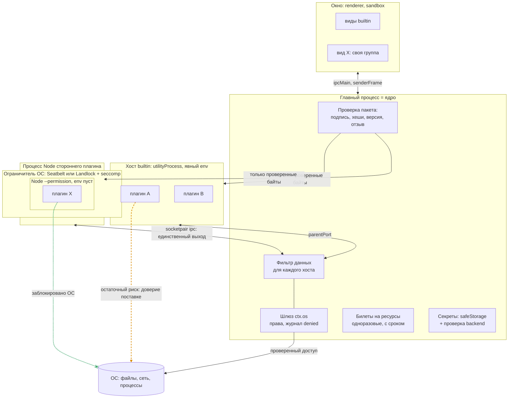

**Что здесь видно.** Три отличия от схемы «сейчас» ([2.1](02-current-state.md#21-процессы-и-границы-доверия)). Первое: до запуска любой пакет проходит проверку подписи и хешей. Второе: сторонний плагин сидит в трёх вложенных оболочках - разрешения Node внутри ограничителя ОС внутри отдельного процесса, и у него один выход - канал к ядру, то есть шлюз. Третье: встроенные плагины остаются в общем хосте и по-прежнему доверяют друг другу (оранжевая стрелка: остаточный риск, [5.9](#59-что-остаётся-незащищённым-и-почему)).

## 5.2. Слой «канал, идентичность и минимум данных»

**Решение.**

1. **Подлинность стороны = владение концом канала**, как сейчас. HMAC, AEAD, mTLS, Noise, подписи сообщений, `SO_PEERCRED` и `LOCAL_PEERTOKEN` на каналах ядро-хост **не вводим**: они не закрывают ни одной из угроз [таблицы 2.9](02-current-state.md#29-угрозы-мера-сейчас-и-пробел) (подмена в общем хосте и чтение сырого канала плагином в том же процессе они не лечат), стоят вычислений на горячем пути и порождают риск ошибок в самописной схеме.
2. **Идентичность плагина = процесс.** Недоверенный плагин всегда один в процессе (как сейчас: `assignHosts`, запись `host-isolated`). Правило закрепить тестом на **настоящем** процессе (TR-01), а не только на подделке сообщений.
3. **Минимум данных на входе в хост** (TR-03): `init` несёт манифесты плагинов этого хоста и тех, с кем у них есть привязки графа; `contracts` уходят только в хосты, где есть потребитель, объявивший этот контракт в `requires`, `optional` или `consumes`.
4. **Окружение хоста задаётся явно** (TR-02): список переменных вместо наследования `process.env`. Опыт В ([Б.1](08-sources-and-measurements.md#б1-опыт-что-может-код-плагина-в-utilityprocess)): `env: { PATH }` убирает токен главного процесса; плагин не видит ничего, что не передано.
5. **Билеты на ресурсы** (терминал; впредь любой ресурс, который ядро отдаёт процессу напрямую): непрозрачные, одноразовые, привязанные к плагину, с коротким сроком, гасятся при отключении плагина и падении хоста ([5.7](#57-слой-секреты-и-ключи)). Билет **идентичности** внутри общего процесса не вводим: сообщения несли бы его по общему `parentPort`, и вредоносный код в том же процессе увидел бы билет соседа.

**Почему так.** Вывод [4.1](04-options.md#41-канал-и-идентичность): криптография различает процессы, а не плагины внутри одного процесса. Для разных процессов различие уже даёт канал. Реальные дыры слоя - лишние данные на входе и наследование окружения (Опыт А, В) - закрываются удалением данных, а не шифрованием.

**Что можно на stdlib:** всё перечисленное. **Цена:** TR-03 - изменение внутреннего протокола ядро-хост (`init`, `contracts`), публичный API плагина не меняется; требует аккуратности при включении и выключении плагинов во время работы.

## 5.3. Слой «изоляция процесса»

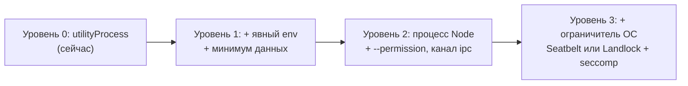

**Что здесь видно.** Каждая ступень включает предыдущую и закрывает больше. Уровень 1 делается сейчас; уровни 2 и 3 включаются по поводу этапа 2 для сторонних плагинов.

**Решение.**

1. **Встроенные плагины остаются в `utilityProcess`** (уровень 1). Они поставляются нами, проверяются в CI, ограничение для них - защита от ошибки ([ADR-CH-0003](../../04-architecture/adr/ADR-CH-0003-trust-and-isolation.md), п. 1), `utilityProcess` уже работает, а память хоста известна замером (около 34 МБ PSS на Linux, 15 МБ физического следа на macOS: [SAD 3.5](../../04-architecture/design/sad.md#35-изоляция-сбоев-хосты-и-сторож)); цена процесса на плагин в ADR-CH-0003 оценена в 12 МБ, мы её не сверяли.
2. **Сторонний плагин - процесс Node, не `utilityProcess`** (уровень 2). Основание: Опыт Б - в `utilityProcess` запреты Node не действуют, песочницы сервиса нет ([mojom](https://raw.githubusercontent.com/electron/electron/main/shell/services/node/public/mojom/node_service.mojom)). Канал - `child_process.fork` с `ipc` (`forkHosts`, `core/src/transports.ts:46-70` уже есть), параметры: пустой `env`, `execArgv: ['--permission', '--allow-fs-read=<проверенный каталог пакета>']`, без `--allow-child-process`, `--allow-worker`, `--allow-addons`.
3. **Проверка эффективности при старте (canary).** Хост при загрузке проверяет, что `process.permission` определён, и пробует запрещённое действие; результат отправляет ядру в `ready`. Ядро не активирует плагин, если запрет не действует. Именно такая проверка поймала бы «принятый и неработающий» `--permission` в `utilityProcess` ([Б.1](08-sources-and-measurements.md#б1-опыт-что-может-код-плагина-в-utilityprocess)).
4. **Ограничитель ОС** (уровень 3), отдельный шаг с вспомогательным бинарником или готовой утилитой:
   - macOS: профиль Seatbelt (`deny network*`, `deny process-fork`, чтение вне каталога). Опыт Д: `sandbox-exec` с таким профилем **работает** на macOS 27.2, вместе с `--permission` закрыты файлы, процессы, сеть. Риск: утилита помечена устаревшей ([man](https://keith.github.io/xcode-man-pages/sandbox-exec.1.html)), `sandbox_init` непубличен ([Chromium](https://chromium.googlesource.com/chromium/src/+/main/sandbox/mac/seatbelt_sandbox_design.md)). Смягчение: ограничитель спрятан за интерфейсом «ConfinerLauncher» с проверкой эффективности (п. 3).
   - Linux: Landlock (файлы, TCP с ядра 6.7) и seccomp в маленьком запускателе; bubblewrap - запасной путь, но Ubuntu 24.04 ограничивает userns через AppArmor. **На Linux мы ничего из этого не запускали** (приложение Б, «не проверено»).
   - Без ограничителя ОС плагин честно помечается «уровень 2: сеть и сокеты не закрыты» (FR-CH-3021).
5. **Фьюз `RunAsNode` против отдельного бинарника Node** (вопрос 2). В Electron процесс Node из бинарника приложения запускается через `ELECTRON_RUN_AS_NODE` (спайк задавал его явно: `docs/research/spikes/sad2/main-u2.js:28`); для этого фьюз `RunAsNode` должен быть включён (по умолчанию он включён), и любой процесс пользователя тогда может запустить подписанный бинарник приложения как Node ([fuses](https://www.electronjs.org/docs/latest/tutorial/fuses)). Отдельный бинарник Node (122 МБ на этой машине) снимает этот риск и позволяет выключить фьюз. Рекомендация - решить по замеру спайка TR-20, начать с `RunAsNode`.
6. **`Compartment` (`ses`)** остаётся вторым слоем против ошибок и цепочки поставок, не границей ([ADR-CH-0003](../../04-architecture/adr/ADR-CH-0003-trust-and-isolation.md), п. 9).

**Что этот слой закрывает:** Опыт А после решения: чтение `secrets.json`, запуск процессов, `parentPort` соседа - да (уровень 2), сеть - да (уровень 3). **Что не закрывает:** разрешённые права (`process`, `pty` - «полный доступ через программу», У-10), побеги из ядра ОС и Node, уязвимости самого Node. **Влияние на задержки:** сырой `socketpair` с самописным кадрированием дал RTT 17 мкс против 50 мкс у `parentPort` (канал `fork` с `ipc` не мерили); сколько даст весь протокол ядра (структурное клонирование, `advanced`-сериализация), покажет TR-20 - бюджет шлюза 1 мс на p99 оставляет запас на порядок, но **это не проверено**.

## 5.4. Слой «происхождение плагинов»

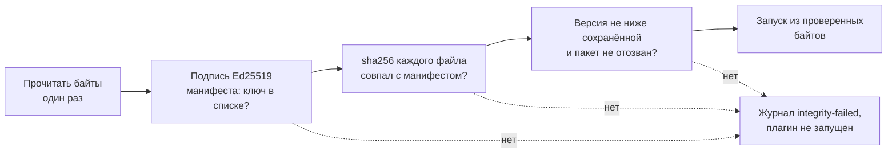

**Что здесь видно.** Четыре проверки идут подряд на одних и тех же прочитанных байтах; любое «нет» останавливает запуск и пишет причину. Ключевое слово «один раз»: файл не открывается второй раз после проверки, поэтому подменить его между проверкой и запуском нельзя.

**Решение.**

1. **Подписанный манифест пакета** (TR-10): `integrity.json` рядом с плагином с полями `id`, `version`, sha256 каждого файла, срок действия и идентификатор ключа; подпись Ed25519 над канонической записью. Формат своё, по образцу minisign ([minisign](https://jedisct1.github.io/minisign/)); `node:crypto` закрывает Ed25519, SHA-256 и `timingSafeEqual`. Доверие **не** берём из `manifest.json` плагина (автор пишет там что угодно).
2. **Хранилище доверия** (TR-11): ключ издателя поставки зашит в приложение; ключи сторонних издателей - в `userData` из слоя пользователя (по [ADR-CH-0015](../../04-architecture/adr/ADR-CH-0015-workspace-trust.md), п. 6 подтверждение не лежит в файле воркспейса). Рядом - наибольшая виденная версия по `id` (защита от отката) и подписанный список отозванных ключей и хешей со сроком годности (идея TUF, [TUF](https://theupdateframework.io/docs/overview/)).
3. **Исполнять то, что проверили.** Ядро читает байты, проверяет, и в процесс плагина отдаёт проверенную копию (например, во временный каталог ядра с правами владельца и только на чтение для процесса плагина), а не исходный путь. Конкретный способ загрузки из проверенных байтов **не проверен**: `import()` из `data:` ломает относительные импорты, а `cyborg-plugin build` собирает бандл главной части - один файл (SAD 6.1); проверка в спайке TR-20/TR-11.
4. **Поставка (встроенные)**: подписать `delivery.json` ключом выпуска (TR-12) и проверять при старте; режим «предупреждать» на пилотах, «отказывать» после (чтобы подпись не «окирпичила» приложение). Подпись приложения macOS (`codesign`, Hardened Runtime) остаётся обязанностью сборки приложения; для JS-плагинов она не помогает (вывод).
5. **Выпуск наших пакетов** `@cyborg-harness/*`: `npm publish --provenance` в CI даёт происхождение сборки (аттестация Sigstore, [npm](https://docs.npmjs.com/generating-provenance-statements)); это для потребителей пакета, не для проверки плагинов ядром (TR-13, по желанию).
6. **Отзыв:** список отозванных, смена эпохи ключа, выключение плагина и остановка хоста. Отзыв действует при следующей загрузке и сразу, если ядро получило обновлённый список.

**Что не даёт:** защиты от подмены самого приложения и списка ключей процессом пользователя (корень доверия - приложение); безопасности содержимого подписанного плагина. **Sigstore проверкой в ядре не берём:** для проверки сертификатов, журнала Rekor и корня нужны сторонние библиотеки, а ядро без зависимостей.

## 5.5. Рукопожатие ядро-хост при старте (целевой вариант)

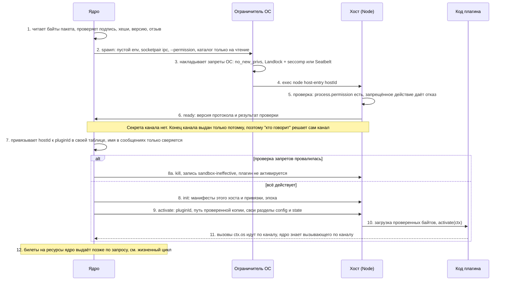

**Что здесь видно.** В рукопожатии нет секрета канала, и это сознательно: единственный конец канала выдан запущенному процессу. Вместо секрета есть три проверки: подпись пакета (шаг 1), эффективность запретов (шаги 5-6) и таблица «хост - плагин» в самом ядре (шаг 7). Имя плагина в сообщениях остаётся, но решает не оно.

**Где вообще нужен секрет канала.** Только там, где канал не приватен. Сегодня таких каналов у ядра нет (сокет экземпляров `claimInstance` передаёт запрос второго запуска, права 0600 в каталоге 0700). Если появится сокет с путём в ФС (например, отдельный процесс-посредник), придётся добавить `SO_PEERCRED` или `LOCAL_PEERTOKEN` и, возможно, токен сессии: тогда ключ сессии получают как `HMAC` от случайного 256-битного значения ядра и ротируют сменой эпохи ([4.2](04-options.md#42-токены-и-подписи)).

## 5.6. Запрос `ctx.os`: проверка права и запись в журнал

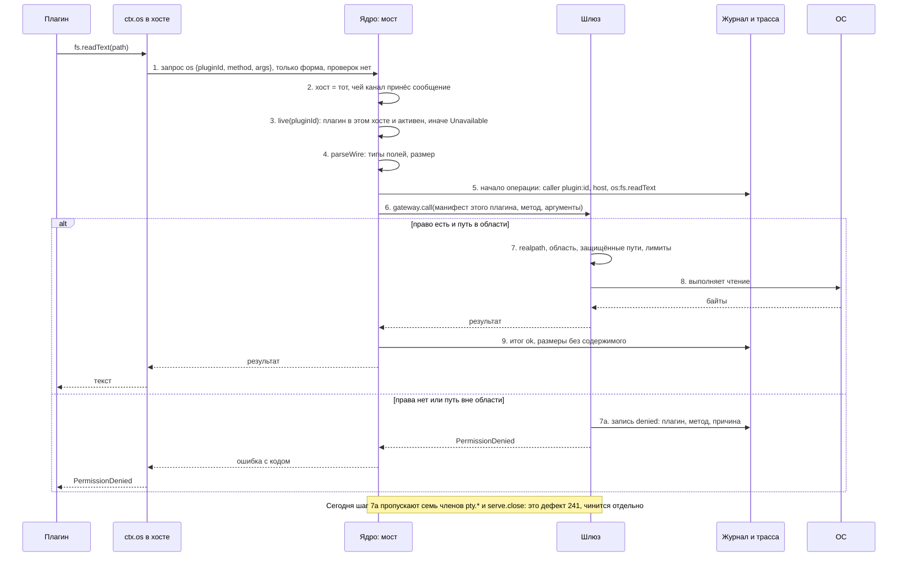

**Что здесь видно.** Решение о праве принимает ядро по **манифесту того плагина, чей канал принёс запрос**, а не по словам запроса. Клиент в хосте ничего не проверяет. Любой отказ оставляет запись `denied`. В целевом варианте этот путь **не меняется**: новые слои стоят вокруг него (процесс не может обойти его мимо канала), а не внутри, поэтому бюджет шлюза не затронут.

## 5.7. Слой «секреты и ключи»

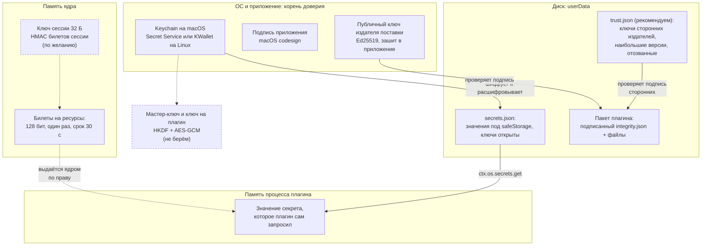

**Что здесь видно.** Сплошные стрелки - то, что рекомендуем и что уже есть. Пунктирные узлы - по желанию (ключ сессии) или не берём (ключ на плагин). Секрет в открытом виде существует только в двух местах: во время расшифровки в ядре и в памяти процесса плагина, который его запросил. На диске и в журнале его нет.

| Что | Где хранится | Кто читает | Статус |
|---|---|---|---|
| Значения секретов | `userData/secrets.json`, под `safeStorage` | ядро; плагин свои через шлюз | ✅ есть |
| Ключи секретов `<плагин>/<ключ>` | там же, открытым текстом | любой, кто читает файл | ⚠️ раскрывают, какие секреты у кого |
| Ключ шифрования | хранилище ОС (Keychain, Secret Service, KWallet) | Chromium по запросу приложения | ✅ на macOS; ⚠️ на Linux, `basic_text` не проверяется |
| Публичный ключ издателя поставки | в приложении | ядро | новое, рекомендуем (TR-12) |
| Ключи сторонних издателей, версии, отозванные | `userData/trust.json` | ядро | новое, рекомендуем (TR-11) |
| Билеты на ресурсы | память ядра | ядро; предъявитель | ✅ для терминала; шаблон для новых |
| Ключ сессии для HMAC-билетов | память ядра | ядро | по желанию, сейчас не нужен |
| Ключ на плагин (HKDF + AES-GCM) | - | - | ❌ не берём |
| Секреты в `env`, `argv` | процесс | тот же пользователь (`ps -E`, `/proc/<pid>/environ`) | ✅ правило: не передавать |

**Решение.**

1. **Хранилище остаётся на `safeStorage`**, корень доверия - ОС ([ADR-CH-0014](../../04-architecture/adr/ADR-CH-0014-secrets.md)). Асинхронный API уже используется, синхронный исчезнет в Electron 46 ([safeStorage](https://www.electronjs.org/docs/latest/api/safe-storage)).
2. **На Linux проверять backend** (TR-04): при `basic_text` объявлять шифрование недоступным (`Unavailable` с понятной причиной), как уже делается без keyring; ручная проверка на Linux с `--password-store=basic`. Каков ответ `isAsyncEncryptionAvailable()` при `basic_text`, не проверено.
3. **Права файлов** `userData` (TR-05): `0600` на файлы и `0700` на каталоги, не полагаясь на umask.
4. **Не берём:** шифрование данных плагина ключом на плагин (защита от чтения файлов одним плагином у другого даёт процесс-граница и запреты ОС, не шифрование: ключ всё равно в памяти ядра), Secure Enclave и TPM2 (не защищают от процесса того же пользователя, Enclave только P-256), `mlock`, `PT_DENY_ATTACH`, Yama (нужен нативный код, не закрывают чтение окружения).
5. **Значение секрета в памяти плагина** - неизбежно: плагин, запросивший секрет, его получил. Защита - в том, что **вредоносный** плагин в своём процессе под запретами не унесёт его мимо ядра (уровень 3), и в журнале значение вычёркивается (K-29).

### Жизненный цикл билета

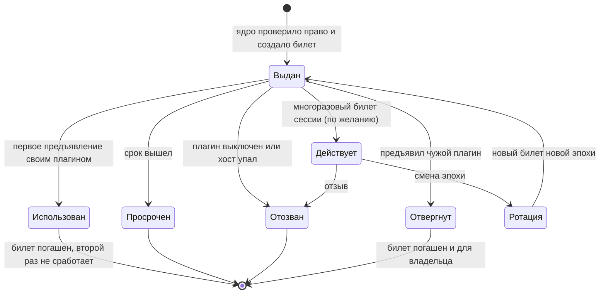

**Что здесь видно.** Билет живёт мало и погашается при первом использовании - «выдача, использование, отзыв» уже реализованы для терминала (`core/src/pty.ts:212-229`: срок 30 с, привязан к плагину, гасится даже чужим предъявлением). Ветка «Действует - Ротация» нужна только для многоразового билета сессии, которого мы сейчас **не вводим**; она показана, чтобы было ясно, как его ротировать и отзывать, если появится общий транспорт. Отзыв при падении хоста и выключении плагина закрепить тестом (**не проверено**, что все ветки отзыва покрыты).

## 5.8. Слой «виды»

**Решение: оставить как есть, закрыть тестами и одним уточнением.**

1. Origin на группу рендера, `senderFrame` на каждом IPC, мост только документам схемы `cyborg-plugin:`, CSP `default-src 'none'` - уже сделаны и под тестами; сторонний плагин всегда один в своей группе.
2. **Тест на настоящем Electron** (TR-31): сейчас идентичность вида проверяется на подставных кадрах (`electron/test/view-frames.test.ts`), в окне проверяет её только smoke. Нужен тест, где вид пробует `history.pushState` на путь соседа, чужую страницу во фрейме и вызов канала мимо моста.
3. **Уточнение:** привязывать плагина к кадру при создании и не перечитывать из текущего `frame.url` (закрывает `pushState` в общей группе). Есть ли в Electron 45 стабильный идентификатор кадра для такой привязки, **не проверено**; решение зависит от спайка.
4. Чувствительные каналы видов передавать **портом по билету**, как терминал, а не общим IPC (шаблон, не обязательная задача).

## 5.9. Что остаётся незащищённым и почему

| Остаточный риск | Почему остаётся | Как смягчаем | Принято ли |
|---|---|---|---|
| Вредоносный код в общем хосте среди встроенных (npm-зависимость, У-42) | Граница - процесс; внутри процесса плагины неразличимы, билеты не помогут ([5.2](#52-слой-канал-идентичность-и-минимум-данных)) | Проверка происхождения пакетов (вопрос 11 SRS); чувствительные встроенные плагины с `"host": "own"`; `Compartment` как слой | ⚠️ ждёт решения |
| Права `process` и `pty` дают права пользователя | Это назначение прав (У-10, У-46) | Закреплённые аргументы, `deny`, слова в окне «полный доступ через программу» | ✅ принято |
| Подмена приложения и списка ключей процессом пользователя | Корень доверия - приложение | Подпись приложения macOS; Linux - только пакетный менеджер дистрибутива | ✅ вне охвата |
| Компрометация главного процесса | После неё границ нет | Минимум зависимостей, строгий разбор входа | ✅ вне охвата |
| Процесс того же пользователя читает `/proc/<pid>/environ`, делает `ptrace` | ОС эту границу не охраняет без Yama и песочниц | Не передавать секреты в `env` и `argv`; фьюзы | ✅ вне охвата ([модель угроз, раздел 1](../../04-architecture/design/threat-model.md#1-предмет-и-граница)) |
| Побеги из Node, Chromium, ядра ОС | Уязвимости ПО | Обновления | ✅ вне охвата |
| Сеть мимо шлюза до появления ограничителя ОС | Node 24 сеть не закрывает | Уровень 3; до него явная пометка человеку | ⚠️ до этапа В2 |
| Вид рисует подделку диалога ядра (У-24) | Вид владеет своим прямоугольником | Окно согласия рисует ядро | ✅ принято частично |
| Промпт-инъекция в агента (Г7) | Права агента задаёт агент | Не ослаблять режим разрешений | ✅ принято |
| Гонка проверки и использования по пути (У-05) | `O_NOFOLLOW` только на последнем компоненте | Операции от дескриптора каталога - отдельная задача | ⚠️ без задачи |

## 5.10. Пять атак: как было и что станет

Для каждой атаки: сначала диаграмма «сейчас» и «с мерами», затем таблица шагов с указанием слоя, на котором нападение останавливается. Слои: **L1** канал и таблица «хост - плагин», **L2** минимум данных и окружение, **L3** происхождение, **L4** изоляция процесса (разрешения Node, ограничитель ОС), **L5** шлюз `ctx.os`, **L6** секреты, **L7** виды.

### Атака 1. «Плагин прикидывается соседом»

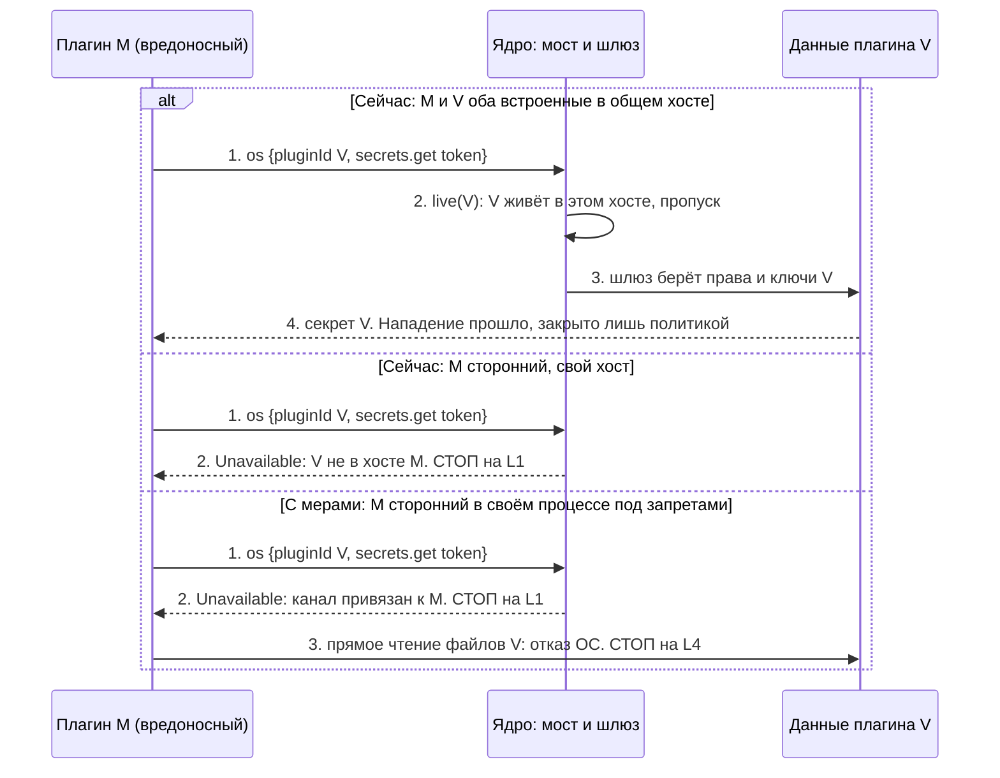

| Шаг | Сейчас | С мерами | Слой, где стоп |
|---|---|---|---|
| 1 | M шлёт `os` с чужим `pluginId` | то же | - |
| 2 | Общий хост: пропуск; свой хост: `Unavailable` (`core/src/host-bridge.ts:18-22`) | Привязка «хост - плагин» в таблице ядра, имя только сверяется; сторонний в общий хост не попадает (тест на настоящем процессе, TR-01) | **L1** |
| 3 | - | Обход канала: чтение файлов V напрямую запрещено разрешениями Node и ОС | **L4** |
| Остаток | Два **встроенных** плагина в общем хосте доверяют друг другу полностью | То же: решает политика «чувствительные встроенные в своём хосте» (вопрос 7.1.6) | не закрыто, принято |

### Атака 2. «Плагин читает чужие данные и манифесты»

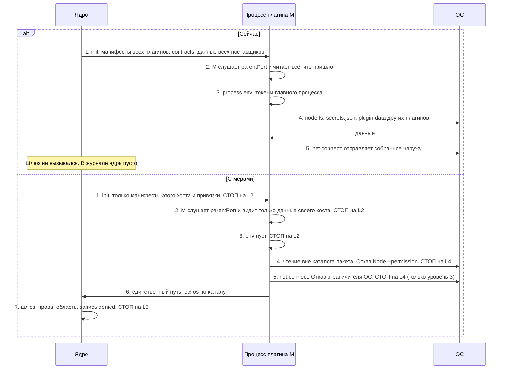

| Шаг | Сейчас (Опыт А) | С мерами | Слой |
|---|---|---|---|
| 1-2 | Видит `init` с чужими манифестами и `contracts` с чужими данными | Присылаются только данные своего хоста (TR-03) | **L2** |
| 3 | Видит `process.env` главного процесса целиком | Окружение пустое (Опыт В) | **L2** |
| 4 | Читает любой файл пользователя, включая `secrets.json` | `--permission --allow-fs-read=<каталог пакета>` и профиль ОС: `ERR_ACCESS_DENIED` / `EPERM` (Опыт Г, Д) | **L4** |
| 5 | Открывает TCP | Уровень 2: **открыто**; уровень 3: запрещено ОС (Опыт Д) | **L4** (ограничитель) |
| 6-7 | Не нужен: идёт мимо | Через канал: шлюз проверяет и пишет `denied` | **L5** |

### Атака 3. «Подмена пакета плагина»

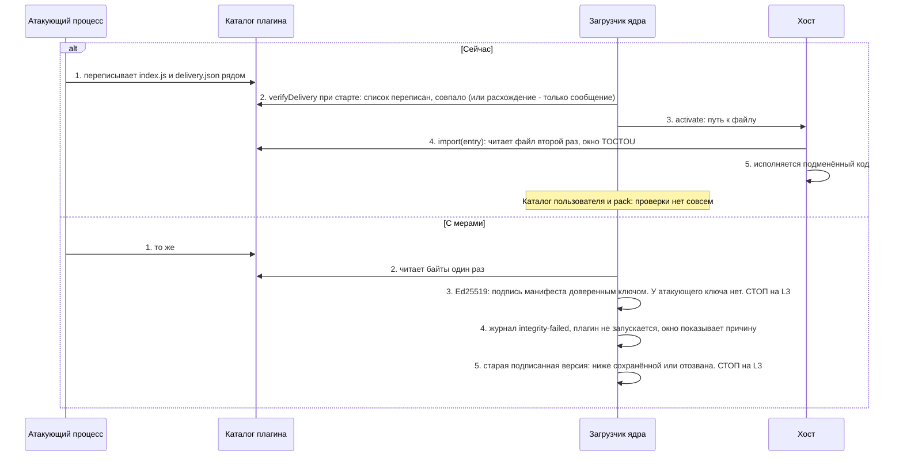

| Шаг | Сейчас | С мерами | Слой |
|---|---|---|---|
| 1 | Подмена файлов и `delivery.json` | то же (предотвратить нельзя: тот же пользователь) | - |
| 2 | Сверка один раз; список подделан вместе с файлами; сообщает, но не отказывает (`electron/src/plugins.ts:149-151`) | Байты читаются один раз | **L3** |
| 3 | - | Подпись не сходится: секретного ключа издателя у атакующего нет | **L3** |
| 4-5 | Подмена выполняется | Отказ, откат на старую версию отвергнут | **L3** |
| Остаток | Атакующий, подменивший **приложение** или список доверенных ключей, подпись обходит | Корень доверия - приложение; вне охвата ([5.9](#59-что-остаётся-незащищённым-и-почему)) | - |

### Атака 4. Повтор (replay)

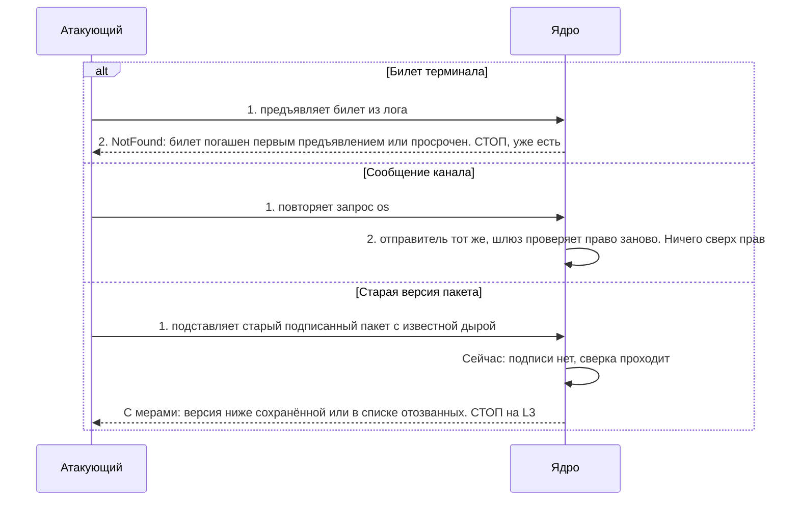

| Вариант | Сейчас | С мерами | Слой |
|---|---|---|---|
| Билет терминала | ✅ одноразовый, 30 с, привязан к плагину (`core/src/pty.ts:212-229`) | то же | L5 |
| Сообщение канала | ✅ повторять нечем: канал приватен, `id` подряд, неизвестный `res` отбрасывается | то же; nonce вводить только вместе с общим транспортом | L1 |
| Откат пакета | ❌ ничего | Наибольшая версия в `trust.json`, срок годности и список отозванных (TR-11) | **L3** |

### Атака 5. «Вид пишет от имени хоста»

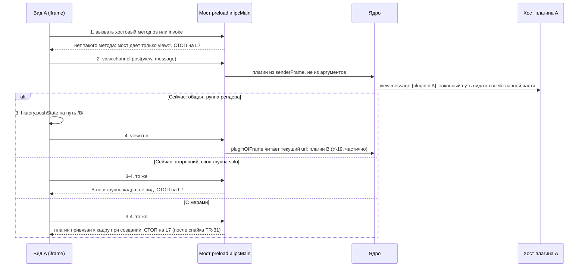

| Шаг | Сейчас | С мерами | Слой |
|---|---|---|---|
| 1 | Нет пути: мост не экспонирует методы хоста | то же | **L7** |
| 2 | Плагин из `senderFrame`, размер до 64 КиБ, имя вида сверяется с манифестом (`core/src/view-channels.ts:108-118`) | то же | L7 |
| 3-4 общая группа | `pushState` меняет путь, виды становятся соседями (`electron/src/view-frames.ts:12-21`) | Привязка к кадру при создании; чувствительные плагины в своей группе (`plugins.uiGroups` из слоя пользователя) | **L7** |
| 3-4 сторонний | Отвергается: плагин обязан состоять в группе кадра | то же; тест на настоящем Electron (TR-31) | **L7** |

## 5.11. Слои защиты

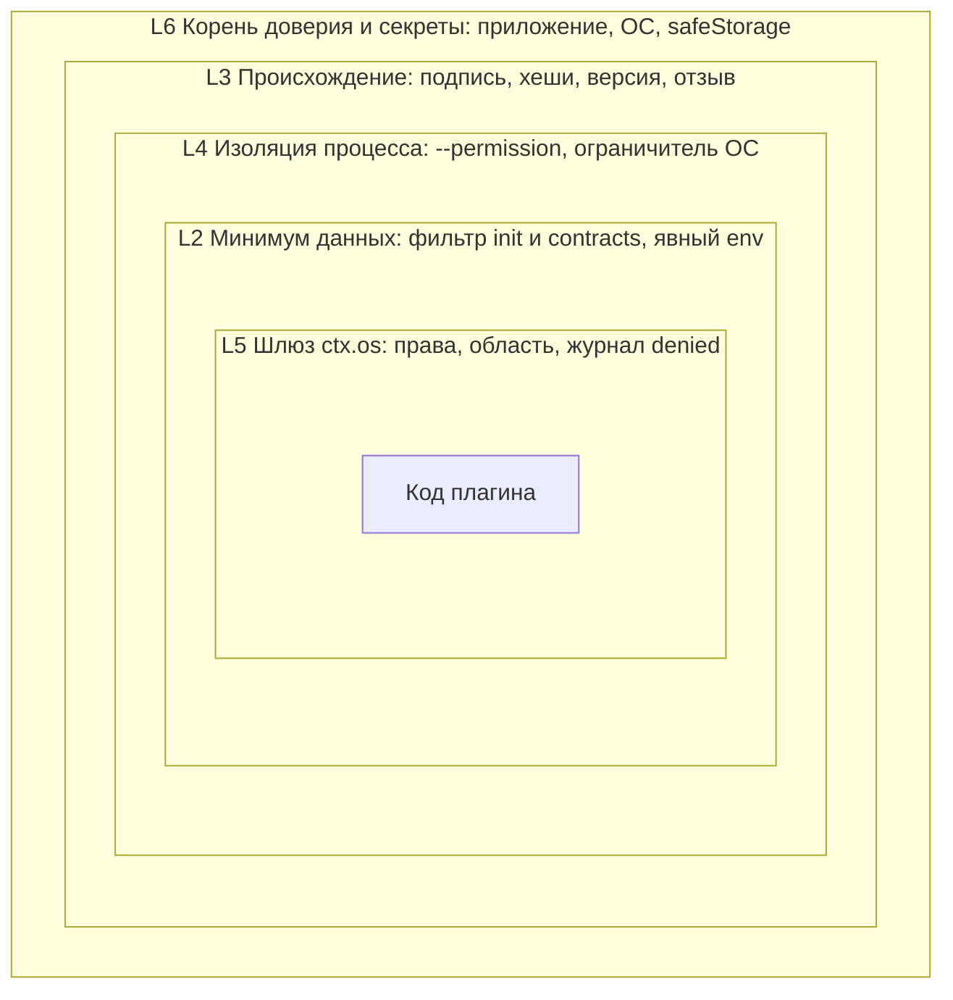

**Что здесь видно.** Код плагина в центре; чтобы навредить, ему нужно пройти слои изнутри наружу. Шлюз (L5) уже есть. Слои L2, L3, L4 - то, что предлагается. Если один слой даст сбой, остальные продолжают работать; ни один слой не заявляется как единственная граница.

**Матрица «угроза × слой».** ✅ слой закрывает угрозу; ⚠️ закрывает частично или при условии; ❌ не закрывает; «-» не относится. Колонка «сейчас» показывает состояние до плана.

| Угроза | Сейчас | L1 канал | L2 данные | L3 подпись | L4 процесс | L5 шлюз | L6 секреты | L7 виды |
|---|---|---|---|---|---|---|---|---|
| Подмена плагина из другого хоста | ✅ | ✅ | - | - | - | - | - | - |
| Подмена плагина в общем хосте | ⚠️ политикой | ⚠️ | - | - | ✅ (свой процесс) | - | - | - |
| Подмена хоста чужим процессом | ⚠️ | ✅ | - | - | ⚠️ (канал в потомке) | - | - | - |
| Подмена вида | ⚠️ | - | - | - | - | - | - | ✅ / ⚠️ общая группа |
| Чтение чужих манифестов и данных контрактов | ❌ | - | ✅ | - | ⚠️ | - | - | - |
| Чтение чужих файлов мимо шлюза | ❌ | - | - | - | ✅ | - | - | - |
| Чтение окружения главного процесса | ❌ | - | ✅ | - | ✅ | - | ⚠️ | - |
| Обход шлюза: процессы | ❌ | - | - | - | ✅ | ✅ | - | - |
| Обход шлюза: сеть | ❌ | - | - | - | ⚠️ только уровень 3 | ✅ | - | - |
| Подмена пакета плагина | ❌ | - | - | ✅ (обнаружение) | - | - | - | - |
| Откат на старую версию | ❌ | - | - | ✅ | - | - | - | - |
| Повтор сообщения канала | ✅ | ✅ | - | - | - | ✅ | - | - |
| Повтор билета | ✅ | - | - | - | - | ✅ | - | - |
| Секрет в покое (файл) | ⚠️ | - | - | - | ⚠️ | - | ✅ (+backend) | - |
| Секрет в журнале | ⚠️ | - | - | - | - | ✅ | ✅ | - |
| Вредный npm-пакет во встроенном плагине | ❌ | - | - | ⚠️ происхождение | ⚠️ если плагин в своём процессе | - | - | - |
| Побег из ядра ОС или Node | ❌ | - | - | - | ❌ | - | - | - |
| Компрометация ядра | ❌ | - | - | - | - | - | - | - |

## 5.12. Отвергнутые альтернативы

| Альтернатива | Почему отвергнута | Когда пересмотреть |
|---|---|---|
| HMAC или AEAD на каналах ядро-хост | Канал приватен; не отделяет плагины внутри процесса; не закрывает ни одной угрозы таблицы 2.9; +70 мкс на сообщение в наивной обвязке (Опыт) | Появится канал по пути в ФС или сеть |
| `SO_PEERCRED` и `LOCAL_PEERTOKEN` на хостах | У каналов хостов нет посторонних концов; нужен нативный код; все плагины одного пользователя с одним uid | Появится сокет с путём |
| mTLS, Noise, SPIFFE | Высокая сложность и риск самописной криптографии при нуле выгоды на локальном канале | Хосты за границей машины |
| Билет идентичности плагина в общем хосте | Секрет в памяти процесса виден соседу | Никогда как граница; допустим как «ремень» против ошибок |
| Macaroons, Biscuit | Нет делегирования между процессами, ядро единственный посредник | Появится передача прав между процессами |
| Sigstore как проверка в ядре | Нужны X.509, Rekor, TUF-корень: сторонние библиотеки; ядро без зависимостей | Ядро получит зависимости или проверку вынесут во внешний шаг установки |
| `--permission` в `utilityProcess` | Опыт Б: не действует | Если Electron реализует (проверять каждый релиз canary-тестом) |
| App Sandbox для приложения | Меняет модель доступа к `ctx.os` целиком | Нет |
| Firejail, AppArmor, SELinux | SUID-утилита, политики администратора | Нет |
| WASM-компоненты, хост как рендерер без Node | Меняют формат плагина; ломают принцип "переход меняет среду, а не код" | Если сторонние плагины станут продуктовой целью |
| Шифрование данных ключом на плагин | Ключ в памяти ядра; защиту от чтения чужих файлов даёт процесс, не шифрование | Если файлы плагинов будут храниться вне `userData` |
| Secure Enclave, TPM2, `mlock`, `PT_DENY_ATTACH` | Не защищают от процесса того же пользователя; нативный код; Enclave только P-256 | Нет |
| `node:vm` как граница | Не механизм безопасности ([vm](https://nodejs.org/docs/latest-v24.x/api/vm.html)) | Нет |
| Подпись в манифесте плагина | Автор пишет в манифест что угодно | Нет |

## 5.13. Что делается на stdlib, а что требует вспомогательного бинарника

| Мера | Только Node/Electron | Требует бинарника или аддона | Цена |
|---|---|---|---|
| Явный `env` хоста | ✅ | - | S |
| Фильтрация `init` и `contracts` | ✅ | - | M |
| Проверка backend `safeStorage` | ✅ | - | S |
| Права файлов `userData` | ✅ | - | S |
| Подпись Ed25519, хеши, версия, отзыв | ✅ `node:crypto` | - | M-L |
| Билеты на ресурсы | ✅ | - | S |
| Тесты на настоящем `utilityProcess` | ✅ | - | M |
| Процесс Node с `--permission` и пустым `env` | ✅ (при `RunAsNode` или отдельном `node`) | отдельный `node` - 122 МБ (опыт на этой машине) | L |
| Canary-проверка эффективности запретов | ✅ | - | S |
| Seatbelt на macOS | ⚠️ через `sandbox-exec` (устарела) | помощник с `sandbox_init` для устойчивости | M |
| Landlock и seccomp на Linux | - | ✅ маленький запускатель на C или Rust | L |
| `SO_PEERCRED`, `LOCAL_PEERTOKEN`, `mlock`, `PT_DENY_ATTACH` | - | ✅ аддон или `node:ffi` (Node 26.1+, в Electron 45 нет) | не берём |
| Проверка Sigstore | - | ✅ библиотека | не берём |
