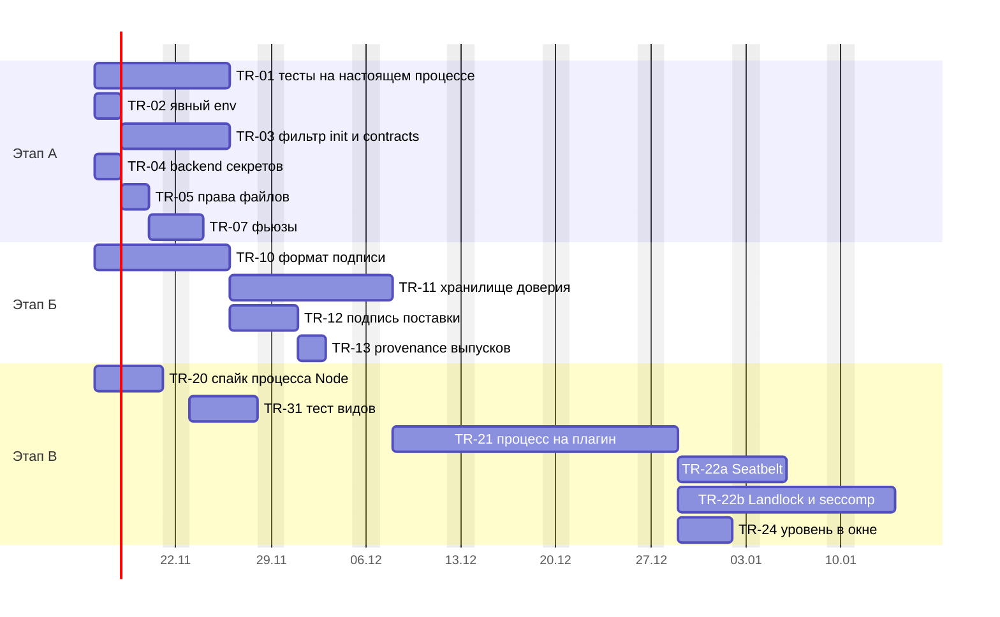
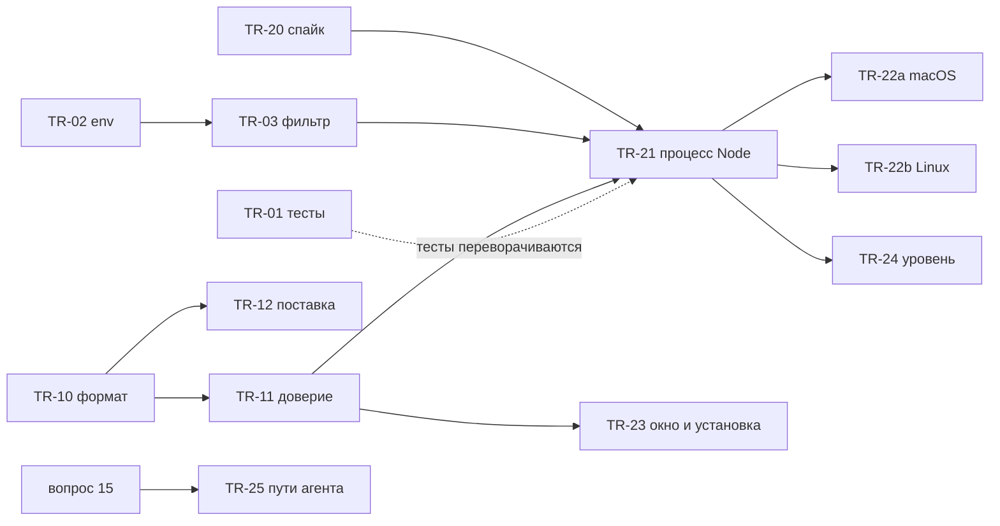

[К оглавлению (README)](README.md) · [← Выбор способа](05-decision.md) · [Открытые вопросы →](07-open-questions.md)

# 6. План работы

Номера задач `TR-NN` - рабочие заготовки этого документа; настоящие номера выдаст трекер. Размеры: **S** - 1-3 рабочих дня, **M** - 4-8, **L** - 10-20 одного разработчика (оценка составителя, не измерение). Столбец «API» отвечает на вопрос: меняется ли публичная форма (`contracts/`, `PluginContext`, манифест, публичные типы пакета ядра); если да, это кандидат следующего `1.0.0-rc.N` с записью в [`contracts/CHANGELOG.md`](../../../contracts/CHANGELOG.md).

## 6.1. Этапы

| Этап | Название | Условие начала | Что даёт | Уровень ([3.3](03-goals-and-threat-model.md#33-уровни-защиты)) |
|---|---|---|---|---|
| **А** | Честный минимум | Можно сразу: меры дешёвые, на stdlib, поведение плагинов не меняют | Находки 3 и 6 и окружение хоста (часть находки 1) из [раздела 0](README.md#0-коротко-на-одну-страницу); тесты на настоящем процессе | 1 |
| **Б** | Происхождение | Можно параллельно с А; обязателен до установки сторонних плагинов | Подписанные пакеты, откат и отзыв; находка 5 | 1-2 |
| **В** | Изоляция доступа | Повод этапа 2 (плагин от автора вне команды или каталог плагинов); спайк TR-20 можно сделать раньше | Процесс Node на сторонний плагин, ограничитель ОС; находки 1 и 2 (для сторонних плагинов) | 2-3 |

## 6.2. Задачи

### Этап А. Честный минимум

| ID | Суть | Зависит от | Критерии приёмки | Размер | API | Пакеты |
|---|---|---|---|---|---|---|
| **TR-01** | Тесты-подделки на **настоящем** `utilityProcess`: плагин-нарушитель в хосте стороннего плагина | - | 1. Скрипт по образцу `playground/scripts/spike-hosts.mjs` и smoke запускает настоящий хост (Linux через `xvfb-run`). 2. Нарушитель читает `process.parentPort`, `process.env`, файл «ядра», запускает процесс, открывает TCP; результаты сравниваются с таблицей [2.8](02-current-state.md#28-что-показал-опыт-код-плагина-в-utilityprocess). 3. Известные дыры записаны как «ожидаемо открыто» со ссылкой на TR-21/22; после соответствующей задачи ожидание переворачивается. 4. Тест «сторонний не делит хост с чужим» идёт на настоящих процессах. 5. Включён в CI на macOS и Linux | M | нет | `playground`, `electron`, `core` (тесты) |
| **TR-02** | Явный `env` хоста плагинов | - | 1. `utilityProcess.fork(..., { env })` с перечнем переменных (стартовый список - `PATH`, минимум для Electron; расширять по доказательствам). 2. Нарушитель из TR-01 не видит переменных, которых нет в перечне. 3. Smoke зелёный на macOS и Linux. 4. Список задокументирован в `electron/README.md` | S | нет | `electron` |
| **TR-03** | Фильтрация `init` и `contracts` по хостам | - | 1. `init` хосту содержит манифесты плагинов этого хоста и тех, с кем у них есть привязки графа (`requires`, `optional`, `consumes`). 2. `contracts` уходит только в хосты, где объявлен потребитель этого контракта; при `enable`/`disable` и перезапуске хоста зеркала актуальны. 3. Тест-запись канала в подставном хосте (`trust.test.ts`) подтверждает, что чужих манифестов и данных нет; существующие тесты `hosts.test.ts`, `loader.test.ts`, `stress-restart.test.ts` зелёные. 4. `npm run spike:hosts`: круг и перезапуск не хуже на 5% | M | нет (внутренний протокол; `core/test/api-snapshot` не меняется) | `core` |
| **TR-04** | Проверка backend секретов на Linux | - | 1. При `getSelectedStorageBackend() === 'basic_text'` хранилище недоступно (`Unavailable`) с причиной словами человека, запись в журнале; на macOS поведение прежнее. 2. Ручная проверка на Linux с `--password-store=basic` и с рабочим keyring (результат в `docs/05-verification/`). 3. Обновлён [ADR-CH-0014](../../04-architecture/adr/ADR-CH-0014-secrets.md), п. 1 | S | нет | `electron` |
| **TR-05** | Права файлов `userData` | - | `cyborg.json`, `state`, `diagnostics/*` создаются `0600`, каталоги `0700` независимо от umask; тест с `umask 022` | S | нет | `core`, `electron` |
| **TR-06** | Загрузчик вызывает проверку импортов для сторонних плагинов как **предупреждение** | - | Для плагина вне поставки перед активацией `checkPlugin`; найденное пишется в журнал; плагин не блокируется (это дисциплина, не защита). Закрывает «Расхождения» [ADR-CH-0003](../../04-architecture/adr/ADR-CH-0003-trust-and-isolation.md) п. 6 | S | возможно: новый вид записи журнала (см. TR-11) | `core` |
| **TR-07** | Чек-лист фьюзов и сборки для приложения-потребителя | вопрос 2 (по `RunAsNode`) | `electron/README.md`: `EnableNodeCliInspectArguments` выкл., `EnableNodeOptionsEnvironmentVariable` выкл., ASAR integrity (macOS), решение по `RunAsNode`; проверка в smoke упакованного приложения ([`bundled-delivery.md`](../../05-verification/bundled-delivery.md)) | S | нет | `electron`, `playground` |

### Этап Б. Происхождение

| ID | Суть | Зависит от | Критерии приёмки | Размер | API | Пакеты |
|---|---|---|---|---|---|---|
| **TR-10** | Формат подписанного пакета и команды `cyborg-plugin sign` и `verify` | вопрос 4 | 1. `integrity.json`: `id`, версия, sha256 файлов, срок, идентификатор ключа; подпись Ed25519 над канонической записью. 2. `verify` отказывает при любом изменённом байте, лишнем файле, чужом ключе, истёкшем сроке. 3. `pack` воспроизводим и кладёт `integrity.json`. 4. Только `node:crypto` | M | нет для `contracts/`; команды `cyborg-plugin` (инструмент, не `PluginContext`) | `tools/cyborg-plugin`, `core` |
| **TR-11** | Хранилище доверия и проверка перед запуском | TR-10 | 1. `userData/trust.json` из слоя пользователя: ключи издателей, наибольшие версии, список отозванных со сроком. 2. Загрузчик читает байты один раз, проверяет, исполняет проверенную копию. 3. Подмена файла, откат версии, отозванный ключ - плагин не запущен, запись `integrity-failed` и причина в окне. 4. Режимы «предупреждать» и «отказывать» (поставка начинает с первого). 5. Способ загрузки из проверенных байтов выбран и проверен на macOS и Linux | L | возможно: новые виды `JournalEntry`, публичный тип пакета ядра (`core/src/index.ts:36`); входит ли он в снимок API, не проверено; если входит - кандидат `rc.N` | `core`, `electron` |
| **TR-12** | Подпись `delivery.json` поставки | TR-10 | Ключ выпуска; `verifyDelivery` проверяет подпись; расхождение пишется в журнал; режим отказа включается отдельным решением после пилотов | S | нет | `core`, `tools/cyborg-plugin` |
| **TR-13** | Происхождение выпусков наших пакетов | - | `npm publish --provenance` в workflow выпуска, проверка `npm audit signatures` на потребителе (условие: облачные раннеры, см. [npm](https://docs.npmjs.com/generating-provenance-statements)) | S | нет | CI |
| **TR-14** | Мера против У-42: перечень пакетов бандла и версий в отчёте сборки | вопрос 11 SRS | Перечень в выводе `cyborg-plugin build`; `npm audit --omit=dev` уже есть в CI (задание `audit`) | S | нет | `tools/cyborg-plugin` |

### Этап В. Изоляция доступа (по поводу этапа 2)

| ID | Суть | Зависит от | Критерии приёмки | Размер | API | Пакеты |
|---|---|---|---|---|---|---|
| **TR-20** | **Спайк:** хост как процесс Node (`forkHosts`) с `--permission` и пустым `env` | - (можно сейчас) | 1. Замер на macOS и Linux: RTT, p99 вызова, память, старт против `utilityProcess` (`spike-hosts`). 2. Работает ли весь протокол ядра (структурное клонирование, пинг сторожа). 3. `RunAsNode` против отдельного бинарника: размер, подпись, поведение фьюза. 4. Способ загрузки проверенных байтов. 5. Отчёт в `docs/05-verification/` с вердиктом по бюджетам | M | нет | `core`, `playground` |
| **TR-21** | Сторонний плагин как процесс Node | TR-20, TR-03, TR-11 | 1. `spawnHost` выбирает способ запуска по происхождению плагина; пустой `env`; `--permission` с чтением только проверенного каталога; без `--allow-child-process`, `--allow-worker`, `--allow-addons`. 2. Canary: хост проверяет `process.permission` и запрещённое действие, ядро не активирует плагин при провале, запись `sandbox-ineffective`. 3. Нарушитель из TR-01: чтение, процесс, воркер, аддон дают отказ (FR-CH-3022, часть); сеть - записана как открытая. 4. Бюджеты шлюза соблюдены (`npm run check:budgets`). 5. Возврат на `utilityProcess` одной настройкой | L | нет для плагина; возможны новые виды записей журнала (см. TR-11) | `core`, `electron` |
| **TR-22a** | Ограничитель ОС для macOS | TR-21 | Профиль Seatbelt (`deny network*`, `deny process-fork`, чтение вне каталога) за интерфейсом запуска; canary подтверждает; нарушитель не открывает сокет и не читает вне каталога; решение по `sandbox-exec` против помощника | M | нет | `electron` |
| **TR-22b** | Ограничитель ОС для Linux | TR-21 | Запускатель накладывает `no_new_privs`, Landlock (по версии ABI ядра) и seccomp; на ядрах без нужного ABI - честная пометка уровня; CI на двух версиях ядра (до и после 6.7); проверка на Ubuntu 24.04 | L | нет | `electron`, новый бинарник |
| **TR-23** | Окно согласия и установка | TR-10, TR-11 | Существующие задачи этапа 2 (X-03, X-04 из [sad2-disputed-points](../../04-architecture/design/sad2-disputed-points.md), FR-CH-3023, FR-CH-3024); здесь только зависимость | L | да (окно, манифест установки): кандидаты `rc.N` по решению владельца | `core`, `electron` |
| **TR-24** | Уровень изоляции плагина в «Плагины Cyborg» и журнале | TR-21 | Человек видит уровень (0-3) и причину; сеть без ограничителя названа словами (FR-CH-3021) | S | возможно: поле в публичном описании состояния плагина - тогда кандидат `rc.N` (не проверено, какой публичный тип его несёт) | `core`, `electron` |
| **TR-25** | Пути конфигурации агента (У-46, вопрос 15 SRS) | решение владельца | Вариант (а): защищённые пути `~/.claude/settings.json`, `.mcp.json`, `CLAUDE.md` и т. п.; тесты шлюза; закрывает У-46 | S-M | поведение, не форма | `core` |
| **TR-31** | Тест видов на настоящем Electron и привязка плагина к кадру | - | 1. Вид пробует `history.pushState` на путь соседа, чужую страницу во фрейме, обход моста: результаты зафиксированы. 2. Если в Electron 45 есть стабильный идентификатор кадра, плагин привязывается при создании кадра; иначе запись в «не проверено» | M | нет | `electron` |

**Влияние на публичный API: итог.** Рекомендованные задачи не меняют форму `ctx`, `ctx.os`, манифеста и контрактов. Кандидатов `rc.N` может быть два, оба условные: новые виды записей журнала (TR-06, TR-11, TR-21) и поле уровня изоляции в публичном описании состояния (TR-24). Окно согласия и установка (TR-23) - отдельное решение владельца. Менять `ctx.os.paths.home` не предлагаем: домашний каталог и так известен коду Node.

## Статус реализации

Состояние на 2026-11-13. Стек PR идёт снизу вверх: этап А ([#250](https://github.com/dex-it/cyborg-harness/pull/250), задача [#246](https://github.com/dex-it/cyborg-harness/issues/246)), затем этап Б ([#247](https://github.com/dex-it/cyborg-harness/issues/247)), этап В1 ([#248](https://github.com/dex-it/cyborg-harness/issues/248)) и этап В2 ([#249](https://github.com/dex-it/cyborg-harness/issues/249)); слияние снизу вверх. Строки других этапов дополняют их исполнители.

| Задача | PR | Что сделано | Не сделано, замечания |
|---|---|---|---|
| TR-01 | [#250](https://github.com/dex-it/cyborg-harness/pull/250) | Проба `--trust-probe` в playground и тест `playground/test/real/trust-real-host.test.ts` (`npm run test:trust`) на настоящем `utilityProcess`: нарушитель в хосте стороннего плагина читает окружение и файл ядра, запускает процесс, открывает TCP, слушает сырой `parentPort`, пишет от имени соседа; ожидания по строкам таблицы 2.8; шаг CI на macOS и Linux | Открытые дыры записаны «ожидаемо открыто» со ссылкой на TR-21 (файлы, процесс, `parentPort`, `process.permission`) и TR-22 (сеть). Замечание к таблице 2.8: `init` плагин сырым слушателем не прочтёт, потому что код плагина грузится после `init`; утечка манифестов в `init` ловится записью канала в `core/test/host-minimum.test.ts` |
| TR-02 | [#250](https://github.com/dex-it/cyborg-harness/pull/250) | `utilityHosts` запускает хост с `env` из `HOST_ENV_KEYS` (`PATH`); строка «видит токен главного процесса» в пробе перевёрнута в «закрыто»; перечень описан в `electron/README.md` | Проверка Wayland и перечня на настоящем Linux-рабочем столе - вручную ([linux-trust-check.md](../../05-verification/linux-trust-check.md)); перечень расширять по доказательству |
| TR-03 | [#250](https://github.com/dex-it/cyborg-harness/pull/250) | `contracts` уходит только в хосты с потребителем (`requires`, `optional`, `consumes`), `init` - манифесты своего хоста и связанных по графу, привязки только своих плагинов; тесты с записью канала (`core/test/host-minimum.test.ts`), `disable`, `enable`, перезапуск хоста; строка «данные контракта чужого поставщика» в пробе перевёрнута | `consumes` граф не привязывает, манифест поставщика такой хост не получает; `system` и `paths.home` всем хостам (строки 3 и 4 таблицы 2.4) не тронуты; сырой `parentPort` своего хоста слушать по-прежнему можно (TR-21) |
| TR-04 | [#250](https://github.com/dex-it/cyborg-harness/pull/250) | Linux с backend `basic_text`: хранилище секретов недоступно, `Unavailable` с причиной словами, строка в журнале строк при запуске; `SecretStore.unavailableReason` (необязательный член типа для приложения); ADR-CH-0014, п. 1 | Ручная проверка на Linux с keyring и `--password-store=basic` не выполнена, процедура и таблица результата - [linux-trust-check.md](../../05-verification/linux-trust-check.md); ответ `isAsyncEncryptionAvailable()` при `basic_text` по-прежнему не проверен |
| TR-05 | [#250](https://github.com/dex-it/cyborg-harness/pull/250) | `cyborg.json`, `state`, «Недавние» - `0600`, `state` и `diagnostics` - `0700` независимо от umask, прежние открытые права сужаются; тесты с umask 022 и 000 | Права `plugin-data`, `plugin-temp` и `userData` целиком не менялись |
| TR-06 | [#250](https://github.com/dex-it/cyborg-harness/pull/250) | Загрузчик зовёт `checkPlugin` для плагина вне поставки перед первой активацией; найденное - предупреждение в журнале строк плагина (без нового вида `JournalEntry`, API не менялся); плагин не блокируется | Динамику (`globalThis.process`) проверка не видит: это дисциплина, не защита (У-04 до этапа 2) |
| TR-07 | не в этом PR | - | Ждёт решения владельца по `RunAsNode` (вопрос 2) |
| TR-10 | [#247](https://github.com/dex-it/cyborg-harness/issues/247) | `integrity.json` (`id`, версия, sha256 файлов, срок, ключ, подпись Ed25519 над канонической записью, только `node:crypto`); `cyborg-plugin keygen`, `sign`, `verify` (каталог и архив читаются в память целиком), `revoke`; `pack` воспроизводим, кладёт подпись и отказывает на устаревшей. Критерии 1-4 закрыты; тесты: `core/test/integrity.test.ts`, `tools/cyborg-plugin/test/sign.test.ts` (ST-3009/1, /2) | Установка пакета приложением и окно согласия (TR-23) |
| TR-11 | [#247](https://github.com/dex-it/cyborg-harness/issues/247) | `userData/trust.json` (ключи издателей, наибольшие версии, отозванные), `createProvenance`, проверка перед каждой активацией, хост исполняет проверенные байты (`module.registerHooks`), `integrity-failed` и причина словами в окне, режимы `warn`/`enforce`, подписанный список отзыва. Критерии 1-5 закрыты; способ загрузки проверен на macOS, Linux (Node в Docker), рантайме Electron и настоящем `utilityProcess` ([provenance-loading.md](../../05-verification/provenance-loading.md)); тесты: `core/test/provenance.test.ts`, `trust-store.test.ts`, `verified-sources.test.ts`, `electron/test/provenance.test.ts`, `playground/test/real/trust-real-host.test.ts` (ST-3009/3-5) | `utilityProcess` на Linux локально и процесс Node под `--permission` (TR-20) не проверены; кнопок отзыва и сброса версии в окне нет |
| TR-12 | [#247](https://github.com/dex-it/cyborg-harness/issues/247) | Подпись `delivery.json` (`delivery --sign-key`, формат остаётся 1), `verifyDeliverySignature`, `verifyDelivery(…, { releaseKeys })`, запись `delivery-failed`, плагин поставки проверяется по подписанным хешам. Режим «отказывать» - отдельным решением после пилотов (по умолчанию «предупреждать»); тесты: `core/test/delivery.test.ts`, `tools/cyborg-plugin/test/delivery.test.ts`, `electron/test/provenance.test.ts` (ST-3009/6) | Ключ выпуска в упакованном приложении (`pack:delivery`): создаёт и хранит владелец |
| TR-13 | [#247](https://github.com/dex-it/cyborg-harness/issues/247) | `npm publish --provenance` при настоящей публикации, `id-token: write` только у `publish`, задание `consumer-check` с `npm audit signatures`; тесты: `scripts/test/release.test.ts`, `workflows.test.ts` (ST-3009/8) | **Не запускалось:** публикации не было; `access: restricted`, о происхождении закрытых пакетов документация npm не говорит - решение о видимости за владельцем |
| TR-14 | [#247](https://github.com/dex-it/cyborg-harness/issues/247) | Перечень пакетов npm бандла с версиями и вкладом в байтах в выводе и отчёте `build` и `delivery`; тест: `tools/cyborg-plugin/test/build.test.ts` (ST-3009/7) | Содержимое пакетов не проверяется; вредный код в зависимости не отсекается (У-42 «частично») |
| TR-20, TR-21, TR-22a, TR-22b, TR-23, TR-24, TR-25, TR-31 | этап В1 и В2, PR см. [#248](https://github.com/dex-it/cyborg-harness/issues/248) и [#249](https://github.com/dex-it/cyborg-harness/issues/249) | - | - |

### Решения этапа А

Принято по поручению владельца 2026-11-13 (рекомендации [раздела 7.1](07-open-questions.md#71-вопросы-владельцу) и «Предложение» исследования):

| Вопрос | Решение | Где записано |
|---|---|---|
| 1. Принять ли этап А без повода для этапа 2 | Да, этап А принят и реализован ([#250](https://github.com/dex-it/cyborg-harness/pull/250)) | эта таблица, [ADR-CH-0003](../../04-architecture/adr/ADR-CH-0003-trust-and-isolation.md), «Расхождения» |
| Перечень переменных окружения хоста (TR-02) | Только `PATH`; расширять по доказательству | [`electron/README.md`](../../../electron/README.md), «Окружение хоста плагинов» |
| Состав `init` и `contracts` (TR-03) | `init` - свой хост плюс связанные по графу (`requires`, `optional`), `contracts` - в хосты с потребителем | [SAD 3.5](../../04-architecture/design/sad.md#35-изоляция-сбоев-хосты-и-сторож), [FR-CH-3025](../../03-requirements/03-security-trust/srs.md) |
| Что считать недоступным хранилищем на Linux (TR-04) | Только `basic_text`; причина - в отказе и строкой журнала при запуске | [ADR-CH-0014](../../04-architecture/adr/ADR-CH-0014-secrets.md), п. 1 |
| Форма записи TR-06 | Предупреждение в журнале строк плагина, нового вида `JournalEntry` нет, `rc.N` не нужен | [ADR-CH-0003](../../04-architecture/adr/ADR-CH-0003-trust-and-isolation.md), «Расхождения» |
| Какие файлы закрывать (TR-05) | Файлы данных приложения в `userData`; файл воркспейса в месте, выбранном человеком, не трогать | [FR-CH-3026](../../03-requirements/03-security-trust/srs.md) |

### Решения этапа Б

Принято по поручению владельца 2026-11-13 (рекомендации [раздела 7.1](07-open-questions.md#71-вопросы-владельцу) и «Предложение» исследования):

| Вопрос | Решение | Где записано |
|---|---|---|
| 4. Корень доверия подписи (TR-10..TR-12) | Один ключ выпуска, зашитый в приложение (`releaseKeys`), запасной офлайн-ключ - вторым элементом; ключи сторонних - в `userData/trust.json`; закрытые ключи создаёт и хранит владелец | [ADR-CH-0017](../../04-architecture/adr/ADR-CH-0017-plugin-provenance.md), п. 3 |
| 5. Подписывать ли `delivery.json`, когда включать отказ (TR-12) | Подписывать; по умолчанию «предупреждать», «отказывать» - настройка `TrustOptions.modes.bundled` отдельным решением после пилотов; для каталога пользователя по умолчанию «отказывать» | ADR-CH-0017, п. 7 |
| Способ загрузки из проверенных байтов (TR-11) | Хук `module.registerHooks`: `data:` ломает `import.meta.url`, копия в каталоге открыта процессу того же пользователя | ADR-CH-0017, п. 5; [provenance-loading.md](../../05-verification/provenance-loading.md) |
| 12. Мера против У-42 (TR-14) | Перечень пакетов бандла в выводе сборки + `npm audit --omit=dev` | [FR-CH-3030](../../03-requirements/03-security-trust/srs.md), [модель угроз](../../04-architecture/design/threat-model.md) |
| 14. `npm publish --provenance` (TR-13) | Да, при настоящей публикации; выключатель `RELEASE_PROVENANCE=false` | ADR-CH-0017, п. 8 |
| Форма публичного API | Форма `ctx`, манифеста и контрактов не меняется, кандидат `rc.N` не нужен; два новых вида записей `JournalEntry` в типе пакета ядра вне снимка контрактов | ADR-CH-0017, п. 10 |

## 6.3. Связь с открытыми задачами и угрозами

| Что | Связь | Что делает этот план |
|---|---|---|
| **#241** (7 членов `ctx.os` без `PermissionDenied`) | Нарушает NFR-CH-3001; сам по себе обхода не даёт | Не входит; исправить **до или вместе с TR-01**, иначе тест «каждый отказ пишется» останется с исключением ST-3001/1 |
| **У-04** обход шлюза через `node:*` | Главная дыра | Закрывается TR-21 (файлы, процессы) и TR-22 (сеть); до них честная пометка |
| **У-42** вредный код в npm-зависимостях | Открыто | TR-14 (перечень пакетов) и вопрос 6 (чувствительные встроенные в своих хостах); код во встроенном общем хосте не изолируется |
| **У-46** запись в конфигурацию агента | Открыто до этапа 2, задачи нет | TR-25 после решения владельца (вопрос 15 SRS) |
| **У-39** обновление расширяет права | Вне этапа 1 | TR-10/11 дают подпись, версию и откат; повторное согласие - TR-23 |
| **У-19** DOM соседей в группе рендера | Частично | TR-31 |

## 6.4. Диаграммы плана

**Что здесь видно.** Этапы А и Б и спайк TR-20 стартуют одновременно и не мешают друг другу. Самая длинная цепочка - подпись (TR-10, TR-11), затем процесс на плагин (TR-21), затем два ограничителя ОС, которые идут параллельно. Даты условные: ось показывает порядок и относительную длину, а не обещание; этап В включается решением владельца по поводу.

## 6.5. Порядок и параллельность

| Волна | Что | Можно параллельно | Блокирует |
|---|---|---|---|
| 0 | #241 (вне плана) | с чем угодно | чистоту TR-01 |
| 1 | TR-01, TR-02, TR-04, TR-05, TR-10, TR-20 | Да, все независимы; TR-01 и TR-02 лучше вести одним человеком | - |
| 2 | TR-03, TR-07, TR-11, TR-12, TR-31 | Да | TR-21 ждёт TR-03, TR-11, TR-20 |
| 3 | TR-21 | - | TR-22a, TR-22b, TR-24 |
| 4 | TR-22a, TR-22b, TR-24, TR-23, TR-25 | Да | выпуск сторонних плагинов |

Оценка длительности (рабочие дни одного разработчика): этап А около 19 дней, этап Б около 21, этап В около 42 (без TR-23). При двух исполнителях этапы А и Б идут параллельно, этап В зависит от них. Оценки составителя; TR-20 уточнит TR-21 и TR-22.

## 6.6. Как проверять

1. **Тесты на настоящем процессе.** Не подделка сообщений в одном процессе (`inlineHosts`), а запуск настоящего `utilityProcess` или процесса Node и «вредоносного» плагина внутри: он делает всё из таблицы [2.8](02-current-state.md#28-что-показал-опыт-код-плагина-в-utilityprocess) и записывает результат. После каждой задачи этапа А/В соответствующая строка из ❌ становится ✅ и тест закрепляет это. Образец - опыт приложения Б.
2. **Canary на каждый релиз Electron и Node.** Тест «`--permission` действует в запущенном хосте»: ловит регрессии вроде «принято, но не работает» при обновлении Electron.
3. **Замеры против бюджетов шлюза.** До и после TR-02, TR-03, TR-21: `npm run spike:gateway`, `npm run spike:hosts`, `npm run check:budgets` (медиана p99 цены вызова ≤ 1 мс до 64 КиБ; Linux блокирующий, macOS справочный: [`playground/budgets.json`](../../../playground/budgets.json)). Дополнительно RTT канала и старт хоста.
4. **Ручные проверки на Linux** (мы там ничего не запускали): `safeStorage` с keyring и с `--password-store=basic`; поведение явного `env` с Wayland и X11; Ubuntu 24.04 (ограничение userns) и ядро до и после 6.7 для Landlock; результат каждой проверки - строка в `docs/05-verification/`.
5. **Негативные тесты подписи:** изменённый байт, лишний файл, чужой ключ, истёкший срок, версия ниже сохранённой, отозванный ключ.
6. **Матрица приёмки.** Новые критерии получают ключи `ST-NNNN/k` в именах тестов; `npm run check:acceptance`.

## 6.7. Риски и откат

| Риск | Вероятность / влияние | Мера | Откат |
|---|---|---|---|
| Процесс Node медленнее `utilityProcess` на нашем протоколе | средняя / среднее | Спайк TR-20 до решения; встроенные остаются на `utilityProcess` | Режим запуска стороннего хоста возвращается на `utilityProcess` одной настройкой |
| Фильтр `init` скрывает нужное: плагин не видит контракт после `enable` | средняя / высокое | Тесты на включение и выключение во время работы, перезапуск хоста; сначала только `contracts`, потом `init` | Откат коммита TR-03: протокол внутренний |
| Явный `env` ломает хост на Linux (нет переменных, нужных Chromium) | средняя / среднее | Начинать с минимума и расширять по доказательствам; проверка на Linux | Откат TR-02 |
| `sandbox-exec` исчезнет из macOS | низкая / среднее | Интерфейс запуска, canary, запасной помощник | Уровень 2 с пометкой |
| Landlock недоступен на ядре пользователя | высокая на старых ядрах / среднее | Проба ABI при запуске, честная пометка уровня | Уровень 2 |
| Ubuntu 24.04 запрещает userns | высокая / низкое | Не опираться на userns | - |
| Подпись «окирпичивает» приложение (потерян ключ, ошибка) | низкая / высокое | Режим «предупреждать» на пилотах; запасной офлайн-ключ; процедура ротации | Выключить проверку флагом человека |
| `--permission` меняет поведение между версиями Node | средняя / среднее | Canary на каждый релиз (6.6, п. 2) | Остановить обновление |
| Увлечение: строим уровень 3 без повода | средняя / среднее | Привязка к поводу этапа 2; этап А и Б ценны сами по себе | Остановиться на уровне 1-2 |
| Фьюз `RunAsNode` и подпись приложения | высокая, если используем / среднее | Вопрос 2; отдельный бинарник Node | - |

## 6.8. Какие документы править при принятии

| Документ | Что менять |
|---|---|
| [SAD](../../04-architecture/design/sad.md) 3.5 | Состав `init`/`contracts` по хостам; явный `env`; процесс Node для сторонних |
| SAD 3.7 | Подраздел про происхождение; backend секретов; уровни изоляции для человека |
| SAD 3.8 | Привязка плагина к кадру, тест видов |
| SAD 6.1, 6.2, 8 (вопросы 8, 17), 9 (риски) | Уровни, подпись, ограничитель ОС; снять «`utilityProcess` не применяет `--permission`» из рисков или переписать |
| Новый ADR-CH-0017 | Происхождение плагинов и изоляция процесса: подпись, доверие, процесс Node, ограничитель ОС, отвергнутое из [5.12](05-decision.md#512-отвергнутые-альтернативы). Номер из счётчика `docs/.req_counter/ADR` (сейчас 0016) |
| [ADR-CH-0003](../../04-architecture/adr/ADR-CH-0003-trust-and-isolation.md) п. 9, «Расхождения» | Ссылка на ADR-CH-0017; уточнение про `forkHosts` |
| [ADR-CH-0014](../../04-architecture/adr/ADR-CH-0014-secrets.md) п. 1 | Отказ при `basic_text` |
| [Модель угроз](../../04-architecture/design/threat-model.md) | У-04, У-39, У-42, У-46, У-19; новые строки: чтение рассылок хоста, наследование окружения, откат пакета |
| [SRS 03](../../03-requirements/03-security-trust/srs.md) | FR-CH-3022, 3023, 3024; новые нормы для минимума данных и проверки эффективности запретов; вопросы 10, 11, 15; таблица единиц |
| [Дорожная карта, раздел 14](../../06-plans/roadmap.md#14-этап-2-изоляция-доступа-по-поводу) | Задачи TR-NN вместо общих строк |
| [`acceptance.md`](../../05-verification/acceptance.md), [`test-plan.md`](../../05-verification/test-plan.md) | Ключи новых критериев |
| `electron/README.md` | Чек-лист фьюзов и явный `env` |
| [Справочник прав](../../guide/reference/permissions.md) | Слова об уровне изоляции и сети |
