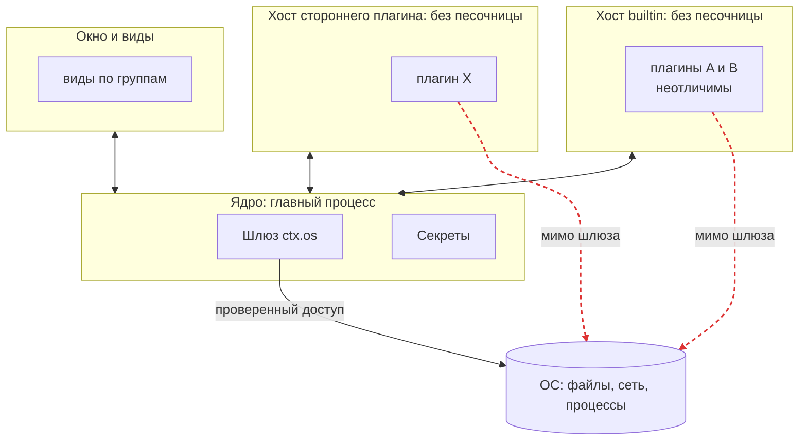
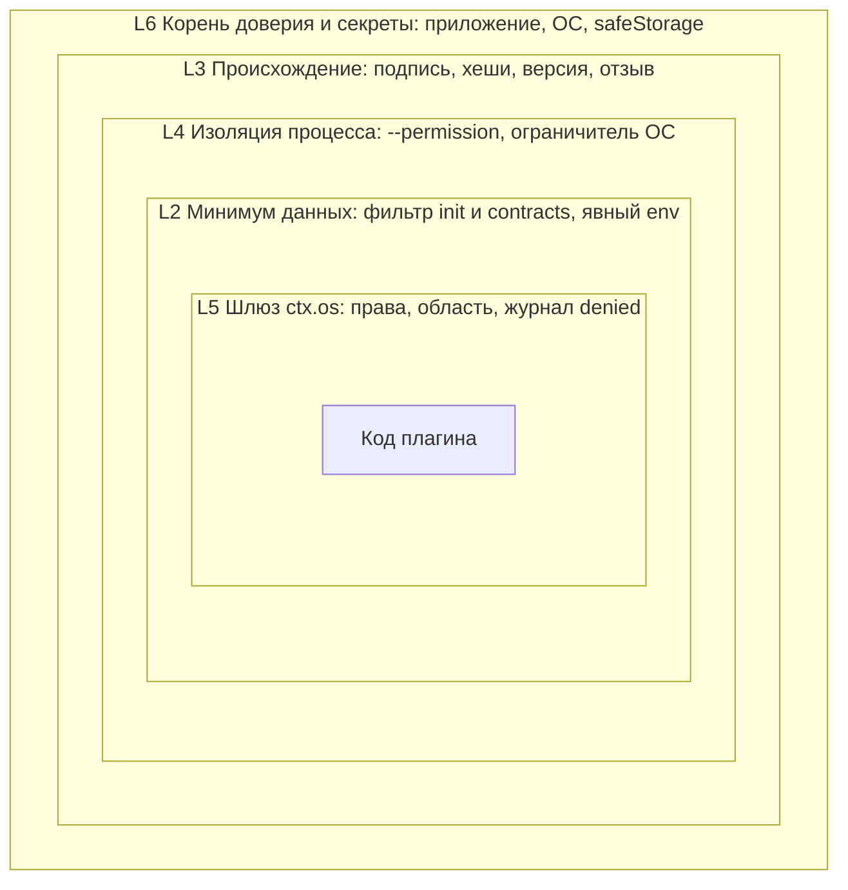

# Доверие ядра, плагинов и хостов: подлинность, изоляция данных и криптография на macOS и Linux

> **Статус: предложение, ждёт решения владельца.** Дата: 2026-11-13. Задача: [#243](https://github.com/dex-it/cyborg-harness/issues/243), исполнитель yaryrslv. Исследование: код ядра не менялся, решений в SAD, ADR и SRS этот документ не принимает; что придётся править при принятии - в [6.8](06-work-plan.md#68-какие-документы-править-при-принятии). Снимок на коммит `0c3c081` (`master`, слияние PR #242); строки кода указаны от корня репозитория и верны для него.
>
> Метки достоверности: **Факт** - прочитано в коде этого репозитория (`путь:строка`) или в первоисточнике по ссылке. **Опыт** - получено запуском на macOS (Darwin 27.2, arm64, Electron 45.2.3, Node 24.20.0), описание и результаты в [приложении Б](08-sources-and-measurements.md#приложение-б-замеры-и-опыты). **Вывод** - наше заключение из фактов. **Не проверено** - не запускали и не нашли первоисточник; сведено в [разделе 7.2](07-open-questions.md#72-что-не-проверено). **На Linux не запускалось ничего**: все числа и опыты - macOS.

## Как читать

- **Быстро:** этот README целиком (коротко, две сводные схемы, вопросы владельцу), затем при желании [разделы 5](05-decision.md) и [6](06-work-plan.md).
- **Подробно:** разделы по порядку, в каждом сверху ссылки «оглавление, назад, вперёд». Сначала в каждом разделе идёт идея и картинка, потом детали.

| Раздел | Файл | О чём |
|---|---|---|
| 0 | [README](#0-коротко-на-одну-страницу) (здесь) | Суть на одной странице, сводные схемы |
| 1 | [01-glossary.md](01-glossary.md) | Словарь простыми словами: nonce, HMAC, Landlock, TOFU и другие, с примерами из проекта |
| 2 | [02-current-state.md](02-current-state.md) | Как устроено сейчас: процессы и границы доверия, каналы, идентичность, данные, права, секреты, происхождение; 22 угрозы с мерами и пробелами; опыт на настоящем `utilityProcess` |
| 3 | [03-goals-and-threat-model.md](03-goals-and-threat-model.md) | Целевые свойства, модель нападающего, уровни защиты, ограничения из принятых решений |
| 4 | [04-options.md](04-options.md) | Разбор способов по семи слоям и сводная таблица сравнения (32 способа) |
| 5 | [05-decision.md](05-decision.md) | Выбор по слоям, схемы целевого варианта, рукопожатие, запрос `ctx.os`, ключи и билеты, пять атак до и после, отвергнутое |
| 6 | [06-work-plan.md](06-work-plan.md) | План: задачи TR-NN с критериями приёмки, порядок, проверка, риски, правки документов |
| 7 | [07-open-questions.md](07-open-questions.md) | 15 вопросов владельцу с рекомендациями и перечень непроверенного |
| 8 | [08-sources-and-measurements.md](08-sources-and-measurements.md) | Источники со ссылками, приложение А (перепроверка по коду), приложение Б (замеры и опыты) |

Статус и метки достоверности указаны выше; задача: [#243](https://github.com/dex-it/cyborg-harness/issues/243).

## 0. Коротко: на одну страницу

**Проблема.** Ядро Cyborg Harness должно отдавать плагину только то, что тому нужно, не давать плагину читать чужое и не давать вредоносному плагину выдать себя за другой плагин. Сегодня это держится на двух вещах: на **проверке в ядре** (шлюз `ctx.os` проверяет права, ядро сверяет, что сообщение пришло из «своего» хоста) и на **соглашении** (плагин не должен обходить `ctx`). Соглашение защищает от ошибки, не от умысла ([модель угроз, раздел 6](../../04-architecture/design/threat-model.md#6-допущения-и-честные-границы)).

**Главные находки** (каждая проверена по коду или опытом):

| # | Находка | Основание |
|---|---|---|
| 1 | ❌ Хост плагина **не изолирован от ОС**: плагин в `utilityProcess` читает файл ядра, окружение главного процесса, запускает программы, открывает сеть и слушает «сырой» канал `parentPort`. Флаг `--permission` в `utilityProcess` принимается и **не действует** | Опыт А и Б ([Б.1](08-sources-and-measurements.md#б1-опыт-что-может-код-плагина-в-utilityprocess)); `electron/src/plugin-hosts.ts:15` |
| 2 | ✅ Подмену плагина соседом из **другого** хоста ядро отсекает. ⚠️ В **общем** хосте плагины неразличимы: плагин может писать от имени соседа. Закрыто только правилом «сторонний плагин всегда один в своём хосте» | `core/src/host-bridge.ts:18-22`; контрольный тест `core/test/trust.test.ts:289-295` |
| 3 | ⚠️ Каждый хост получает **манифесты всех плагинов** и описание данных всех поставщиков контрактов, даже если не просил | `core/src/host-pool.ts:101`, `core/src/context-build.ts:181`, `core/src/contract-calls.ts:25-27` |
| 4 | ✅/❌ Криптографии идентичности (токенов, подписей, проверки пира) в коде нет. Но и **не нужна на приватных каналах**: второй конец канала есть только у запущенного ядром процесса, а HMAC и шифрование не отделят плагины внутри одного процесса | `grep` по `core/src`, `electron/src`, `tools` ([2.3](02-current-state.md#23-идентичность-на-канале-кто-говорит)); [Факт](https://www.electronjs.org/docs/latest/api/utility-process), [Опыт А](08-sources-and-measurements.md#б1-опыт-что-может-код-плагина-в-utilityprocess) |
| 5 | ❌ Происхождение плагина не проверяется: список sha256 лежит рядом с файлами, не подписан и только сообщает; для каталога пользователя и `pack` нет ничего | `core/src/delivery.ts:102-119`, `electron/src/plugins.ts:149-151` |
| 6 | ⚠️ Секреты на macOS защищены Keychain, на Linux без keyring `safeStorage` шифрует «зашитым открытым паролем»; приложение этого не проверяет | [Факт Electron](https://www.electronjs.org/docs/latest/api/safe-storage); `electron/src/os-env.ts:7-11` |
| 7 | ⚠️ Готового «одним флагом» способа нет: песочницу процесса на macOS и seccomp/Landlock на Linux из чистого Node не поставить, нужен вспомогательный бинарник; встроенная модель разрешений Node - «ремень безопасности», сеть в Node 24 не закрывает | [Node permissions](https://nodejs.org/docs/latest-v24.x/api/permissions.html); Опыт Г |

**Рекомендация** (по слоям, подробно в [разделе 5](05-decision.md#5-выбор-способа)):

1. **Канал и идентичность:** оставить «подлинность = владение концом канала» (уже так), не вводить HMAC, шифрование, mTLS, Noise и `SO_PEERCRED` на приватных каналах. Закрепить это тестом на **настоящем** `utilityProcess`.
2. **Минимум данных:** хосту отдавать только его манифесты и нужные ему контракты; окружение хоста задавать явно (опыт: убирает токены главного процесса одной строкой).
3. **Изоляция процесса (этап 2):** сторонний плагин - отдельный процесс Node с пустым окружением и `--permission` по каналу, который у ядра уже есть (`forkHosts`), а поверх - ограничитель ОС (Landlock и seccomp на Linux, Seatbelt на macOS) как отдельный шаг с вспомогательным бинарником. До него честно говорим человеку, что сеть и чтение мимо шлюза не закрыты.
4. **Происхождение:** подпись Ed25519 манифеста пакета с хешами файлов (всё на `node:crypto`), список доверенных ключей и отозванных версий, проверка **перед** запуском, байты читаются один раз.
5. **Секреты:** остаются в `safeStorage`; добавить отказ при `basic_text` на Linux и права файлов. Аппаратные хранилища (Secure Enclave, TPM), `mlock`, шифрование данных плагинов ключом на плагин - не берём.
6. **Виды:** оставить origin на группу и проверку `senderFrame`; добавить тест на настоящем Electron.

**Что это даёт.** Закрывает находки 3, 5 и 6, а для сторонних плагинов - 1 (файлы, процессы, сеть) и 2 (отдельный процесс на плагин); для встроенных плагинов в общем хосте остаётся доверие друг к другу. Не меняет форму `ctx.os`, не трогает бюджеты шлюза (канал остаётся тем же; новых вычислений на горячем пути нет). **Что стоит.** Этап А (проверенные мелочи, stdlib, без изменения публичного API) - около 4 недель одного разработчика, 2-3 при двоих. Этап Б (подпись) - около 4 недель. Этап В (процесс на плагин и ограничитель ОС) - 8-10 недель и вспомогательный бинарник на каждую ОС. Это оценки составителя, не измерения ([6.5](06-work-plan.md#65-порядок-и-параллельность)).

**Ближайшие шаги** (можно начать, не дожидаясь решения по этапу 2): тест-подделка на настоящем `utilityProcess` (TR-01), явный `env` хоста (TR-02), фильтрация `init` и `contracts` (TR-03), проверка backend `safeStorage` (TR-05), спайк «сторонний плагин как процесс Node» (TR-20).

**Что решить владельцу** (полный список с рекомендациями - [раздел 7.1](07-open-questions.md#71-вопросы-владельцу)): (1) принять ли «этап А» без повода для этапа 2; (2) как запускать процесс стороннего плагина: сборка Electron с включённым `RunAsNode` или отдельный бинарник Node (около 122 МБ у нас на машине); (3) вспомогательный бинарник ограничителя ОС - берём или живём на `--permission` с честным предупреждением; (4) формат и корень доверия подписи (ключ издателя в приложении, список ключей пользователя); (5) вопрос 15 SRS (пути конфигурации агента).

## Сводные схемы

Две схемы из разделов 2 и 5 повторены здесь, чтобы картину можно было увидеть, не открывая разделов. Подробные подписи и остальные схемы (рукопожатие, запрос `ctx.os`, ключи и билеты, пять атак до и после, план) - в [разделе 5](05-decision.md) и [разделе 6](06-work-plan.md).

### Границы доверия сейчас

**Что здесь видно.** Каждая рамка - процесс ОС. Красные пунктирные стрелки - пути мимо шлюза: код плагина в хосте может сам открыть файл, сокет или процесс (опыт в [разделе 2.8](02-current-state.md#28-что-показал-опыт-код-плагина-в-utilityprocess)). Подробная схема - [2.1](02-current-state.md#21-процессы-и-границы-доверия).

### Слои защиты в целевом варианте

**Что здесь видно.** Шлюз (L5) уже есть; L2, L3, L4 предлагаются. Ни один слой не заявляется единственной границей. Матрица «угроза × слой» и остальные схемы целевого варианта - в [5.11](05-decision.md#511-слои-защиты) и [5.1](05-decision.md#51-целевая-схема).

